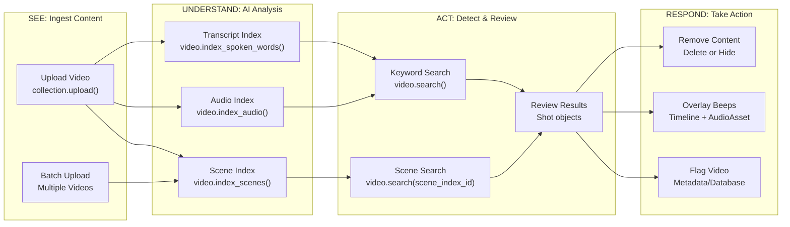
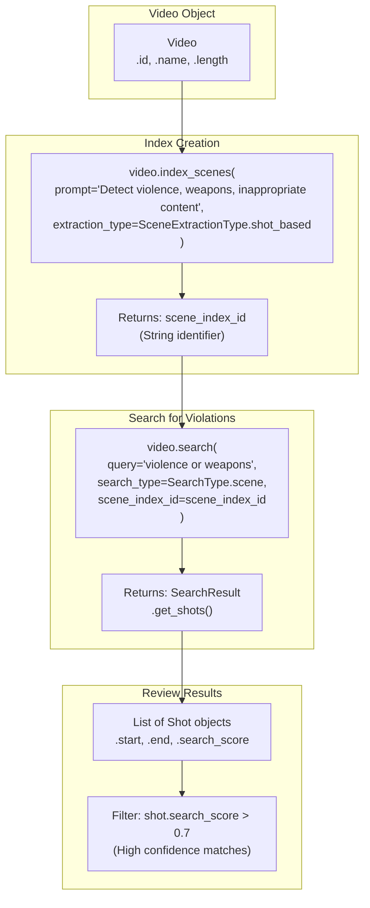
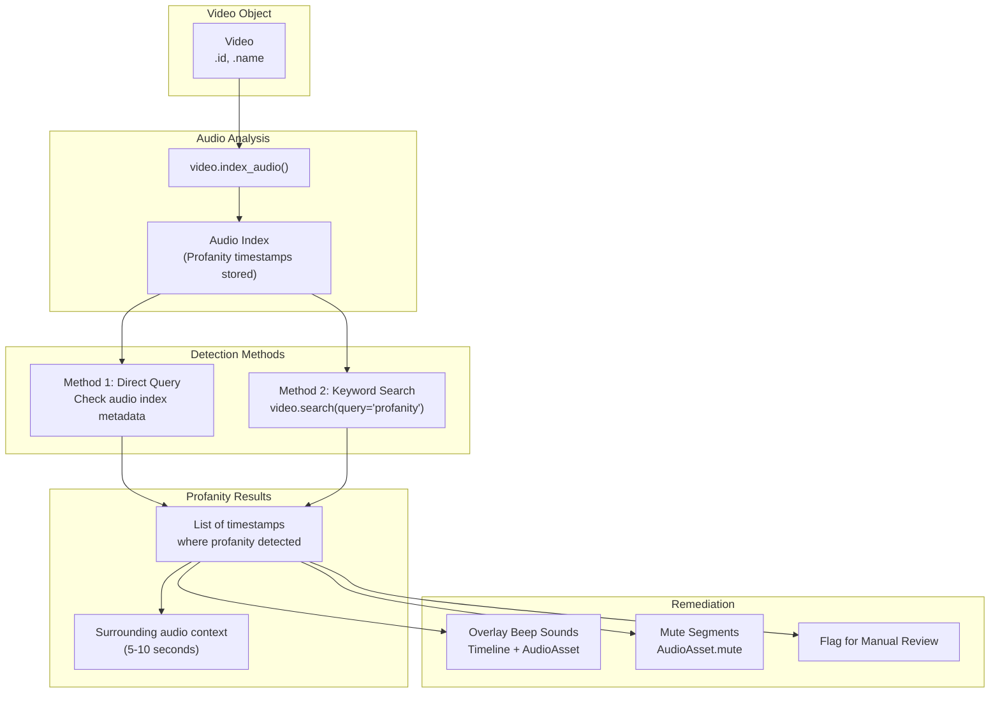
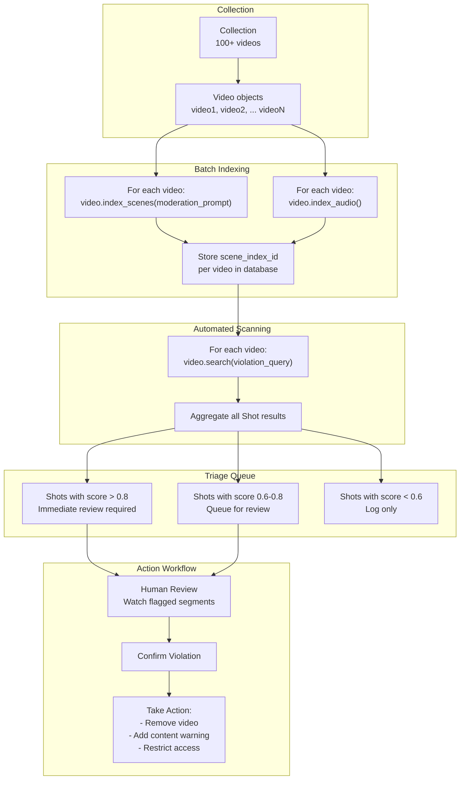
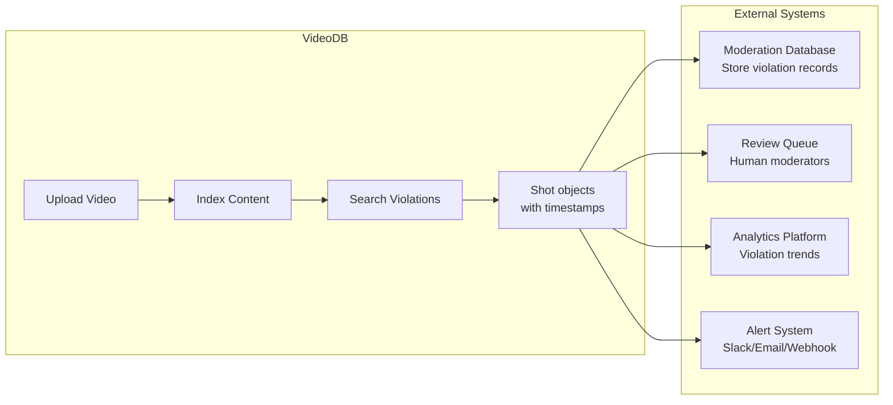

<!-- source: DeepWiki mcp.deepwiki.com · repo video-db/skills · page 12.2 Content Moderation · fetched 2026-10-26 -->

# Content Moderation

<details>
<summary>Relevant source files</summary>

The following files were used as context for generating this wiki page:

- [python/reference/use-cases.md](python/reference/use-cases.md)

</details>


This page documents how to use VideoDB's AI indexing and search capabilities for automated content moderation, including detecting inappropriate visual content, profanity in audio, and policy violations. Content moderation leverages the same indexing and search infrastructure described in [Video Understanding and Indexing](#5) and [Searching Videos](#6), but applies them to safety and compliance use cases.

For real-time moderation of live streams, see [Security and Monitoring](#12.4). For meeting content review, see [Meeting Recording and Analysis](#12.3).

---

## Content Moderation Workflow

Content moderation in VideoDB follows the See→Understand→Act paradigm by indexing media with AI, searching for problematic patterns, and acting on the results.



**Sources:** [python/reference/use-cases.md:82-90]()

---

## Visual Content Moderation

Visual content moderation uses `index_scenes()` to analyze video frames with AI, then `search()` to find specific problematic patterns.

### Scene Indexing for Policy Enforcement

The `video.index_scenes()` method analyzes visual content and generates AI descriptions. For content moderation, use targeted prompts that focus on policy violations:

| Moderation Type | Scene Index Prompt | Example Detected Content |
|----------------|-------------------|-------------------------|
| Violence Detection | "Identify violent actions, weapons, blood" | "Person holding a firearm", "Physical altercation" |
| Inappropriate Content | "Detect nudity, sexual content, drug use" | "Exposed body parts", "Drug paraphernalia visible" |
| Brand Safety | "Identify controversial symbols, hate speech imagery" | "Extremist symbols on clothing", "Offensive gestures" |
| Product Compliance | "Detect tobacco, alcohol, gambling content" | "Cigarette pack visible", "Beer bottle on table" |



The `scene_index_id` is critical because a single video can have multiple scene indexes with different prompts. Store the `scene_index_id` for moderation-specific indexes separately from content discovery indexes.

**Sources:** [python/reference/use-cases.md:84-86]()

### Search Strategy for Visual Violations

Once scene indexing completes, use semantic search with policy-specific queries:

```python
# Search for specific violation categories
violence_results = video.search(
    query="violence, fighting, weapons, blood",
    search_type=SearchType.scene,
    scene_index_id=moderation_scene_index_id
)

inappropriate_results = video.search(
    query="nudity, sexual content, drug use",
    search_type=SearchType.scene,
    scene_index_id=moderation_scene_index_id
)
```

The `search()` method returns a `SearchResult` object. Call `.get_shots()` to retrieve individual `Shot` objects with timestamps:

| Shot Attribute | Purpose | Moderation Usage |
|---------------|---------|------------------|
| `.start` | Segment start time (seconds) | Flag timestamp in review queue |
| `.end` | Segment end time (seconds) | Calculate violation duration |
| `.search_score` | Match confidence (0-1) | Filter high-confidence violations |
| `.text` | AI scene description | Review context for human moderators |

Filter results by `search_score` threshold to reduce false positives. Scores above 0.7 typically indicate high-confidence matches requiring review.

**Sources:** [python/reference/use-cases.md:84-86]()

---

## Audio Content Moderation

Audio moderation uses `index_audio()` to detect profanity, inappropriate language, and audio policy violations.

### Profanity Detection with Audio Indexing

The `video.index_audio()` method analyzes audio content and can detect profanity with timestamps:



**Audio Index Capabilities:**
- Detects profanity and inappropriate language
- Provides precise timestamps for each occurrence
- Analyzes audio events beyond speech (music, sound effects)

**Sources:** [python/reference/use-cases.md:87-89]()

### Overlaying Beeps for Profanity

Once profanity timestamps are identified, use the Timeline editor to overlay beep sounds:

```python
from videodb import connect
from videodb.timeline import Timeline

conn = connect()
timeline = conn.create_timeline()

# Original video with profanity at timestamps
video = coll.get_video("video_id")

# Add original video to timeline
timeline.add_inline(asset=video)

# Generate or upload beep sound effect
beep_audio = coll.generate_sound_effect(
    prompt="short beep tone for censorship",
    duration=0.5
)

# Overlay beep at each profanity timestamp
profanity_timestamps = [12.5, 45.2, 102.8]  # From audio index
for timestamp in profanity_timestamps:
    timeline.add_overlay(
        start=timestamp,
        asset=beep_audio
    )

# Generate censored stream
censored_stream = timeline.generate_stream()
```

The `add_overlay()` method places the beep sound at the specified timestamp without modifying the original video asset. Multiple overlays can be added at different timestamps.

**Sources:** [python/reference/use-cases.md:87-89]()

### Transcript-Based Language Detection

For more nuanced language policy enforcement, combine `index_spoken_words()` with keyword search:

```python
# Index transcript
video.index_spoken_words()

# Search for policy violations
results = video.search(
    query="offensive language hate speech slurs",
    search_type=SearchType.keyword  # Exact matching
)

# Review context around matches
for shot in results.get_shots():
    print(f"Match at {shot.start}s: {shot.text}")
```

Keyword search with `SearchType.keyword` matches exact words in the transcript, useful for detecting specific prohibited terms. Semantic search with `SearchType.semantic` finds contextually similar language even if exact words differ.

**Sources:** [python/reference/use-cases.md:87-89]()

---

## Batch Moderation Workflow

For moderating large content libraries, index and search across entire collections:



**Batch Processing Pattern:**
1. Index all videos with moderation-specific prompts
2. Store `scene_index_id` for each video in external database
3. Run automated searches with violation queries
4. Triage results by `search_score` for human review
5. Execute moderation actions on confirmed violations

**Sources:** [python/reference/use-cases.md:82-90]()

---

## Integration Patterns

### Moderation API Endpoint

Expose content moderation as an API service:

| Endpoint | Input | Processing | Output |
|----------|-------|------------|--------|
| `POST /moderate` | Video URL or file | 1. Upload via `collection.upload()`<br/>2. Run `index_scenes()` and `index_audio()`<br/>3. Search for violations<br/>4. Return flagged segments | JSON with violation timestamps, scores, descriptions |
| `GET /moderate/{video_id}/status` | Video ID | Check indexing completion status | Indexing progress percentage |
| `POST /moderate/{video_id}/review` | Video ID, action | Execute moderation action (remove, flag, beep overlay) | Confirmation with new stream URL |

### Real-time vs Batch Moderation

| Use Case | Approach | VideoDB Methods |
|----------|----------|-----------------|
| User-uploaded content | Real-time moderation before publishing | `upload()` → `index_scenes()` → `search()` → Approve/reject |
| Existing library scan | Batch moderation on schedule | Iterate collection → Index all → Search all → Generate reports |
| Live stream monitoring | Real-time event detection | See [Security and Monitoring](#12.4) for RTStream approach |

### External System Integration

Content moderation results can feed into external safety systems:



Store `video.id`, `shot.start`, `shot.end`, `shot.search_score`, and `shot.text` in external databases for audit trails and trend analysis.

**Sources:** [python/reference/use-cases.md:82-90]()

---

## Limitations and Considerations

### AI Accuracy

Scene and audio indexing use AI models that may produce:
- **False positives**: Content flagged as violations that are actually acceptable
- **False negatives**: Violations missed by AI analysis
- **Context sensitivity**: AI may not understand nuanced context (e.g., educational violence vs. gratuitous violence)

**Recommendation:** Use AI moderation as first-pass screening with human review for final decisions, especially for high-stakes content.

### Score Thresholds

The `search_score` attribute ranges from 0 to 1, but optimal thresholds vary by use case:

| Score Range | Interpretation | Recommended Action |
|------------|----------------|-------------------|
| 0.8 - 1.0 | High confidence match | Immediate review or auto-action |
| 0.6 - 0.79 | Medium confidence | Queue for human review |
| 0.4 - 0.59 | Low confidence | Log for pattern analysis |
| 0.0 - 0.39 | Very low confidence | Ignore (likely false positive) |

Calibrate thresholds based on your content policy and tolerance for false positives/negatives.

### Indexing Costs

Scene and audio indexing incur processing costs per video. For large-scale moderation:
- Index selectively (e.g., only user-uploaded content, not trusted sources)
- Reuse existing indexes when possible
- Batch index during off-peak hours

**Sources:** [python/reference/use-cases.md:82-90]()

---

## Example Workflows

### Workflow 1: Pre-Publication Moderation

```
1. User uploads video → collection.upload(url)
2. Immediately index → video.index_scenes(moderation_prompt) + video.index_audio()
3. Search for violations → video.search(query, scene_index_id)
4. If high-score violations found → Block publication, notify user
5. If no violations → Approve for publishing
```

### Workflow 2: Library Audit

```
1. Get all videos → coll.get_videos()
2. For each video → video.index_scenes() + video.index_audio()
3. For each video → video.search(violation_queries)
4. Aggregate all Shot results → Sort by search_score
5. Generate audit report → Export to CSV/database
6. Queue high-score matches → Human review workflow
```

### Workflow 3: Profanity Censorship

```
1. Index audio → video.index_audio()
2. Extract profanity timestamps → From audio index results
3. Create timeline → conn.create_timeline()
4. Add original video → timeline.add_inline(video)
5. Generate beep sound → coll.generate_sound_effect("beep")
6. Overlay beeps at timestamps → timeline.add_overlay(beep, timestamp)
7. Generate censored version → timeline.generate_stream()
8. Replace original stream URL → Update in database
```

**Sources:** [python/reference/use-cases.md:82-90]()

---

