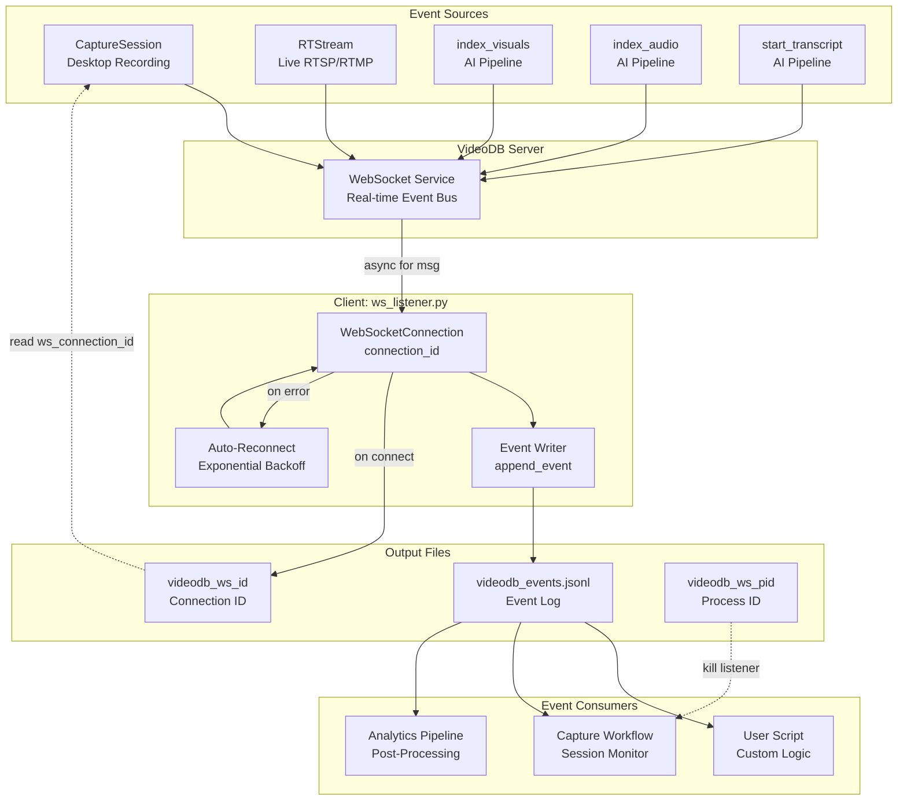
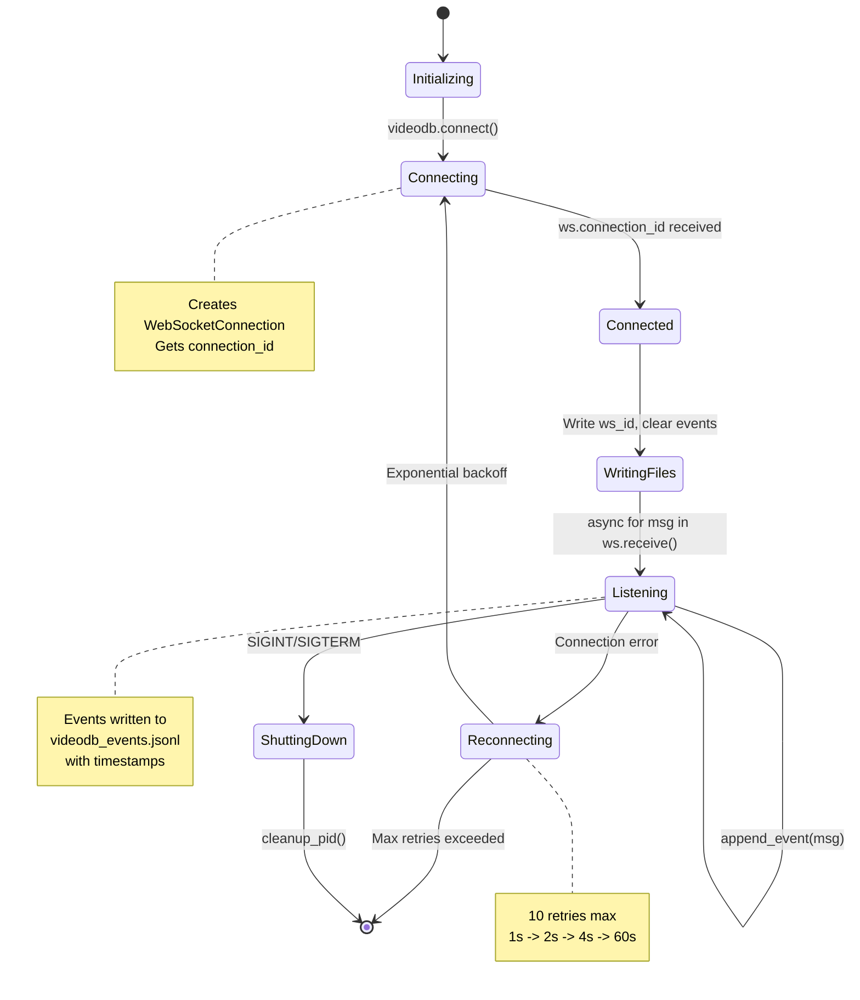
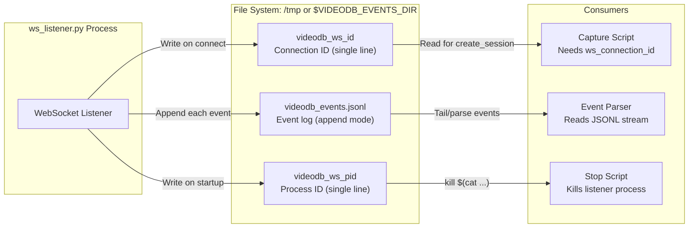
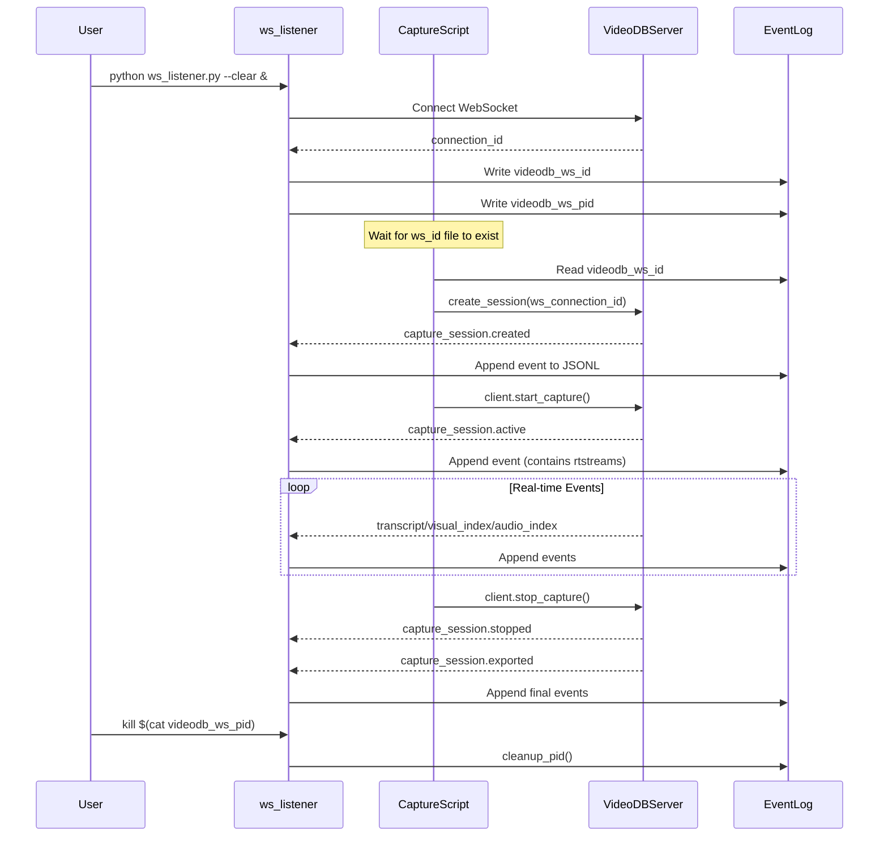
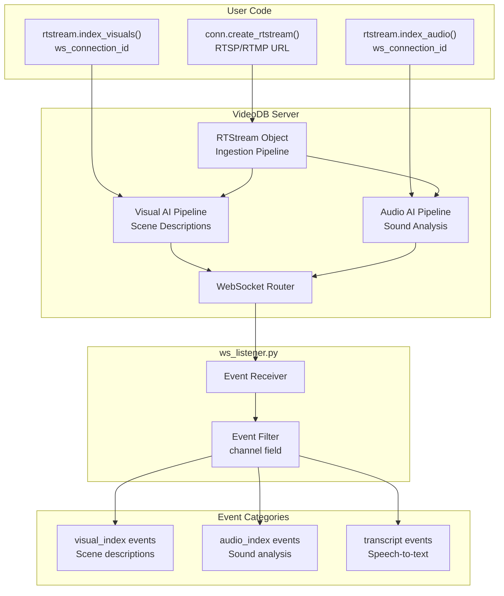
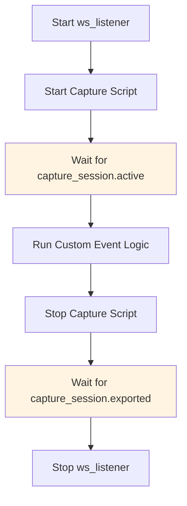
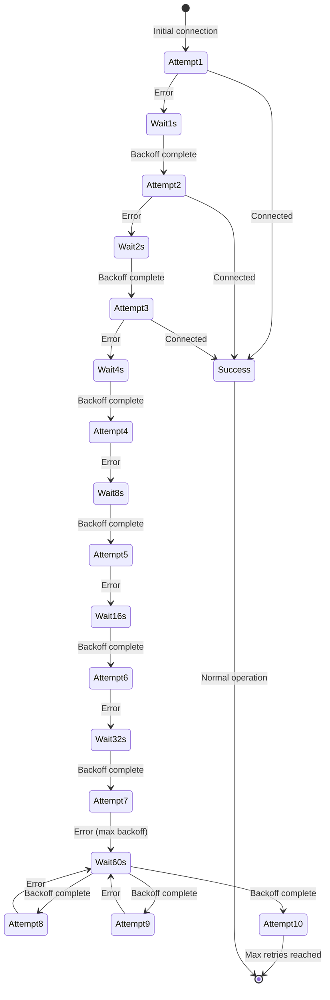

<!-- source: DeepWiki mcp.deepwiki.com · repo video-db/skills · page 13 WebSocket Listener · fetched 2026-10-26 -->

# WebSocket Listener

<details>
<summary>Relevant source files</summary>

The following files were used as context for generating this wiki page:

- [python/reference/capture.md](python/reference/capture.md)
- [python/scripts/ws_listener.py](python/scripts/ws_listener.py)

</details>


## Purpose and Scope

The WebSocket Listener is a standalone Python script that captures real-time events from VideoDB's server-side operations and logs them to a local JSONL file. It provides the bridge between asynchronous, long-running operations (desktop capture, live stream processing, AI pipelines) and consumable event logs that can be parsed, filtered, and analyzed.

This page documents the `ws_listener.py` script itself—its implementation, output files, and role in the system architecture. For instructions on running the listener and consuming events, see [Running the Listener](#13.1). For details on event structure and parsing, see [Event Format and Consumption](#13.2). For the capture workflow that uses this listener, see [Desktop Capture](#8). For live stream event handling, see [Live Stream Processing](#9).

---

## System Architecture Role

The WebSocket listener occupies a critical position in VideoDB's real-time infrastructure. Unlike typical REST API operations that return results immediately, operations like desktop capture and live stream indexing run continuously and produce events over time. The WebSocket listener provides a simple, file-based event delivery mechanism without requiring webhook servers or polling loops.

### Event Flow Architecture



**Sources:** [python/scripts/ws_listener.py:1-204](), [python/reference/capture.md:1-102]()

---

## Script Implementation

The `ws_listener.py` script is implemented as a single-file asyncio application with robust error handling and lifecycle management.

### Core Components

| Component | Purpose | File Location |
|-----------|---------|---------------|
| `listen_with_retry()` | Main event loop with auto-reconnect logic | [python/scripts/ws_listener.py:100-160]() |
| `append_event()` | Writes events to JSONL with timestamps | [python/scripts/ws_listener.py:78-84]() |
| `write_pid()` / `cleanup_pid()` | PID file management for process control | [python/scripts/ws_listener.py:86-98]() |
| `main_async()` | Signal handler registration and task orchestration | [python/scripts/ws_listener.py:162-193]() |

### Connection Lifecycle



**Sources:** [python/scripts/ws_listener.py:100-193]()

### Key Features

#### Auto-Reconnect with Exponential Backoff

The listener implements resilient connection handling to survive temporary network issues. Configuration constants control retry behavior:

| Constant | Value | Purpose |
|----------|-------|---------|
| `MAX_RETRIES` | 10 | Maximum reconnection attempts |
| `INITIAL_BACKOFF` | 1 second | First retry delay |
| `MAX_BACKOFF` | 60 seconds | Maximum retry delay |

On each connection failure, the backoff doubles until reaching `MAX_BACKOFF`, then remains constant. The retry counter resets on successful connection. See [python/scripts/ws_listener.py:42-44]() and [python/scripts/ws_listener.py:150-159]().

#### Graceful Shutdown

Signal handlers for `SIGINT` and `SIGTERM` allow clean termination. The shutdown sequence:

1. Signal handler sets `shutdown_event` ([python/scripts/ws_listener.py:167-169]())
2. Main loop detects event and cancels listener task ([python/scripts/ws_listener.py:179-190]())
3. PID file removed before exit ([python/scripts/ws_listener.py:199-200]())

This ensures events are fully written and file handles are closed properly.

#### Process Management

The script writes its PID to a file, enabling simple process control:

```bash
# Stop the listener
kill $(cat /tmp/videodb_ws_pid)
```

PID file location: `<output_dir>/videodb_ws_pid` where `output_dir` defaults to `/tmp` or `$VIDEODB_EVENTS_DIR`. See [python/scripts/ws_listener.py:66]() and [python/scripts/ws_listener.py:86-98]().

**Sources:** [python/scripts/ws_listener.py:100-204](), [python/reference/capture.md:86-101]()

---

## Output File System

The listener creates three files that serve different purposes in the capture workflow:

### File Artifacts



**File Descriptions:**

| File | Content | Purpose | Lifecycle |
|------|---------|---------|-----------|
| `videodb_events.jsonl` | JSONL event stream with timestamps | Event log for all WebSocket messages | Cleared on first connect if `--clear` flag used, otherwise appended |
| `videodb_ws_id` | Single line: WebSocket connection ID | Provides `ws_connection_id` for capture/RTStream operations | Written on each connection, overwritten on reconnect |
| `videodb_ws_pid` | Single line: Process ID | Enables `kill` for clean shutdown | Written on startup, removed on exit |

**Sources:** [python/scripts/ws_listener.py:64-66](), [python/reference/capture.md:92-96]()

---

## Integration with Capture Sessions

Desktop capture operations require a WebSocket connection ID to route real-time events back to the listener. The workflow demonstrates tight coupling between the listener and capture lifecycle.

### Capture Workflow Integration



**Critical Dependencies:**

1. **ws_listener must start first**: The capture script needs to read `videodb_ws_id` to create the session ([python/reference/capture.md:23-26]())
2. **Listener must stay running**: All events flow through WebSocket; if listener dies, events are lost ([python/reference/capture.md:19]())
3. **Export event arrives last**: The listener must remain active until `capture_session.exported` to capture the final video URLs ([python/reference/capture.md:49-50](), [python/reference/capture.md:60-64]())

**Sources:** [python/reference/capture.md:17-64](), [python/scripts/ws_listener.py:109-141]()

---

## Integration with Live Streams

RTStream objects (from live RTSP/RTMP feeds) use the same WebSocket mechanism for AI pipeline events. When you call `rtstream.index_visuals()` or `rtstream.index_audio()`, results stream through the WebSocket connection.

### RTStream Event Flow



Unlike capture sessions (which have lifecycle events like `capture_session.active`), RTStream events are purely data-driven: you receive AI analysis results as they are generated. Event filtering is done by checking the `channel` field in each event.

**Sources:** [python/scripts/ws_listener.py:136-141]()

---

## Event Timestamp Enrichment

The listener automatically enriches all events with two timestamp fields before writing to JSONL:

| Field | Type | Example | Purpose |
|-------|------|---------|---------|
| `ts` | ISO 8601 string | `"2024-01-15T14:32:18.123456+00:00"` | Human-readable timestamp |
| `unix_ts` | Float (seconds) | `1705330338.123456` | Sortable, filterable numeric timestamp |

This enrichment happens in `append_event()` ([python/scripts/ws_listener.py:78-84]()), ensuring every logged event has a precise local arrival time. These timestamps are critical for:

- Sorting events chronologically
- Filtering events by time range
- Calculating event latency (server event time vs. local arrival time)
- Building time-series analytics

The enrichment uses `datetime.now(timezone.utc)` to ensure all timestamps are UTC-based.

**Sources:** [python/scripts/ws_listener.py:78-84]()

---

## Command-Line Interface

The script supports minimal command-line arguments for flexibility without complexity.

### Usage Syntax

```bash
python scripts/ws_listener.py [OPTIONS] [output_dir]
```

### Arguments and Options

| Argument/Option | Type | Default | Description |
|-----------------|------|---------|-------------|
| `output_dir` | Positional | `/tmp` or `$VIDEODB_EVENTS_DIR` | Directory for all output files |
| `--clear` | Flag | False | Clear events file before starting (for new sessions) |

### Argument Parsing

The script uses simple argv parsing without external dependencies ([python/scripts/ws_listener.py:47-61]()):

1. Check for `--clear` flag in `sys.argv[1:]`
2. Find first non-flag argument for `output_dir`
3. Fall back to `$VIDEODB_EVENTS_DIR` or `/tmp`

### Output Format

On successful connection, the script prints a parseable line to stdout:

```
WS_ID=<connection_id>
```

This format enables shell scripts to capture the connection ID directly:

```bash
output=$(python scripts/ws_listener.py --clear &)
ws_id=$(echo "$output" | grep "^WS_ID=" | cut -d= -f2)
```

However, the recommended approach is reading from the `videodb_ws_id` file after the listener starts.

**Sources:** [python/scripts/ws_listener.py:6-27](), [python/scripts/ws_listener.py:47-61](), [python/scripts/ws_listener.py:126-129]()

---

## Best Practices

### When to Use `--clear`

The `--clear` flag should be used when starting a **new capture session** or when you want to ensure the event log only contains events from the current run. Without `--clear`, events append to existing logs, which is useful for:

- Multiple capture sessions in one log
- Historical event retention
- Continuous monitoring scenarios

With `--clear`, the first connection clears the file ([python/scripts/ws_listener.py:118-121]()), but subsequent reconnections (if the connection drops) will append, not clear again.

### Process Lifecycle Management

The capture workflow requires careful coordination of process lifecycles:



**Critical ordering:**
1. Listener starts first (creates `ws_id` file)
2. Capture script reads `ws_id` and starts session
3. Capture script must keep `CaptureClient` alive (long-running process)
4. On shutdown, stop capture first, then wait for export event
5. Only after export event arrives, stop the listener

Violating this order (e.g., killing the listener before export) means losing the final video URLs.

**Sources:** [python/reference/capture.md:54-64]()

---

## Error Handling and Reconnection

The listener implements robust error handling to survive transient failures without manual intervention.

### Retry Strategy



The backoff calculation is simple: `backoff = min(backoff * 2, MAX_BACKOFF)` ([python/scripts/ws_listener.py:159]()). This provides rapid recovery for brief issues while avoiding server overload during sustained outages.

### Connection Status Logging

The listener logs key events to stdout with timestamps for monitoring:

| Log Message | Meaning |
|-------------|---------|
| `Connected (ws_id=...)` | Successful WebSocket connection |
| `Connection error: <exception>` | Connection or receive error occurred |
| `Reconnecting in Xs (attempt Y/10)...` | Entering backoff period before retry |
| `Max retries (10) exceeded, exiting` | Fatal error, listener terminating |
| `Received shutdown signal` | SIGINT/SIGTERM received, clean shutdown starting |
| `Shutdown complete` | All tasks cancelled, ready to exit |

All logs include timestamps via the `log()` helper ([python/scripts/ws_listener.py:72-76]()).

**Sources:** [python/scripts/ws_listener.py:100-160](), [python/scripts/ws_listener.py:162-193]()

---

## Environment Variables

The script respects one environment variable for configuration:

| Variable | Purpose | Default | Example |
|----------|---------|---------|---------|
| `VIDEODB_EVENTS_DIR` | Output directory for all files | `/tmp` | `/var/log/videodb` |
| `VIDEO_DB_API_KEY` | VideoDB authentication (via `videodb.connect()`) | (required) | `v-abc123...` |

The `VIDEODB_EVENTS_DIR` provides a way to customize output location without command-line arguments, useful for systemd services or Docker containers.

The script loads environment variables using `dotenv` ([python/scripts/ws_listener.py:36-37]()), allowing `.env` files in the working directory.

**Sources:** [python/scripts/ws_listener.py:36-37](), [python/scripts/ws_listener.py:58-59]()

---

## Common Patterns

### Background Execution with Clean Shutdown

```bash
# Start listener in background
python scripts/ws_listener.py --clear &

# Wait for ws_id file to be created
while [ ! -f /tmp/videodb_ws_id ]; do sleep 0.1; done

# Run your capture code
python my_capture.py

# Stop listener cleanly
kill $(cat /tmp/videodb_ws_pid)
```

### Reading Events in Real-Time

While the listener is running, you can tail the JSONL file:

```bash
tail -f /tmp/videodb_events.jsonl | while read -r line; do
  echo "$line" | jq .
done
```

### Filtering Events by Channel

```bash
# Show only transcript events
cat /tmp/videodb_events.jsonl | jq 'select(.channel == "transcript")'

# Show only visual_index events
cat /tmp/videodb_events.jsonl | jq 'select(.channel == "visual_index")'
```

For detailed event structure and parsing, see [Event Format and Consumption](#13.2).

**Sources:** [python/reference/capture.md:73-87]()

---

