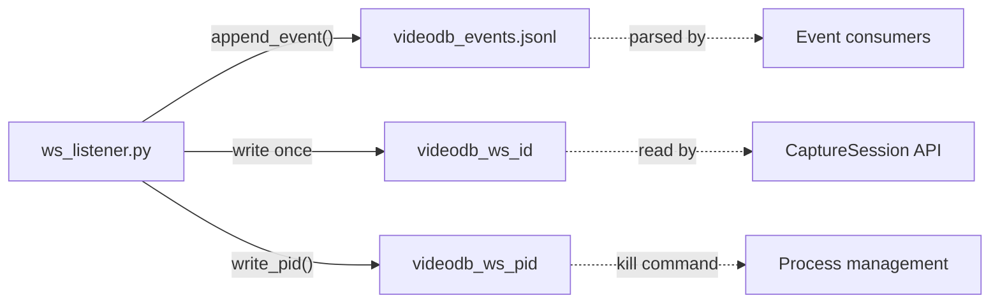
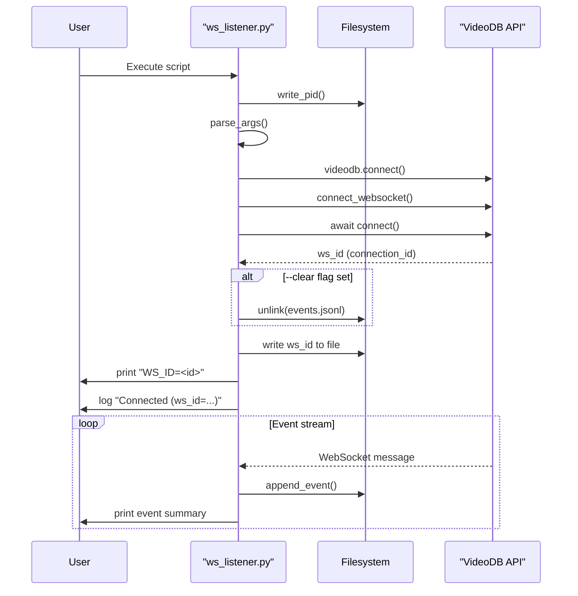
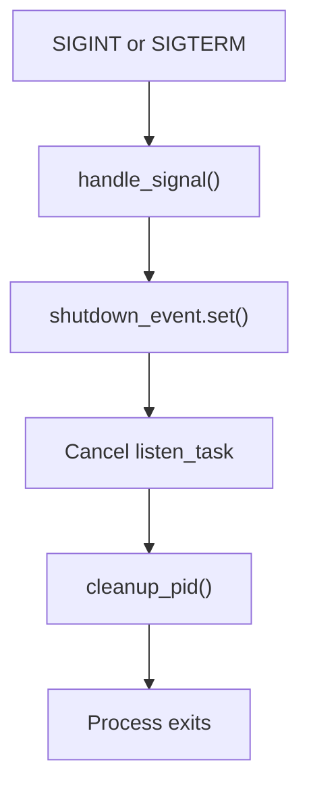
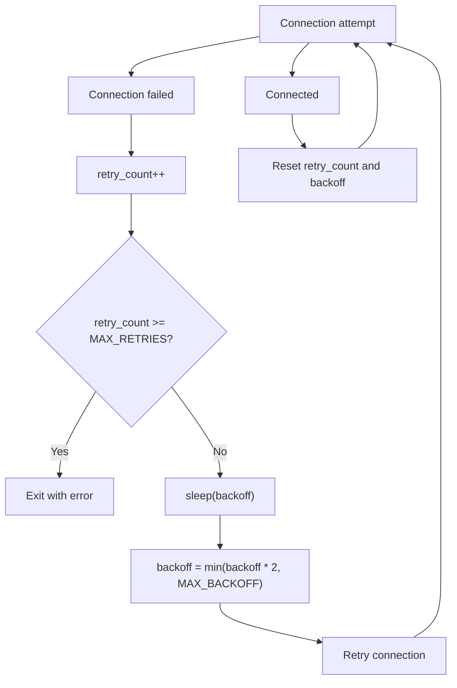

<!-- source: DeepWiki mcp.deepwiki.com · repo video-db/skills · page 13.1 Running the Listener · fetched 2026-10-26 -->

# Running the Listener

<details>
<summary>Relevant source files</summary>

The following files were used as context for generating this wiki page:

- [python/scripts/ws_listener.py](python/scripts/ws_listener.py)

</details>


This page documents how to run the `ws_listener.py` script, which captures real-time WebSocket events from VideoDB and logs them to a JSONL file. This script is essential for desktop capture and live stream processing, as it receives transcripts, visual analysis, and alerts from ongoing sessions.

For information about the event format and how to parse the logged events, see [Event Format and Consumption](#13.2). For details about capture session workflows, see [Capture Workflow](#8.1). For live stream event configuration, see [Events and Alerts](#9.3).

---

## Overview

The `ws_listener.py` script establishes a WebSocket connection to VideoDB's event stream and continuously logs all incoming events to a file. It is required for:

- **Desktop Capture**: Receiving transcripts and visual analysis from `CaptureSession` instances
- **Live Stream Processing**: Receiving real-time AI indexing results from `RTStream` objects
- **Event Alerts**: Receiving notifications when custom events are detected

The script runs as a long-lived process, typically in the background, and includes automatic reconnection with exponential backoff to handle transient network failures.

**Sources:** [python/scripts/ws_listener.py:1-27]()

---

## Command-Line Usage

### Basic Syntax

```bash
python scripts/ws_listener.py [OPTIONS] [output_dir]
```

### Arguments

| Argument | Description | Default |
|----------|-------------|---------|
| `output_dir` | Directory where output files will be written | `/tmp` (or value of `VIDEODB_EVENTS_DIR` environment variable) |

### Options

| Option | Description |
|--------|-------------|
| `--clear` | Clear the events file before starting (use when starting a new session) |

### Output Format

The script prints the WebSocket connection ID on the first line in parseable format:

```
WS_ID=<connection_id>
```

This ID must be passed to `CaptureSession` or `RTStream` methods to route events to this listener.

**Sources:** [python/scripts/ws_listener.py:5-27](), [python/scripts/ws_listener.py:47-61]()

---

## Output Files

The listener creates three files in the output directory:

### File Structure



### File Descriptions

| File | Purpose | Format |
|------|---------|--------|
| `videodb_events.jsonl` | All WebSocket events received during the session | One JSON object per line (JSONL) |
| `videodb_ws_id` | WebSocket connection ID | Plain text, single line |
| `videodb_ws_pid` | Process ID of the listener | Plain text, single line |

The `videodb_events.jsonl` file is appended to continuously as events arrive. Each event is written as a single line with added timestamp fields `ts` (ISO format) and `unix_ts` (Unix epoch).

**Sources:** [python/scripts/ws_listener.py:14-17](), [python/scripts/ws_listener.py:64-66](), [python/scripts/ws_listener.py:78-84](), [python/scripts/ws_listener.py:86-90]()

---

## Environment Variables

The listener uses two environment variables:

| Variable | Purpose | Default |
|----------|---------|---------|
| `VIDEODB_EVENTS_DIR` | Default output directory for event files | `/tmp` |
| `VIDEO_DB_API_KEY` | VideoDB API authentication key (required) | None |

The `VIDEO_DB_API_KEY` is required for establishing the WebSocket connection via `videodb.connect()`. The script loads environment variables from a `.env` file if present.

**Sources:** [python/scripts/ws_listener.py:36-37](), [python/scripts/ws_listener.py:58-59](), [python/scripts/ws_listener.py:109]()

---

## Starting the Listener

### Basic Usage

```bash
# Start in foreground (for testing)
python scripts/ws_listener.py

# Start in background (typical usage)
python scripts/ws_listener.py &

# Start with custom output directory
python scripts/ws_listener.py /path/to/events &

# Start fresh session (clear previous events)
python scripts/ws_listener.py --clear &
```

### Startup Sequence



### Capturing the WebSocket ID

The listener outputs the connection ID in two ways:

1. **Standard output (first line)**: Parseable format for automation
   ```bash
   WS_ID=abc123def456
   ```

2. **File**: Written to `<output_dir>/videodb_ws_id`
   ```bash
   WS_ID=$(cat /tmp/videodb_ws_id)
   ```

This ID must be passed to capture or stream operations:

```python
# In your main script
ws_id = "abc123def456"  # From listener output
session = conn.create_capture_session(ws_connection_id=ws_id)
```

**Sources:** [python/scripts/ws_listener.py:100-144](), [python/scripts/ws_listener.py:124-129]()

---

## Stopping the Listener

### Graceful Shutdown

The listener handles `SIGINT` (Ctrl+C) and `SIGTERM` signals gracefully, closing the WebSocket connection and cleaning up the PID file.

```bash
# Using the PID file
kill $(cat /tmp/videodb_ws_pid)

# Or with custom output directory
kill $(cat /path/to/events/videodb_ws_pid)

# Force kill if needed
kill -9 $(cat /tmp/videodb_ws_pid)
```

### Shutdown Process



The shutdown sequence ensures that:
1. The WebSocket connection is closed properly
2. Any pending events are flushed to disk
3. The PID file is removed

**Sources:** [python/scripts/ws_listener.py:162-193](), [python/scripts/ws_listener.py:92-97](), [python/scripts/ws_listener.py:195-201]()

---

## Auto-Reconnect Behavior

The listener includes automatic reconnection with exponential backoff to handle network failures or server restarts.

### Retry Configuration

| Parameter | Value | Purpose |
|-----------|-------|---------|
| `MAX_RETRIES` | 10 | Maximum number of reconnection attempts |
| `INITIAL_BACKOFF` | 1 second | Initial wait time before first retry |
| `MAX_BACKOFF` | 60 seconds | Maximum wait time between retries |

### Backoff Algorithm



### Behavior Details

- **On successful connection**: Retry counter resets to zero, backoff resets to 1 second
- **On connection failure**: Wait with exponential backoff (1s, 2s, 4s, 8s, 16s, 32s, 60s, 60s, ...)
- **After 10 failures**: Script exits with error
- **On reconnection**: The same `ws_id` is maintained across reconnects (events are not lost)

The `--clear` flag only clears the events file on the **first** connection, not on reconnects.

**Sources:** [python/scripts/ws_listener.py:41-44](), [python/scripts/ws_listener.py:100-160]()

---

## Common Usage Patterns

### Pattern 1: Desktop Capture Session

```bash
# Terminal 1: Start listener
python scripts/ws_listener.py --clear &
# Output: WS_ID=abc123

# Terminal 2: Run capture
python -c "
import videodb
conn = videodb.connect()
session = conn.create_capture_session(ws_connection_id='abc123')
# ... rest of capture workflow
"

# Terminal 1: View events in real-time
tail -f /tmp/videodb_events.jsonl
```

### Pattern 2: Live Stream Monitoring

```bash
# Start listener with custom directory
mkdir -p ~/stream_events
python scripts/ws_listener.py --clear ~/stream_events &

# Get the WebSocket ID
WS_ID=$(cat ~/stream_events/videodb_ws_id)

# In your stream processing script, use $WS_ID
# for rtstream.index_visuals() or create_alert() calls
```

### Pattern 3: Automated Event Processing

```bash
# Run listener in background
python scripts/ws_listener.py --clear /var/log/videodb &

# Process events in another script
while true; do
    # Read new events
    tail -n 100 /var/log/videodb/videodb_events.jsonl | python process_events.py
    sleep 5
done
```

### Pattern 4: Multiple Sessions

For multiple concurrent sessions, use separate output directories:

```bash
# Session 1
python scripts/ws_listener.py --clear /tmp/session1 &
WS_ID_1=$(cat /tmp/session1/videodb_ws_id)

# Session 2
python scripts/ws_listener.py --clear /tmp/session2 &
WS_ID_2=$(cat /tmp/session2/videodb_ws_id)

# Each session gets its own event stream
```

**Sources:** [python/scripts/ws_listener.py:22-26](), [python/scripts/ws_listener.py:64-66]()

---

## Troubleshooting

### Issue: "Connection error" messages

**Cause**: Network connectivity issues or invalid API key

**Solution**:
1. Verify `VIDEO_DB_API_KEY` environment variable is set correctly
2. Check network connectivity to VideoDB servers
3. The listener will automatically retry with exponential backoff

### Issue: Events file not updating

**Cause**: Listener process may have crashed or been killed

**Solution**:
```bash
# Check if process is still running
ps -p $(cat /tmp/videodb_ws_pid)

# If not running, restart
python scripts/ws_listener.py &
```

### Issue: "Max retries exceeded"

**Cause**: Persistent connection failures (10+ consecutive failures)

**Solution**:
1. Check VideoDB service status
2. Verify API key validity
3. Check firewall/proxy settings blocking WebSocket connections
4. Restart the listener after resolving the underlying issue

### Issue: Multiple listeners with same output directory

**Cause**: Starting a new listener without stopping the previous one

**Solution**:
```bash
# Always stop existing listener first
kill $(cat /tmp/videodb_ws_pid) 2>/dev/null || true
# Then start new listener
python scripts/ws_listener.py --clear &
```

**Sources:** [python/scripts/ws_listener.py:146-160]()

---

## Integration with Capture and Streams

The listener is a prerequisite for receiving events from:

- **`CaptureSession`**: Pass `ws_connection_id` to `create_capture_session()`
- **`RTStream.index_visuals()`**: Pass `ws_connection_id` parameter
- **`RTStream.index_audio()`**: Pass `ws_connection_id` parameter
- **`RTStream.create_alert()`**: Pass `ws_connection_id` parameter

Without a running listener, these operations will still execute, but events will not be received locally. The WebSocket connection serves as the delivery mechanism for real-time results.

For details on consuming the events written to `videodb_events.jsonl`, see [Event Format and Consumption](#13.2).

**Sources:** [python/scripts/ws_listener.py:1-4]()

---

