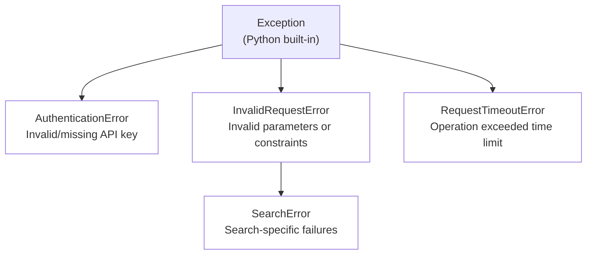
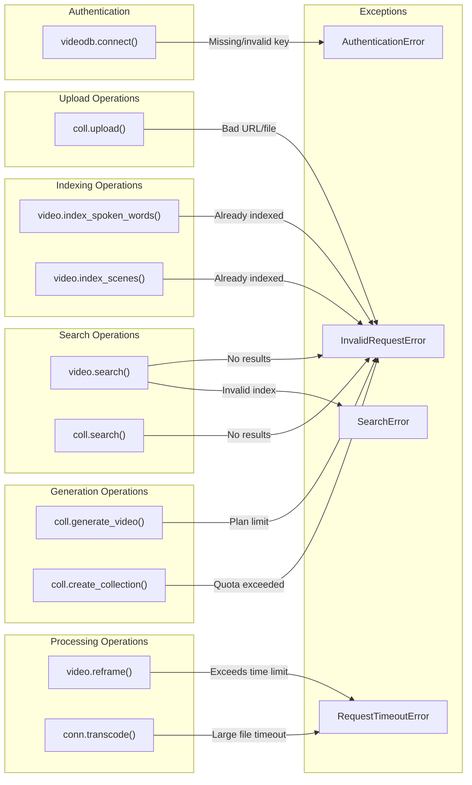

<!-- source: DeepWiki mcp.deepwiki.com · repo video-db/skills · page 14.1 Exception Types · fetched 2026-10-26 -->

# Exception Types

<details>
<summary>Relevant source files</summary>

The following files were used as context for generating this wiki page:

- [python/SKILL.md](python/SKILL.md)

</details>


This page documents the exception types raised by the VideoDB Python SDK. These exceptions provide structured error handling for authentication failures, invalid requests, timeouts, and search-specific errors. For general error handling patterns and recovery strategies, see [Common Error Patterns](#14.2).

---

## Exception Hierarchy

The VideoDB SDK defines a hierarchy of exception classes that inherit from Python's standard `Exception` class. All VideoDB exceptions can be caught using the base module's exception types.

**Exception Class Structure**



**Sources:** [python/SKILL.md:276-287]()

---

## AuthenticationError

`AuthenticationError` is raised when authentication with the VideoDB API fails. This occurs during connection initialization when the API key is invalid, missing, or expired.

### When Raised

| Operation | Trigger Condition |
|-----------|------------------|
| `videodb.connect()` | `VIDEO_DB_API_KEY` environment variable is missing |
| `videodb.connect()` | API key is invalid or malformed |
| `videodb.connect()` | API key has expired or been revoked |

### Exception Properties

The exception contains an error message describing the authentication failure. The SDK automatically raises this exception before any API operations are attempted.

### Handling Pattern

```python
from videodb.exceptions import AuthenticationError

try:
    conn = videodb.connect()
except AuthenticationError:
    print("Authentication failed. Check your VIDEO_DB_API_KEY")
    # Instruct user to verify key or set it in environment/dotenv
```

### Common Causes

1. **Missing API Key**: No `VIDEO_DB_API_KEY` in environment or `.env` file
2. **Typo in Key**: Incorrectly copied API key with missing characters
3. **Wrong Environment**: Using development key in production or vice versa
4. **Expired Key**: Key has been regenerated or account suspended

**Sources:** [python/SKILL.md:68-81](), [python/SKILL.md:276-282]()

---

## InvalidRequestError

`InvalidRequestError` is the most common exception type, raised when API requests contain invalid parameters, violate constraints, or reference non-existent resources. This exception encompasses a wide range of failure scenarios.

### When Raised

| Operation | Trigger Condition | Error Message Pattern |
|-----------|------------------|----------------------|
| `coll.upload()` | Invalid URL or unreachable file | `"Upload failed: ..."` |
| `video.index_spoken_words()` | Video already has spoken word index | `"Spoken word index for video already exists"` |
| `video.index_scenes()` | Scene index already exists for video | `"Scene index with id XXXX already exists"` |
| `video.search()` | No results match query | `"No results found"` |
| `coll.generate_video()` | Plan does not support video generation | `"Operation not allowed"` or `"maximum limit"` |
| `coll.create_collection()` | Collection limit reached for plan | `"maximum limit"` |

### Search No-Results Exception

A critical pattern: `video.search()` and `coll.search()` raise `InvalidRequestError` with message `"No results found"` when a query produces zero matches. This is **not an error condition** but a normal search outcome that must be handled explicitly.

```python
from videodb.exceptions import InvalidRequestError

try:
    results = video.search("product demo")
    shots = results.get_shots()
    stream_url = results.compile()
except InvalidRequestError as e:
    if "No results found" in str(e):
        # Treat as empty results
        shots = []
    else:
        # Actual error condition
        raise
```

**Sources:** [python/SKILL.md:152-167](), [python/SKILL.md:200-206]()

### Idempotency Errors

Several operations raise `InvalidRequestError` when attempting to create resources that already exist:

```python
# Spoken word indexing - use force=True to skip if exists
try:
    video.index_spoken_words()
except InvalidRequestError as e:
    if "already exists" in str(e):
        # Skip or use force=True parameter
        pass
```

```python
import re

# Scene indexing - extract existing index ID from error
try:
    scene_index_id = video.index_scenes(
        extraction_type=SceneExtractionType.shot_based,
        prompt="Describe the visual content in this scene.",
    )
except Exception as e:
    match = re.search(r"id\s+([a-f0-9]+)", str(e))
    if match:
        scene_index_id = match.group(1)  # Reuse existing index
    else:
        raise
```

**Sources:** [python/SKILL.md:143-145](), [python/SKILL.md:176-188](), [python/SKILL.md:293-295]()

### Plan-Gated Features

Certain operations raise `InvalidRequestError` when the user's plan does not support the requested feature:

- `coll.generate_video()` - Video generation not available on plan
- `coll.create_collection()` - Collection limit exceeded

These errors contain messages like `"Operation not allowed"` or `"maximum limit"`.

**Sources:** [python/SKILL.md:298]()

---

## RequestTimeoutError

`RequestTimeoutError` is raised when server-side operations exceed their maximum execution time. This typically occurs with long-running processing tasks.

### When Raised

| Operation | Typical Cause | Duration Before Timeout |
|-----------|--------------|------------------------|
| `video.reframe()` | Full-length video reframing | Several minutes |
| `conn.transcode()` | Large file transcoding | Variable by file size |
| Search operations | Complex semantic queries | Rarely, on large collections |

### Reframe Timeout Pattern

The `video.reframe()` operation is particularly prone to timeouts on full-length videos. The recommended pattern is to use asynchronous callbacks or trim to short segments:

```python
from videodb import ReframeMode

# Synchronous: Limit to short segment to avoid timeout
reframed = video.reframe(start=0, end=60, target="vertical", mode=ReframeMode.smart)

# Asynchronous: Use callback_url for full-length videos
video.reframe(target="vertical", callback_url="https://example.com/webhook")
# Returns None immediately, result delivered to webhook when complete
```

**Sources:** [python/SKILL.md:242-262](), [python/SKILL.md:296]()

### Recovery Strategy

For timeout-prone operations:
1. **Segment the input**: Process smaller chunks (e.g., `start`/`end` parameters)
2. **Use async callbacks**: Pass `callback_url` for webhook delivery
3. **Retry with smaller scope**: Reduce quality/resolution settings
4. **Pre-process on timeline**: Trim to essential segments before expensive operations

**Sources:** [python/SKILL.md:242-262]()

---

## SearchError

`SearchError` is a specialized exception for search-specific failures. In practice, most search errors are raised as `InvalidRequestError` (particularly the "No results found" case), but `SearchError` may be used for semantic search failures or index-related issues.

### When Raised

| Scenario | Cause |
|----------|-------|
| Index missing | Searching without prior `index_spoken_words()` or `index_scenes()` |
| Invalid `scene_index_id` | Referencing non-existent scene index |
| Malformed query | Search query contains invalid syntax or parameters |

### Handling Pattern

```python
from videodb.exceptions import SearchError, InvalidRequestError

try:
    results = video.search(
        query="person writing on a whiteboard",
        search_type=SearchType.semantic,
        index_type=IndexType.scene,
        scene_index_id=scene_index_id,
    )
except (SearchError, InvalidRequestError) as e:
    if "No results found" in str(e):
        results = []  # Empty results, not an error
    elif "index" in str(e).lower():
        # Missing or invalid index
        print("Index not found. Run index_scenes() first.")
    else:
        raise
```

**Sources:** [python/SKILL.md:152-167](), [python/SKILL.md:200-206]()

---

## Exception-Operation Matrix

The following diagram maps operations to the exceptions they commonly raise:

**Operation-Exception Flow**



**Sources:** [python/SKILL.md:276-287](), [python/SKILL.md:289-298]()

---

## Comprehensive Error Handling Template

The following template demonstrates robust exception handling for common VideoDB workflows:

```python
from videodb.exceptions import AuthenticationError, InvalidRequestError, RequestTimeoutError
import videodb
import re

# Authentication with fallback
try:
    conn = videodb.connect()
except AuthenticationError:
    print("Set VIDEO_DB_API_KEY in environment or .env file")
    print("Get free key at https://console.videodb.io")
    exit(1)

coll = conn.get_collection()

# Upload with error recovery
try:
    video = coll.upload(url="https://example.com/video.mp4")
except InvalidRequestError as e:
    print(f"Upload failed: {e}")
    exit(1)

# Idempotent indexing
video.index_spoken_words(force=True)  # Skip error if already indexed

# Scene indexing with ID extraction
try:
    scene_index_id = video.index_scenes(
        extraction_type=SceneExtractionType.shot_based,
        prompt="Describe visual content",
    )
except Exception as e:
    match = re.search(r"id\s+([a-f0-9]+)", str(e))
    if match:
        scene_index_id = match.group(1)
    else:
        raise

# Search with no-results handling
try:
    results = video.search("product demo", score_threshold=0.3)
    shots = results.get_shots()
except InvalidRequestError as e:
    if "No results found" in str(e):
        shots = []
    else:
        raise

# Timeout-safe reframing
try:
    reframed = video.reframe(start=0, end=60, target="vertical")
except RequestTimeoutError:
    # Fallback to async processing
    video.reframe(target="vertical", callback_url="https://example.com/webhook")
    print("Reframe job submitted, result will be sent to webhook")
```

**Sources:** [python/SKILL.md:276-287](), [python/SKILL.md:143-167](), [python/SKILL.md:176-206](), [python/SKILL.md:242-262]()

---

## Import Statements

All exception types are imported from the `videodb.exceptions` module:

```python
from videodb.exceptions import (
    AuthenticationError,
    InvalidRequestError,
    RequestTimeoutError,
    SearchError,
)
```

For most use cases, importing `AuthenticationError` and `InvalidRequestError` is sufficient, as these cover the majority of error scenarios.

**Sources:** [python/SKILL.md:152](), [python/SKILL.md:173](), [python/SKILL.md:276]()

---

## Exception Message Patterns

The following table catalogs common exception message patterns for programmatic error detection:

| Exception Type | Message Pattern | Detection Strategy |
|---------------|----------------|-------------------|
| `AuthenticationError` | `"Invalid API key"` | Catch exception type directly |
| `InvalidRequestError` | `"No results found"` | `"No results found" in str(e)` |
| `InvalidRequestError` | `"already exists"` | `"already exists" in str(e)` |
| `InvalidRequestError` | `"Scene index with id XXXX"` | `re.search(r"id\s+([a-f0-9]+)", str(e))` |
| `InvalidRequestError` | `"Operation not allowed"` | `"Operation not allowed" in str(e)` |
| `InvalidRequestError` | `"maximum limit"` | `"maximum limit" in str(e)` |
| `RequestTimeoutError` | Various timeout messages | Catch exception type directly |

**Sources:** [python/SKILL.md:289-298]()

---

