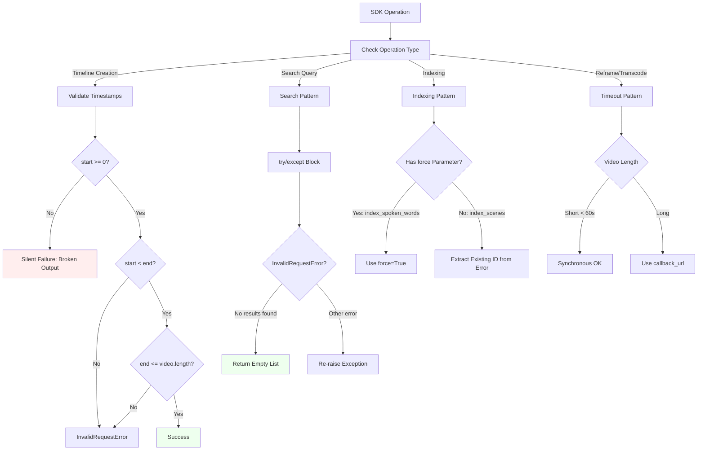
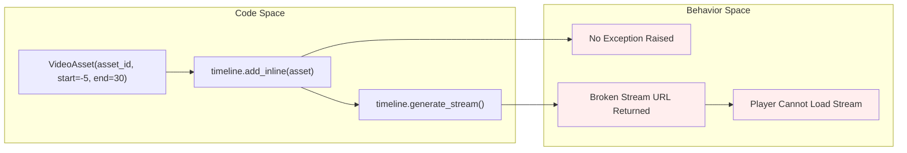
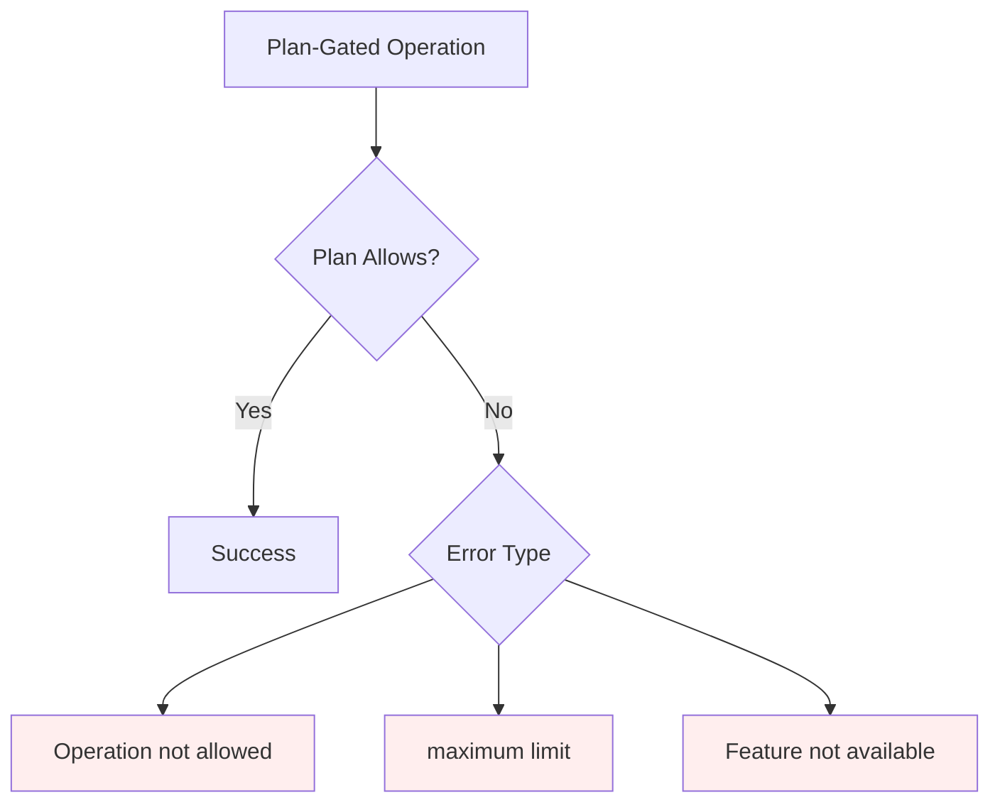
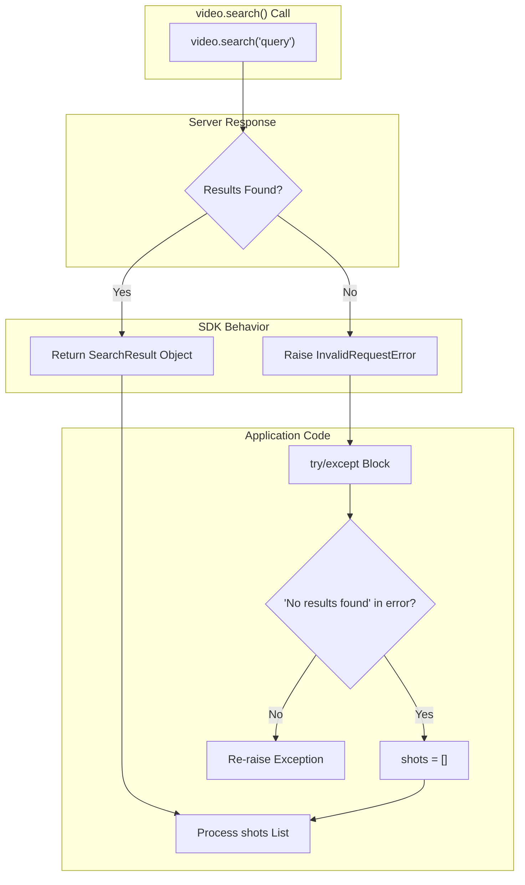
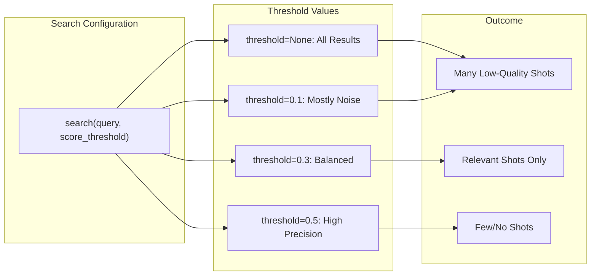
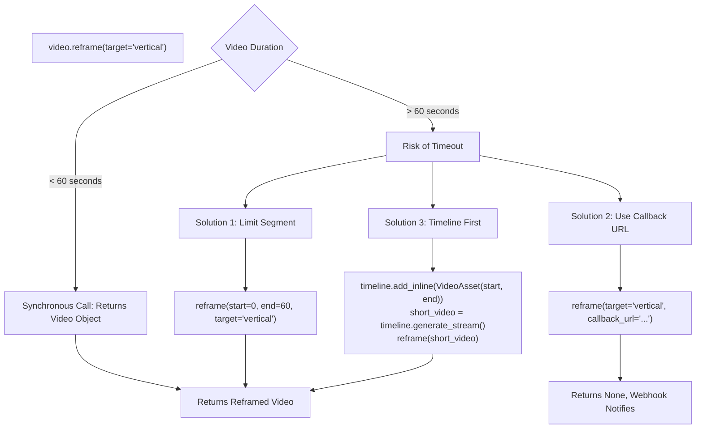

<!-- source: DeepWiki mcp.deepwiki.com · repo video-db/skills · page 14.2 Common Error Patterns · fetched 2026-10-26 -->

# Common Error Patterns

<details>
<summary>Relevant source files</summary>

The following files were used as context for generating this wiki page:

- [python/SKILL.md](python/SKILL.md)

</details>


This document covers recurring error patterns that occur during normal VideoDB SDK usage, including silent failures, search result handling, idempotency issues, and timeout management. These patterns differ from exception types (covered in [14.1](#14.1)) by focusing on how errors manifest in workflows rather than the exception classes themselves.

For information about specific exception types and their inheritance hierarchy, see [14.1](#14.1).

---

## Overview of Error Pattern Categories

The VideoDB SDK exhibits four categories of error patterns that require special handling:

| Pattern Category | Manifestation | Impact |
|------------------|---------------|---------|
| **Silent Failures** | Operations succeed but produce broken output | Invalid media streams, corrupted timeline output |
| **Expected Exceptions** | Errors that represent normal empty states | Search with no results, missing content |
| **Idempotency Conflicts** | Errors when repeating already-completed operations | Re-indexing videos, duplicate scene indexes |
| **Timeout Behaviors** | Long-running operations blocking indefinitely | Reframe on full-length videos, large transcodes |

**Sources:** [python/SKILL.md:289-298]()

---

## Error Pattern Decision Tree



**Sources:** [python/SKILL.md:210-262](), [python/SKILL.md:289-298]()

---

## Silent Failures

Silent failures are operations that complete successfully but produce incorrect or broken output. These are particularly dangerous because they do not raise exceptions, making them difficult to detect.

### Timeline Negative Timestamp Pattern

The most common silent failure occurs when creating `VideoAsset` objects with negative `start` timestamps. The SDK silently accepts negative values but produces corrupted stream output.



**Prevention Strategy:**

Always validate timestamps before creating timeline assets:

| Validation | Rule | Error if Violated |
|------------|------|-------------------|
| `start >= 0` | Start must be non-negative | Silent failure (broken output) |
| `start < end` | Start must precede end | `InvalidRequestError` (immediate) |
| `end <= video.length` | End must be within video | `InvalidRequestError` (immediate) |

**Code Pattern:**

```python
def safe_video_asset(video, start, end):
    """Create VideoAsset with validation to prevent silent failures."""
    if start < 0:
        raise ValueError(f"start must be >= 0, got {start}")
    if start >= end:
        raise ValueError(f"start must be < end, got start={start}, end={end}")
    if end > video.length:
        raise ValueError(f"end must be <= video.length ({video.length}), got {end}")
    
    return VideoAsset(asset_id=video.id, start=start, end=end)
```

**Sources:** [python/SKILL.md:210-213](), [python/SKILL.md:219-223](), [python/SKILL.md:297]()

### Plan-Gated Feature Silent Failures

Some operations fail with ambiguous messages when plan limits are exceeded:



**Affected Operations:**

| Operation | Common Error Message | Solution |
|-----------|---------------------|----------|
| `coll.generate_video()` | "Operation not allowed" | Upgrade plan or reduce generation count |
| `conn.create_collection()` | "maximum limit" | Delete unused collections or upgrade |
| Advanced AI features | "Feature not available" | Contact support for plan upgrade |

**Sources:** [python/SKILL.md:298]()

---

## Search Result Handling

Search operations have a unique error pattern: empty results raise `InvalidRequestError` instead of returning an empty list. This violates typical API design patterns where "no results" is a success state.

### No Results Found Pattern



**Required Code Pattern:**

```python
from videodb.exceptions import InvalidRequestError

try:
    results = video.search("product demo")
    shots = results.get_shots()
except InvalidRequestError as e:
    if "No results found" in str(e):
        shots = []  # Treat as empty results
    else:
        raise  # Re-raise unexpected errors
```

**Canonical Pattern Mapping:**

| Natural Language | Code Entity | Error Condition |
|------------------|-------------|-----------------|
| "Search returned nothing" | `video.search()` | Raises `InvalidRequestError` with message "No results found" |
| "Filter by score" | `search(..., score_threshold=0.3)` | Lower threshold may return results |
| "Empty results" | `shots = []` | Application-level empty list after catching exception |

**Sources:** [python/SKILL.md:152-167](), [python/SKILL.md:295]()

### Score Threshold Pattern

Scene search often returns low-relevance noise. Use `score_threshold` to filter results:



**Recommended Thresholds:**

| Search Type | Recommended Threshold | Rationale |
|-------------|----------------------|-----------|
| Semantic (spoken) | `0.2 - 0.3` | Transcripts have clear semantic matching |
| Scene (visual) | `0.3 - 0.4` | Visual descriptions are less precise |
| Keyword (exact) | N/A | Keyword search doesn't use scoring |

**Sources:** [python/SKILL.md:190-205]()

---

## Idempotency and Re-indexing Patterns

Indexing operations are not idempotent by default. Attempting to re-index content produces different errors depending on the operation.

### Two Indexing Patterns

```mermaid
graph TB
    subgraph "index_spoken_words()"
        SpokenCall["video.index_spoken_words()"]
        AlreadyIndexed{"Already Indexed?"}
        SpokenError["Error: Spoken word index already exists"]
        UseForce["Use force=True Parameter"]
        SkipIfExists["Silently Skip Re-indexing"]
        SpokenSuccess["Success"]
    end
    
    subgraph "index_scenes()"
        SceneCall["video.index_scenes()"]
        SceneExists{"Scene Index Exists?"}
        SceneError["Error: Scene index with id XXXX already exists"]
        ExtractID["Extract scene_index_id from Error Message"]
        UseExistingID["Use Extracted ID for search()"]
        SceneSuccess["New Index Created"]
    end
    
    SpokenCall --> AlreadyIndexed
    AlreadyIndexed -->|"Yes"| SpokenError
    AlreadyIndexed -->|"No"| SpokenSuccess
    SpokenError --> UseForce
    UseForce --> SkipIfExists
    
    SceneCall --> SceneExists
    SceneExists -->|"Yes"| SceneError
    SceneExists -->|"No"| SceneSuccess
    SceneError --> ExtractID
    ExtractID --> UseExistingID
```



**Sources:** [python/SKILL.md:143-147](), [python/SKILL.md:176-189](), [python/SKILL.md:293-294]()

### Spoken Word Index Pattern

The `index_spoken_words()` method has a `force` parameter to handle re-indexing:

| Pattern | Code | Behavior |
|---------|------|----------|
| **First time** | `video.index_spoken_words()` | Creates index, returns success |
| **Re-index without force** | `video.index_spoken_words()` | Raises error: "Spoken word index for video already exists" |
| **Re-index with force** | `video.index_spoken_words(force=True)` | Silently skips re-indexing, returns success |

**Idempotent Pattern:**

```python
# Always use force=True to make the operation idempotent
video.index_spoken_words(force=True)
text = video.get_transcript_text()
```

**Sources:** [python/SKILL.md:143-147](), [python/SKILL.md:293]()

### Scene Index Extraction Pattern

The `index_scenes()` method has **no force parameter**. When a scene index already exists, you must extract the existing `scene_index_id` from the error message:

```python
import re
from videodb import SceneExtractionType
from videodb.exceptions import InvalidRequestError

try:
    scene_index_id = video.index_scenes(
        extraction_type=SceneExtractionType.shot_based,
        prompt="Describe the visual content in this scene.",
    )
except Exception as e:
    # Extract existing scene_index_id from error message
    match = re.search(r"id\s+([a-f0-9]+)", str(e))
    if match:
        scene_index_id = match.group(1)
    else:
        raise  # Unexpected error format
```

**Error Message Format:**

```
Scene index with id a7c3f8b2d1e9 already exists for this video
```

**Extraction Pattern:**

| Step | Code Entity | Purpose |
|------|-------------|---------|
| 1. Call `index_scenes()` | `video.index_scenes(...)` | Attempt to create new index |
| 2. Catch exception | `except Exception as e:` | Intercept the "already exists" error |
| 3. Extract ID | `re.search(r"id\s+([a-f0-9]+)", str(e))` | Parse hexadecimal ID from message |
| 4. Use in search | `video.search(..., scene_index_id=scene_index_id)` | Reference existing index |

**Sources:** [python/SKILL.md:176-189](), [python/SKILL.md:294]()

### Why Scene Index Has No Force Parameter

Scene indexes support multiple indexes per video (different prompts, extraction types). The lack of a `force` parameter prevents accidentally overwriting a specific index configuration. Instead, users must explicitly choose which index to use via `scene_index_id`.

---

## Timeout Management

Long-running server-side operations like `reframe()` and `transcode()` can block indefinitely without proper timeout handling.

### Reframe Timeout Pattern

The `video.reframe()` method performs server-side aspect ratio conversion. For long videos, this can exceed typical HTTP timeouts.



**Sources:** [python/SKILL.md:242-262](), [python/SKILL.md:296]()

### Synchronous vs. Async Reframe

| Approach | When to Use | Code Pattern |
|----------|-------------|--------------|
| **Synchronous (limited segment)** | Short clips, known duration < 60s | `reframed = video.reframe(start=0, end=60, target="vertical")` |
| **Async (callback URL)** | Full-length videos, background processing | `video.reframe(target="vertical", callback_url="https://example.com/webhook")` |
| **Timeline-first** | Complex edits before reframing | Trim on `Timeline`, export, then reframe |

**Synchronous Pattern (Recommended):**

```python
from videodb import ReframeMode

# Always prefer reframing a short segment to avoid timeouts
reframed = video.reframe(
    start=0, 
    end=60,  # Limit to 60 seconds
    target="vertical",
    mode=ReframeMode.smart
)
```

**Async Pattern:**

```python
# For full-length videos, use callback_url (returns None immediately)
video.reframe(
    target="vertical",
    callback_url="https://example.com/webhook"
)
# Result delivered via webhook when complete
```

**Sources:** [python/SKILL.md:250-261]()

### Transcode Timeout Pattern

The `conn.transcode()` method has similar timeout risks for large files:

```python
from videodb import TranscodeMode, VideoConfig, AudioConfig

# Always use callback_url for production transcode operations
job_id = conn.transcode(
    source="https://example.com/large-video.mp4",
    callback_url="https://example.com/webhook",  # Required for async
    mode=TranscodeMode.economy,
    video_config=VideoConfig(resolution=720, quality=23),
    audio_config=AudioConfig(mute=False),
)
# job_id returned immediately, result via webhook
```

**Sources:** [python/SKILL.md:225-238]()

---

## Error Recovery Strategies

### Retry Patterns

| Error Type | Retry Strategy | Code Pattern |
|------------|----------------|--------------|
| `AuthenticationError` | No retry, prompt for new API key | Inform user to check `VIDEO_DB_API_KEY` |
| `InvalidRequestError` (search) | Check message for "No results found" | Treat as empty, don't retry |
| `InvalidRequestError` (indexing) | Extract existing ID, continue | Use `force=True` or extract `scene_index_id` |
| `RequestTimeoutError` | Switch to async pattern | Use `callback_url` parameter |

### Combining Error Patterns

Real-world workflows often combine multiple error patterns:

```python
import re
from videodb import SearchType, IndexType, SceneExtractionType
from videodb.exceptions import InvalidRequestError

def search_with_all_patterns(video, query):
    """Demonstrates combined error handling for production use."""
    
    # Pattern 1: Idempotent spoken word indexing
    video.index_spoken_words(force=True)
    
    # Pattern 2: Scene index extraction
    try:
        scene_index_id = video.index_scenes(
            extraction_type=SceneExtractionType.shot_based,
            prompt="Describe the visual content.",
        )
    except Exception as e:
        match = re.search(r"id\s+([a-f0-9]+)", str(e))
        if match:
            scene_index_id = match.group(1)
        else:
            raise
    
    # Pattern 3: No results found handling with score threshold
    try:
        results = video.search(
            query=query,
            search_type=SearchType.semantic,
            index_type=IndexType.scene,
            scene_index_id=scene_index_id,
            score_threshold=0.3,  # Filter noise
        )
        shots = results.get_shots()
    except InvalidRequestError as e:
        if "No results found" in str(e):
            shots = []
        else:
            raise
    
    # Pattern 4: Timeline validation for each shot
    validated_shots = []
    for shot in shots:
        if shot.start >= 0 and shot.start < shot.end and shot.end <= video.length:
            validated_shots.append(shot)
    
    return validated_shots
```

**Sources:** [python/SKILL.md:152-206](), [python/SKILL.md:289-298]()

---

## Summary Table

| Error Pattern | Detection | Prevention | Recovery |
|---------------|-----------|------------|----------|
| **Negative timestamps** | Broken stream output | Validate `start >= 0` before `VideoAsset` | Re-create timeline with valid timestamps |
| **Search no results** | `InvalidRequestError` with "No results found" | N/A (expected state) | Catch exception, treat as empty list |
| **Re-indexing spoken words** | "Spoken word index already exists" | Use `force=True` parameter | Idempotent pattern handles automatically |
| **Re-indexing scenes** | "Scene index with id XXXX already exists" | N/A (intentional design) | Extract ID from error with regex |
| **Reframe timeout** | HTTP timeout or indefinite blocking | Limit segment with `start`/`end` | Use `callback_url` for async processing |
| **Plan limits** | "Operation not allowed" or "maximum limit" | Check plan before operations | Inform user of plan constraints |

**Sources:** [python/SKILL.md:289-298]()

---

