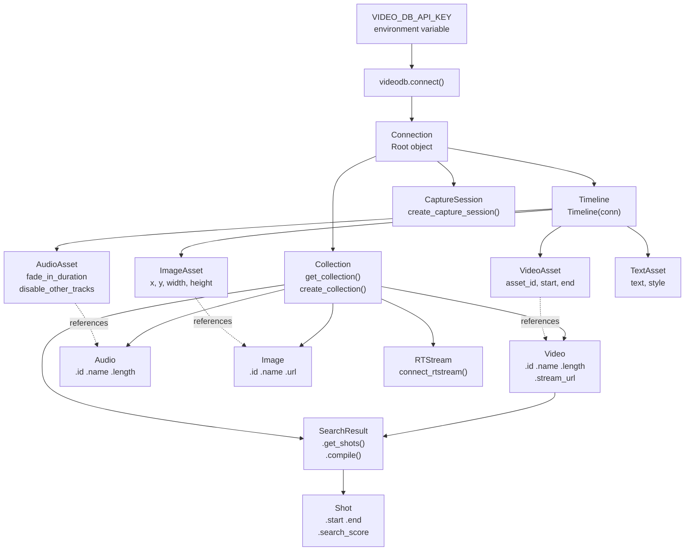
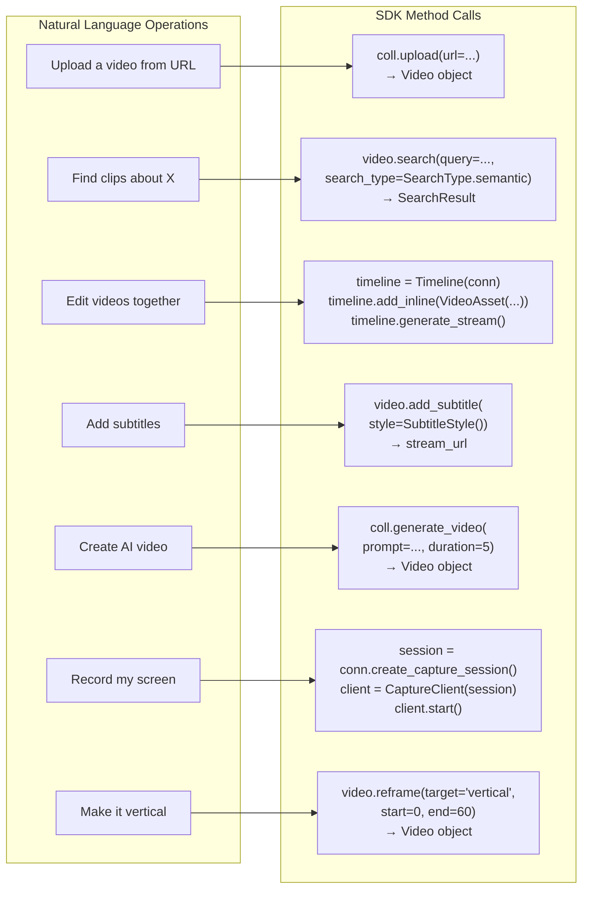
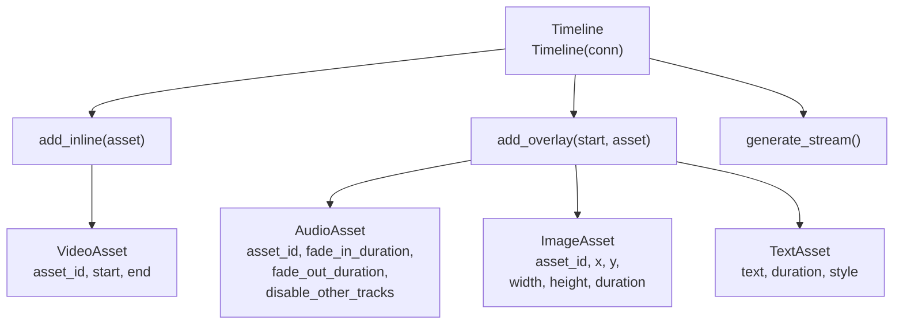

<!-- source: DeepWiki mcp.deepwiki.com · repo video-db/skills · page 15 API Reference · fetched 2026-10-26 -->

# API Reference

<details>
<summary>Relevant source files</summary>

The following files were used as context for generating this wiki page:

- [python/reference/api-reference.md](python/reference/api-reference.md)

</details>


This page provides a complete reference for all classes, methods, and parameters in the VideoDB Python SDK. It documents method signatures, parameter types, return values, and usage patterns for programmatic access to VideoDB's capabilities.

For workflow-oriented guides on how to use these APIs, see:
- [Installation and Setup](#1.1) for initial configuration
- [Quick Start](#1.2) for basic usage patterns
- [Object Model](#2.1) for understanding object relationships
- [Searching Videos](#6) for search operation details
- [Timeline Editing](#7) for composition workflows
- [Desktop Capture](#8) for capture session details
- [Live Stream Processing](#9) for RTStream details

---

## Core Object Hierarchy



**Object Model Hierarchy**

The SDK follows a strict ownership hierarchy where `Connection` is the root object created by `videodb.connect()`. It provides factory methods for `Collection` (media container), `Timeline` (composition editor), and `CaptureSession` (desktop recording). Collections contain media assets (`Video`, `Audio`, `Image`, `RTStream`), which provide indexing and search methods that return `SearchResult` objects containing `Shot` segments. Timeline uses asset wrapper classes (`VideoAsset`, `AudioAsset`, `ImageAsset`, `TextAsset`) that reference media objects by ID.

**Sources:** [python/reference/api-reference.md:1-31]()

---

## Method Organization by Functional Area

```mermaid
graph LR
    subgraph "Connection Methods"
        conn_upload["upload()"]
        conn_transcode["transcode()"]
        conn_collections["get_collection()<br/>create_collection()"]
        conn_capture["create_capture_session()"]
        conn_meeting["record_meeting()"]
        conn_ws["connect_websocket()"]
    end
    
    subgraph "Collection Methods"
        coll_upload["upload()"]
        coll_search["search()"]
        coll_generate["generate_image()<br/>generate_video()<br/>generate_music()<br/>generate_voice()"]
        coll_media["get_videos()<br/>get_audios()<br/>get_images()"]
        coll_dub["dub_video()"]
        coll_rtstream["connect_rtstream()"]
    end
    
    subgraph "Video Methods"
        video_index["index_spoken_words()<br/>index_scenes()<br/>index_visuals()<br/>index_audio()"]
        video_search["search()"]
        video_edit["add_subtitle()<br/>reframe()<br/>generate_stream()"]
        video_transcript["get_transcript()<br/>translate_transcript()"]
    end
    
    subgraph "Timeline Methods"
        timeline_add["add_inline()<br/>add_overlay()"]
        timeline_generate["generate_stream()"]
    end
    
    subgraph "Search Methods"
        search_shots["get_shots()"]
        search_compile["compile()"]
        search_play["play()"]
    end
    
    Connection --> conn_collections
    Connection --> conn_upload
    Connection --> conn_transcode
    Connection --> conn_capture
    Connection --> conn_meeting
    Connection --> conn_ws
    
    Collection --> coll_upload
    Collection --> coll_search
    Collection --> coll_generate
    Collection --> coll_media
    Collection --> coll_dub
    Collection --> coll_rtstream
    
    Video --> video_index
    Video --> video_search
    Video --> video_edit
    Video --> video_transcript
    
    Timeline --> timeline_add
    Timeline --> timeline_generate
    
    SearchResult["SearchResult"] --> search_shots
    SearchResult --> search_compile
    SearchResult --> search_play
```



**Functional Method Grouping**

Methods are organized by their primary function: `Connection` handles authentication and resource creation; `Collection` manages media uploads and AI generation; `Video` provides indexing and search; `Timeline` composes multiple assets; `SearchResult` handles search output.

**Sources:** [python/reference/api-reference.md:16-31](), [python/reference/api-reference.md:106-133](), [python/reference/api-reference.md:168-190]()

---

## Natural Language to SDK Method Mapping



**Mapping User Intent to Code**

Common user operations map to specific SDK method chains. Upload uses `coll.upload()`, search requires `video.search()` with `SearchType` enum, composition uses `Timeline` with asset classes, subtitles use `video.add_subtitle()`, generation uses `coll.generate_*()` methods, recording uses `CaptureSession` and `CaptureClient`, and reframing uses `video.reframe()` with target presets.

**Sources:** [python/reference/api-reference.md:115-124](), [python/reference/api-reference.md:366-383](), [python/reference/api-reference.md:273-285]()

---

## Connection

The `Connection` object is created by `videodb.connect()` and serves as the authenticated root for all SDK operations.

### Connection Initialization

```python
import videodb

conn = videodb.connect(
    api_key="your-api-key",      # or set VIDEO_DB_API_KEY env var
    base_url=None,                # custom API endpoint (optional)
)
```

Returns a `Connection` object that provides factory methods for collections, timelines, and capture sessions.

**Sources:** [python/reference/api-reference.md:5-14]()

### Connection Methods

| Method | Returns | Description |
|--------|---------|-------------|
| `conn.get_collection(collection_id="default")` | `Collection` | Get collection by ID (returns default collection if no ID provided) |
| `conn.get_collections()` | `list[Collection]` | List all collections in the account |
| `conn.create_collection(name, description, is_public=False)` | `Collection` | Create a new collection with specified name and settings |
| `conn.update_collection(id, name, description)` | `Collection` | Update an existing collection's metadata |
| `conn.check_usage()` | `dict` | Get account usage statistics |
| `conn.upload(source, media_type, name, ...)` | `Video\|Audio\|Image` | Upload media to the default collection |
| `conn.record_meeting(meeting_url, bot_name, ...)` | `Meeting` | Deploy a bot to record a live meeting |
| `conn.create_capture_session(...)` | `CaptureSession` | Create a desktop capture session (see [Desktop Capture](#8)) |
| `conn.youtube_search(query, result_threshold, duration)` | `list[dict]` | Search YouTube and return video metadata |
| `conn.transcode(source, callback_url, mode, ...)` | `str` | Transcode video asynchronously (returns job ID) |
| `conn.get_transcode_details(job_id)` | `dict` | Get transcode job status and output details |
| `conn.connect_websocket(collection_id)` | `WebSocketConnection` | Create WebSocket connection for real-time events |

**Sources:** [python/reference/api-reference.md:16-31]()

### Transcode Method

Server-side video transcoding with custom resolution, quality, and audio settings. No local ffmpeg required.

```python
from videodb import TranscodeMode, VideoConfig, AudioConfig

job_id = conn.transcode(
    source="https://example.com/video.mp4",
    callback_url="https://example.com/webhook",
    mode=TranscodeMode.economy,
    video_config=VideoConfig(resolution=720, quality=23),
    audio_config=AudioConfig(mute=False),
)

# Poll for completion
details = conn.get_transcode_details(job_id)
```

#### Transcode Parameters

| Parameter | Type | Default | Description |
|-----------|------|---------|-------------|
| `source` | `str` | required | URL of the video to transcode (must be downloadable) |
| `callback_url` | `str` | required | Webhook URL to receive completion notification |
| `mode` | `TranscodeMode` | `TranscodeMode.economy` | Processing speed: `economy` (slower, cheaper) or `lightning` (faster) |
| `video_config` | `VideoConfig` | `VideoConfig()` | Video encoding configuration object |
| `audio_config` | `AudioConfig` | `AudioConfig()` | Audio encoding configuration object |

Returns a job ID string. Use `conn.get_transcode_details(job_id)` to check status.

#### VideoConfig

```python
from videodb import VideoConfig, ResizeMode

config = VideoConfig(
    resolution=720,              # Target height in pixels (e.g. 480, 720, 1080)
    quality=23,                  # Encoding quality (lower = better, range: 0-51, default 23)
    framerate=30,                # Target framerate (frames per second)
    aspect_ratio="16:9",         # Target aspect ratio string
    resize_mode=ResizeMode.crop, # Resize strategy: crop, fit, or pad
)
```

| Field | Type | Default | Description |
|-------|------|---------|-------------|
| `resolution` | `int\|None` | `None` | Target resolution height in pixels (None = keep original) |
| `quality` | `int` | `23` | Encoding quality, lower values = higher quality (0-51 range) |
| `framerate` | `int\|None` | `None` | Target framerate (None = keep original) |
| `aspect_ratio` | `str\|None` | `None` | Target aspect ratio (e.g. `"16:9"`, `"9:16"`, `"1:1"`) |
| `resize_mode` | `str` | `ResizeMode.crop` | How to fit video into target dimensions: `crop`, `fit`, or `pad` |

#### AudioConfig

```python
from videodb import AudioConfig

config = AudioConfig(mute=False)
```

| Field | Type | Default | Description |
|-------|------|---------|-------------|
| `mute` | `bool` | `False` | Set to `True` to remove audio track |

**Sources:** [python/reference/api-reference.md:33-98]()

---

## Collection

`Collection` objects represent media containers that group related videos, audios, and images. They provide upload, search, and generation capabilities.

### Collection Methods

| Method | Returns | Description |
|--------|---------|-------------|
| `coll.get_videos()` | `list[Video]` | List all videos in the collection |
| `coll.get_video(video_id)` | `Video` | Retrieve a specific video by ID |
| `coll.get_audios()` | `list[Audio]` | List all audio files in the collection |
| `coll.get_audio(audio_id)` | `Audio` | Retrieve a specific audio by ID |
| `coll.get_images()` | `list[Image]` | List all images in the collection |
| `coll.get_image(image_id)` | `Image` | Retrieve a specific image by ID |
| `coll.upload(url=None, file_path=None, media_type=None, name=None)` | `Video\|Audio\|Image` | Upload media from URL or local file |
| `coll.search(query, search_type, index_type, score_threshold, ...)` | `SearchResult` | Semantic search across all videos in collection |
| `coll.generate_image(prompt, aspect_ratio="1:1")` | `Image` | Generate an image using AI |
| `coll.generate_video(prompt, duration=5)` | `Video` | Generate a video using AI |
| `coll.generate_music(prompt, duration=5)` | `Audio` | Generate background music using AI |
| `coll.generate_sound_effect(prompt, duration=2)` | `Audio` | Generate a sound effect using AI |
| `coll.generate_voice(text, voice_name="Default")` | `Audio` | Generate speech from text using AI voice synthesis |
| `coll.generate_text(prompt, model_name="basic", response_type="text")` | `dict` | LLM text generation (access result via `["output"]` key) |
| `coll.dub_video(video_id, language_code)` | `Video` | Create a dubbed version of a video in another language |
| `coll.record_meeting(meeting_url, bot_name, ...)` | `Meeting` | Deploy a meeting bot to record a session |
| `coll.create_capture_session(...)` | `CaptureSession` | Create a desktop capture session |
| `coll.get_capture_session(...)` | `CaptureSession` | Retrieve an existing capture session |
| `coll.connect_rtstream(url, name, ...)` | `RTStream` | Connect to a live RTSP/RTMP stream |
| `coll.make_public()` | `None` | Make the collection publicly accessible |
| `coll.make_private()` | `None` | Make the collection private |
| `coll.delete_video(video_id)` | `None` | Delete a video from the collection |
| `coll.delete_audio(audio_id)` | `None` | Delete an audio from the collection |
| `coll.delete_image(image_id)` | `None` | Delete an image from the collection |
| `coll.delete()` | `None` | Delete the entire collection |

**Important:** `coll.search()` only supports semantic search across collections. Keyword and scene search raise `NotImplementedError` for collections. For those search types, use `video.search()` on individual videos.

**Sources:** [python/reference/api-reference.md:99-133]()

### Upload Parameters

```python
video = coll.upload(
    url=None,            # Remote URL (HTTP, YouTube, etc.)
    file_path=None,      # Local file path
    media_type=None,     # "video", "audio", or "image" (auto-detected if omitted)
    name=None,           # Custom name for the media
    description=None,    # Description text
    callback_url=None,   # Webhook URL for async upload notification
)
```

Either `url` or `file_path` must be provided. The `media_type` is auto-detected from file extension/content but can be explicitly specified.

**Sources:** [python/reference/api-reference.md:135-146]()

---

## Video

`Video` objects represent uploaded or generated video content with indexing, search, and transformation capabilities.

### Video Properties

| Property | Type | Description |
|----------|------|-------------|
| `video.id` | `str` | Unique video identifier |
| `video.collection_id` | `str` | Parent collection ID |
| `video.name` | `str` | Video name/title |
| `video.description` | `str` | Video description text |
| `video.length` | `float` | Duration in seconds |
| `video.stream_url` | `str` | Default HLS stream URL for playback |
| `video.player_url` | `str` | Embeddable player URL |
| `video.thumbnail_url` | `str` | Thumbnail image URL |

**Sources:** [python/reference/api-reference.md:154-165]()

### Video Methods

| Method | Returns | Description |
|--------|---------|-------------|
| `video.generate_stream(timeline=None)` | `str` | Generate HLS stream URL (optionally with timeline `[(start, end)]` tuples) |
| `video.play()` | `str` | Open stream in default browser, returns player URL |
| `video.index_spoken_words(language_code=None, force=False)` | `None` | Transcribe and index speech for search (use `force=True` to reindex) |
| `video.index_scenes(extraction_type, prompt, ...)` | `str` | Index visual scenes with AI (returns `scene_index_id`) |
| `video.index_visuals(prompt, batch_config, ...)` | `str` | Frame-level visual indexing (returns `scene_index_id`) |
| `video.index_audio(prompt, model_name, ...)` | `str` | Index audio content with LLM (returns `scene_index_id`) |
| `video.get_transcript(start=None, end=None)` | `list[dict]` | Get timestamped transcript segments |
| `video.get_transcript_text(start=None, end=None)` | `str` | Get full transcript as plain text |
| `video.generate_transcript(force=None)` | `dict` | Generate transcript (returns transcript data) |
| `video.translate_transcript(language, additional_notes)` | `list[dict]` | Translate transcript to another language |
| `video.search(query, search_type, index_type, filter, **kwargs)` | `SearchResult` | Search within this video |
| `video.add_subtitle(style=SubtitleStyle())` | `str` | Add auto-generated subtitles (returns stream URL) |
| `video.generate_thumbnail(time=None)` | `str\|Image` | Generate a thumbnail image at specified time |
| `video.get_thumbnails()` | `list[Image]` | Get all generated thumbnails |
| `video.extract_scenes(extraction_type, extraction_config)` | `SceneCollection` | Extract scenes based on shot/time/transcript boundaries |
| `video.reframe(start, end, target, mode, callback_url)` | `Video\|None` | Convert aspect ratio (returns `Video` unless `callback_url` set) |
| `video.clip(prompt, content_type, model_name)` | `str` | Generate clip from natural language prompt (returns stream URL) |
| `video.insert_video(video, timestamp)` | `str` | Insert another video at timestamp (returns stream URL) |
| `video.download(name=None)` | `dict` | Download the video file |
| `video.delete()` | `None` | Delete the video |

**Sources:** [python/reference/api-reference.md:167-190]()

### Reframe Method

Convert video to different aspect ratio with optional smart object tracking. Processing is server-side and can be slow.

> **Warning:** Reframing is computationally intensive and may timeout on long videos. Always use `start`/`end` to limit the segment (recommended < 60 seconds), or use `callback_url` for async processing.

```python
from videodb import ReframeMode

# Synchronous reframe (short segments only):
reframed = video.reframe(
    start=0,
    end=60,
    target="vertical",          # or "square", "landscape"
    mode=ReframeMode.smart      # or ReframeMode.simple
)

# Async reframe for full videos (returns None, result via webhook):
video.reframe(
    target="vertical",
    callback_url="https://example.com/webhook"
)

# Custom dimensions:
reframed = video.reframe(
    start=0,
    end=60,
    target={"width": 1080, "height": 1080},
    mode=ReframeMode.simple
)
```

#### Reframe Parameters

| Parameter | Type | Default | Description |
|-----------|------|---------|-------------|
| `start` | `float\|None` | `None` | Start time in seconds (None = beginning) |
| `end` | `float\|None` | `None` | End time in seconds (None = end of video) |
| `target` | `str\|dict` | `"vertical"` | Preset string (`"vertical"`, `"square"`, `"landscape"`) or `{"width": int, "height": int}` |
| `mode` | `str` | `ReframeMode.smart` | `ReframeMode.simple` (center crop) or `ReframeMode.smart` (AI object tracking) |
| `callback_url` | `str\|None` | `None` | Webhook URL for async notification (if set, returns `None`) |

Returns a `Video` object when `callback_url` is `None`, otherwise returns `None` and delivers result to webhook.

**Sources:** [python/reference/api-reference.md:192-221]()

---

## Audio

`Audio` objects represent audio files including uploaded tracks, generated music, sound effects, and voice synthesis output.

### Audio Properties

| Property | Type | Description |
|----------|------|-------------|
| `audio.id` | `str` | Unique audio identifier |
| `audio.collection_id` | `str` | Parent collection ID |
| `audio.name` | `str` | Audio name/title |
| `audio.length` | `float` | Duration in seconds |

### Audio Methods

| Method | Returns | Description |
|--------|---------|-------------|
| `audio.generate_url()` | `str` | Generate signed playback URL |
| `audio.get_transcript(start=None, end=None)` | `list[dict]` | Get timestamped transcript segments (if audio contains speech) |
| `audio.get_transcript_text(start=None, end=None)` | `str` | Get full transcript as plain text |
| `audio.generate_transcript(force=None)` | `dict` | Generate transcript from audio |
| `audio.delete()` | `None` | Delete the audio |

**Sources:** [python/reference/api-reference.md:223-246]()

---

## Image

`Image` objects represent static images including uploaded photos, generated images, and video thumbnails.

### Image Properties

| Property | Type | Description |
|----------|------|-------------|
| `image.id` | `str` | Unique image identifier |
| `image.collection_id` | `str` | Parent collection ID |
| `image.name` | `str` | Image name/title |
| `image.url` | `str\|None` | Direct image URL (may be `None` for generated images) |

### Image Methods

| Method | Returns | Description |
|--------|---------|-------------|
| `image.generate_url()` | `str` | Generate signed URL (use this instead of `.url` for generated images) |
| `image.delete()` | `None` | Delete the image |

**Note:** For AI-generated images, the `.url` property may be `None`. Always use `image.generate_url()` to get a valid URL.

**Sources:** [python/reference/api-reference.md:248-268]()

---

## Timeline and Assets

The `Timeline` class provides non-destructive video composition by arranging assets sequentially (inline) or as overlays. Asset classes wrap media objects with transformation parameters.



**Timeline Asset System**

`Timeline(conn)` creates a composition editor. `add_inline()` places `VideoAsset` objects sequentially on the main track. `add_overlay()` places `AudioAsset`, `ImageAsset`, or `TextAsset` objects at specific timestamps as overlays. `generate_stream()` compiles the composition into an HLS stream URL.

**Sources:** [python/reference/api-reference.md:270-285]()

### Timeline

```python
from videodb.timeline import Timeline

timeline = Timeline(conn)
```

| Method | Returns | Description |
|--------|---------|-------------|
| `timeline.add_inline(asset)` | `None` | Add `VideoAsset` sequentially to main track |
| `timeline.add_overlay(start, asset)` | `None` | Add `AudioAsset`, `ImageAsset`, or `TextAsset` at timestamp |
| `timeline.generate_stream()` | `str` | Compile timeline and return HLS stream URL |

**Sources:** [python/reference/api-reference.md:273-285]()

### VideoAsset

```python
from videodb.asset import VideoAsset

asset = VideoAsset(
    asset_id=video.id,    # Reference to Video object ID
    start=0,              # Trim start time in seconds
    end=None,             # Trim end time (None = full duration)
)
```

Represents a video segment for timeline composition. Use `start` and `end` to trim the video without modifying the original.

**Sources:** [python/reference/api-reference.md:287-298]()

### AudioAsset

```python
from videodb.asset import AudioAsset

asset = AudioAsset(
    asset_id=audio.id,              # Reference to Audio object ID
    start=0,                        # Start time in audio
    end=None,                       # End time (None = full duration)
    disable_other_tracks=True,      # Mute original video audio when True
    fade_in_duration=0,             # Fade-in duration in seconds (max 5)
    fade_out_duration=0,            # Fade-out duration in seconds (max 5)
)
```

Represents an audio track for timeline overlay. Set `disable_other_tracks=True` to replace original audio, or `False` to mix.

**Sources:** [python/reference/api-reference.md:300-312]()

### ImageAsset

```python
from videodb.asset import ImageAsset

asset = ImageAsset(
    asset_id=image.id,    # Reference to Image object ID
    duration=None,        # Display duration in seconds
    width=100,            # Display width in pixels
    height=100,           # Display height in pixels
    x=80,                 # Horizontal position (pixels from left edge)
    y=20,                 # Vertical position (pixels from top edge)
)
```

Represents an image overlay for timeline. Position and size are in pixels from the video's top-left corner.

**Sources:** [python/reference/api-reference.md:314-328]()

### TextAsset

```python
from videodb.asset import TextAsset, TextStyle

asset = TextAsset(
    text="Hello World",
    duration=5,
    style=TextStyle(
        fontsize=24,
        fontcolor="black",
        boxcolor="white",       # Background box color
        alpha=1.0,              # Opacity (0.0 = transparent, 1.0 = opaque)
        font="Sans",
        text_align="T",         # Text alignment within box
    ),
)
```

Represents a text overlay for timeline. The `TextStyle` object controls appearance including font, colors, and positioning.

**Sources:** [python/reference/api-reference.md:330-347]()

### CaptionAsset (Editor API)

`CaptionAsset` belongs to the separate Editor API system which uses its own `Timeline`, `Track`, and `Clip` classes (distinct from the main Timeline API). For subtitle overlays using the standard Timeline API, see `video.add_subtitle()`.

```python
from videodb.editor import CaptionAsset, FontStyling

asset = CaptionAsset(
    src="auto",                     # "auto" for auto-generated or base64-encoded ASS string
    font=FontStyling(name="Clear Sans", size=30),
    primary_color="&H00FFFFFF",
)
```

See [Timeline Editing](#7) page for details on Editor API usage with caption overlays.

**Sources:** [python/reference/api-reference.md:349-363]()

---

## Search Objects

Search operations return `SearchResult` objects containing `Shot` segments that can be compiled into streams or accessed individually.

### SearchResult

```python
results = video.search("query", search_type=SearchType.semantic)
```

| Method | Returns | Description |
|--------|---------|-------------|
| `results.get_shots()` | `list[Shot]` | Get list of all matching segments |
| `results.compile()` | `str` | Compile all shots into a single HLS stream URL |
| `results.play()` | `str` | Open compiled stream in browser, returns player URL |

**Sources:** [python/reference/api-reference.md:386-397]()

### Shot

Individual search result segment with timing and relevance information.

#### Shot Properties

| Property | Type | Description |
|----------|------|-------------|
| `shot.video_id` | `str` | Source video identifier |
| `shot.video_length` | `float` | Source video total duration |
| `shot.video_title` | `str` | Source video name |
| `shot.start` | `float` | Segment start time in seconds |
| `shot.end` | `float` | Segment end time in seconds |
| `shot.text` | `str` | Matched text content (transcript or scene description) |
| `shot.search_score` | `float` | Search relevance score (higher = more relevant) |

#### Shot Methods

| Method | Returns | Description |
|--------|---------|-------------|
| `shot.generate_stream()` | `str` | Generate HLS stream URL for this specific shot |
| `shot.play()` | `str` | Open shot stream in browser, returns player URL |

**Sources:** [python/reference/api-reference.md:399-413]()

### Video Search Parameters

Complete parameter reference for `video.search()` method:

```python
results = video.search(
    query="your query",
    search_type=SearchType.semantic,       # semantic, keyword, or scene
    index_type=IndexType.spoken_word,      # spoken_word or scene
    result_threshold=None,                 # Maximum number of results to return
    score_threshold=None,                  # Minimum relevance score filter
    dynamic_score_percentage=None,         # Percentage of dynamic score
    scene_index_id=None,                   # Target specific scene index (via **kwargs)
    filter=[],                             # Metadata filters for scene search
)
```

**Important:** `video.search()` raises `InvalidRequestError` with message `"No results found"` when there are no matches. Always wrap search calls in try/except blocks. For scene search, use `score_threshold=0.3` or higher to filter low-relevance noise.

**Note:** `filter` is an explicit parameter. `scene_index_id` must be passed via `**kwargs` as it's forwarded to the API.

For scene search, use `search_type=SearchType.semantic` with `index_type=IndexType.scene`. Pass `scene_index_id` when you have multiple scene indexes and need to target a specific one.

**Sources:** [python/reference/api-reference.md:365-384]()

---

## Meeting

`Meeting` objects represent recorded meeting sessions from meeting bots deployed to Zoom, Google Meet, or Microsoft Teams.

```python
meeting = coll.record_meeting(
    meeting_url="https://meet.google.com/...",
    bot_name="Recorder Bot",
    callback_url=None,          # Webhook URL for status updates
    callback_data=None,         # Optional dict passed through to callbacks
    time_zone="UTC",            # Time zone for the meeting
)
```

### Meeting Properties

| Property | Type | Description |
|----------|------|-------------|
| `meeting.id` | `str` | Unique meeting identifier |
| `meeting.collection_id` | `str` | Parent collection ID |
| `meeting.status` | `str` | Current status (e.g. "initializing", "processing", "completed") |
| `meeting.video_id` | `str` | Recorded video ID (available after completion) |
| `meeting.bot_name` | `str` | Name displayed for the bot in the meeting |
| `meeting.meeting_title` | `str` | Meeting title/subject |
| `meeting.meeting_url` | `str` | Original meeting URL |
| `meeting.speaker_timeline` | `dict` | Speaker timeline data with timestamps |
| `meeting.is_active` | `bool` | `True` if initializing or processing |
| `meeting.is_completed` | `bool` | `True` if recording finished successfully |

### Meeting Methods

| Method | Returns | Description |
|--------|---------|-------------|
| `meeting.refresh()` | `Meeting` | Refresh meeting data from server |
| `meeting.wait_for_status(target_status, timeout=14400, interval=120)` | `bool` | Poll until status reached (default timeout: 4 hours) |

**Sources:** [python/reference/api-reference.md:415-447]()

---

## Enumerations and Constants

The SDK provides enumeration classes for type-safe parameter values.

### SearchType

```python
from videodb import SearchType

SearchType.semantic    # Natural language semantic search (AI embeddings)
SearchType.keyword     # Exact keyword matching in transcripts
SearchType.scene       # Visual scene search (may require paid plan)
SearchType.llm         # LLM-powered search
```

**Sources:** [python/reference/api-reference.md:456-466]()

### IndexType

```python
from videodb import IndexType

IndexType.spoken_word  # Search in transcribed speech
IndexType.scene        # Search in visual scene descriptions
```

**Sources:** [python/reference/api-reference.md:518-520]()

### SceneExtractionType

```python
from videodb import SceneExtractionType

SceneExtractionType.shot_based      # Automatic shot boundary detection
SceneExtractionType.time_based      # Fixed time interval extraction
SceneExtractionType.transcript      # Transcript-based scene extraction
```

**Sources:** [python/reference/api-reference.md:468-476]()

### SubtitleStyle

```python
from videodb import SubtitleStyle

style = SubtitleStyle(
    font_name="Arial",
    font_size=18,
    primary_colour="&H00FFFFFF",    # Hex color in ASS format
    bold=False,
    # ... see SubtitleStyle for all options
)
video.add_subtitle(style=style)
```

**Sources:** [python/reference/api-reference.md:478-491]()

### TextStyle

```python
from videodb import TextStyle
# or: from videodb.asset import TextStyle

style = TextStyle(
    fontsize=24,
    fontcolor="black",
    boxcolor="white",        # Background box color
    font="Sans",
    text_align="T",          # Text alignment
    alpha=1.0,               # Opacity
)
```

**Sources:** [python/reference/api-reference.md:499-513]()

### Additional Enums

```python
from videodb import (
    MediaType,              # video, audio, image
    Segmenter,              # word, sentence, time
    SegmentationType,       # sentence, llm
    TranscodeMode,          # economy, lightning
    ResizeMode,             # crop, fit, pad
    ReframeMode,            # simple, smart
    RTStreamChannelType,    # Real-time stream channel types
    SubtitleAlignment,      # Subtitle positioning enums
    SubtitleBorderStyle,    # Subtitle border style enums
)
```

**Sources:** [python/reference/api-reference.md:493-528]()

---

## Exceptions

The SDK defines specific exception types for error handling.

```python
from videodb.exceptions import (
    AuthenticationError,     # Invalid or missing API key
    InvalidRequestError,     # Bad parameters or malformed request
    RequestTimeoutError,     # Request exceeded timeout limit
    SearchError,             # Search operation failure
    VideodbError,            # Base exception for all VideoDB errors
)
```

### Exception Reference

| Exception | Common Causes |
|-----------|--------------|
| `AuthenticationError` | Missing or invalid `VIDEO_DB_API_KEY` environment variable |
| `InvalidRequestError` | Invalid URL, unsupported media format, bad parameters, no search results |
| `RequestTimeoutError` | Server response took too long (common with reframe on long videos) |
| `SearchError` | Searching before indexing, invalid search type for index |
| `VideodbError` | Generic server errors, network issues, unexpected failures |

**Important:** `InvalidRequestError` with message `"No results found"` is raised by search operations when there are no matches. This is not a true error but expected behavior. Always wrap search calls in try/except to handle this case gracefully.

**Sources:** [python/reference/api-reference.md:530-548]()

---

## RTStream and Capture Reference

For detailed documentation of real-time stream processing and desktop capture APIs, see dedicated pages:

- **RTStream**: Live RTSP/RTMP ingestion, real-time indexing, and event detection - see [Live Stream Processing](#9)
- **CaptureSession**: Desktop recording, WebSocket events, and post-session processing - see [Desktop Capture](#8)
- **WebSocket Listener**: Event streaming and JSONL log format - see [WebSocket Listener](#13)

Key objects include:
- `RTStream`: Created by `coll.connect_rtstream()`, provides `index_visuals()`, `index_audio()`, `start_transcript()`, and `create_alert()`
- `CaptureSession`: Created by `conn.create_capture_session()`, manages desktop recording lifecycle
- `CaptureClient`: Local client that streams to `CaptureSession`
- `RTStreamSceneIndex`: Returned by indexing methods, used to create alerts
- `Event`: Reusable detection rule for alert triggers
- `Alert`: Wires an `Event` to an `RTStreamSceneIndex` for notifications

**Sources:** [python/reference/api-reference.md:449-452]()

---

This API reference documents all public classes and methods in the VideoDB Python SDK. For workflow examples and detailed usage patterns, refer to the topic-specific pages linked at the beginning of this document.

---

