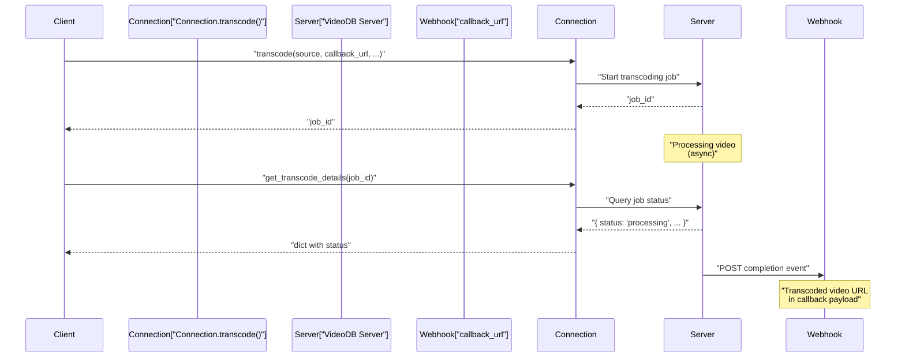
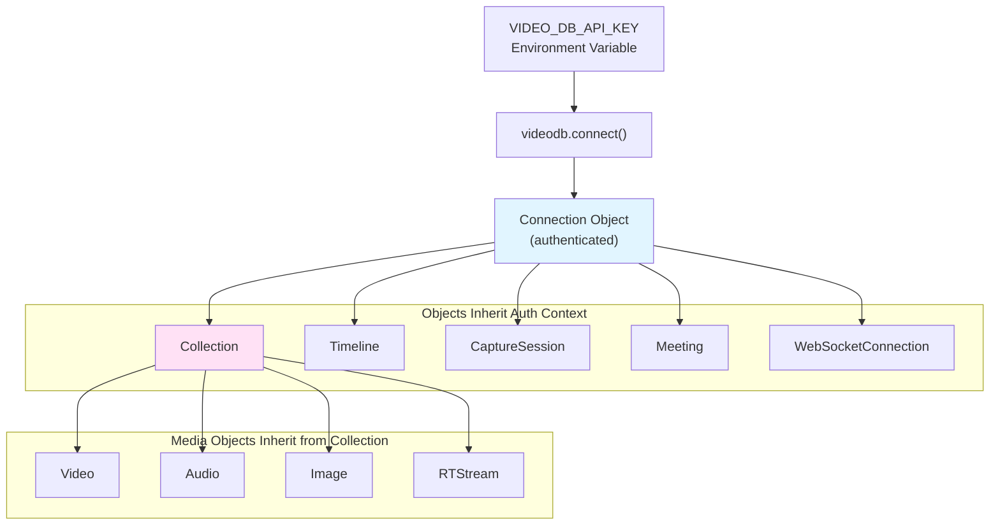

<!-- source: DeepWiki mcp.deepwiki.com · repo video-db/skills · page 15.1 Connection Methods · fetched 2026-10-26 -->

# Connection Methods

<details>
<summary>Relevant source files</summary>

The following files were used as context for generating this wiki page:

- [python/reference/api-reference.md](python/reference/api-reference.md)

</details>


## Purpose and Scope

This page documents all methods available on the `Connection` object, which serves as the root entry point for the VideoDB SDK. The `Connection` object is created by calling `videodb.connect()` and provides factory methods for collections, media upload, transcoding, capture sessions, and WebSocket connections.

For methods on `Collection`, `Video`, `Audio`, and `Image` objects, see sections [15.2](#15.2), [15.3](#15.3), and [15.4](#15.4). For `Timeline` and asset classes, see [15.5](#15.5). For capture and RTStream methods, see [15.7](#15.7).

---

## Creating a Connection

The `Connection` object is created by calling `videodb.connect()` with an API key:

```python
import videodb

conn = videodb.connect(
    api_key="your-api-key",      # Optional if VIDEO_DB_API_KEY env var is set
    base_url=None,                # Optional custom API endpoint
)
```

### Parameters

| Parameter | Type | Default | Description |
|-----------|------|---------|-------------|
| `api_key` | `str\|None` | `None` | API key for authentication. If `None`, reads from `VIDEO_DB_API_KEY` environment variable |
| `base_url` | `str\|None` | `None` | Custom API endpoint URL (rarely needed) |

**Returns:** `Connection` object

**Raises:** `AuthenticationError` if the API key is invalid or missing

Sources: [python/reference/api-reference.md:5-11]()

---

## Connection Object Method Hierarchy

```mermaid
graph TB
    Connect["videodb.connect()"]
    Connection["Connection Object"]
    
    subgraph "Collection Management"
        GetColl["get_collection()"]
        GetColls["get_collections()"]
        CreateColl["create_collection()"]
        UpdateColl["update_collection()"]
    end
    
    subgraph "Media Operations"
        Upload["upload()"]
        Transcode["transcode()"]
        TranscodeDetails["get_transcode_details()"]
        YouTubeSearch["youtube_search()"]
    end
    
    subgraph "Real-time Operations"
        CreateCapture["create_capture_session()"]
        RecordMeeting["record_meeting()"]
        ConnectWS["connect_websocket()"]
    end
    
    subgraph "Utilities"
        CheckUsage["check_usage()"]
    end
    
    subgraph "Return Types"
        CollObj["Collection"]
        MediaObj["Video | Audio | Image"]
        CaptureObj["CaptureSession"]
        MeetingObj["Meeting"]
        WSObj["WebSocketConnection"]
        JobID["job_id (str)"]
        UsageDict["dict"]
    end
    
    Connect --> Connection
    
    Connection --> GetColl
    Connection --> GetColls
    Connection --> CreateColl
    Connection --> UpdateColl
    
    Connection --> Upload
    Connection --> Transcode
    Connection --> TranscodeDetails
    Connection --> YouTubeSearch
    
    Connection --> CreateCapture
    Connection --> RecordMeeting
    Connection --> ConnectWS
    
    Connection --> CheckUsage
    
    GetColl --> CollObj
    GetColls --> CollObj
    CreateColl --> CollObj
    UpdateColl --> CollObj
    
    Upload --> MediaObj
    Transcode --> JobID
    TranscodeDetails --> UsageDict
    YouTubeSearch --> UsageDict
    
    CreateCapture --> CaptureObj
    RecordMeeting --> MeetingObj
    ConnectWS --> WSObj
    
    CheckUsage --> UsageDict
```



Sources: [python/reference/api-reference.md:16-31]()

---

## Collection Management Methods

### get_collection

Retrieve a collection by ID. If no ID is provided, returns the default collection.

```python
coll = conn.get_collection(collection_id="default")
```

**Parameters:**

| Parameter | Type | Default | Description |
|-----------|------|---------|-------------|
| `collection_id` | `str` | `"default"` | Collection ID to retrieve |

**Returns:** `Collection` object

---

### get_collections

List all collections accessible to the authenticated user.

```python
collections = conn.get_collections()
```

**Returns:** `list[Collection]`

---

### create_collection

Create a new collection with optional name, description, and visibility settings.

```python
coll = conn.create_collection(
    name="My Collection",
    description="Description text",
    is_public=False
)
```

**Parameters:**

| Parameter | Type | Default | Description |
|-----------|------|---------|-------------|
| `name` | `str` | required | Collection name |
| `description` | `str` | required | Collection description |
| `is_public` | `bool` | `False` | Whether collection is publicly accessible |

**Returns:** `Collection` object

---

### update_collection

Update an existing collection's name and description.

```python
coll = conn.update_collection(
    id="collection_id",
    name="New Name",
    description="New Description"
)
```

**Parameters:**

| Parameter | Type | Default | Description |
|-----------|------|---------|-------------|
| `id` | `str` | required | Collection ID to update |
| `name` | `str` | required | New collection name |
| `description` | `str` | required | New collection description |

**Returns:** `Collection` object

Sources: [python/reference/api-reference.md:18-23]()

---

## Media Upload Methods

### upload

Upload media (video, audio, or image) directly to the default collection. For uploads to specific collections, use `collection.upload()` instead (see [15.2](#15.2)).

```python
# Upload from URL
video = conn.upload(
    source="https://example.com/video.mp4",
    media_type="video",
    name="My Video"
)

# Upload from local file
video = conn.upload(
    source="/path/to/file.mp4",
    media_type="video",
    name="Local Video"
)

# Upload YouTube video
video = conn.upload(
    source="https://youtube.com/watch?v=...",
    media_type="video"
)
```

**Parameters:**

| Parameter | Type | Default | Description |
|-----------|------|---------|-------------|
| `source` | `str` | required | URL or local file path |
| `media_type` | `str\|None` | `None` | `"video"`, `"audio"`, or `"image"` (auto-detected if omitted) |
| `name` | `str\|None` | `None` | Custom name for the media |

**Returns:** `Video`, `Audio`, or `Image` object depending on `media_type`

Sources: [python/reference/api-reference.md:25]()

---

## Transcoding Methods

The transcoding methods allow server-side video processing with custom resolution, quality, and audio settings. Transcoding is asynchronous and uses a callback URL for completion notification.

### transcode

Start a transcoding job for a video URL.

```python
from videodb import TranscodeMode, VideoConfig, AudioConfig

job_id = conn.transcode(
    source="https://example.com/video.mp4",
    callback_url="https://example.com/webhook",
    mode=TranscodeMode.economy,
    video_config=VideoConfig(resolution=720, quality=23),
    audio_config=AudioConfig(mute=False),
)
```

**Parameters:**

| Parameter | Type | Default | Description |
|-----------|------|---------|-------------|
| `source` | `str` | required | URL of the video to transcode (must be downloadable) |
| `callback_url` | `str` | required | Webhook URL to receive completion notification |
| `mode` | `TranscodeMode` | `TranscodeMode.economy` | `TranscodeMode.economy` or `TranscodeMode.lightning` |
| `video_config` | `VideoConfig` | `VideoConfig()` | Video encoding configuration |
| `audio_config` | `AudioConfig` | `AudioConfig()` | Audio encoding configuration |

**Returns:** `str` (job ID)

---

### get_transcode_details

Retrieve the status and details of a transcoding job.

```python
details = conn.get_transcode_details(job_id)
```

**Parameters:**

| Parameter | Type | Default | Description |
|-----------|------|---------|-------------|
| `job_id` | `str` | required | Job ID returned by `transcode()` |

**Returns:** `dict` containing job status, progress, and output details

Sources: [python/reference/api-reference.md:29-30, 33-63]()

---

## Transcode Configuration Objects

### VideoConfig

Configuration for video encoding parameters.

```python
from videodb import VideoConfig, ResizeMode

config = VideoConfig(
    resolution=720,              # Target resolution height (e.g. 480, 720, 1080)
    quality=23,                  # Encoding quality (lower = better, default 23)
    framerate=30,                # Target framerate
    aspect_ratio="16:9",         # Target aspect ratio
    resize_mode=ResizeMode.crop, # How to fit: crop, fit, or pad
)
```

**VideoConfig Fields:**

| Field | Type | Default | Description |
|-------|------|---------|-------------|
| `resolution` | `int\|None` | `None` | Target resolution height in pixels |
| `quality` | `int` | `23` | Encoding quality (lower = higher quality, range typically 0-51) |
| `framerate` | `int\|None` | `None` | Target framerate (e.g. 24, 30, 60) |
| `aspect_ratio` | `str\|None` | `None` | Target aspect ratio (e.g. `"16:9"`, `"9:16"`, `"1:1"`) |
| `resize_mode` | `ResizeMode` | `ResizeMode.crop` | `ResizeMode.crop`, `ResizeMode.fit`, or `ResizeMode.pad` |

---

### AudioConfig

Configuration for audio encoding parameters.

```python
from videodb import AudioConfig

config = AudioConfig(mute=False)
```

**AudioConfig Fields:**

| Field | Type | Default | Description |
|-------|------|---------|-------------|
| `mute` | `bool` | `False` | Whether to mute the audio track completely |

Sources: [python/reference/api-reference.md:65-97]()

---

## Transcode Workflow Diagram



Sources: [python/reference/api-reference.md:33-63]()

---

## Real-time Operations

### create_capture_session

Create a desktop capture session for recording screen and audio. See [15.7](#15.7) for full `CaptureSession` API details.

```python
capture = conn.create_capture_session(
    session_name="My Session",
    collection_id=None,  # Uses default collection if None
)
```

**Parameters:**

| Parameter | Type | Default | Description |
|-----------|------|---------|-------------|
| `session_name` | `str` | required | Name for the capture session |
| `collection_id` | `str\|None` | `None` | Target collection ID (uses default if `None`) |

**Returns:** `CaptureSession` object

For detailed capture workflow documentation, see [8. Desktop Capture](#8).

---

### record_meeting

Record a live meeting from Zoom, Google Meet, or Microsoft Teams by joining with a bot.

```python
meeting = conn.record_meeting(
    meeting_url="https://meet.google.com/...",
    bot_name="Recorder Bot",
    callback_url=None,
    callback_data=None,
    time_zone="UTC",
)
```

**Parameters:**

| Parameter | Type | Default | Description |
|-----------|------|---------|-------------|
| `meeting_url` | `str` | required | Meeting URL (Zoom, Meet, Teams) |
| `bot_name` | `str` | required | Display name for the recording bot |
| `callback_url` | `str\|None` | `None` | Webhook URL for status updates |
| `callback_data` | `dict\|None` | `None` | Custom data passed through to callbacks |
| `time_zone` | `str` | `"UTC"` | Time zone for the meeting |

**Returns:** `Meeting` object

For meeting bot use cases, see [12.3 Meeting Recording and Analysis](#12.3).

---

### connect_websocket

Establish a WebSocket connection for receiving real-time events from capture sessions or RTStreams.

```python
ws = conn.connect_websocket(collection_id="collection_id")
```

**Parameters:**

| Parameter | Type | Default | Description |
|-----------|------|---------|-------------|
| `collection_id` | `str` | required | Collection ID for WebSocket connection scope |

**Returns:** `WebSocketConnection` object

For WebSocket event handling, see [13. WebSocket Listener](#13) and [8.3 Capture Events](#8.3).

Sources: [python/reference/api-reference.md:27-28, 31]()

---

## Utility Methods

### check_usage

Retrieve account usage statistics, including storage, processing time, and quota limits.

```python
usage = conn.check_usage()
```

**Returns:** `dict` with usage statistics

---

### youtube_search

Search YouTube for videos matching a query. Useful for finding content to upload and process.

```python
results = conn.youtube_search(
    query="machine learning tutorial",
    result_threshold=10,
    duration="medium"
)
```

**Parameters:**

| Parameter | Type | Default | Description |
|-----------|------|---------|-------------|
| `query` | `str` | required | Search query string |
| `result_threshold` | `int` | required | Maximum number of results to return |
| `duration` | `str` | required | Duration filter: `"short"`, `"medium"`, or `"long"` |

**Returns:** `list[dict]` with YouTube video metadata (title, URL, duration, etc.)

Sources: [python/reference/api-reference.md:24, 28]()

---

## Connection Method Reference Table

| Method | Returns | Description |
|--------|---------|-------------|
| `conn.get_collection(collection_id="default")` | `Collection` | Get collection (default if no ID) |
| `conn.get_collections()` | `list[Collection]` | List all collections |
| `conn.create_collection(name, description, is_public=False)` | `Collection` | Create new collection |
| `conn.update_collection(id, name, description)` | `Collection` | Update a collection |
| `conn.check_usage()` | `dict` | Get account usage stats |
| `conn.upload(source, media_type, name)` | `Video\|Audio\|Image` | Upload to default collection |
| `conn.record_meeting(meeting_url, bot_name, ...)` | `Meeting` | Record a meeting |
| `conn.create_capture_session(...)` | `CaptureSession` | Create a capture session |
| `conn.youtube_search(query, result_threshold, duration)` | `list[dict]` | Search YouTube |
| `conn.transcode(source, callback_url, mode, ...)` | `str` | Transcode video (returns job ID) |
| `conn.get_transcode_details(job_id)` | `dict` | Get transcode job status and details |
| `conn.connect_websocket(collection_id)` | `WebSocketConnection` | Connect to WebSocket |

Sources: [python/reference/api-reference.md:18-31]()

---

## Authentication Context

The `Connection` object created by `videodb.connect()` carries authentication context that is automatically inherited by all objects created from it (`Collection`, `CaptureSession`, `Timeline`, etc.). This means you never need to manually pass API keys to individual operations—authentication is handled transparently.



Sources: [python/reference/api-reference.md:5-14]()

---

## Error Handling

All `Connection` methods may raise the following exceptions:

| Exception | Condition |
|-----------|-----------|
| `AuthenticationError` | Invalid or missing API key |
| `InvalidRequestError` | Invalid parameters or malformed request |
| `RequestTimeoutError` | Server took too long to respond |
| `VideodbError` | Generic server or network errors |

For comprehensive error handling patterns, see [14. Error Handling](#14).

Sources: [python/reference/api-reference.md:532-548]()

---

