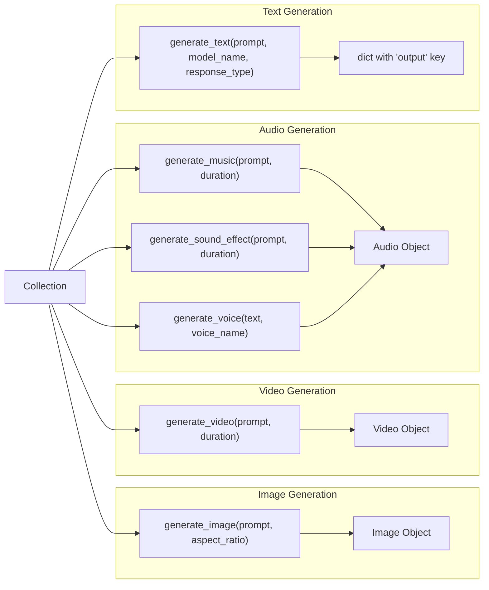
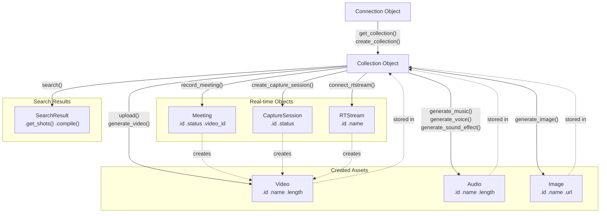

<!-- source: DeepWiki mcp.deepwiki.com · repo video-db/skills · page 15.2 Collection Methods · fetched 2026-10-26 -->

# Collection Methods

<details>
<summary>Relevant source files</summary>

The following files were used as context for generating this wiki page:

- [python/reference/api-reference.md](python/reference/api-reference.md)

</details>


This page documents all methods available on the `Collection` object. Collections serve as containers for media assets (videos, audio, images) and provide factory methods for AI generation, search, and real-time operations.

For information about retrieving collections, see [Connection Methods](#15.1). For methods specific to individual media assets, see [Video Methods](#15.3) and [Audio and Image Methods](#15.4). For real-time stream operations, see [Capture and RTStream Classes](#15.7).

---

## Overview

The `Collection` object is obtained via `Connection.get_collection()` or `Connection.create_collection()`. It provides:

- **Media retrieval and management** — Get, upload, and delete videos, audio, and images
- **Cross-collection search** — Semantic search across all videos in the collection
- **AI generation** — Create images, videos, music, voice, and text
- **Dubbing** — Translate and dub videos into other languages
- **Real-time operations** — Desktop capture, live streams, and meeting recording
- **Collection-level settings** — Public/private visibility control

Sources: [python/reference/api-reference.md:99-134]()

---

## Method Categories

```mermaid
graph TB
    Collection["Collection Object"]
    
    subgraph "Media Retrieval"
        GetVideos["get_videos()<br/>→ list[Video]"]
        GetVideo["get_video(video_id)<br/>→ Video"]
        GetAudios["get_audios()<br/>→ list[Audio]"]
        GetAudio["get_audio(audio_id)<br/>→ Audio"]
        GetImages["get_images()<br/>→ list[Image]"]
        GetImage["get_image(image_id)<br/>→ Image"]
    end
    
    subgraph "Upload & Delete"
        Upload["upload(url, file_path, media_type)<br/>→ Video|Audio|Image"]
        DeleteVideo["delete_video(video_id)<br/>→ None"]
        DeleteAudio["delete_audio(audio_id)<br/>→ None"]
        DeleteImage["delete_image(image_id)<br/>→ None"]
    end
    
    subgraph "Search"
        Search["search(query, search_type)<br/>→ SearchResult"]
    end
    
    subgraph "AI Generation"
        GenImage["generate_image(prompt, aspect_ratio)<br/>→ Image"]
        GenVideo["generate_video(prompt, duration)<br/>→ Video"]
        GenMusic["generate_music(prompt, duration)<br/>→ Audio"]
        GenSoundEffect["generate_sound_effect(prompt, duration)<br/>→ Audio"]
        GenVoice["generate_voice(text, voice_name)<br/>→ Audio"]
        GenText["generate_text(prompt, model_name)<br/>→ dict"]
    end
    
    subgraph "Dubbing"
        DubVideo["dub_video(video_id, language_code)<br/>→ Video"]
    end
    
    subgraph "Real-time"
        RecordMeeting["record_meeting(meeting_url, bot_name)<br/>→ Meeting"]
        CreateCapture["create_capture_session(...)<br/>→ CaptureSession"]
        GetCapture["get_capture_session(...)<br/>→ CaptureSession"]
        ConnectRTStream["connect_rtstream(url, name)<br/>→ RTStream"]
    end
    
    subgraph "Collection Management"
        MakePublic["make_public()<br/>→ None"]
        MakePrivate["make_private()<br/>→ None"]
        Delete["delete()<br/>→ None"]
    end
    
    Collection --> GetVideos
    Collection --> GetVideo
    Collection --> GetAudios
    Collection --> GetAudio
    Collection --> GetImages
    Collection --> GetImage
    Collection --> Upload
    Collection --> DeleteVideo
    Collection --> DeleteAudio
    Collection --> DeleteImage
    Collection --> Search
    Collection --> GenImage
    Collection --> GenVideo
    Collection --> GenMusic
    Collection --> GenSoundEffect
    Collection --> GenVoice
    Collection --> GenText
    Collection --> DubVideo
    Collection --> RecordMeeting
    Collection --> CreateCapture
    Collection --> GetCapture
    Collection --> ConnectRTStream
    Collection --> MakePublic
    Collection --> MakePrivate
    Collection --> Delete
```

**Collection Method Categories**

This diagram maps all `Collection` methods to their return types. The `Collection` object acts as a factory for creating media assets and initiating real-time operations while managing existing assets through retrieval and deletion methods.

Sources: [python/reference/api-reference.md:99-134]()

---

## Media Retrieval Methods

These methods retrieve existing media assets from the collection.

### get_videos()

Returns all videos in the collection.

```python
videos = coll.get_videos()
```

**Returns:** `list[Video]`

### get_video(video_id)

Retrieves a specific video by ID.

```python
video = coll.get_video("video_id_here")
```

| Parameter | Type | Description |
|-----------|------|-------------|
| `video_id` | `str` | Unique video identifier |

**Returns:** `Video` object

### get_audios()

Returns all audio assets in the collection.

```python
audios = coll.get_audios()
```

**Returns:** `list[Audio]`

### get_audio(audio_id)

Retrieves a specific audio asset by ID.

```python
audio = coll.get_audio("audio_id_here")
```

| Parameter | Type | Description |
|-----------|------|-------------|
| `audio_id` | `str` | Unique audio identifier |

**Returns:** `Audio` object

### get_images()

Returns all images in the collection.

```python
images = coll.get_images()
```

**Returns:** `list[Image]`

### get_image(image_id)

Retrieves a specific image by ID.

```python
image = coll.get_image("image_id_here")
```

| Parameter | Type | Description |
|-----------|------|-------------|
| `image_id` | `str` | Unique image identifier |

**Returns:** `Image` object

Sources: [python/reference/api-reference.md:105-114]()

---

## upload()

Uploads media from URLs, YouTube links, or local files to the collection.

```python
video = coll.upload(
    url="https://example.com/video.mp4",
    media_type="video",
    name="My Video",
)

# Or upload from local file
video = coll.upload(
    file_path="/path/to/video.mp4",
    name="Local Video",
)

# YouTube upload
video = coll.upload(
    url="https://www.youtube.com/watch?v=...",
)
```

### Parameters

| Parameter | Type | Default | Description |
|-----------|------|---------|-------------|
| `url` | `str\|None` | `None` | Remote URL (HTTP, HTTPS, YouTube) |
| `file_path` | `str\|None` | `None` | Local file path |
| `media_type` | `str\|None` | `None` | `"video"`, `"audio"`, or `"image"` (auto-detected if omitted) |
| `name` | `str\|None` | `None` | Custom name for the media asset |
| `description` | `str\|None` | `None` | Description metadata |
| `callback_url` | `str\|None` | `None` | Webhook URL for async notification when upload completes |

**Returns:** `Video`, `Audio`, or `Image` object depending on the uploaded media type.

**Note:** Either `url` or `file_path` must be provided. If both are provided, `url` takes precedence. The `media_type` is auto-detected from file extension or MIME type if not specified.

Sources: [python/reference/api-reference.md:115, 135-146]()

---

## search()

Performs semantic search across all videos in the collection. Returns matching segments from any video.

```python
from videodb import SearchType, IndexType

results = coll.search(
    query="discussion about AI",
    search_type=SearchType.semantic,
    index_type=IndexType.spoken_word,
    score_threshold=0.5,
)

shots = results.get_shots()
compiled_url = results.compile()
```

### Parameters

| Parameter | Type | Default | Description |
|-----------|------|---------|-------------|
| `query` | `str` | required | Natural language search query |
| `search_type` | `SearchType` | `SearchType.semantic` | Must be `SearchType.semantic` |
| `index_type` | `IndexType` | `IndexType.spoken_word` | `IndexType.spoken_word` or `IndexType.scene` |
| `score_threshold` | `float\|None` | `None` | Minimum relevance score (0.0-1.0) |
| `namespace` | `str\|None` | `None` | Filter results to specific namespace |
| `scene_index_id` | `str\|None` | `None` | Target specific scene index (pass via `**kwargs`) |

**Returns:** `SearchResult` object containing matched shots from all videos in the collection.

**Important:** Only `SearchType.semantic` is supported for collection-level search. Keyword and scene search raise `NotImplementedError`. For those search types, use `video.search()` on individual videos (see [Video Methods](#15.3)).

Sources: [python/reference/api-reference.md:116]()

---

## AI Generation Methods

Collection provides factory methods for creating new media assets using generative AI.



**AI Generation Method Flow**

All generation methods are asynchronous operations that create new media assets in the collection. Generated assets have unique IDs and can be used in timelines or other operations immediately after creation.

Sources: [python/reference/api-reference.md:117-123]()

### generate_image()

Generates an image from a text prompt using AI.

```python
image = coll.generate_image(
    prompt="A serene mountain landscape at sunset",
    aspect_ratio="16:9",
)
```

| Parameter | Type | Default | Description |
|-----------|------|---------|-------------|
| `prompt` | `str` | required | Text description of the desired image |
| `aspect_ratio` | `str` | `"1:1"` | `"1:1"`, `"16:9"`, `"9:16"`, `"4:3"`, or `"3:4"` |

**Returns:** `Image` object

### generate_video()

Generates a video clip from a text prompt using AI.

```python
video = coll.generate_video(
    prompt="Waves crashing on a beach at sunrise",
    duration=5,
)
```

| Parameter | Type | Default | Description |
|-----------|------|---------|-------------|
| `prompt` | `str` | required | Text description of the desired video |
| `duration` | `int` | `5` | Video length in seconds |

**Returns:** `Video` object

### generate_music()

Generates background music from a text prompt.

```python
audio = coll.generate_music(
    prompt="Upbeat electronic music with drums",
    duration=30,
)
```

| Parameter | Type | Default | Description |
|-----------|------|---------|-------------|
| `prompt` | `str` | required | Description of the desired music style |
| `duration` | `int` | `5` | Audio length in seconds |

**Returns:** `Audio` object

### generate_sound_effect()

Generates a sound effect from a text prompt.

```python
audio = coll.generate_sound_effect(
    prompt="Door creaking open",
    duration=2,
)
```

| Parameter | Type | Default | Description |
|-----------|------|---------|-------------|
| `prompt` | `str` | required | Description of the sound effect |
| `duration` | `int` | `2` | Audio length in seconds |

**Returns:** `Audio` object

### generate_voice()

Generates speech from text using text-to-speech.

```python
audio = coll.generate_voice(
    text="Hello, this is a test of the voice generation system.",
    voice_name="Default",
)
```

| Parameter | Type | Default | Description |
|-----------|------|---------|-------------|
| `text` | `str` | required | Text to convert to speech |
| `voice_name` | `str` | `"Default"` | Voice profile name |

**Returns:** `Audio` object

### generate_text()

Generates text using a large language model (LLM).

```python
result = coll.generate_text(
    prompt="Summarize the key points from this meeting",
    model_name="basic",
    response_type="text",
)

text = result["output"]
```

| Parameter | Type | Default | Description |
|-----------|------|---------|-------------|
| `prompt` | `str` | required | Text prompt for the LLM |
| `model_name` | `str` | `"basic"` | Model tier: `"basic"`, `"advanced"`, or `"premium"` |
| `response_type` | `str` | `"text"` | Expected response format |

**Returns:** `dict` with `"output"` key containing the generated text.

**Note:** Access the result via `result["output"]`, not directly from the return value.

Sources: [python/reference/api-reference.md:117-123]()

---

## dub_video()

Creates a dubbed version of a video in a different language, replacing the original audio with AI-generated speech.

```python
dubbed_video = coll.dub_video(
    video_id="original_video_id",
    language_code="es",  # Spanish
)
```

| Parameter | Type | Description |
|-----------|------|-------------|
| `video_id` | `str` | ID of the video to dub |
| `language_code` | `str` | Target language code (e.g., `"es"`, `"fr"`, `"de"`) |

**Returns:** `Video` object containing the dubbed version

**Note:** The original video is transcribed, translated, and re-vocalized in the target language. The returned video is a new asset with a different ID.

Sources: [python/reference/api-reference.md:123]()

---

## Real-time Operation Methods

These methods create and manage real-time data sources: desktop capture sessions, live streams, and meeting recordings.

### record_meeting()

Joins a video conference (Zoom, Google Meet, Microsoft Teams) as a bot to record the session.

```python
meeting = coll.record_meeting(
    meeting_url="https://meet.google.com/...",
    bot_name="Recorder Bot",
    callback_url="https://example.com/webhook",
)
```

| Parameter | Type | Default | Description |
|-----------|------|---------|-------------|
| `meeting_url` | `str` | required | Join URL for the meeting |
| `bot_name` | `str` | required | Display name for the recording bot |
| `callback_url` | `str\|None` | `None` | Webhook URL for status updates |
| `callback_data` | `dict\|None` | `None` | Custom data passed through to callbacks |
| `time_zone` | `str` | `"UTC"` | Time zone for the meeting |

**Returns:** `Meeting` object for tracking recording status

For detailed meeting recording documentation, see [Meeting Recording and Analysis](#12.3).

### create_capture_session()

Creates a desktop capture session for recording screen, microphone, and system audio.

```python
session = coll.create_capture_session(
    name="Recording Session",
    description="Desktop capture with live AI processing",
)
```

**Returns:** `CaptureSession` object

For complete capture workflow documentation, see [Desktop Capture](#8) and [Capture and RTStream Classes](#15.7).

### get_capture_session()

Retrieves an existing capture session by ID.

```python
session = coll.get_capture_session(session_id="session_id_here")
```

**Returns:** `CaptureSession` object

### connect_rtstream()

Connects to an RTSP or RTMP live stream for real-time ingestion and AI processing.

```python
rtstream = coll.connect_rtstream(
    url="rtsp://camera.example.com/stream",
    name="Security Camera 1",
)
```

| Parameter | Type | Description |
|-----------|------|-------------|
| `url` | `str` | RTSP or RTMP stream URL |
| `name` | `str` | Display name for the stream |

**Returns:** `RTStream` object

For live stream AI processing and event detection, see [Live Stream Processing](#9) and [Capture and RTStream Classes](#15.7).

Sources: [python/reference/api-reference.md:124-127]()

---

## Collection Management Methods

### make_public()

Makes the collection publicly accessible. Anyone with the collection ID can view its contents.

```python
coll.make_public()
```

**Returns:** `None`

### make_private()

Makes the collection private. Only the owner can access it.

```python
coll.make_private()
```

**Returns:** `None`

### Delete Methods

#### delete_video(video_id)

Deletes a specific video from the collection.

```python
coll.delete_video("video_id_here")
```

**Returns:** `None`

#### delete_audio(audio_id)

Deletes a specific audio asset from the collection.

```python
coll.delete_audio("audio_id_here")
```

**Returns:** `None`

#### delete_image(image_id)

Deletes a specific image from the collection.

```python
coll.delete_image("image_id_here")
```

**Returns:** `None`

#### delete()

Deletes the entire collection and all its contents.

```python
coll.delete()
```

**Returns:** `None`

**Warning:** This operation is irreversible. All videos, audio, images, and metadata in the collection will be permanently deleted.

Sources: [python/reference/api-reference.md:128-134]()

---

## Method Reference Table

| Method | Returns | Category | Description |
|--------|---------|----------|-------------|
| `get_videos()` | `list[Video]` | Retrieval | List all videos |
| `get_video(video_id)` | `Video` | Retrieval | Get specific video |
| `get_audios()` | `list[Audio]` | Retrieval | List all audios |
| `get_audio(audio_id)` | `Audio` | Retrieval | Get specific audio |
| `get_images()` | `list[Image]` | Retrieval | List all images |
| `get_image(image_id)` | `Image` | Retrieval | Get specific image |
| `upload(...)` | `Video\|Audio\|Image` | Upload | Upload media from URL or file |
| `search(...)` | `SearchResult` | Search | Semantic search across collection |
| `generate_image(...)` | `Image` | AI Generation | Generate image from prompt |
| `generate_video(...)` | `Video` | AI Generation | Generate video from prompt |
| `generate_music(...)` | `Audio` | AI Generation | Generate music from prompt |
| `generate_sound_effect(...)` | `Audio` | AI Generation | Generate sound effect |
| `generate_voice(...)` | `Audio` | AI Generation | Text-to-speech |
| `generate_text(...)` | `dict` | AI Generation | LLM text generation |
| `dub_video(...)` | `Video` | Dubbing | Translate and dub video |
| `record_meeting(...)` | `Meeting` | Real-time | Join and record meeting |
| `create_capture_session(...)` | `CaptureSession` | Real-time | Create desktop capture session |
| `get_capture_session(...)` | `CaptureSession` | Real-time | Retrieve capture session |
| `connect_rtstream(...)` | `RTStream` | Real-time | Connect to live stream |
| `make_public()` | `None` | Management | Make collection public |
| `make_private()` | `None` | Management | Make collection private |
| `delete_video(video_id)` | `None` | Delete | Delete specific video |
| `delete_audio(audio_id)` | `None` | Delete | Delete specific audio |
| `delete_image(image_id)` | `None` | Delete | Delete specific image |
| `delete()` | `None` | Delete | Delete entire collection |

Sources: [python/reference/api-reference.md:99-134]()

---

## Collection as Factory Pattern



**Collection Factory Pattern**

The `Collection` object acts as a factory that creates and manages media assets. Upload and generation methods return media objects that are automatically stored in the collection. Real-time operations (meeting, capture, rtstream) create server-side sessions that eventually export to permanent `Video` objects. Search operates across all videos in the collection, returning `SearchResult` objects containing matched segments.

Sources: [python/reference/api-reference.md:99-134]()

---

