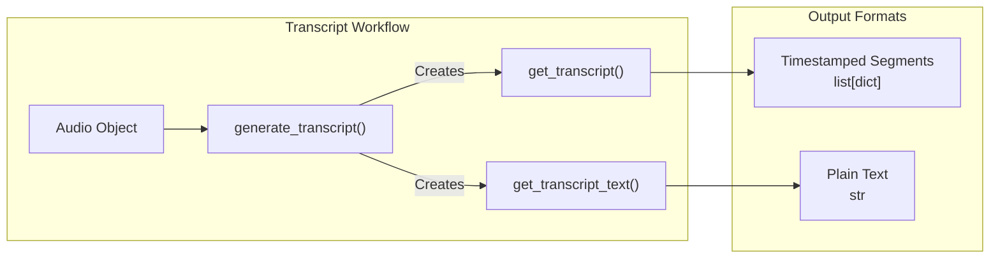
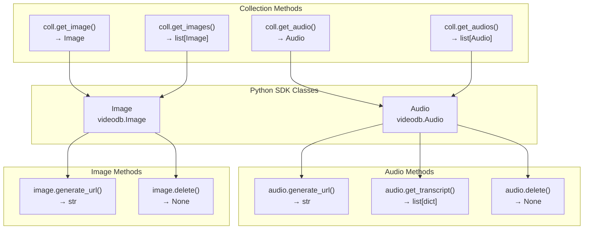

<!-- source: DeepWiki mcp.deepwiki.com · repo video-db/skills · page 15.4 Audio and Image Methods · fetched 2026-10-26 -->

# Audio and Image Methods

<details>
<summary>Relevant source files</summary>

The following files were used as context for generating this wiki page:

- [python/reference/api-reference.md](python/reference/api-reference.md)

</details>


## Purpose and Scope

This page documents the methods and properties available on `Audio` and `Image` objects in the VideoDB SDK. These objects represent media assets stored in collections: audio files (music, sound effects, voice recordings) and image files (photos, generated images, thumbnails).

For uploading media, see [Media Management](#4). For generating audio and images with AI, see [AI Media Generation](#11). For using these assets in timeline compositions, see [Timeline and Asset Classes](#15.5). For video-specific methods, see [Video Methods](#15.3).

---

## Audio Object Overview

The `Audio` object represents an audio asset stored in a collection. Audio can be uploaded from URLs or local files, generated using AI (music, sound effects, voice synthesis), or extracted from video sources.

### Retrieving Audio Objects

Audio objects are retrieved from a `Collection`:

```python
# Get specific audio by ID
audio = coll.get_audio(audio_id="aud_123")

# List all audios in collection
audios = coll.get_audios()
```

**Sources:** [python/reference/api-reference.md:109-112]()

---

## Audio Properties

| Property | Type | Description |
|----------|------|-------------|
| `audio.id` | `str` | Unique audio identifier |
| `audio.collection_id` | `str` | Parent collection ID |
| `audio.name` | `str` | Audio asset name |
| `audio.length` | `float` | Duration in seconds |

**Sources:** [python/reference/api-reference.md:229-236]()

---

## Audio Methods

### generate_url()

Generates a signed URL for direct playback of the audio asset. The URL is temporary and authenticated.

**Signature:**
```python
audio.generate_url() -> str
```

**Returns:** `str` - Signed URL for audio playback

**Example:**
```python
audio = coll.get_audio("aud_123")
playback_url = audio.generate_url()
# Use playback_url in audio player or download
```

**Sources:** [python/reference/api-reference.md:240-242]()

---

### Transcript Methods

Audio objects support transcription, enabling speech-to-text extraction with timestamps. These methods mirror the transcript functionality available on `Video` objects.

#### get_transcript()

Retrieves timestamped transcript segments for the audio.

**Signature:**
```python
audio.get_transcript(
    start: float | None = None,
    end: float | None = None
) -> list[dict]
```

**Parameters:**
| Parameter | Type | Default | Description |
|-----------|------|---------|-------------|
| `start` | `float \| None` | `None` | Start time in seconds (None = beginning) |
| `end` | `float \| None` | `None` | End time in seconds (None = end) |

**Returns:** `list[dict]` - List of transcript segments with `text`, `start`, and `end` timestamps

**Example:**
```python
# Get full transcript
segments = audio.get_transcript()

# Get transcript for specific time range
segments = audio.get_transcript(start=10.0, end=30.0)

# Each segment contains:
# [{"text": "Hello world", "start": 0.5, "end": 2.1}, ...]
```

---

#### get_transcript_text()

Retrieves the full transcript as plain text without timestamps.

**Signature:**
```python
audio.get_transcript_text(
    start: float | None = None,
    end: float | None = None
) -> str
```

**Parameters:**
| Parameter | Type | Default | Description |
|-----------|------|---------|-------------|
| `start` | `float \| None` | `None` | Start time in seconds |
| `end` | `float \| None` | `None` | End time in seconds |

**Returns:** `str` - Complete transcript text (concatenated, no timestamps)

**Example:**
```python
# Get full text
text = audio.get_transcript_text()

# Get text for specific range
text = audio.get_transcript_text(start=10.0, end=30.0)
```

---

#### generate_transcript()

Generates a transcript for the audio if one does not already exist. This operation is idempotent by default.

**Signature:**
```python
audio.generate_transcript(force: bool | None = None) -> dict
```

**Parameters:**
| Parameter | Type | Default | Description |
|-----------|------|---------|-------------|
| `force` | `bool \| None` | `None` | Force regeneration if transcript exists |

**Returns:** `dict` - Transcript metadata

**Example:**
```python
# Generate transcript if not exists
metadata = audio.generate_transcript()

# Force regeneration
metadata = audio.generate_transcript(force=True)
```

**Sources:** [python/reference/api-reference.md:240-245]()

---

### delete()

Permanently deletes the audio asset from the collection.

**Signature:**
```python
audio.delete() -> None
```

**Example:**
```python
audio = coll.get_audio("aud_123")
audio.delete()
# audio object is now invalid
```

**Sources:** [python/reference/api-reference.md:246]()

---

## Audio Object Diagram

```mermaid
graph TB
    subgraph "Collection"
        Collection["Collection"]
    end
    
    subgraph "Audio Object"
        Audio["Audio<br/>.id, .name, .length"]
    end
    
    subgraph "Audio Methods"
        GenerateURL["generate_url()<br/>→ str"]
        GetTranscript["get_transcript()<br/>→ list[dict]"]
        GetTranscriptText["get_transcript_text()<br/>→ str"]
        GenerateTranscript["generate_transcript()<br/>→ dict"]
        Delete["delete()<br/>→ None"]
    end
    
    subgraph "External Systems"
        CDN["Signed URL<br/>Playback System"]
        TranscriptEngine["Speech-to-Text<br/>Engine"]
    end
    
    Collection -->|"get_audio(audio_id)"| Audio
    Collection -->|"get_audios()"| Audio
    
    Audio --> GenerateURL
    Audio --> GetTranscript
    Audio --> GetTranscriptText
    Audio --> GenerateTranscript
    Audio --> Delete
    
    GenerateURL --> CDN
    GetTranscript --> TranscriptEngine
    GetTranscriptText --> TranscriptEngine
    GenerateTranscript --> TranscriptEngine
```

**Sources:** [python/reference/api-reference.md:223-246]()

---

## Image Object Overview

The `Image` object represents an image asset stored in a collection. Images can be uploaded from URLs or local files, generated using AI prompts, or extracted as thumbnails from videos.

### Retrieving Image Objects

Image objects are retrieved from a `Collection`:

```python
# Get specific image by ID
image = coll.get_image(image_id="img_123")

# List all images in collection
images = coll.get_images()
```

**Sources:** [python/reference/api-reference.md:113-114]()

---

## Image Properties

| Property | Type | Description |
|----------|------|-------------|
| `image.id` | `str` | Unique image identifier |
| `image.collection_id` | `str` | Parent collection ID |
| `image.name` | `str` | Image asset name |
| `image.url` | `str \| None` | Image URL (may be `None` for generated images) |

**Note:** For AI-generated images, the `url` property may be `None`. Always use `generate_url()` for reliable URL access.

**Sources:** [python/reference/api-reference.md:256-261]()

---

## Image Methods

### generate_url()

Generates a signed URL for accessing the image. This method should always be used for AI-generated images where the `url` property may be `None`.

**Signature:**
```python
image.generate_url() -> str
```

**Returns:** `str` - Signed URL for image access

**Example:**
```python
# For uploaded images
image = coll.get_image("img_123")
url = image.generate_url()

# For AI-generated images (url property may be None)
image = coll.generate_image(prompt="sunset over mountains")
url = image.generate_url()  # Required for generated images
```

**Sources:** [python/reference/api-reference.md:265-267]()

---

### delete()

Permanently deletes the image asset from the collection.

**Signature:**
```python
image.delete() -> None
```

**Example:**
```python
image = coll.get_image("img_123")
image.delete()
# image object is now invalid
```

**Sources:** [python/reference/api-reference.md:268]()

---

## Image Object Diagram

```mermaid
graph TB
    subgraph "Collection"
        Collection["Collection"]
    end
    
    subgraph "Image Object"
        Image["Image<br/>.id, .name, .url"]
    end
    
    subgraph "Image Methods"
        GenerateURL["generate_url()<br/>→ str"]
        Delete["delete()<br/>→ None"]
    end
    
    subgraph "Image Sources"
        Upload["Uploaded Image"]
        Generated["AI Generated"]
        Thumbnail["Video Thumbnail"]
    end
    
    subgraph "External Systems"
        CDN["Signed URL<br/>Image CDN"]
    end
    
    Upload --> Image
    Generated --> Image
    Thumbnail --> Image
    
    Collection -->|"get_image(image_id)"| Image
    Collection -->|"get_images()"| Image
    
    Image --> GenerateURL
    Image --> Delete
    
    GenerateURL --> CDN
```

**Sources:** [python/reference/api-reference.md:248-268]()

---

## Common Patterns and Usage

### URL Generation for Playback

Both `Audio` and `Image` objects provide `generate_url()` for obtaining authenticated URLs. These URLs are signed and temporary, suitable for embedding in web applications or downloading.

**Pattern:**
```python
# Audio playback
audio = coll.get_audio("aud_123")
audio_url = audio.generate_url()
# Use in <audio> tag or media player

# Image display
image = coll.get_image("img_123")
image_url = image.generate_url()
# Use in  tag or download
```

---

### Transcript Extraction Workflow

Audio objects support the same transcript methods as Video objects, enabling consistent speech-to-text workflows across media types.



**Example:**
```python
# Generate transcript for voice recording
audio = coll.get_audio("voice_memo_123")
audio.generate_transcript()

# Extract segments for UI display
segments = audio.get_transcript()
for seg in segments:
    print(f"{seg['start']:.2f}s: {seg['text']}")

# Extract full text for analysis
full_text = audio.get_transcript_text()
```

**Sources:** [python/reference/api-reference.md:240-245]()

---

### Asset Deletion

Both `Audio` and `Image` objects support permanent deletion via the `delete()` method. Deletion is immediate and irreversible.

**Considerations:**
- Deleted assets cannot be recovered
- References in timelines become invalid
- Stream URLs pointing to deleted assets will fail

**Example:**
```python
# Delete unused audio
audio = coll.get_audio("temp_audio")
audio.delete()

# Delete generated image after export
image = coll.generate_image(prompt="logo")
# ... use image in timeline ...
image.delete()  # Clean up after use
```

---

## Method Comparison Table

| Method | Audio | Image | Returns | Purpose |
|--------|-------|-------|---------|---------|
| `generate_url()` | ✓ | ✓ | `str` | Get signed playback/access URL |
| `get_transcript()` | ✓ | ✗ | `list[dict]` | Get timestamped transcript segments |
| `get_transcript_text()` | ✓ | ✗ | `str` | Get plain text transcript |
| `generate_transcript()` | ✓ | ✗ | `dict` | Create transcript if not exists |
| `delete()` | ✓ | ✓ | `None` | Permanently remove asset |

**Sources:** [python/reference/api-reference.md:240-268]()

---

## Integration with Timeline Editor

Both `Audio` and `Image` objects can be used in timeline compositions via their corresponding asset classes:

- **Audio** → `AudioAsset` - For background music, sound effects, voiceovers with fade controls
- **Image** → `ImageAsset` - For overlays, watermarks, static frames with positioning

**Example:**
```python
from videodb.timeline import Timeline
from videodb.asset import AudioAsset, ImageAsset

timeline = Timeline(conn)

# Add background music
audio = coll.get_audio("background_music")
audio_asset = AudioAsset(
    asset_id=audio.id,
    fade_in_duration=2,
    fade_out_duration=2
)
timeline.add_overlay(start=0, asset=audio_asset)

# Add watermark image
image = coll.get_image("watermark")
image_asset = ImageAsset(
    asset_id=image.id,
    x=10,
    y=10,
    width=100,
    height=50
)
timeline.add_overlay(start=0, asset=image_asset)

stream_url = timeline.generate_stream()
```

For full details on timeline usage, see [Timeline and Asset Classes](#15.5).

**Sources:** [python/reference/api-reference.md:300-328]()

---

## Code Entity Mapping



**Sources:** [python/reference/api-reference.md:223-268]()

---

