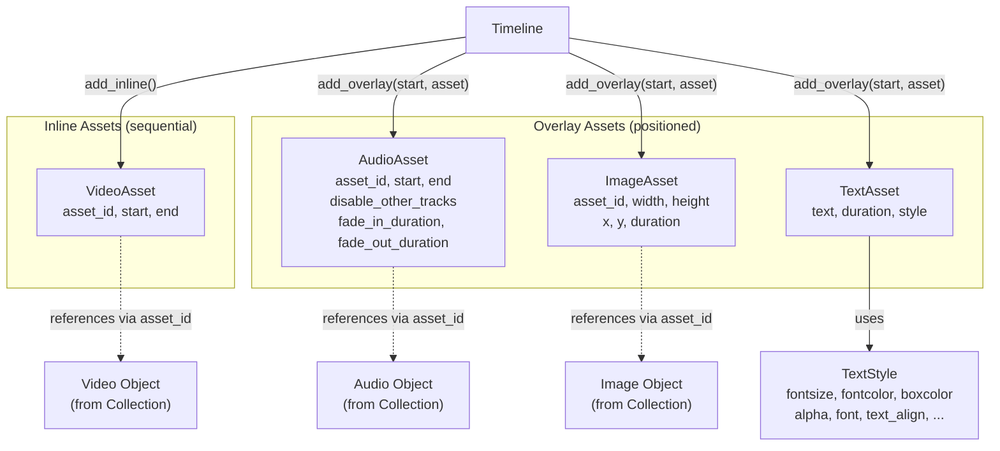
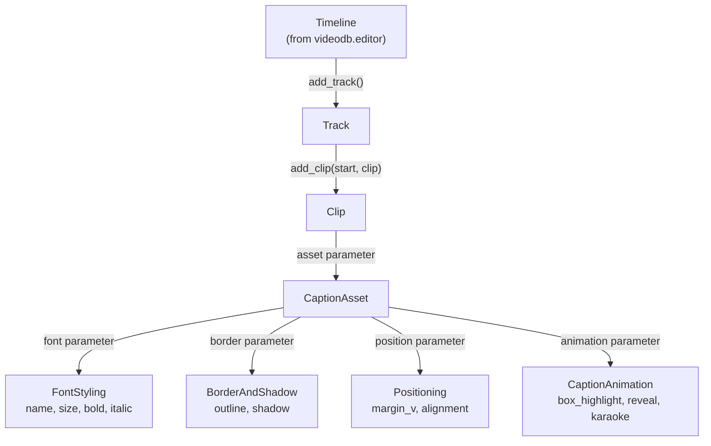

<!-- source: DeepWiki mcp.deepwiki.com · repo video-db/skills · page 15.5 Timeline and Asset Classes · fetched 2026-10-26 -->

# Timeline and Asset Classes

<details>
<summary>Relevant source files</summary>

The following files were used as context for generating this wiki page:

- [python/reference/api-reference.md](python/reference/api-reference.md)
- [python/reference/editor.md](python/reference/editor.md)

</details>


This page documents the class signatures and parameters for `Timeline` and all asset types used in timeline composition. For conceptual guidance on building timelines and complete workflow examples, see [Timeline Editing](#7).

This reference covers two separate timeline systems:
- **`videodb.timeline.Timeline`**: Main timeline API for video composition with `VideoAsset`, `AudioAsset`, `ImageAsset`, and `TextAsset`
- **`videodb.editor.Timeline`**: Editor API for advanced caption styling with `CaptionAsset`, `Clip`, and `Track`

For search result classes and indexing parameters, see [Search and Result Classes](#15.6). For capture and streaming classes, see [Capture and RTStream Classes](#15.7).

---

## Timeline Class

**Import:** `from videodb.timeline import Timeline`

**Initialization:**

```python
timeline = Timeline(conn)
```

| Parameter | Type | Description |
|-----------|------|-------------|
| `conn` | `Connection` | Connection object from `videodb.connect()` |

### Methods

| Method | Returns | Description |
|--------|---------|-------------|
| `add_inline(asset)` | `None` | Add `VideoAsset` sequentially to main track |
| `add_overlay(start, asset)` | `None` | Add `AudioAsset`, `ImageAsset`, or `TextAsset` at timestamp |
| `generate_stream()` | `str` | Compile timeline and return stream URL |

**Sources:** [python/reference/api-reference.md:270-284](), [python/reference/editor.md:9-21]()

---

## Asset Class Hierarchy



**Sources:** [python/reference/api-reference.md:270-346](), [python/reference/editor.md:20-31]()

---

## VideoAsset

**Import:** `from videodb.asset import VideoAsset`

Represents a video clip on the timeline. Used exclusively with `timeline.add_inline()` for sequential playback on the main track.

```python
asset = VideoAsset(
    asset_id=video.id,
    start=0,
    end=None,
)
```

### Parameters

| Parameter | Type | Default | Description |
|-----------|------|---------|-------------|
| `asset_id` | `str` | required | Video media ID (from `Video.id`) |
| `start` | `float` | `0` | Trim start time in seconds |
| `end` | `float\|None` | `None` | Trim end time in seconds (`None` = full video length) |

**Validation Notes:**
- The SDK does not validate negative timestamps. Passing `start=-5` is silently accepted but produces broken output.
- Always ensure: `start >= 0`, `start < end`, and `end <= video.length`.

**Sources:** [python/reference/api-reference.md:288-298](), [python/reference/editor.md:62-70]()

---

## AudioAsset

**Import:** `from videodb.asset import AudioAsset`

Represents an audio track overlay with fade controls. Used with `timeline.add_overlay(start, asset)` to layer music, sound effects, or narration.

```python
asset = AudioAsset(
    asset_id=audio.id,
    start=0,
    end=None,
    disable_other_tracks=True,
    fade_in_duration=0,
    fade_out_duration=0,
)
```

### Parameters

| Parameter | Type | Default | Description |
|-----------|------|---------|-------------|
| `asset_id` | `str` | required | Audio media ID (from `Audio.id`) |
| `start` | `float` | `0` | Trim start time in seconds |
| `end` | `float\|None` | `None` | Trim end time in seconds (`None` = full audio length) |
| `disable_other_tracks` | `bool` | `True` | When `True`, mutes all other audio tracks (including video audio) |
| `fade_in_duration` | `float` | `0` | Fade-in duration in seconds (maximum 5 seconds) |
| `fade_out_duration` | `float` | `0` | Fade-out duration in seconds (maximum 5 seconds) |

**Constraints:**
- Maximum fade duration: 5 seconds
- No volume control parameter available - audio is full volume or muted via `disable_other_tracks`

**Sources:** [python/reference/api-reference.md:300-312](), [python/reference/editor.md:126-154]()

---

## ImageAsset

**Import:** `from videodb.asset import ImageAsset`

Represents an image overlay with position and size controls. Used with `timeline.add_overlay(start, asset)` for logos, watermarks, or static graphics.

```python
asset = ImageAsset(
    asset_id=image.id,
    duration=None,
    width=100,
    height=100,
    x=80,
    y=20,
)
```

### Parameters

| Parameter | Type | Default | Description |
|-----------|------|---------|-------------|
| `asset_id` | `str` | required | Image media ID (from `Image.id`) |
| `width` | `int\|str` | `100` | Display width in pixels |
| `height` | `int\|str` | `100` | Display height in pixels |
| `x` | `int` | `80` | Horizontal position in pixels from left edge |
| `y` | `int` | `20` | Vertical position in pixels from top edge |
| `duration` | `float\|None` | `None` | Display duration in seconds (`None` = entire timeline) |

**Positioning:**
- Uses absolute pixel coordinates from top-left origin
- No anchor point control - always positioned from top-left corner of image

**Sources:** [python/reference/api-reference.md:315-328](), [python/reference/editor.md:157-186]()

---

## TextAsset

**Import:** `from videodb.asset import TextAsset, TextStyle`

Represents a text overlay with styling controls. Used with `timeline.add_overlay(start, asset)` for titles, captions, or lower-thirds.

```python
asset = TextAsset(
    text="Hello World",
    duration=5,
    style=TextStyle(
        fontsize=24,
        fontcolor="black",
        boxcolor="white",
        alpha=1.0,
        font="Sans",
        text_align="T",
    ),
)
```

### Parameters

| Parameter | Type | Default | Description |
|-----------|------|---------|-------------|
| `text` | `str` | required | Text content to display |
| `duration` | `float` | required | Display duration in seconds |
| `style` | `TextStyle` | `TextStyle()` | Styling configuration object |

**Limitations:**
- Static display only - no fade-in/out or animation
- Single style per text block - cannot mix fonts, colors, or weights within one `TextAsset`

**Sources:** [python/reference/api-reference.md:330-346](), [python/reference/editor.md:72-93]()

---

## TextStyle

**Import:** `from videodb.asset import TextStyle` or `from videodb import TextStyle`

Configuration object for `TextAsset` styling. Controls font, color, positioning, and background box appearance.

```python
style = TextStyle(
    fontsize=24,
    fontcolor="black",
    boxcolor="white",
    alpha=1.0,
    font="Sans",
    text_align="T",
    x="(main_w-text_w)/2",
    y="(main_h-text_h)/2",
)
```

### Core Parameters

| Parameter | Type | Default | Description |
|-----------|------|---------|-------------|
| `fontsize` | `int` | `24` | Font size in pixels |
| `fontcolor` | `str` | `"black"` | Text color (CSS color name or hex) |
| `fontcolor_expr` | `str` | `""` | Dynamic color expression (FFmpeg syntax) |
| `alpha` | `float` | `1.0` | Text opacity (0.0 = transparent, 1.0 = opaque) |
| `font` | `str` | `"Sans"` | Font family name |

### Background Box Parameters

| Parameter | Type | Default | Description |
|-----------|------|---------|-------------|
| `box` | `bool` | `True` | Enable background box |
| `boxcolor` | `str` | `"white"` | Background box color |
| `boxborderw` | `str` | `"10"` | Box border width |
| `boxw` | `int` | `0` | Box width override (0 = auto) |
| `boxh` | `int` | `0` | Box height override (0 = auto) |

### Positioning Parameters

| Parameter | Type | Default | Description |
|-----------|------|---------|-------------|
| `x` | `str` | `"(main_w-text_w)/2"` | Horizontal position expression (FFmpeg syntax) |
| `y` | `str` | `"(main_h-text_h)/2"` | Vertical position expression (FFmpeg syntax) |
| `text_align` | `str` | `"T"` | Text alignment within box |
| `y_align` | `str` | `"text"` | Vertical alignment reference |

### Border and Shadow Parameters

| Parameter | Type | Default | Description |
|-----------|------|---------|-------------|
| `borderw` | `int` | `0` | Text border width |
| `bordercolor` | `str` | `"black"` | Text border color |
| `shadowcolor` | `str` | `"black"` | Text shadow color |
| `shadowx` | `int` | `0` | Shadow horizontal offset |
| `shadowy` | `int` | `0` | Shadow vertical offset |

### Advanced Parameters

| Parameter | Type | Default | Description |
|-----------|------|---------|-------------|
| `line_spacing` | `int` | `0` | Line spacing in pixels |
| `expansion` | `str` | `"normal"` | Text expansion mode |
| `basetime` | `int` | `0` | Base time for time-based expressions |
| `fix_bounds` | `bool` | `False` | Fix text boundary calculation |
| `text_shaping` | `bool` | `True` | Enable complex text shaping |
| `tabsize` | `int` | `4` | Tab size in spaces |

**Position Expression Variables:**
- `main_w` - main video width
- `main_h` - main video height
- `text_w` - text width
- `text_h` - text height

**Sources:** [python/reference/api-reference.md:499-513](), [python/reference/editor.md:96-124]()

---

## Editor API Classes

The Editor API (`videodb.editor`) provides a separate timeline system with advanced caption styling. These classes are **not compatible** with `videodb.timeline.Timeline`.



**Sources:** [python/reference/editor.md:214-250]()

---

## CaptionAsset

**Import:** `from videodb.editor import CaptionAsset`

Part of the Editor API. Used for auto-generated subtitle overlays with animation support. Requires video to have spoken words indexed.

```python
caption = CaptionAsset(
    src="auto",
    font=FontStyling(name="Clear Sans", size=30),
    primary_color="&H00FFFFFF",
    secondary_color="&H000000FF",
    back_color="&H00000000",
    border=BorderAndShadow(outline=1),
    position=Positioning(margin_v=30),
    animation=CaptionAnimation.box_highlight,
)
```

### Parameters

| Parameter | Type | Default | Description |
|-----------|------|---------|-------------|
| `src` | `str` | `"auto"` | Caption source (`"auto"` for generated subtitles or base64 ASS string) |
| `font` | `FontStyling\|None` | `FontStyling()` | Font styling configuration |
| `primary_color` | `str` | `"&H00FFFFFF"` | Primary text color (ASS format: `&HAABBGGRR`) |
| `secondary_color` | `str` | `"&H000000FF"` | Secondary text color (ASS format) |
| `back_color` | `str` | `"&H00000000"` | Background box color (ASS format) |
| `border` | `BorderAndShadow\|None` | `BorderAndShadow()` | Border and shadow styling |
| `position` | `Positioning\|None` | `Positioning()` | Caption alignment and margins |
| `animation` | `CaptionAnimation\|None` | `None` | Animation effect type |

**ASS Color Format:**
- Format: `&HAABBGGRR` (alpha, blue, green, red in hexadecimal)
- Example: `&H00FFFFFF` = opaque white, `&H80000000` = 50% transparent black

### FontStyling

```python
from videodb.editor import FontStyling

font = FontStyling(
    name="Clear Sans",
    size=30,
    bold=False,
    italic=False,
)
```

### BorderAndShadow

```python
from videodb.editor import BorderAndShadow

border = BorderAndShadow(
    outline=1,
    shadow=0,
)
```

### Positioning

```python
from videodb.editor import Positioning

position = Positioning(
    margin_v=30,      # vertical margin from bottom
    alignment=2,      # alignment code
)
```

### CaptionAnimation

```python
from videodb.editor import CaptionAnimation

# Available animation types:
CaptionAnimation.box_highlight
CaptionAnimation.reveal
CaptionAnimation.karaoke
```

**Sources:** [python/reference/api-reference.md:349-363](), [python/reference/editor.md:214-263]()

---

## API Compatibility Matrix

| Asset Class | Compatible Timeline | Import Path |
|-------------|-------------------|-------------|
| `VideoAsset` | `videodb.timeline.Timeline` | `from videodb.asset import VideoAsset` |
| `AudioAsset` | `videodb.timeline.Timeline` | `from videodb.asset import AudioAsset` |
| `ImageAsset` | `videodb.timeline.Timeline` | `from videodb.asset import ImageAsset` |
| `TextAsset` | `videodb.timeline.Timeline` | `from videodb.asset import TextAsset` |
| `TextStyle` | Used with `TextAsset` | `from videodb.asset import TextStyle` |
| `CaptionAsset` | `videodb.editor.Timeline` | `from videodb.editor import CaptionAsset` |
| `FontStyling` | Used with `CaptionAsset` | `from videodb.editor import FontStyling` |

**Warning:** Do not mix assets between the two timeline systems. `CaptionAsset` will not work with `videodb.timeline.Timeline`, and `VideoAsset`/`AudioAsset`/`ImageAsset`/`TextAsset` will not work with `videodb.editor.Timeline`.

**Sources:** [python/reference/editor.md:385-396]()

---

