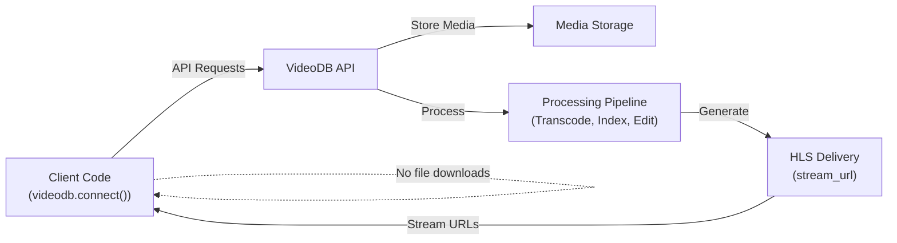
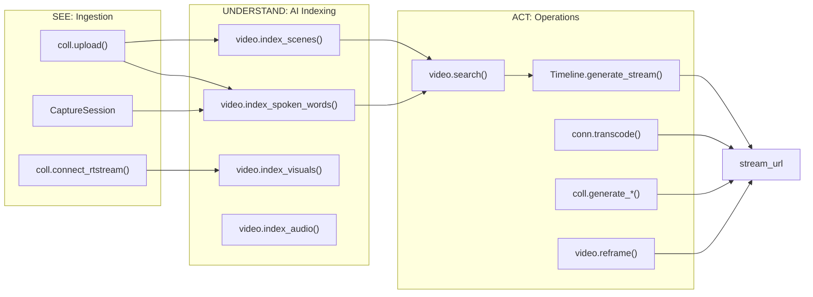
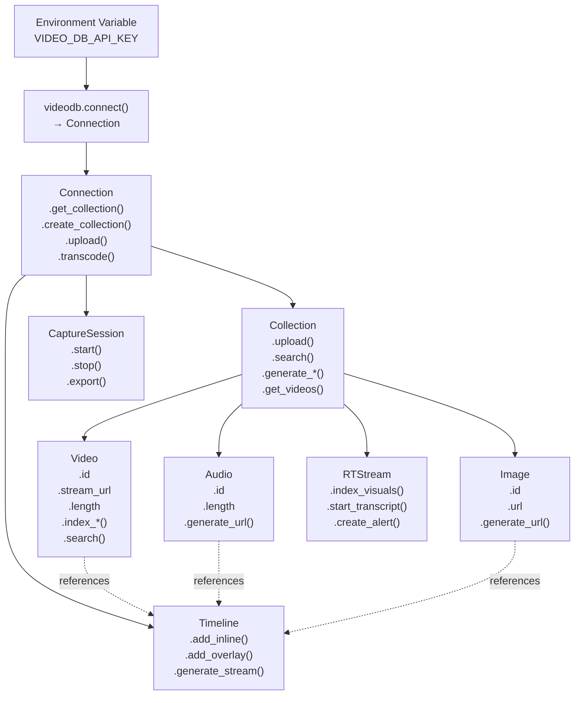
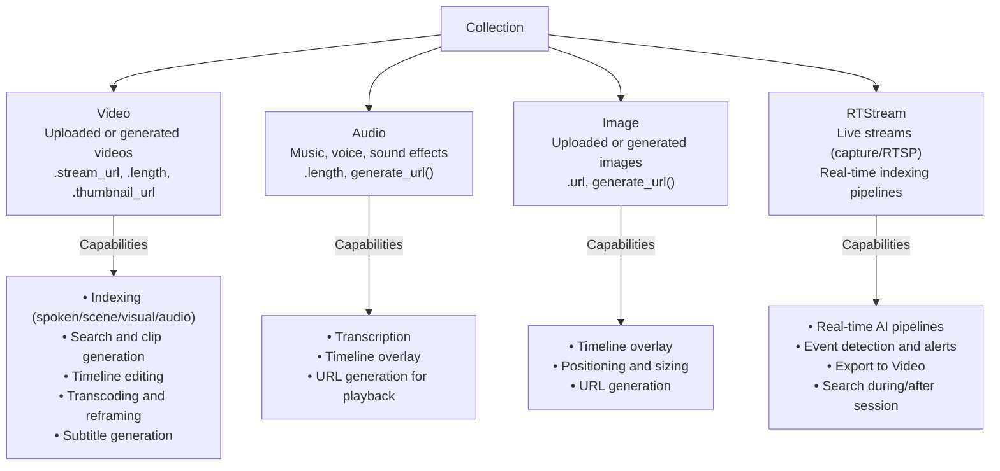
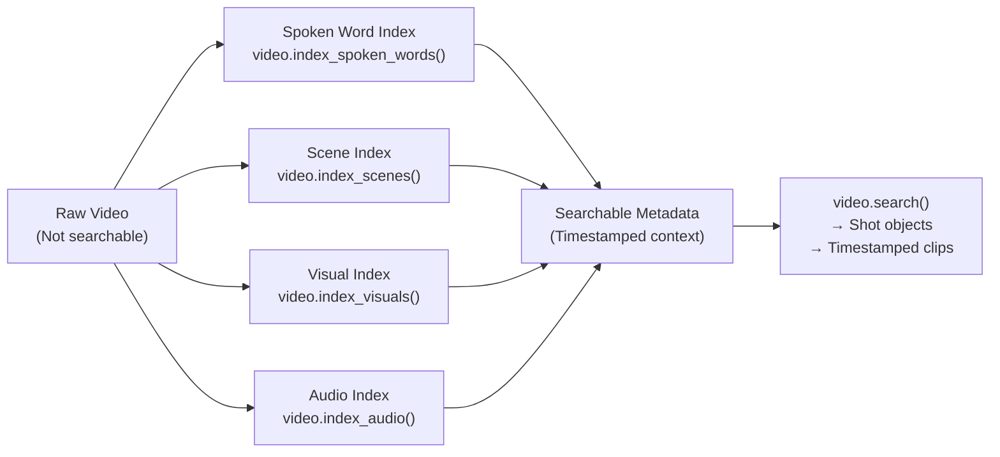
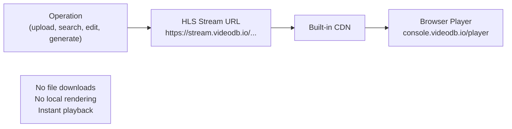

<!-- source: DeepWiki mcp.deepwiki.com · repo video-db/skills · page 2 Core Concepts · fetched 2026-10-26 -->

# Core Concepts

<details>
<summary>Relevant source files</summary>

The following files were used as context for generating this wiki page:

- [README.md](README.md)
- [python/SKILL.md](python/SKILL.md)
- [python/reference/api-reference.md](python/reference/api-reference.md)

</details>


This page explains the fundamental architecture and design principles of the VideoDB Skills system. It covers the server-side processing model, the See→Understand→Act workflow paradigm, the object hierarchy, and how authentication and streaming work. For detailed information about specific object classes and their methods, see [Object Model](#2.1). For authentication configuration and error handling, see [Authentication](#2.2).

---

## Server-Side Processing Architecture

VideoDB operates on a **server-side processing model**. All video operations—ingestion, indexing, transcoding, editing, generation—execute on VideoDB's infrastructure. The client (your Python code or AI agent) sends API requests and receives stream URLs or metadata in response.



**Key Design Principles:**

| Principle | Implementation | Benefit |
|-----------|---------------|---------|
| **No local processing** | Operations execute server-side via API calls | No ffmpeg, moviepy, or codec dependencies required |
| **URL-based results** | Methods return `stream_url` strings, not file paths | Instant playback without downloading or rendering |
| **Asynchronous operations** | Long tasks use `callback_url` or WebSocket events | Non-blocking workflows for heavy processing |
| **Built-in CDN** | All streams delivered via HLS over CDN | Global low-latency playback |

This means you never download video files, run local encoders, or manage temporary storage. Instead:

- `coll.upload(url="...")` → Returns `Video` object with `.stream_url`
- `video.add_subtitle()` → Returns stream URL with burned-in subtitles
- `timeline.generate_stream()` → Returns compiled composition as stream URL

**Sources:** [python/SKILL.md:1-10](), [README.md:104-130]()

---

## The See→Understand→Act Paradigm

VideoDB operations follow a three-phase workflow:



### SEE: Ingestion

Bring media into the system via one of three methods:

```python
# Upload from URL or file
video = coll.upload(url="https://example.com/video.mp4")
video = coll.upload(file_path="/local/video.mp4")

# Desktop capture (real-time recording)
session = conn.create_capture_session(...)

# Live stream ingestion
rtstream = coll.connect_rtstream(url="rtsp://camera/stream")
```

**Sources:** [python/SKILL.md:20-22](), [python/reference/api-reference.md:115]()

### UNDERSTAND: AI Indexing

Transform raw media into searchable, structured content:

```python
# Transcription index
video.index_spoken_words(force=True)

# Visual scene analysis
scene_index_id = video.index_scenes(
    extraction_type=SceneExtractionType.shot_based,
    prompt="Describe visual content in this scene."
)

# Frame-level visual understanding
video.index_visuals(prompt="Describe what's visible")

# Audio content analysis
video.index_audio(prompt="Identify sounds and music")
```

Indexing is **mandatory for search**. Attempting to search an unindexed video raises `SearchError`.

**Sources:** [python/SKILL.md:23-28](), [python/reference/api-reference.md:173-177]()

### ACT: Operations

Perform operations on indexed content:

```python
# Search and create clips
results = video.search("product demo")
shots = results.get_shots()
stream_url = results.compile()  # All shots as one stream

# Timeline editing
timeline = Timeline(conn)
timeline.add_inline(VideoAsset(asset_id=video.id, start=10, end=30))
timeline.add_overlay(0, TextAsset(text="Title", duration=3))
edited_url = timeline.generate_stream()

# Transform format/resolution
job_id = conn.transcode(
    source="https://example.com/video.mp4",
    video_config=VideoConfig(resolution=720)
)

# Generate new media
music = coll.generate_music(prompt="upbeat background music", duration=30)
```

**Sources:** [python/SKILL.md:29-34](), [python/reference/api-reference.md:107-133]()

---

## Object Model Overview

The SDK uses a hierarchical object model where authentication and authorization flow downward:



### Hierarchy Rules

1. **Connection** is the root object created by `videodb.connect()`
2. **Collection** is the primary container for media assets
3. **Media Assets** (`Video`, `Audio`, `Image`, `RTStream`) belong to collections
4. **Timeline** references media assets but doesn't own them
5. **CaptureSession** produces `RTStream` objects during recording

All objects inherit authentication context from their parent, so you never pass API keys explicitly after initial connection.

**Sources:** [python/reference/api-reference.md:4-31]()

---

## Authentication and Connection

### Establishing Connection

```python
from dotenv import load_dotenv
import videodb

load_dotenv(".env")  # Reads VIDEO_DB_API_KEY from .env file
conn = videodb.connect()  # Or pass api_key= explicitly
```

The `videodb.connect()` function:
1. Reads `VIDEO_DB_API_KEY` from environment or `.env` file
2. Validates the key with VideoDB's API
3. Returns a `Connection` object that manages all subsequent operations
4. Raises `AuthenticationError` if the key is invalid or missing

**Sources:** [python/SKILL.md:68-80](), [python/reference/api-reference.md:5-12]()

### API Key Management

| Method | Command | Use Case |
|--------|---------|----------|
| **Export in shell** | `export VIDEO_DB_API_KEY=sk-xxx` | Recommended for CLI workflows |
| **Project `.env` file** | `VIDEO_DB_API_KEY=sk-xxx` | Best for codebases with `load_dotenv()` |
| **Explicit parameter** | `videodb.connect(api_key="sk-xxx")` | Testing or multi-account scenarios |

Get a free API key at https://console.videodb.io (includes $20 free credits).

**Sources:** [python/SKILL.md:114-123](), [README.md:71-84]()

---

## Media Asset Types

Collections contain four types of media assets:



### Video Assets

Created via `coll.upload()` or `coll.generate_video()`. Primary object for processing.

```python
video = coll.upload(url="https://example.com/video.mp4")
print(f"ID: {video.id}")
print(f"Duration: {video.length} seconds")
print(f"Stream: {video.stream_url}")
```

**Sources:** [python/reference/api-reference.md:148-191]()

### Audio Assets

Created via `coll.upload()` or generative methods (`coll.generate_music()`, `coll.generate_voice()`).

```python
audio = coll.generate_music(prompt="calm piano", duration=30)
playback_url = audio.generate_url()
```

**Sources:** [python/reference/api-reference.md:223-246]()

### Image Assets

Created via `coll.upload()` or `coll.generate_image()`. Used for overlays and thumbnails.

```python
image = coll.generate_image(prompt="sunset over mountains", aspect_ratio="16:9")
url = image.generate_url()
```

**Sources:** [python/reference/api-reference.md:248-268]()

### RTStream Assets

Live streams from desktop capture or RTSP/RTMP feeds. Support real-time AI pipelines.

```python
rtstream = coll.connect_rtstream(url="rtsp://camera/stream")
rtstream.index_visuals(prompt="Describe what's happening")
```

For detailed coverage, see [Live Stream Processing](#9).

**Sources:** [python/reference/api-reference.md:449-453]()

---

## Indexing and the Context Layer

Raw video is not searchable. **Indexing** creates structured metadata that enables search, clip generation, and intelligent operations.

### Indexing Types



| Index Type | Method | Creates | Search Capability |
|------------|--------|---------|-------------------|
| **Spoken Word** | `video.index_spoken_words()` | Timestamped transcript | Semantic and keyword search of speech |
| **Scene** | `video.index_scenes()` | AI descriptions of visual scenes | Visual content queries ("person at whiteboard") |
| **Visual** | `video.index_visuals()` | Frame-level analysis | Detailed visual understanding |
| **Audio** | `video.index_audio()` | Audio content metadata | Sound, music, profanity detection |

### Index Persistence

- Indexes are created once and stored permanently
- `index_spoken_words(force=True)` skips if already indexed
- `index_scenes()` has no `force` parameter—raises error if index exists
- Multiple scene indexes can exist per video (different prompts)

**Sources:** [python/SKILL.md:143-206](), [python/reference/api-reference.md:173-177]()

---

## Stream-Based Delivery

All VideoDB operations produce **HLS stream URLs**, not downloadable files:



### Stream Characteristics

| Characteristic | Implementation |
|----------------|----------------|
| **Protocol** | HLS (HTTP Live Streaming) |
| **Latency** | Sub-second for cached content |
| **Format** | Adaptive bitrate (multiple qualities) |
| **CDN** | Global delivery, no VideoDB server load |
| **Persistence** | URLs remain valid permanently |

### Stream Sources

Different operations produce streams in different ways:

```python
# Original video stream
video = coll.upload(url="...")
stream_url = video.stream_url  # Direct property access

# Search results compiled
results = video.search("query")
stream_url = results.compile()  # All matching shots merged

# Timeline composition
timeline = Timeline(conn)
timeline.add_inline(VideoAsset(...))
stream_url = timeline.generate_stream()  # Compiled edit

# Single shot
shot = results.get_shots()[0]
stream_url = shot.generate_stream()  # Individual clip
```

### Playing Streams

To view a stream in a browser:

```python
# Manual player URL
player_url = f"https://console.videodb.io/player?url={stream_url}"

# Or use built-in method
player_url = video.play()  # Opens in browser automatically
```

**Sources:** [python/SKILL.md:46-51](), [python/reference/api-reference.md:164]()

---

## Processing Operations Overview

VideoDB supports six categories of operations:

### 1. Search and Clip Generation

```python
# Semantic search
results = video.search("product demo", search_type=SearchType.semantic)

# Compile all results
stream_url = results.compile()

# Individual shots
for shot in results.get_shots():
    print(f"{shot.start}-{shot.end}: {shot.text}")
```

**Sources:** [python/SKILL.md:149-167]()

### 2. Timeline Editing

Non-destructive composition of multiple assets:

```python
from videodb.timeline import Timeline
from videodb.asset import VideoAsset, AudioAsset, TextAsset

timeline = Timeline(conn)
timeline.add_inline(VideoAsset(asset_id=video.id, start=10, end=30))
timeline.add_overlay(0, AudioAsset(asset_id=music.id))
timeline.add_overlay(5, TextAsset(text="Title", duration=3))

stream_url = timeline.generate_stream()
```

For detailed coverage, see [Timeline Editing](#7).

**Sources:** [python/SKILL.md:208-224](), [python/reference/api-reference.md:270-363]()

### 3. Transcoding and Reframing

Server-side format conversion:

```python
# Change resolution/quality
job_id = conn.transcode(
    source="https://example.com/video.mp4",
    mode=TranscodeMode.economy,
    video_config=VideoConfig(resolution=720, quality=23)
)

# Change aspect ratio
reframed = video.reframe(start=0, end=60, target="vertical")
```

**Warning:** `reframe()` can timeout on long videos. Always use `start`/`end` to limit segments or pass `callback_url` for async processing.

**Sources:** [python/SKILL.md:225-262](), [python/reference/api-reference.md:33-221]()

### 4. AI Generation

Create new media assets:

```python
# Images
image = coll.generate_image(prompt="sunset", aspect_ratio="16:9")

# Videos
video = coll.generate_video(prompt="waves crashing", duration=5)

# Music
music = coll.generate_music(prompt="upbeat techno", duration=30)

# Voice
voice = coll.generate_voice(text="Hello world", voice_name="Default")

# Text (LLM)
result = coll.generate_text(prompt="Summarize this video", model_name="pro")
```

For detailed coverage, see [AI Media Generation](#11).

**Sources:** [python/SKILL.md:264-271](), [python/reference/api-reference.md:117-123]()

### 5. Real-Time Processing

Desktop capture and live stream ingestion:

```python
# Desktop capture
session = conn.create_capture_session(...)
session.start()
# ... recording happens ...
session.stop()
video = session.export()

# Live stream
rtstream = coll.connect_rtstream(url="rtsp://camera/stream")
rtstream.start_transcript()
rtstream.index_visuals(prompt="Describe activity")
```

For detailed coverage, see [Desktop Capture](#8) and [Live Stream Processing](#9).

**Sources:** [python/SKILL.md:315-346]()

### 6. Subtitles and Transcription

```python
# Generate and burn subtitles
video.index_spoken_words(force=True)
stream_url = video.add_subtitle()

# Get transcript
transcript = video.get_transcript()
text = video.get_transcript_text()
```

**Sources:** [python/SKILL.md:141-148](), [python/reference/api-reference.md:177-181]()

---

## Error Handling Patterns

### Authentication Errors

```python
from videodb.exceptions import AuthenticationError

try:
    conn = videodb.connect()
except AuthenticationError:
    print("Invalid or missing VIDEO_DB_API_KEY")
```

**Sources:** [python/SKILL.md:273-287](), [python/reference/api-reference.md:532-549]()

### Search Returns No Results

`video.search()` raises `InvalidRequestError` when no matches found. Always wrap in try/except:

```python
from videodb.exceptions import InvalidRequestError

try:
    results = video.search("query")
    shots = results.get_shots()
except InvalidRequestError as e:
    if "No results found" in str(e):
        shots = []  # Treat as empty
    else:
        raise
```

**Sources:** [python/SKILL.md:152-167]()

### Scene Index Already Exists

`index_scenes()` has no `force` parameter. Extract existing ID from error:

```python
import re

try:
    scene_index_id = video.index_scenes(...)
except Exception as e:
    match = re.search(r"id\s+([a-f0-9]+)", str(e))
    if match:
        scene_index_id = match.group(1)
    else:
        raise
```

**Sources:** [python/SKILL.md:172-189]()

---

## Common Patterns

### Natural Language to Code Mapping

| Natural Language Command | Code Implementation |
|-------------------------|---------------------|
| "Upload this video and return a stream link" | `video = coll.upload(url="..."); print(video.stream_url)` |
| "Find all moments mentioning 'product'" | `results = video.search("product"); shots = results.get_shots()` |
| "Create a 30-second clip from 1:00 to 1:30" | `timeline = Timeline(conn); timeline.add_inline(VideoAsset(asset_id=video.id, start=60, end=90))` |
| "Add subtitles with white text on black background" | `video.add_subtitle(style=SubtitleStyle(primary_colour="&H00FFFFFF"))` |
| "Generate background music and overlay it" | `music = coll.generate_music(...); timeline.add_overlay(0, AudioAsset(asset_id=music.id))` |
| "Reframe this for Instagram (vertical)" | `reframed = video.reframe(target="vertical")` |

**Sources:** [python/SKILL.md:55-62](), [README.md:87-98]()

---

## Summary

The VideoDB system provides:

1. **Server-side processing** - No local tools required
2. **See→Understand→Act workflow** - Ingest, index, operate
3. **Hierarchical object model** - Connection → Collection → Media Assets
4. **AI indexing layer** - Makes video searchable by content
5. **Stream-based delivery** - HLS URLs for instant playback
6. **Comprehensive operations** - Search, edit, transcode, generate

All operations are API-driven, return stream URLs, and execute on VideoDB's infrastructure. This architecture keeps client code lightweight while enabling powerful video workflows.

For implementation details:
- Object classes and methods: [Object Model](#2.1)
- API key configuration: [Authentication](#2.2)
- Specific capabilities: See sections [4](#4) through [11](#11)

**Sources:** [python/SKILL.md:1-362](), [README.md:1-144](), [python/reference/api-reference.md:1-549]()

---

