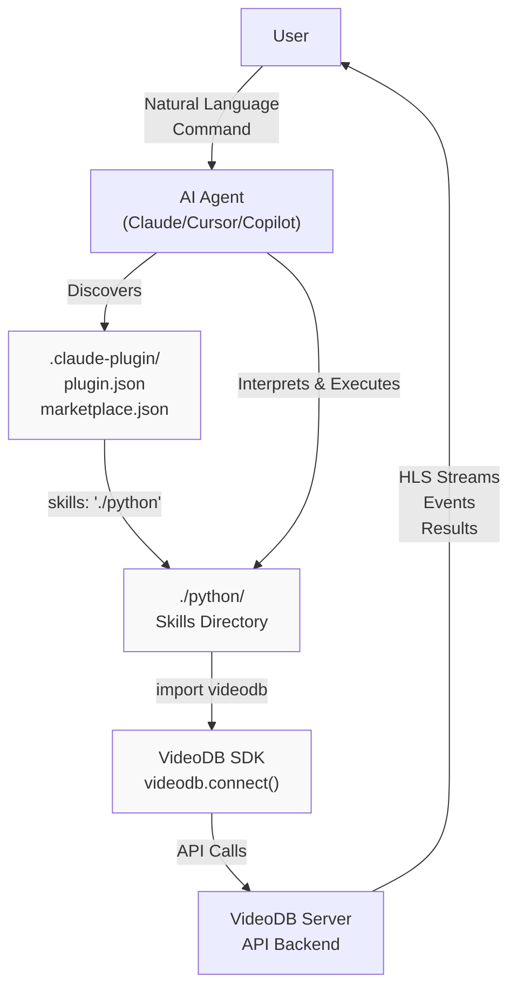
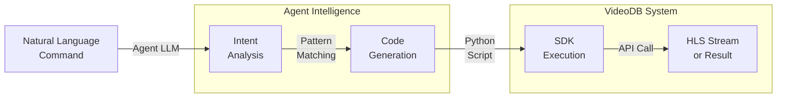
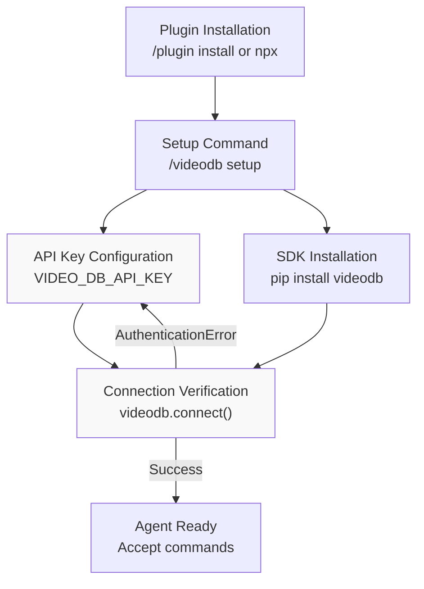

<!-- source: DeepWiki mcp.deepwiki.com · repo video-db/skills · page 3 AI Agent Integration · fetched 2026-10-26 -->

# AI Agent Integration

<details>
<summary>Relevant source files</summary>

The following files were used as context for generating this wiki page:

- [.claude-plugin/marketplace.json](.claude-plugin/marketplace.json)
- [.claude-plugin/plugin.json](.claude-plugin/plugin.json)
- [README.md](README.md)

</details>


This document explains how AI agents (Claude Code, Cursor, Copilot) interact with the VideoDB Skills system through the plugin architecture. It covers the integration layer that translates natural language commands into SDK operations, the plugin installation process, and the underlying mechanisms that enable agent-agnostic video processing.

For details about the specific commands and their Python implementations, see [Plugin Architecture](#3.1). For comprehensive examples of natural language instructions, see [Natural Language Commands](#3.2).

---

## Integration Layer Overview

The VideoDB Skills system operates as a bridge between conversational AI agents and the VideoDB Python SDK. When a user gives a natural language instruction to their AI agent, the system interprets that command and executes the appropriate SDK operations server-side.

**Key Integration Flow:**



**Sources:** [README.md:1-144](), [.claude-plugin/plugin.json:1-6](), [.claude-plugin/marketplace.json:1-13]()

---

## Plugin Discovery and Registration

The plugin system uses a standardized `.claude-plugin/` directory structure that AI agents can automatically discover and register.

### Directory Structure

```
skills/
├── .claude-plugin/
│   ├── plugin.json          # Plugin metadata and configuration
│   └── marketplace.json     # Marketplace listing definition
├── python/                   # Skills directory (Python implementations)
│   └── [skill modules]
└── README.md
```

### plugin.json Format

The `plugin.json` file defines the plugin's identity and points to the skills directory:

[.claude-plugin/plugin.json:1-6]()

| Field | Value | Purpose |
|-------|-------|---------|
| `name` | `"videodb"` | Plugin identifier used by agents |
| `description` | Process videos via natural language | User-facing description |
| `version` | `"1.1.0"` | Semantic version for updates |
| `skills` | `"./python"` | Path to executable skills directory |

The `skills` field is the critical link—it tells the agent where to find the Python code that implements video operations. When an agent loads this plugin, it registers the `./python` directory as an executable skill context.

### marketplace.json Format

The `marketplace.json` file enables public distribution through plugin marketplaces:

[.claude-plugin/marketplace.json:1-13]()

| Field | Value | Purpose |
|-------|-------|---------|
| `name` | `"videodb-skills"` | Marketplace listing identifier |
| `owner.name` | `"VideoDB"` | Publisher identity |
| `plugins[0].name` | `"videodb"` | Must match `plugin.json` name |
| `plugins[0].source` | `"./"` | Repository root path |

This structure allows users to install the plugin using the shorthand `videodb@videodb-skills` in marketplace commands.

**Sources:** [.claude-plugin/plugin.json:1-6](), [.claude-plugin/marketplace.json:1-13]()

---

## Installation Methods

VideoDB Skills supports multiple installation methods depending on the AI agent in use.

### Method 1: Claude Code Plugin System

For Claude Code users, the plugin can be installed directly from the marketplace:

```bash
/plugin marketplace add video-db/skills
/plugin install videodb@videodb-skills
```

**Command Breakdown:**

| Command | Action |
|---------|--------|
| `/plugin marketplace add video-db/skills` | Registers the GitHub repository as a plugin source |
| `/plugin install videodb@videodb-skills` | Installs the `videodb` plugin from the `videodb-skills` marketplace listing |

After installation, the `/videodb` command namespace becomes available for setup and operations.

### Method 2: NPX Skills Manager

For agent-agnostic installation, the NPX skills manager clones the repository and registers it:

```bash
npx skills add video-db/skills
```

This method works with Cursor, Copilot, and any agent that supports skill directory discovery.

### Method 3: Manual Setup for Other Agents

For agents without native plugin systems:

1. Clone the repository: `git clone https://github.com/video-db/skills`
2. Add the `python/` directory to the agent's workspace
3. Configure the API key via environment variable
4. Instruct the agent: "Use the videodb skills from the python directory"

**Sources:** [README.md:52-84]()

---

## Natural Language Command Processing

The core innovation of VideoDB Skills is translating conversational instructions into SDK operations. The agent analyzes the natural language command, identifies the intent, and generates appropriate Python code using the VideoDB SDK.

### Command → Code Translation Flow



### Example Command Mappings

The table below shows how natural language instructions map to specific SDK operations:

| Natural Language Command | Detected Intent | SDK Code Pattern |
|--------------------------|----------------|------------------|
| "Upload https://youtube.com/watch?v=..." | Video ingestion | `conn.upload(url="...")` |
| "Find every scene showing 'phone close-up'" | Scene search | `video.index_scenes()` → `video.search()` |
| "Take clips from 10s-30s and 45s-60s" | Timeline editing | `Timeline()` → `add_inline(VideoAsset(...))` |
| "Add subtitles with white text on black background" | Subtitle generation | `video.add_subtitle(style=...)` |
| "Capture my screen for two minutes" | Real-time capture | `conn.create_capture_session()` → `CaptureClient()` |
| "Generate background music and add to clip" | AI generation + composition | `coll.generate_music()` → `timeline.add_inline(AudioAsset(...))` |
| "Monitor RTSP feed and alert on person detection" | Live stream analysis | `coll.add_stream()` → `rtstream.index_visuals()` → `create_alert()` |

**Sources:** [README.md:87-98]()

---

## Example: Natural Language to SDK Code

Here's a detailed example showing how a complex natural language command translates into SDK operations:

### User Command:
```
"Upload this YouTube video, find all moments where someone says 'artificial intelligence', 
create a 30-second compilation, and add auto-generated subtitles"
```

### Intent Breakdown:

| Step | Intent | SDK Operation |
|------|--------|---------------|
| 1 | Upload YouTube video | `conn.upload(url=youtube_url)` |
| 2 | Index spoken words | `video.index_spoken_words()` |
| 3 | Search for keyword | `video.search(query="artificial intelligence", search_type=SearchType.keyword)` |
| 4 | Compile results into timeline | `result.compile()` or `Timeline()` + `VideoAsset` per shot |
| 5 | Generate subtitles | `video.add_subtitle()` |
| 6 | Return playable stream | `timeline.generate_stream()` or `result.compile().play()` |

### Agent-Generated Python Code (Conceptual):

```python
import videodb
from videodb import SearchType

# Step 1: Upload
conn = videodb.connect()
video = conn.upload(url="https://youtube.com/...")

# Step 2-3: Index and search
video.index_spoken_words()
result = video.search(
    query="artificial intelligence",
    search_type=SearchType.keyword
)

# Step 4: Create compilation (first 30 seconds of results)
shots = result.get_shots()
compilation = result.compile()  # Automatically creates timeline

# Step 5: Add subtitles
compilation.add_subtitle()

# Step 6: Return stream URL
stream_url = compilation.play()
print(f"Your compilation is ready: {stream_url}")
```

The agent doesn't execute this exact code—it synthesizes similar operations based on the plugin's skill definitions and SDK documentation. The key is that the plugin provides context about available VideoDB operations, enabling the agent to construct valid SDK calls.

**Sources:** [README.md:87-98]()

---

## Agent-Specific Considerations

### Claude Code Integration

Claude Code provides the richest integration experience:
- Native `/plugin` command namespace
- Automatic skill directory registration
- Persistent environment variable management
- Context-aware code generation based on plugin metadata

[README.md:58-63]()

### Cursor and GitHub Copilot

Cursor and Copilot rely on workspace context rather than formal plugin systems:
- The `python/` skills directory must be in the workspace
- The agent discovers Python modules via import statements
- API key configuration requires manual `.env` setup
- Natural language instructions work but lack dedicated command namespaces

[README.md:74-84]()

### Generalization to Other Agents

The plugin architecture is designed to be agent-agnostic by:
1. Using standard Python modules in `./python` (no proprietary formats)
2. Requiring only `videodb` SDK import (single dependency)
3. Outputting standard HLS stream URLs (universal playback)
4. Supporting environment variable authentication (POSIX standard)

Any agent capable of executing Python code can use VideoDB Skills by importing the SDK and following the documented patterns.

**Sources:** [README.md:1-144](), [.claude-plugin/plugin.json:1-6]()

---

## Setup and Configuration Flow

After plugin installation, the setup process establishes the connection between the agent and VideoDB's server infrastructure:



### Setup Command Behavior

The `/videodb setup` command (or equivalent "setup videodb" instruction) performs:

1. **API Key Acquisition**: Directs user to https://console.videodb.io for free API key ($20 credits, no card required)
2. **Environment Configuration**: Sets `VIDEO_DB_API_KEY` via `export` or `.env` file
3. **SDK Installation**: Executes `pip install videodb` in the project environment
4. **Connection Test**: Runs `videodb.connect()` to verify authentication
5. **Confirmation**: Reports success or detailed error if authentication fails

[README.md:66-84]()

### Authentication Methods

| Method | Command | Persistence |
|--------|---------|-------------|
| **Terminal Export** (Recommended) | `export VIDEO_DB_API_KEY=sk-...` | Current session only |
| **Project .env File** | Add `VIDEO_DB_API_KEY=sk-...` to `.env` | Persistent per project |
| **System Environment** | OS-specific env variable config | Global across all projects |

For details on authentication mechanics, see [Authentication](#2.2).

**Sources:** [README.md:66-84]()

---

## Skills Directory Structure

The `./python` directory referenced by [.claude-plugin/plugin.json:5]() contains the executable skill implementations. While the specific module structure is not shown in the provided files, the skills directory follows these principles:

1. **Python Module Organization**: Each skill is a Python module that imports `videodb`
2. **SDK Dependency**: All skills depend on the VideoDB Python SDK as the only external requirement
3. **Stateless Operations**: Skills generate code that interacts with server-side state, not local state
4. **Return HLS Streams**: All video operations return playable HLS URLs, not local files

### Expected Usage Pattern

```python
# Agent-generated code structure for a typical skill
import videodb

# Connect with API key from environment
conn = videodb.connect()

# Perform operation (upload, search, edit, etc.)
result = conn.upload(url="...")

# Return stream URL for immediate playback
stream_url = result.play()
```

The agent interprets the user's natural language command, identifies the appropriate SDK methods from the skills directory context, and constructs executable Python code following these patterns.

**Sources:** [.claude-plugin/plugin.json:1-6](), [README.md:1-144]()

---

## Supported Platforms

The plugin system and skills directory work across all major development platforms:

| Platform | Support Level | Notes |
|----------|---------------|-------|
| **macOS** | Full | Native support for desktop capture |
| **Linux** | Full | All features supported |
| **Windows (PowerShell)** | Full | Requires PowerShell for environment variables |
| **Windows (CMD)** | Partial | May require manual environment configuration |

[README.md:130]()

**Sources:** [README.md:130]()

---

## Benefits of the Plugin Architecture

The plugin-based integration provides several architectural advantages:

### 1. Separation of Concerns
- **Agent Layer**: Handles natural language understanding and code generation
- **Skills Layer**: Provides VideoDB-specific operation patterns
- **SDK Layer**: Manages API communication and object model
- **Server Layer**: Executes heavy video processing

### 2. Agent Portability
The same skill repository works across Claude Code, Cursor, Copilot, and other agents without modification. The `./python` skills directory is the stable interface.

### 3. No Local Dependencies
Users don't need FFmpeg, video codecs, or GPU acceleration installed locally. All processing happens server-side, and results stream via HLS.

### 4. Automatic Updates
When the SDK or skills are updated, agents automatically discover new capabilities without plugin reinstallation (assuming the skills directory is git-tracked).

### 5. Consistent Authentication
The `VIDEO_DB_API_KEY` environment variable works uniformly across all agents and platforms, following standard POSIX conventions.

**Sources:** [README.md:103-112](), [.claude-plugin/plugin.json:1-6]()

---

## Comparison to Direct SDK Usage

While developers can use the VideoDB Python SDK directly without AI agents, the plugin architecture provides distinct advantages for certain workflows:

| Aspect | Direct SDK Usage | AI Agent Plugin |
|--------|------------------|-----------------|
| **Interface** | Python code written by developer | Natural language instructions |
| **Documentation** | Requires reading API docs | Agent interprets commands contextually |
| **Workflow Composition** | Manual chaining of operations | Agent generates multi-step workflows |
| **Learning Curve** | Must learn SDK methods and parameters | Describe desired outcome conversationally |
| **Flexibility** | Full programmatic control | Limited to agent interpretation |
| **Error Handling** | Explicit try/catch blocks | Agent attempts automatic recovery |

The plugin architecture is ideal for:
- Rapid prototyping of video workflows
- Non-programmers using AI coding agents
- Exploratory analysis of video content
- One-off video processing tasks

Direct SDK usage remains better for:
- Production applications requiring deterministic behavior
- Complex business logic with custom error handling
- Performance-critical batch processing
- Integration with existing Python codebases

**Sources:** [README.md:1-144]()

---

## Summary

The VideoDB Skills plugin architecture creates a natural language interface to server-side video processing by:

1. **Registering** the plugin via `plugin.json` and `marketplace.json` for agent discovery
2. **Exposing** Python skills in the `./python` directory for agent execution
3. **Translating** natural language commands into VideoDB SDK operations
4. **Authenticating** via the `VIDEO_DB_API_KEY` environment variable
5. **Streaming** results as HLS URLs for immediate playback

This architecture enables AI agents to perform complex video operations (capture, search, edit, generate) through conversational instructions, while keeping all heavy processing server-side.

For implementation details of the plugin files and marketplace integration, see [Plugin Architecture](#3.1). For comprehensive examples of natural language command patterns, see [Natural Language Commands](#3.2).

**Sources:** [README.md:1-144](), [.claude-plugin/plugin.json:1-6](), [.claude-plugin/marketplace.json:1-13]()

---

