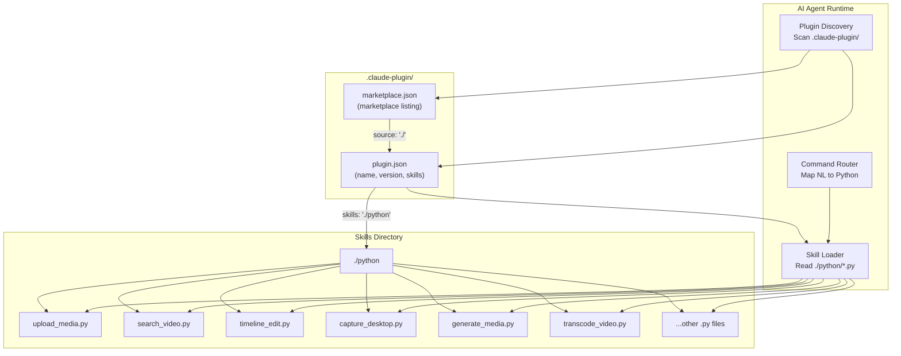
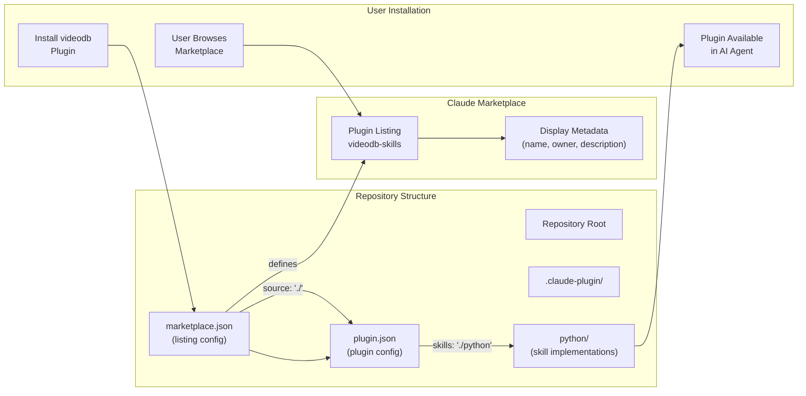
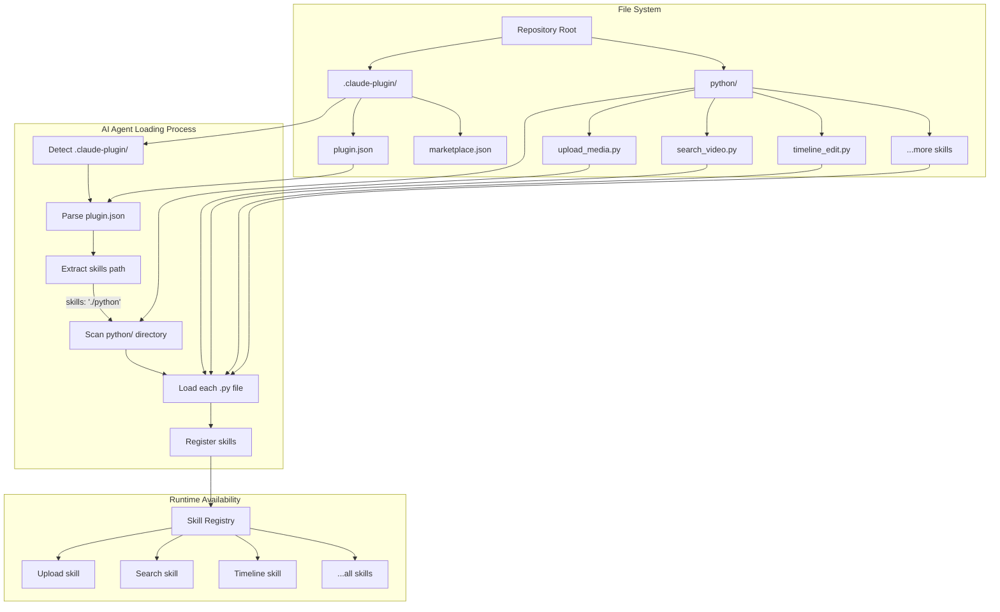

<!-- source: DeepWiki mcp.deepwiki.com · repo video-db/skills · page 3.1 Plugin Architecture · fetched 2026-10-26 -->

# Plugin Architecture

<details>
<summary>Relevant source files</summary>

The following files were used as context for generating this wiki page:

- [.claude-plugin/marketplace.json](.claude-plugin/marketplace.json)
- [.claude-plugin/plugin.json](.claude-plugin/plugin.json)

</details>


## Purpose and Scope

This document explains the plugin architecture that enables AI agents (Claude, Cursor, Copilot) to discover and execute VideoDB capabilities. It covers the structure and purpose of the plugin configuration files, how the skills directory is referenced, and the integration with the Claude marketplace. For information about how to use natural language commands once the plugin is installed, see [Natural Language Commands](#3.2). For details about the Python SDK that the plugin wraps, see [Core Concepts](#2).

---

## Plugin Configuration Files

The VideoDB plugin is defined by two JSON configuration files located in the `.claude-plugin/` directory. These files enable AI agents to discover the plugin's capabilities and route natural language commands to the appropriate Python implementations.

### plugin.json Structure

The primary plugin definition file is [.claude-plugin/plugin.json:1-6](), which contains the essential metadata for plugin registration:

| Field | Value | Purpose |
|-------|-------|---------|
| `name` | `"videodb"` | Unique identifier for the plugin within AI agents |
| `description` | Summary of capabilities | Displayed to users when browsing available plugins |
| `version` | `"1.1.0"` | Semantic versioning for compatibility tracking |
| `skills` | `"./python"` | Relative path to the directory containing executable Python scripts |

The `skills` field is the critical integration point. It instructs the AI agent to scan the `./python` directory for Python files that implement individual video processing capabilities. Each `.py` file in this directory represents a distinct skill that can be invoked via natural language.

**Diagram: Plugin Configuration to Code Mapping**



**Sources:** [.claude-plugin/plugin.json:1-6]()

---

### marketplace.json Structure

The marketplace configuration file [.claude-plugin/marketplace.json:1-13]() enables the plugin to be published and discovered in the Claude plugin marketplace:

| Field | Value | Purpose |
|-------|-------|---------|
| `name` | `"videodb-skills"` | Marketplace listing identifier |
| `owner.name` | `"VideoDB"` | Publisher attribution |
| `plugins[0].name` | `"videodb"` | Must match `plugin.json` name field |
| `plugins[0].description` | Capability summary | User-facing description in marketplace |
| `plugins[0].source` | `"./"` | Relative path to the plugin root directory |

The `source` field points to the directory containing `plugin.json`. This allows multiple plugins to be packaged in a single marketplace listing, though VideoDB currently publishes a single plugin.

**Diagram: Marketplace Integration Flow**



**Sources:** [.claude-plugin/marketplace.json:1-13](), [.claude-plugin/plugin.json:1-6]()

---

## Plugin Discovery Mechanism

AI agents discover and load the plugin through a multi-stage process:

### 1. Repository Scanning

When a user connects an AI agent to a repository containing VideoDB Skills, the agent scans for plugin configuration:

```
Repository Root
└── .claude-plugin/
    ├── marketplace.json  → Read for marketplace metadata
    └── plugin.json       → Read for plugin configuration
```

The presence of the `.claude-plugin/` directory signals to the AI agent that this repository contains executable skills.

### 2. Skills Directory Resolution

The `skills` field in [.claude-plugin/plugin.json:5]() specifies `"./python"`, which resolves to:

```
Repository Root
├── .claude-plugin/
│   └── plugin.json
└── python/              ← Skills directory
    ├── upload_media.py
    ├── search_video.py
    ├── timeline_edit.py
    └── ...
```

The relative path `"./python"` is interpreted relative to the repository root, not the `.claude-plugin/` directory.

### 3. Skill Enumeration

The AI agent reads all `.py` files in the skills directory. Each Python file represents an independent skill that can be invoked. The agent uses the file docstrings, function signatures, and type hints to understand:

- **Skill purpose**: What video operation does this perform?
- **Input parameters**: What arguments are required?
- **Output format**: What does the skill return?
- **Execution constraints**: What prerequisites must be met?

### 4. Natural Language Mapping

When a user issues a natural language command like "search my video for mentions of Python", the AI agent:

1. Analyzes the intent and entities in the command
2. Matches the intent to an appropriate skill (e.g., `search_video.py`)
3. Extracts parameters from the command (video identifier, search query)
4. Executes the Python script with the extracted parameters
5. Returns the formatted result to the user

This mapping is handled automatically by the AI agent's language model, which learns the skill capabilities from the Python code structure.

**Sources:** [.claude-plugin/plugin.json:5]()

---

## Plugin Metadata Fields

### Version Management

The `version` field in [.claude-plugin/plugin.json:4]() uses semantic versioning (`"1.1.0"`). This enables:

- **Compatibility tracking**: AI agents can verify minimum required versions
- **Update notifications**: Users are alerted when newer versions are available
- **Breaking change management**: Major version increments signal incompatible changes

The current version `1.1.0` indicates:
- Major version `1`: Stable public API
- Minor version `1`: Feature additions without breaking changes
- Patch version `0`: No bug fixes since last minor release

### Description Guidelines

Both configuration files contain description fields that serve different audiences:

| File | Description Purpose | Character Limit |
|------|-------------------|-----------------|
| `plugin.json` | Technical summary for AI agent | No strict limit |
| `marketplace.json` | User-facing marketing copy | ~200 characters recommended |

The descriptions in [.claude-plugin/plugin.json:3]() and [.claude-plugin/marketplace.json:9]() are identical, emphasizing:

1. **Primary SDK**: "VideoDB Python SDK" (establishes technical foundation)
2. **Core operations**: "Upload, search, edit, generate subtitles, transcode, capture, and stream"
3. **Interaction model**: "all via natural language"

This structure helps users quickly understand the plugin's scope and interaction model.

**Sources:** [.claude-plugin/plugin.json:3-4](), [.claude-plugin/marketplace.json:9]()

---

## Directory Structure Contract

The plugin architecture enforces a strict directory structure:

```
Repository Root
├── .claude-plugin/          ← Plugin definition directory (mandatory)
│   ├── plugin.json          ← Plugin configuration (mandatory)
│   └── marketplace.json     ← Marketplace listing (optional)
│
└── python/                  ← Skills directory (path defined in plugin.json)
    ├── __init__.py          ← Not required (skills loaded individually)
    ├── upload_media.py      ← Individual skill files
    ├── search_video.py
    ├── timeline_edit.py
    ├── capture_desktop.py
    ├── generate_media.py
    ├── transcode_video.py
    └── ...                  ← Additional skills
```

### Directory Naming Constraints

- **`.claude-plugin/`**: Must use this exact name (case-sensitive)
- **`plugin.json`**: Must use this exact name (no variations)
- **`marketplace.json`**: Optional, but must use this exact name if present
- **Skills directory**: Name defined by `skills` field (VideoDB uses `python`)

### Skills Directory Requirements

The skills directory referenced in [.claude-plugin/plugin.json:5]() must contain:

1. **Python files**: Each `.py` file represents a skill
2. **Executable code**: Skills must be runnable Python scripts
3. **Self-contained logic**: Each skill should handle one category of operations
4. **Standard imports**: Skills can import `videodb` SDK and standard library modules

The skills directory does **not** require:
- `__init__.py` (skills are loaded as standalone scripts, not modules)
- Package structure (no subdirectories expected)
- Manifest file (AI agent auto-discovers all `.py` files)

**Diagram: File System Layout to Plugin Loading**



**Sources:** [.claude-plugin/plugin.json:5]()

---

## Marketplace Publishing Workflow

To publish or update the plugin in the Claude marketplace:

1. **Update `marketplace.json`**: Modify [.claude-plugin/marketplace.json:1-13]() with marketplace metadata
2. **Update `plugin.json`**: Increment version in [.claude-plugin/plugin.json:4]() following semver
3. **Commit changes**: Push updates to the repository
4. **Marketplace submission**: Submit via Claude's plugin marketplace portal

The marketplace reads the configuration files directly from the repository, enabling automatic updates when the repository changes.

### Version Update Strategy

| Change Type | Version Update | Example |
|-------------|---------------|---------|
| New skill added | Minor version increment | `1.1.0` → `1.2.0` |
| Skill parameter changed | Major version increment | `1.1.0` → `2.0.0` |
| Bug fix in skill | Patch version increment | `1.1.0` → `1.1.1` |
| Description update | No version change | `1.1.0` → `1.1.0` |

**Sources:** [.claude-plugin/marketplace.json:1-13](), [.claude-plugin/plugin.json:4]()

---

## Summary

The VideoDB plugin architecture consists of two configuration files and a skills directory:

- **`plugin.json`**: Defines plugin identity, version, and skills path
- **`marketplace.json`**: Enables marketplace discovery and installation
- **`./python/`**: Contains executable Python scripts implementing video operations

The AI agent reads these configurations to discover capabilities, then maps natural language commands to Python skill executions. This architecture abstracts the complexity of video processing behind conversational interfaces while maintaining full SDK functionality.

**Sources:** [.claude-plugin/plugin.json:1-6](), [.claude-plugin/marketplace.json:1-13]()

---

