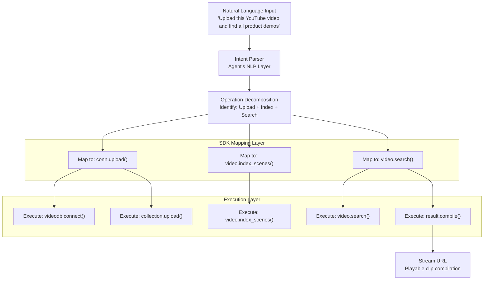
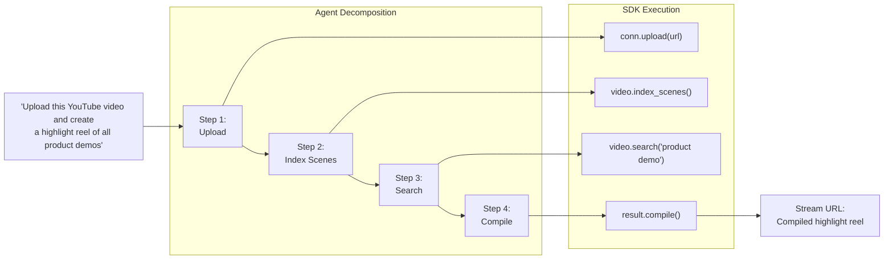
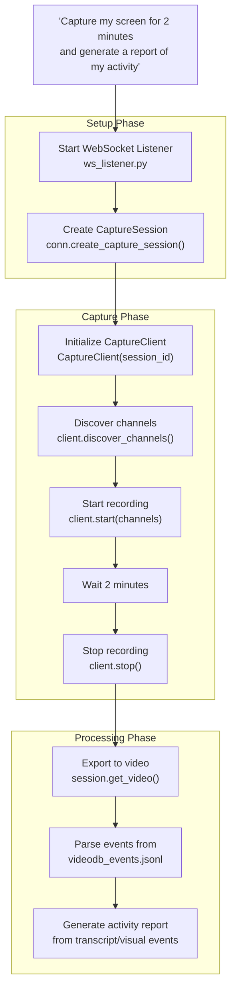
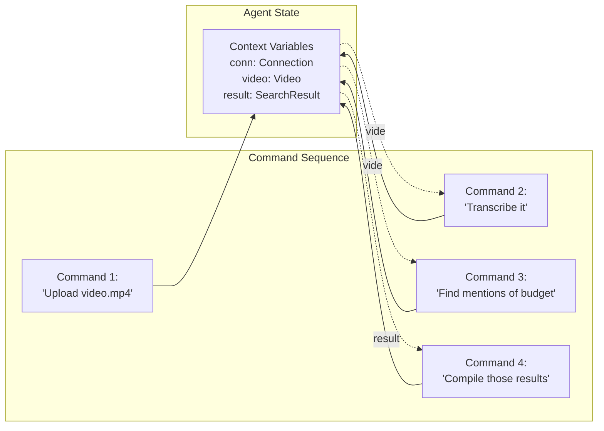

<!-- source: DeepWiki mcp.deepwiki.com · repo video-db/skills · page 3.2 Natural Language Commands · fetched 2026-10-26 -->

# Natural Language Commands

<details>
<summary>Relevant source files</summary>

The following files were used as context for generating this wiki page:

- [README.md](README.md)
- [python/reference/use-cases.md](python/reference/use-cases.md)

</details>


This document explains how natural language instructions given to AI agents (Claude, Cursor, Copilot) are translated into VideoDB SDK operations. It provides comprehensive examples of command patterns, their corresponding SDK method calls, and strategies for composing multi-step video workflows through conversational instructions.

For information about the plugin architecture that enables natural language processing, see [Plugin Architecture](#3.1). For initial setup and configuration, see [Installation and Setup](#1.1).

---

## Command Translation Architecture

AI agents process natural language commands through a multi-stage translation pipeline that maps user intent to specific SDK operations. The agent analyzes the command, identifies required operations, determines the correct sequence of API calls, and executes them using the VideoDB Python SDK.

### Translation Flow



**Sources:** [README.md:87-97]()

The agent maintains context across commands, reusing `Connection` and `Collection` objects from previous operations. This allows chained commands like "now add subtitles to that video" without re-specifying which video.

---

## Command Structure Patterns

Natural language commands follow predictable patterns that map to the See → Understand → Act workflow:

| Pattern Type | Structure | Example | Primary SDK Object |
|--------------|-----------|---------|-------------------|
| **Ingestion** | `[Action] [Source] [Optional: Destination]` | "Upload this YouTube link" | `Connection.upload()` |
| **Analysis** | `[Index/Analyze] [Media] [Optional: Type]` | "Transcribe this video" | `Video.index_spoken_words()` |
| **Query** | `[Find/Search] [Criteria] in [Media]` | "Find all mentions of 'product'" | `Video.search()` |
| **Extraction** | `[Extract/Get] [Segment] from [Media]` | "Get clips from 10s to 30s" | `Video.generate_stream()` |
| **Composition** | `[Combine/Merge] [Assets] [Optional: Styling]` | "Compile these clips with subtitles" | `Timeline.add_inline()` |
| **Generation** | `[Generate/Create] [Type] [Optional: Specs]` | "Generate background music" | `Collection.generate_music()` |
| **Transformation** | `[Convert/Change] [Property] of [Media]` | "Reframe to vertical" | `Video.reframe()` |

**Sources:** [README.md:87-97](), [python/reference/use-cases.md:1-119]()

---

## Command Category Examples

### See: Ingestion Commands

These commands ingest media into VideoDB for processing.

| Natural Language Command | SDK Translation | Result |
|-------------------------|-----------------|--------|
| "Upload https://youtube.com/watch?v=xyz" | `conn = videodb.connect()`<br/>`video = conn.upload(url="...")` | `Video` object with `.stream_url` |
| "Upload this local file video.mp4" | `coll = conn.get_collection()`<br/>`video = coll.upload(file_path="video.mp4")` | `Video` object |
| "Start capturing my screen for 2 minutes" | `session = conn.create_capture_session()`<br/>`client = CaptureClient(session_id)`<br/>`client.start()` | `CaptureSession` object |
| "Connect to this RTSP stream rtsp://camera/live" | `coll = conn.get_collection()`<br/>`stream = coll.connect_rtstream(url="...")` | `RTStream` object |

**Sources:** [README.md:25-29]()

---

### Understand: Analysis Commands

These commands index and search media content.

| Natural Language Command | SDK Translation | Result |
|-------------------------|-----------------|--------|
| "Transcribe this video" | `video.index_spoken_words()` | Transcript index created |
| "Index the visual scenes in this video" | `scene_id = video.index_scenes()`<br/>`# Returns scene_index_id` | Scene index created |
| "Find all mentions of 'product demo'" | `result = video.search(query="product demo")`<br/>`shots = result.get_shots()` | List of `Shot` objects |
| "Search for scenes showing a phone" | `result = video.search(`<br/>`  query="phone visible",`<br/>`  search_type=SearchType.scene,`<br/>`  scene_index_id=scene_id)` | Scene search results |
| "Find product mentions across all videos" | `coll = conn.get_collection()`<br/>`result = coll.search(query="product")` | Cross-collection results |

**Sources:** [README.md:27](), [python/reference/use-cases.md:7-17]()

---

### Act: Transformation and Output Commands

These commands manipulate, edit, and deliver media.

| Natural Language Command | SDK Translation | Result |
|-------------------------|-----------------|--------|
| "Give me a shareable stream link" | `stream_url = video.stream_url`<br/>`player_url = video.player_url` | HLS URL and player URL |
| "Compile clips from 10-30s and 45-60s" | `stream = video.generate_stream(`<br/>`  timeline=[(10, 30), (45, 60)])` | Compiled stream URL |
| "Add subtitles with white text on black background" | `video.add_subtitle(`<br/>`  TextStyle(fontsize=20, fontcolor="white", bg_color="black"))` | Video with subtitles |
| "Reframe this to vertical for TikTok" | `vertical = video.reframe(`<br/>`  reframe_target="vertical",`<br/>`  reframe_mode=ReframeMode.dynamic)` | Reframed `Video` object |
| "Generate 30 seconds of background music" | `audio = coll.generate_music(`<br/>`  prompt="upbeat background",`<br/>`  duration=30)` | `Audio` object |
| "Create a timeline with this video and add text overlay" | `timeline = conn.create_timeline()`<br/>`timeline.add_inline(VideoAsset(video))`<br/>`timeline.add_overlay(TextAsset(...))` | Timeline composition |

**Sources:** [README.md:92-96](), [python/reference/use-cases.md:20-35]()

---

## Multi-Step Workflow Commands

Complex commands often require multiple SDK operations executed in sequence. AI agents decompose these into logical steps.

### Workflow: Create Highlight Reel



**Example SDK Sequence:**

```python
# Natural language: "Upload this YouTube video and create a highlight reel of all product demos"

# Step 1: Connect and upload
import videodb
conn = videodb.connect()
coll = conn.get_collection()
video = coll.upload(url="https://youtube.com/watch?v=...")

# Step 2: Index scenes for visual search
scene_index_id = video.index_scenes(
    prompt="Describe what products are visible and what's being demonstrated"
)

# Step 3: Search for product demos
result = video.search(
    query="product demonstration",
    search_type=SearchType.scene,
    scene_index_id=scene_index_id
)

# Step 4: Compile matching segments
stream_url = result.compile()
```

**Sources:** [python/reference/use-cases.md:9-11]()

---

### Workflow: Desktop Capture with AI Analysis



**Example SDK Sequence:**

```python
# Natural language: "Capture my screen for 2 minutes and write a report"

# Step 1: Start WebSocket listener (in separate terminal)
# $ python ws_listener.py --output capture_events.jsonl

# Step 2: Create capture session
conn = videodb.connect()
session = conn.create_capture_session(ws_connection_id="ws_conn_123")

# Step 3: Initialize client and start capture
from videodb.capture import CaptureClient
client = CaptureClient(session_id=session.session_id)
channels = client.discover_channels()
client.start(channels=["display", "mic"])

# Step 4: Wait 2 minutes
time.sleep(120)

# Step 5: Stop capture
client.stop()

# Step 6: Export and analyze
video = session.get_video()
# Parse events from videodb_events.jsonl for transcript and visual descriptions
# Generate report from event data
```

**Sources:** [README.md:96](), [python/reference/use-cases.md:38-61]()

---

## Command Context and State Management

AI agents maintain context across sequential commands, allowing for natural conversational workflows.

### Context Persistence

| User Command | Agent Context | SDK Object Reused |
|--------------|---------------|-------------------|
| "Upload this video" | Creates `video` variable | N/A |
| "Now transcribe it" | References previous `video` | `video.index_spoken_words()` |
| "Search for 'meeting notes'" | Still references same `video` | `video.search(...)` |
| "Add subtitles" | Uses search results or video | `video.add_subtitle()` |

### Object Reference Patterns



**Sources:** [README.md:87-97]()

---

## Advanced Command Patterns

### Conditional and Parametric Commands

Some commands include parameters or conditions that map to specific SDK arguments:

| Natural Language Command | SDK Translation | Parameter Mapping |
|-------------------------|-----------------|-------------------|
| "Upload in Spanish" | `video = coll.upload(url, language_code="es")` | Language parameter |
| "Search with threshold 0.3" | `result = video.search(query, score_threshold=0.3)` | Score filtering |
| "Generate 60 second music" | `audio = coll.generate_music(prompt, duration=60)` | Duration parameter |
| "Reframe to 720p vertical" | `new = video.reframe(target="vertical", width=720)` | Resolution + aspect |
| "Add red text overlay at 10 seconds" | `timeline.add_overlay(TextAsset(..., fontcolor="red"), start=10)` | Color + timing |

---

### Batch and Iterative Commands

Commands that operate on multiple items or require iteration:

| Natural Language Command | SDK Translation | Pattern |
|-------------------------|-----------------|---------|
| "Upload all MP4 files in this folder" | `for file in glob("*.mp4"):`<br/>`  coll.upload(file_path=file)` | Batch upload |
| "Search each video for 'conclusion'" | `for video in coll.get_videos():`<br/>`  video.search("conclusion")` | Iterate collection |
| "Index scenes for all videos" | `for video in coll.get_videos():`<br/>`  video.index_scenes()` | Batch indexing |

**Sources:** [python/reference/use-cases.md:12-13]()

---

## Real-time and Event-Driven Commands

Commands involving live streams or capture sessions often include monitoring and alerting:

| Natural Language Command | SDK Translation | Event Handling |
|-------------------------|-----------------|----------------|
| "Alert me when someone enters frame" | `stream.index_visuals(...)`<br/>`event = Event(prompt="person entering")`<br/>`alert = stream.create_alert(event)` | WebSocket delivery |
| "Monitor this RTSP feed for 1 hour" | `stream = coll.connect_rtstream(url)`<br/>`stream.start_ingest()`<br/>`# WebSocket listener active` | Continuous processing |
| "Log all screen activity" | `session.start_capture(channels=["display"])`<br/>`# ws_listener logs to JSONL` | Event logging |

**Sources:** [README.md:97](), [python/reference/use-cases.md:64-78]()

---

## Command Ambiguity and Resolution

AI agents resolve ambiguous commands by inferring missing parameters or asking for clarification:

### Ambiguous Command Examples

| Ambiguous Command | Agent Resolution | SDK Result |
|-------------------|------------------|------------|
| "Upload this video" (no file specified) | Agent checks current directory or asks for path | `coll.upload(file_path=...)` |
| "Search for product" (which video?) | Uses most recently mentioned video | `video.search("product")` |
| "Add subtitles" (which style?) | Uses default styling | `video.add_subtitle()` |
| "Reframe to vertical" (which mode?) | Defaults to `ReframeMode.dynamic` | `video.reframe(...)` |

### Explicit vs Implicit Commands

Agents prioritize explicit parameters but fall back to sensible defaults:

```python
# Explicit: "Generate 30 seconds of jazz music at 128kbps"
audio = coll.generate_music(
    prompt="jazz",
    duration=30,
    quality="128k"
)

# Implicit: "Generate some background music"
# Agent uses defaults: duration from context, standard quality
audio = coll.generate_music(prompt="background")
```

**Sources:** [README.md:74-84]()

---

## Command-to-SDK Mapping Reference

Comprehensive mapping table for common operations:

### Ingestion Operations

| Natural Language | SDK Method | Object |
|------------------|------------|--------|
| upload video | `Connection.upload(url)` | `Video` |
| upload to collection | `Collection.upload(url)` | `Video` |
| start capture | `CaptureClient.start()` | `CaptureSession` |
| connect stream | `Collection.connect_rtstream()` | `RTStream` |

### Indexing Operations

| Natural Language | SDK Method | Object |
|------------------|------------|--------|
| transcribe | `Video.index_spoken_words()` | `Video` |
| index scenes | `Video.index_scenes()` | `scene_index_id` |
| index visuals | `RTStream.index_visuals()` | `RTStreamSceneIndex` |
| index audio | `RTStream.index_audio()` | `RTStreamSceneIndex` |

### Search Operations

| Natural Language | SDK Method | Object |
|------------------|------------|--------|
| search transcript | `Video.search(query, search_type=SearchType.semantic)` | `SearchResult` |
| keyword search | `Video.search(query, search_type=SearchType.keyword)` | `SearchResult` |
| scene search | `Video.search(query, search_type=SearchType.scene)` | `SearchResult` |
| collection search | `Collection.search(query)` | `SearchResult` |

### Composition Operations

| Natural Language | SDK Method | Object |
|------------------|------------|--------|
| create timeline | `Connection.create_timeline()` | `Timeline` |
| add video clip | `Timeline.add_inline(VideoAsset(...))` | `Timeline` |
| add overlay | `Timeline.add_overlay(ImageAsset(...))` | `Timeline` |
| add subtitles | `Video.add_subtitle(TextStyle(...))` | `Video` |
| compile results | `SearchResult.compile()` | `stream_url` |

### Generation Operations

| Natural Language | SDK Method | Object |
|------------------|------------|--------|
| generate image | `Collection.generate_image(prompt)` | `Image` |
| generate video | `Collection.generate_video(prompt)` | `Video` |
| generate music | `Collection.generate_music(prompt)` | `Audio` |
| generate voice | `Collection.generate_voice(text)` | `Audio` |
| generate text | `Collection.generate_text(prompt)` | `str` |

### Transformation Operations

| Natural Language | SDK Method | Object |
|------------------|------------|--------|
| reframe video | `Video.reframe(reframe_target)` | `Video` |
| transcode | `Connection.transcode(video)` | `Video` |
| dub video | `Collection.dub_video(video)` | `Video` |
| translate transcript | `Collection.translate_transcript()` | `Transcript` |

**Sources:** [README.md:113-124](), [python/reference/use-cases.md:109-118]()

---

## Best Practices for Natural Language Commands

### Clear Command Structure

| ✅ Good Command | ❌ Ambiguous Command | Reason |
|----------------|---------------------|---------|
| "Upload YouTube link X and search for 'demo'" | "Process this video" | Explicit operations |
| "Add white subtitles to video Y" | "Make subtitles" | Specifies styling |
| "Generate 30s jazz music at 128kbps" | "Make music" | Clear parameters |
| "Reframe to 9:16 with dynamic tracking" | "Make it vertical" | Explicit mode |

### Contextual Commands

Commands work best when they build on previous context:

```
User: "Upload https://youtube.com/watch?v=xyz"
Agent: [Executes upload, stores video reference]

User: "Transcribe it"
Agent: [Uses stored video reference]

User: "Search for product mentions"
Agent: [Uses same video, searches transcript]

User: "Compile those results"
Agent: [Uses search results from previous step]
```

### Error Recovery Commands

When operations fail, agents can retry with modifications:

```
User: "Search for 'budget'"
Agent: [Search returns 0 results]

User: "Try searching for 'financial' instead"
Agent: [New search with different query]

User: "Lower the threshold to 0.2"
Agent: [Retry search with adjusted score_threshold]
```

**Sources:** [README.md:87-97]()

---

This command reference enables users to interact with VideoDB through natural conversational language while understanding how those commands translate to specific SDK operations. The agent layer handles intent parsing, parameter inference, and execution sequencing automatically.

---

