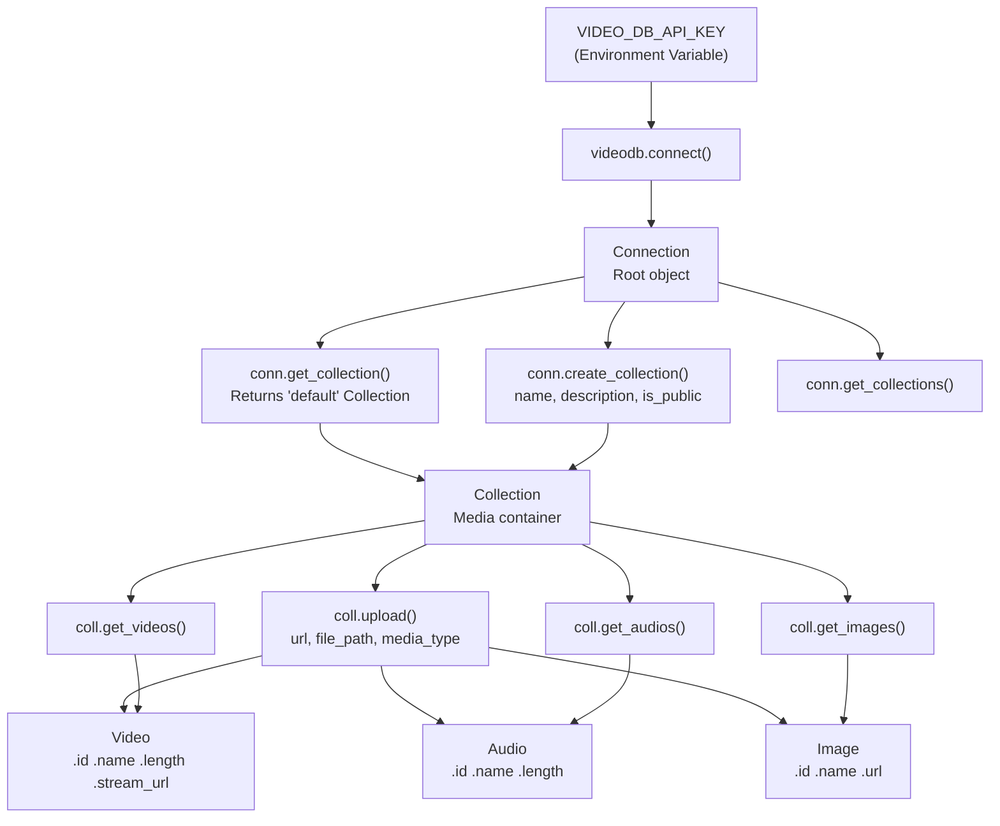
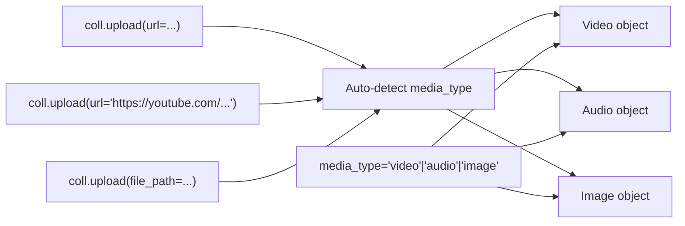
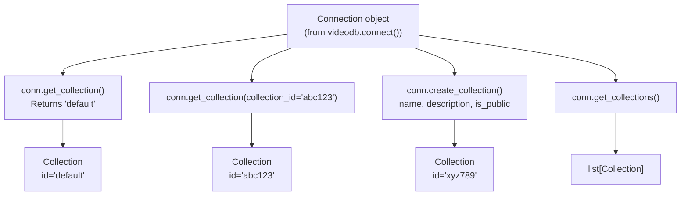
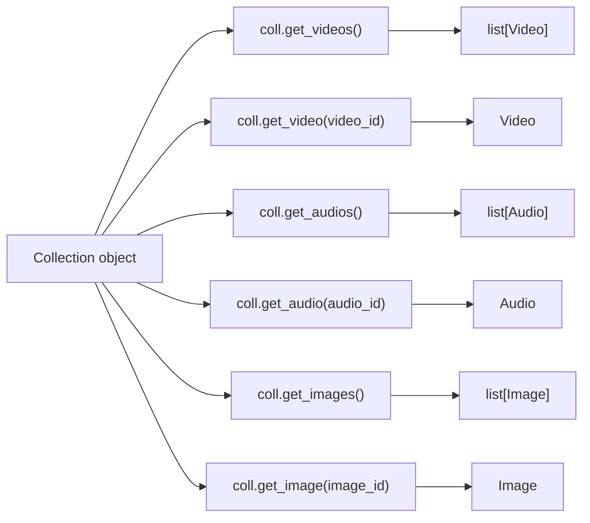

<!-- source: DeepWiki mcp.deepwiki.com · repo video-db/skills · page 4 Media Management · fetched 2026-10-26 -->

# Media Management

<details>
<summary>Relevant source files</summary>

The following files were used as context for generating this wiki page:

- [python/SKILL.md](python/SKILL.md)
- [python/reference/api-reference.md](python/reference/api-reference.md)

</details>


This document covers the uploading, organizing, and managing of media assets (Video, Audio, Image) within VideoDB Collections. It explains the object model hierarchy, upload methods, collection management, and basic media asset operations.

For advanced video processing (indexing, searching, editing), see [Video Understanding and Indexing](#5) and [Timeline Editing](#7). For real-time media capture and live streams, see [Desktop Capture](#8) and [Live Stream Processing](#9).

**Sources:** [python/SKILL.md:1-362](), [python/reference/api-reference.md:1-549]()

---

## Object Model Hierarchy

The VideoDB SDK organizes media through a three-level hierarchy: `Connection` → `Collection` → Media Assets (`Video`, `Audio`, `Image`).



**Diagram: Connection-Collection-Media Object Hierarchy**

The `Connection` object is created by `videodb.connect()` and serves as the factory for `Collection` objects. Each `Collection` contains and manages `Video`, `Audio`, and `Image` assets. The `Connection` automatically validates the `VIDEO_DB_API_KEY` environment variable on initialization.

**Sources:** [python/SKILL.md:68-96](), [python/reference/api-reference.md:4-32]()

---

## Media Asset Types

VideoDB supports three core media types, each represented by a distinct class:

| Media Type | Class | Key Properties | Primary Use Cases |
|------------|-------|----------------|-------------------|
| **Video** | `Video` | `.id`, `.name`, `.length`, `.stream_url`, `.player_url`, `.thumbnail_url` | Indexing, searching, timeline editing, transcoding, reframing |
| **Audio** | `Audio` | `.id`, `.name`, `.length` | Background music, voiceovers, sound effects, dubbing |
| **Image** | `Image` | `.id`, `.name`, `.url` | Overlays, thumbnails, generated artwork, branding |

All media types share common properties (`.id`, `.name`, `.collection_id`) and inherit authentication context from their parent `Collection`.

**Sources:** [python/reference/api-reference.md:148-269]()

---

## Uploading Media

### Upload Methods

The `Collection.upload()` method supports three input sources:



**Diagram: Upload Input Sources and Type Detection**

**Sources:** [python/SKILL.md:127-138](), [python/reference/api-reference.md:135-146]()

### Upload Parameters

| Parameter | Type | Default | Description |
|-----------|------|---------|-------------|
| `url` | `str \| None` | `None` | Remote URL (HTTP, HTTPS, YouTube) |
| `file_path` | `str \| None` | `None` | Local file path |
| `media_type` | `str \| None` | `None` | Explicit type: `"video"`, `"audio"`, or `"image"` (auto-detected if omitted) |
| `name` | `str \| None` | `None` | Custom name for the asset |
| `description` | `str \| None` | `None` | Asset description |
| `callback_url` | `str \| None` | `None` | Webhook URL for async upload notification |

**Sources:** [python/reference/api-reference.md:135-146]()

### Upload Examples

```python
# Upload from URL
video = coll.upload(url="https://example.com/video.mp4")

# Upload from YouTube
video = coll.upload(url="https://www.youtube.com/watch?v=VIDEO_ID")

# Upload local file
video = coll.upload(file_path="/path/to/video.mp4")

# Upload with explicit type and metadata
audio = coll.upload(
    file_path="/path/to/music.mp3",
    media_type="audio",
    name="Background Music",
    description="Corporate track"
)

# Async upload with webhook
video = coll.upload(
    url="https://example.com/large-video.mp4",
    callback_url="https://myapp.com/upload-complete"
)
```

The `media_type` parameter is optional; the SDK auto-detects based on file extension or MIME type. Explicit specification is recommended when the source lacks clear type information.

**Sources:** [python/SKILL.md:127-138](), [python/reference/api-reference.md:135-146]()

---

## Collections

### Creating and Retrieving Collections



**Diagram: Collection Creation and Retrieval Paths**

Every VideoDB account has a `"default"` collection. Calling `conn.get_collection()` without arguments returns this default collection.

**Sources:** [python/reference/api-reference.md:18-32](), [python/reference/api-reference.md:99-134]()

### Collection Methods

| Method | Returns | Description |
|--------|---------|-------------|
| `conn.get_collection(collection_id="default")` | `Collection` | Retrieve collection by ID (defaults to `"default"`) |
| `conn.get_collections()` | `list[Collection]` | List all collections |
| `conn.create_collection(name, description, is_public=False)` | `Collection` | Create new collection |
| `conn.update_collection(id, name, description)` | `Collection` | Update collection metadata |
| `coll.make_public()` | `None` | Make collection publicly accessible |
| `coll.make_private()` | `None` | Make collection private |
| `coll.delete()` | `None` | Delete the collection and all its assets |

**Sources:** [python/reference/api-reference.md:18-32](), [python/reference/api-reference.md:106-134]()

### Public vs Private Collections

Collections have a visibility setting controlled by `is_public`:

- **Private collections** (default): Only accessible with API authentication
- **Public collections**: Accessible via public URLs without authentication

Use `coll.make_public()` and `coll.make_private()` to toggle visibility after creation.

**Sources:** [python/reference/api-reference.md:22-23](), [python/reference/api-reference.md:128-129]()

---

## Managing Media Assets

### Listing Assets



**Diagram: Asset Retrieval Methods**

**Sources:** [python/reference/api-reference.md:106-134]()

### Asset Retrieval Methods

| Method | Returns | Description |
|--------|---------|-------------|
| `coll.get_videos()` | `list[Video]` | List all videos in collection |
| `coll.get_video(video_id)` | `Video` | Retrieve specific video by ID |
| `coll.get_audios()` | `list[Audio]` | List all audio assets |
| `coll.get_audio(audio_id)` | `Audio` | Retrieve specific audio by ID |
| `coll.get_images()` | `list[Image]` | List all images |
| `coll.get_image(image_id)` | `Image` | Retrieve specific image by ID |

**Sources:** [python/reference/api-reference.md:106-134]()

### Deleting Assets

| Method | Description |
|--------|-------------|
| `coll.delete_video(video_id)` | Delete video from collection |
| `coll.delete_audio(audio_id)` | Delete audio from collection |
| `coll.delete_image(image_id)` | Delete image from collection |
| `video.delete()` | Delete video (instance method) |
| `audio.delete()` | Delete audio (instance method) |
| `image.delete()` | Delete image (instance method) |

Assets can be deleted either through the `Collection` object using the asset ID, or directly via the asset instance's `.delete()` method.

**Sources:** [python/reference/api-reference.md:130-134](), [python/reference/api-reference.md:189](), [python/reference/api-reference.md:246](), [python/reference/api-reference.md:268]()

---

## Video Object Properties and Methods

### Video Properties

| Property | Type | Description |
|----------|------|-------------|
| `.id` | `str` | Unique video identifier |
| `.collection_id` | `str` | Parent collection ID |
| `.name` | `str` | Video name |
| `.description` | `str` | Video description |
| `.length` | `float` | Duration in seconds |
| `.stream_url` | `str` | Default HLS stream URL for playback |
| `.player_url` | `str` | Embeddable player URL |
| `.thumbnail_url` | `str` | Thumbnail image URL |

**Sources:** [python/reference/api-reference.md:154-165]()

### Core Video Methods

| Method | Returns | Description |
|--------|---------|-------------|
| `video.generate_stream(timeline=None)` | `str` | Generate HLS stream URL (optional timeline segments) |
| `video.play()` | `str` | Open stream in browser, returns player URL |
| `video.generate_thumbnail(time=None)` | `str \| Image` | Generate thumbnail at timestamp |
| `video.get_thumbnails()` | `list[Image]` | Retrieve all generated thumbnails |
| `video.download(name=None)` | `dict` | Download video file |
| `video.delete()` | `None` | Delete the video |

For indexing methods (`index_spoken_words`, `index_scenes`, etc.), see [Video Understanding and Indexing](#5). For search methods, see [Searching Videos](#6). For timeline editing methods, see [Timeline Editing](#7).

**Sources:** [python/reference/api-reference.md:168-190]()

---

## Audio Object Properties and Methods

### Audio Properties

| Property | Type | Description |
|----------|------|-------------|
| `.id` | `str` | Unique audio identifier |
| `.collection_id` | `str` | Parent collection ID |
| `.name` | `str` | Audio name |
| `.length` | `float` | Duration in seconds |

**Sources:** [python/reference/api-reference.md:229-236]()

### Audio Methods

| Method | Returns | Description |
|--------|---------|-------------|
| `audio.generate_url()` | `str` | Generate signed URL for direct playback |
| `audio.get_transcript(start=None, end=None)` | `list[dict]` | Retrieve timestamped transcript |
| `audio.get_transcript_text(start=None, end=None)` | `str` | Get transcript as plain text |
| `audio.generate_transcript(force=None)` | `dict` | Generate transcript from audio |
| `audio.delete()` | `None` | Delete the audio asset |

Audio assets can be transcribed independently of video. Use `audio.generate_url()` to obtain a playable URL for direct audio playback.

**Sources:** [python/reference/api-reference.md:238-246]()

---

## Image Object Properties and Methods

### Image Properties

| Property | Type | Description |
|----------|------|-------------|
| `.id` | `str` | Unique image identifier |
| `.collection_id` | `str` | Parent collection ID |
| `.name` | `str` | Image name |
| `.url` | `str \| None` | Image URL (may be `None` for generated images) |

**Note:** For images created via `coll.generate_image()`, the `.url` property may be `None`. Always use `image.generate_url()` for reliable access.

**Sources:** [python/reference/api-reference.md:254-261]()

### Image Methods

| Method | Returns | Description |
|--------|---------|-------------|
| `image.generate_url()` | `str` | Generate signed URL for image access |
| `image.delete()` | `None` | Delete the image |

**Sources:** [python/reference/api-reference.md:263-268]()

---

## Connection-Level Upload

The `Connection` object also provides an `upload()` method that uploads directly to the default collection:

```python
# These are equivalent:
video = conn.upload(url="https://example.com/video.mp4")
video = conn.get_collection().upload(url="https://example.com/video.mp4")
```

The `conn.upload()` method accepts the same parameters as `coll.upload()` and is a convenience shortcut for uploading to the default collection.

**Sources:** [python/reference/api-reference.md:25]()

---

## Usage Example Workflow

```python
import videodb

# 1. Connect and authenticate
conn = videodb.connect()  # Uses VIDEO_DB_API_KEY from environment

# 2. Get or create a collection
coll = conn.get_collection()  # Default collection
# OR: coll = conn.create_collection(name="My Project", is_public=False)

# 3. Upload media
video = coll.upload(url="https://example.com/video.mp4", name="Demo Video")
audio = coll.upload(file_path="/path/to/music.mp3", media_type="audio")
image = coll.upload(url="https://example.com/logo.png")

# 4. List assets
videos = coll.get_videos()
print(f"Collection contains {len(videos)} videos")

# 5. Access asset properties
print(f"Video length: {video.length} seconds")
print(f"Stream URL: {video.stream_url}")

# 6. Retrieve specific asset
retrieved_video = coll.get_video(video.id)

# 7. Delete asset
video.delete()
```

**Sources:** [python/SKILL.md:68-96](), [python/SKILL.md:127-138](), [python/reference/api-reference.md:1-32](), [python/reference/api-reference.md:99-134]()

---

