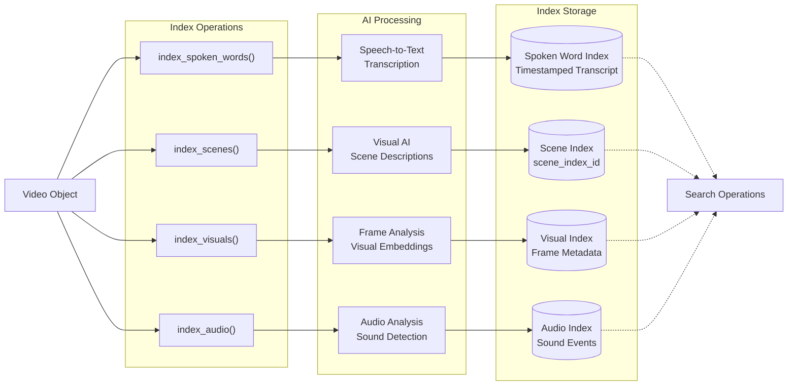
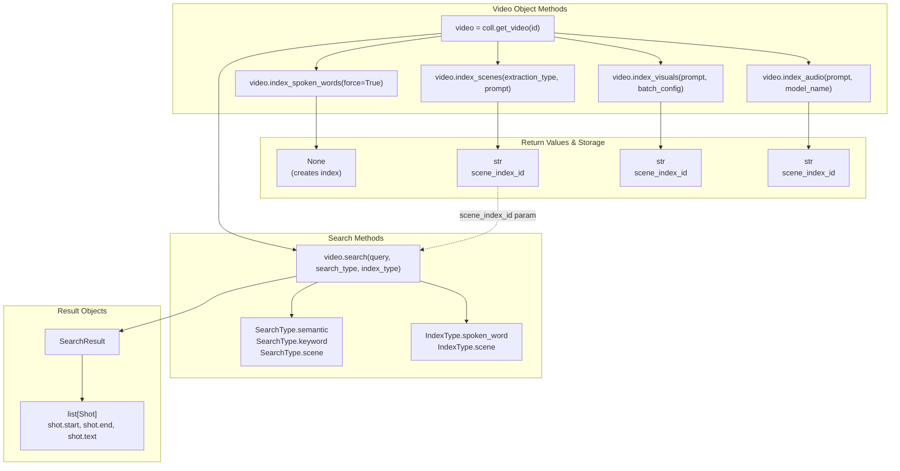

<!-- source: DeepWiki mcp.deepwiki.com · repo video-db/skills · page 5 Video Understanding and Indexing · fetched 2026-10-26 -->

# Video Understanding and Indexing

<details>
<summary>Relevant source files</summary>

The following files were used as context for generating this wiki page:

- [python/SKILL.md](python/SKILL.md)
- [python/reference/api-reference.md](python/reference/api-reference.md)
- [python/reference/search.md](python/reference/search.md)

</details>


This document explains how AI indexing transforms raw video into searchable, structured content. Indexing is the foundation of VideoDB's "Understand" phase in the See→Understand→Act paradigm, enabling semantic search, keyword search, and scene-based queries.

For specific indexing workflows, see [Spoken Word Indexing](#5.1), [Scene Indexing](#5.2), and [Visual and Audio Indexing](#5.3). For using indexes to search videos, see [Searching Videos](#6).

---

## Overview

Raw video files are opaque binary data. Indexing analyzes video content using AI models and creates structured metadata that makes the content queryable. Once indexed, you can search for specific moments using natural language, keywords, or visual descriptions.

**Indexing is a prerequisite for search.** You must index a video before you can search it. Indexing is a one-time server-side operation per video per index type.

---

## Index Types

VideoDB provides four types of indexes, each analyzing different aspects of video content:

| Index Type | Purpose | Primary Method | Enables |
|------------|---------|----------------|---------|
| **Spoken Word** | Transcribes audio to text | `video.index_spoken_words()` | Semantic search, keyword search on spoken content |
| **Scene** | AI descriptions of visual scenes | `video.index_scenes()` | Scene search, visual content queries |
| **Visual** | Frame-level visual analysis | `video.index_visuals()` | Detailed visual understanding, custom prompts |
| **Audio** | Audio content analysis | `video.index_audio()` | Audio-based search, sound detection |

Sources: [python/reference/search.md:1-60](), [python/reference/api-reference.md:168-177]()

---

## Indexing Architecture

### Indexing Pipeline



**Indexing Pipeline Flow**

Sources: [python/reference/search.md:1-60](), [python/reference/api-reference.md:168-177]()

---

### Code Entity Mapping



**Code Entity Relationships**

Sources: [python/reference/api-reference.md:149-190](), [python/reference/search.md:1-60]()

---

## Indexing Workflow

### 1. Upload Video

```python
video = coll.upload(url="https://example.com/video.mp4")
```

At this point, the video is stored but not indexed. You cannot search it yet.

Sources: [python/reference/api-reference.md:135-146]()

---

### 2. Create Indexes

#### Spoken Word Index

```python
# force=True makes indexing idempotent
video.index_spoken_words(force=True)
```

This transcribes the audio track and creates a searchable index of spoken content. Required for semantic search and keyword search on transcripts.

**Parameters:**
- `language_code` (optional): Language code (e.g., `"en"`, `"es"`)
- `force` (default `False`): Skip if already indexed to avoid errors
- `segmentation_type` (default `SegmentationType.sentence`): How to segment transcript
- `callback_url` (optional): Webhook for async notification

Sources: [python/reference/search.md:11-32](), [python/SKILL.md:140-146]()

---

#### Scene Index

```python
from videodb import SceneExtractionType

scene_index_id = video.index_scenes(
    extraction_type=SceneExtractionType.shot_based,
    prompt="Describe the visual content, objects, actions, and setting.",
)
```

This analyzes visual content and generates AI descriptions of scenes. Returns a `scene_index_id` that you must pass to `video.search()` for scene-based queries.

**Important:** `index_scenes()` raises an error if a scene index already exists. Extract the existing `scene_index_id` from the error:

```python
import re

try:
    scene_index_id = video.index_scenes(...)
except Exception as e:
    match = re.search(r"id\s+([a-f0-9]+)", str(e))
    if match:
        scene_index_id = match.group(1)
    else:
        raise
```

**Extraction Types:**

| Type | Description | Use Case |
|------|-------------|----------|
| `SceneExtractionType.shot_based` | Automatic shot boundary detection | General purpose, action content |
| `SceneExtractionType.time_based` | Fixed time interval extraction | Uniform sampling, long static content |
| `SceneExtractionType.transcript` | Transcript-based scene boundaries | Speech-driven scene segmentation |

Sources: [python/reference/search.md:33-71](), [python/SKILL.md:169-206]()

---

#### Visual and Audio Indexes

```python
# Frame-level visual analysis
visual_index_id = video.index_visuals(
    prompt="Identify objects, people, and text visible in each frame.",
    batch_config={"batch_size": 10},
)

# Audio content analysis
audio_index_id = video.index_audio(
    prompt="Detect music, speech, sound effects, and profanity.",
    model_name="gpt-4o",
)
```

These create more granular indexes for specialized use cases. Both return `scene_index_id` values that can be used in search.

Sources: [python/reference/api-reference.md:175-176]()

---

### 3. Search Indexed Content

Once indexed, you can search the video:

```python
from videodb import SearchType, IndexType

# Search spoken content
results = video.search(
    query="product demo",
    search_type=SearchType.semantic,
)

# Search visual scenes
results = video.search(
    query="person writing on whiteboard",
    search_type=SearchType.semantic,
    index_type=IndexType.scene,
    scene_index_id=scene_index_id,
    score_threshold=0.3,  # Filter low-relevance results
)
```

For complete search documentation, see [Searching Videos](#6).

Sources: [python/reference/search.md:73-154]()

---

## Index Storage and Reuse

### Persistent Indexes

Indexes are stored permanently on VideoDB's servers. Once created, an index exists for the lifetime of the video. You never need to re-index unless you want a different configuration.

```python
# First time: creates index
video.index_spoken_words()

# Later: raises error because index already exists
video.index_spoken_words()  # Error: "Spoken word index already exists"

# Solution: use force=True to skip if exists
video.index_spoken_words(force=True)  # Success (no-op)
```

Sources: [python/SKILL.md:290-298](), [python/reference/search.md:11-32]()

---

### Multiple Scene Indexes

Unlike spoken word indexes (one per video), you can create **multiple scene indexes** per video with different configurations:

```python
# Index 1: General scene descriptions
index_1 = video.index_scenes(
    extraction_type=SceneExtractionType.shot_based,
    prompt="Describe the overall scene and setting.",
)

# Index 2: Product-focused descriptions
index_2 = video.index_scenes(
    extraction_type=SceneExtractionType.time_based,
    extraction_config={"time": 5},
    prompt="List all products visible on screen.",
)

# Search using a specific index
results = video.search(
    query="smartphone",
    search_type=SearchType.semantic,
    index_type=IndexType.scene,
    scene_index_id=index_2,  # Target the product-focused index
)
```

This allows different "views" of the same video optimized for different search use cases.

Sources: [python/reference/search.md:33-71](), [python/reference/search.md:130-136]()

---

## Indexing vs. Transcription

### Getting Transcripts

Indexing creates a searchable structure, but you can also retrieve raw transcript text:

```python
# Create spoken word index
video.index_spoken_words(force=True)

# Get timestamped transcript segments
transcript = video.get_transcript()
# Returns: [{"start": 0.0, "end": 2.5, "text": "Hello world"}, ...]

# Get plain text transcript
text = video.get_transcript_text()
# Returns: "Hello world..."
```

**Important:** `get_transcript()` and `get_transcript_text()` require prior `index_spoken_words()` or `generate_transcript()`. They retrieve the existing transcript but do not create an index.

Sources: [python/reference/api-reference.md:177-178]()

---

## Common Patterns

### Index Once, Search Many

```python
# Upload and index (one-time setup)
video = coll.upload(url="https://example.com/long-video.mp4")
video.index_spoken_words(force=True)

scene_index_id = video.index_scenes(
    extraction_type=SceneExtractionType.shot_based,
    prompt="Describe visual content.",
)

# Now perform multiple searches (fast)
results_1 = video.search("product features")
results_2 = video.search("customer testimonials")
results_3 = video.search(
    query="whiteboard diagram",
    search_type=SearchType.semantic,
    index_type=IndexType.scene,
    scene_index_id=scene_index_id,
)
```

Sources: [python/reference/search.md:223]()

---

### Idempotent Indexing

Use `force=True` to make indexing safe in scripts that may run multiple times:

```python
# This pattern never fails on re-runs
video.index_spoken_words(force=True)  # Skips if already indexed

try:
    scene_index_id = video.index_scenes(...)
except Exception as e:
    # Extract existing ID if already indexed
    match = re.search(r"id\s+([a-f0-9]+)", str(e))
    if match:
        scene_index_id = match.group(1)
    else:
        raise
```

Sources: [python/SKILL.md:290-298](), [python/reference/search.md:230]()

---

### Cross-Collection Search

Index multiple videos in a collection, then search across all of them:

```python
coll = conn.get_collection()

# Index all videos
for video in coll.get_videos():
    video.index_spoken_words(force=True)

# Search across all videos
results = coll.search(
    query="product demo",
    search_type=SearchType.semantic,
)

for shot in results.get_shots():
    print(f"Found in {shot.video_id} at {shot.start}s")
```

**Note:** Collection-level search only supports `SearchType.semantic`. For keyword or scene search, use `video.search()` on individual videos.

Sources: [python/reference/search.md:193-210]()

---

## Index Types Comparison

### When to Use Each Index

| Scenario | Index Type | Search Type | Example Query |
|----------|------------|-------------|---------------|
| Find spoken words/phrases | Spoken Word | Semantic | `"explaining AI concepts"` |
| Find exact terms in speech | Spoken Word | Keyword | `"machine learning"` |
| Find visual content | Scene | Semantic w/ IndexType.scene | `"person at whiteboard"` |
| Analyze frames in detail | Visual | Custom processing | Frame-by-frame object detection |
| Detect audio events | Audio | Custom processing | Music, profanity, sound effects |

Sources: [python/reference/search.md:73-154]()

---

### Combining Multiple Indexes

You can index a video with multiple index types and search them independently:

```python
# Index both spoken and visual content
video.index_spoken_words(force=True)
scene_index_id = video.index_scenes(
    extraction_type=SceneExtractionType.shot_based,
    prompt="Describe visual content.",
)

# Search spoken content
spoken_results = video.search(
    query="product features",
    search_type=SearchType.semantic,
)

# Search visual content
visual_results = video.search(
    query="product demo on screen",
    search_type=SearchType.semantic,
    index_type=IndexType.scene,
    scene_index_id=scene_index_id,
)
```

Sources: [python/reference/search.md:223-230]()

---

## Performance Considerations

### Indexing Duration

| Index Type | Processing Time | Notes |
|------------|----------------|-------|
| Spoken Word | ~10-20% of video duration | Depends on audio complexity |
| Scene (shot_based) | ~50-100% of video duration | More shots = longer processing |
| Scene (time_based) | ~30-70% of video duration | Predictable based on interval |
| Visual | Variable | Depends on batch_config |
| Audio | ~20-40% of video duration | Similar to spoken word |

Indexing is server-side and asynchronous. For long videos, use `callback_url` to receive webhook notifications when indexing completes.

Sources: [python/reference/api-reference.md:173-176]()

---

### Search Performance

Once indexed, searches are fast (typically <1 second) regardless of video length. The index is optimized for query performance.

Sources: [python/reference/search.md:224]()

---

## Error Handling

### Common Indexing Errors

| Error | Cause | Solution |
|-------|-------|----------|
| `"Spoken word index already exists"` | Re-indexing without `force=True` | Use `video.index_spoken_words(force=True)` |
| `"Scene index with id XXX already exists"` | Re-indexing scenes | Extract `scene_index_id` from error with regex |
| `SearchError: "Video not indexed"` | Searching before indexing | Call `index_spoken_words()` first |
| `InvalidRequestError: "No results found"` | Query returned no matches | Catch exception, treat as empty results |

Sources: [python/SKILL.md:289-298](), [python/reference/search.md:227-230]()

---

### Handling No Results

`video.search()` raises `InvalidRequestError` when no results match. Always wrap search calls in try/except:

```python
from videodb.exceptions import InvalidRequestError

try:
    results = video.search("your query")
    shots = results.get_shots()
except InvalidRequestError as e:
    if "No results found" in str(e):
        shots = []  # Treat as empty
    else:
        raise
```

Sources: [python/SKILL.md:152-167](), [python/reference/search.md:228]()

---

## Next Steps

- For detailed spoken word indexing workflows, see [Spoken Word Indexing](#5.1)
- For scene indexing configuration and extraction types, see [Scene Indexing](#5.2)
- For visual and audio indexing details, see [Visual and Audio Indexing](#5.3)
- For using indexes to search videos, see [Searching Videos](#6)
- For working with search results, see [Working with Search Results](#6.2)

Sources: [python/reference/search.md:1-231]()

---

