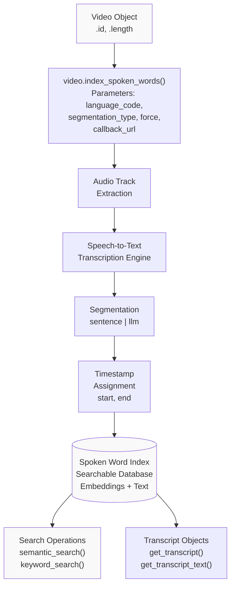
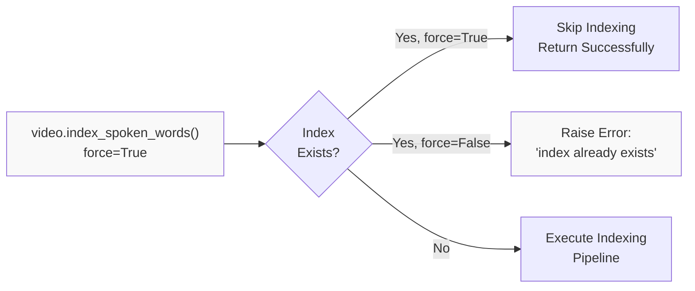
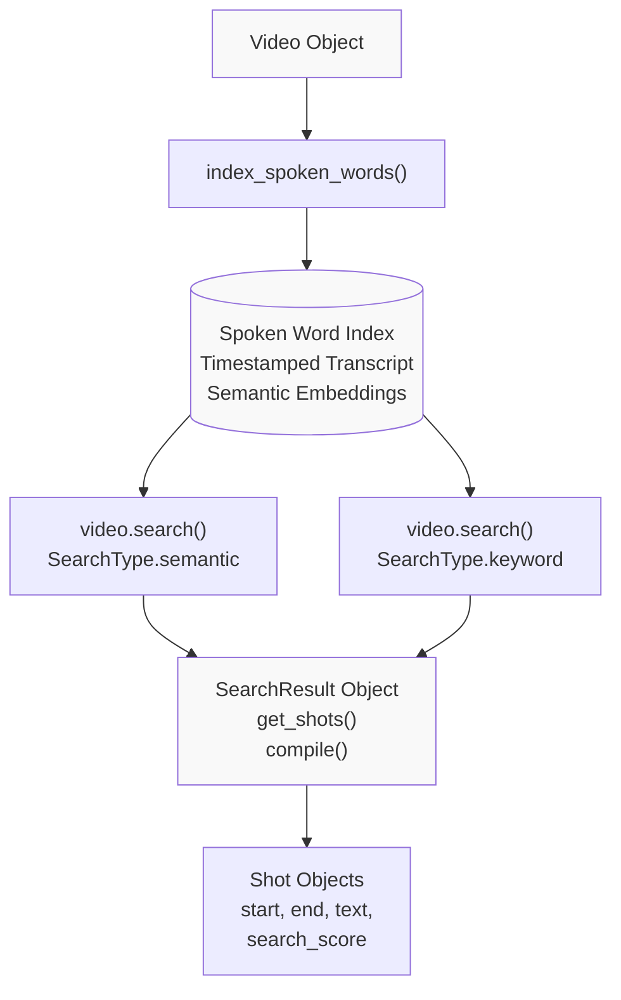

<!-- source: DeepWiki mcp.deepwiki.com · repo video-db/skills · page 5.1 Spoken Word Indexing · fetched 2026-10-26 -->

# Spoken Word Indexing

<details>
<summary>Relevant source files</summary>

The following files were used as context for generating this wiki page:

- [python/SKILL.md](python/SKILL.md)
- [python/reference/search.md](python/reference/search.md)

</details>


## Purpose and Scope

Spoken word indexing transcribes the audio track of a video into timestamped text segments and builds a searchable index over the spoken content. This operation is a prerequisite for semantic search and keyword search operations on video assets.

This page documents the `index_spoken_words()` method, transcript retrieval, and the underlying indexing mechanics. For visual content indexing, see [Scene Indexing](#5.2). For frame-level and audio content analysis, see [Visual and Audio Indexing](#5.3). For using the spoken word index in search operations, see [Searching Videos](#6).

**Sources:** [python/SKILL.md:141-147](), [python/reference/search.md:1-32]()

---

## Overview

The spoken word index transforms audio into searchable, timestamped text. This is a one-time operation per video that creates a persistent index stored on the VideoDB backend. Once indexed, the video's spoken content becomes queryable through semantic (natural language) and keyword (exact match) search operations.

The indexing process:
1. Extracts the audio track from the video
2. Transcribes speech to text using AI models
3. Segments the transcript into logical units (sentences or LLM-based segments)
4. Timestamps each segment with start/end times
5. Builds a semantic embedding index for natural language queries
6. Stores the index for future search operations

**Sources:** [python/reference/search.md:11-32]()

---

## Indexing Pipeline



**Diagram: Spoken Word Indexing Pipeline**

This diagram illustrates the transformation from raw video audio to searchable spoken content. The `index_spoken_words()` method orchestrates the entire pipeline server-side. The resulting index enables both search operations and transcript retrieval.

**Sources:** [python/reference/search.md:11-32]()

---

## Method Signature and Parameters

The `index_spoken_words()` method is called on a `Video` object:

```python
video.index_spoken_words(
    language_code=None,
    segmentation_type=SegmentationType.sentence,
    force=False,
    callback_url=None
)
```

### Parameters

| Parameter | Type | Default | Description |
|-----------|------|---------|-------------|
| `language_code` | `str \| None` | `None` | ISO 639-1 language code (e.g., `"en"`, `"es"`, `"fr"`). If `None`, automatic language detection is used. |
| `segmentation_type` | `SegmentationType` | `SegmentationType.sentence` | Controls how the transcript is divided: `sentence` (grammatical boundaries) or `llm` (semantic boundaries using LLM analysis). |
| `force` | `bool` | `False` | If `True`, skips indexing if the video is already indexed (idempotent operation). If `False`, raises an error if an index already exists. |
| `callback_url` | `str \| None` | `None` | Optional webhook URL for async completion notification. If provided, the method returns immediately and the backend POSTs to this URL when indexing completes. |

**Sources:** [python/reference/search.md:24-31]()

---

## Language Support

The `language_code` parameter accepts ISO 639-1 two-letter language codes. When omitted, the system automatically detects the spoken language.

**Common language codes:**

| Language | Code |
|----------|------|
| English | `en` |
| Spanish | `es` |
| French | `fr` |
| German | `de` |
| Italian | `it` |
| Portuguese | `pt` |
| Japanese | `ja` |
| Chinese | `zh` |
| Hindi | `hi` |
| Arabic | `ar` |

**Example:**

```python
# Explicit language specification
video.index_spoken_words(language_code="es")

# Automatic language detection
video.index_spoken_words()
```

**Sources:** [python/reference/search.md:24-31]()

---

## Idempotent Indexing with the `force` Parameter

By default, calling `index_spoken_words()` on an already-indexed video raises an error:

```
Error: Spoken word index for video already exists
```

The `force=True` parameter makes the operation idempotent—if the video is already indexed, the method returns successfully without re-indexing. This is essential for workflows where you cannot guarantee whether a video has been indexed previously.

### Code Entity Mapping



**Diagram: Idempotent Indexing Logic**

### Recommended Pattern

Always use `force=True` in production workflows to avoid errors when re-running indexing operations:

```python
# Safe pattern - idempotent
video.index_spoken_words(force=True)

# Unsafe pattern - will fail if already indexed
video.index_spoken_words()  # May raise error
```

**Sources:** [python/SKILL.md:144](), [python/reference/search.md:19](), [python/SKILL.md:293]()

---

## Retrieving Transcripts

After indexing, the transcript is accessible through two methods:

### `get_transcript_text()`

Returns the full transcript as a single string with no timestamp information:

```python
video.index_spoken_words(force=True)
text = video.get_transcript_text()
print(text)
# Output: "Welcome to this tutorial. Today we will discuss..."
```

### `get_transcript()`

Returns structured transcript data with timestamps for each segment:

```python
video.index_spoken_words(force=True)
transcript = video.get_transcript()

for segment in transcript:
    print(f"[{segment['start']:.2f}s - {segment['end']:.2f}s]: {segment['text']}")
# Output:
# [0.00s - 3.45s]: Welcome to this tutorial.
# [3.50s - 7.20s]: Today we will discuss machine learning.
```

**Sources:** [python/SKILL.md:146]()

---

## Segmentation Types

The `segmentation_type` parameter controls how the transcript is divided into searchable units.

### Segmentation Type Comparison

| Type | Enum Value | Boundary Logic | Use Case |
|------|-----------|----------------|----------|
| **Sentence** | `SegmentationType.sentence` | Grammatical sentence boundaries (periods, question marks) | General purpose, natural reading flow |
| **LLM** | `SegmentationType.llm` | Semantic topic boundaries analyzed by LLM | Long-form content with thematic shifts, lectures, podcasts |

### Example

```python
from videodb import SegmentationType

# Sentence-based segmentation (default)
video.index_spoken_words(
    segmentation_type=SegmentationType.sentence,
    force=True
)

# LLM-based semantic segmentation
video.index_spoken_words(
    segmentation_type=SegmentationType.llm,
    force=True
)
```

**Sentence segmentation** produces tighter segments aligned with grammatical structure. **LLM segmentation** produces larger segments grouped by semantic meaning, which can improve search relevance for conceptual queries.

**Sources:** [python/reference/search.md:29]()

---

## Asynchronous Processing

For long videos or high-volume indexing workflows, use the `callback_url` parameter to enable asynchronous processing:

```python
video.index_spoken_words(
    callback_url="https://example.com/webhook/indexing_complete",
    force=True
)
```

When `callback_url` is provided:
1. The method returns immediately (non-blocking)
2. Indexing proceeds server-side in the background
3. On completion, the backend POSTs a notification to the webhook URL

The webhook receives a JSON payload with indexing status and metadata.

**Sources:** [python/reference/search.md:31]()

---

## Integration with Search Operations

The spoken word index enables two search types on the `Video` object:

### Semantic Search

Natural language queries matched against transcript content using AI embeddings:

```python
from videodb import SearchType

video.index_spoken_words(force=True)

results = video.search(
    query="explaining the benefits of machine learning",
    search_type=SearchType.semantic
)
```

### Keyword Search

Exact term matching in the transcript:

```python
results = video.search(
    query="artificial intelligence",
    search_type=SearchType.keyword
)
```

For detailed search operations and result handling, see [Search Types](#6.1) and [Working with Search Results](#6.2).

**Sources:** [python/reference/search.md:72-100]()

---

## Search Operation Dependencies



**Diagram: Spoken Word Index Dependencies in Search Workflow**

Both semantic and keyword search require a spoken word index. Attempting to search an unindexed video raises an error. The index must be created before any search operations can execute.

**Sources:** [python/reference/search.md:1-8](), [python/reference/search.md:72-100]()

---

## Common Patterns and Best Practices

### Pattern 1: Safe Idempotent Indexing

Always use `force=True` to avoid "already exists" errors:

```python
video.index_spoken_words(force=True)
```

**Sources:** [python/SKILL.md:293]()

### Pattern 2: Transcript + Subtitle Generation

Index spoken words and immediately add subtitles to the video:

```python
video.index_spoken_words(force=True)
stream_url = video.add_subtitle()
```

**Sources:** [python/SKILL.md:141-147]()

### Pattern 3: Index + Search + Compile

Complete workflow from indexing to playable results:

```python
from videodb import SearchType

video.index_spoken_words(force=True)
results = video.search(
    query="product demonstration",
    search_type=SearchType.semantic
)
stream_url = results.compile()
```

**Sources:** [python/reference/search.md:213-220]()

### Pattern 4: Error Handling for Search

Search operations raise `InvalidRequestError` when no results are found. Always handle this exception:

```python
from videodb.exceptions import InvalidRequestError

video.index_spoken_words(force=True)

try:
    results = video.search("your query")
    shots = results.get_shots()
except InvalidRequestError as e:
    if "No results found" in str(e):
        shots = []  # Treat as empty result set
    else:
        raise
```

**Sources:** [python/SKILL.md:152-167](), [python/reference/search.md:228]()

### Pattern 5: Async Indexing for Long Videos

For videos longer than 30 minutes or batch processing workflows:

```python
video.index_spoken_words(
    callback_url="https://example.com/webhooks/indexing",
    force=True
)
# Method returns immediately, indexing continues server-side
```

**Sources:** [python/reference/search.md:31]()

---

## Error Scenarios

| Scenario | Error Message | Solution |
|----------|---------------|----------|
| Indexing already-indexed video | `Spoken word index for video already exists` | Use `force=True` parameter |
| Searching unindexed video | `Video not indexed` or similar | Call `video.index_spoken_words()` first |
| Search returns no matches | `InvalidRequestError: No results found` | Catch exception and treat as empty results |
| Invalid language code | `Invalid language code` | Use valid ISO 639-1 codes or omit for auto-detection |

**Sources:** [python/SKILL.md:291-298](), [python/reference/search.md:228]()

---

## Index Persistence and Reuse

Spoken word indexes are stored permanently on the VideoDB backend and associated with the video asset. Once indexed:
- The index persists across sessions
- No re-indexing is needed for future searches
- The index remains available even if the original video is accessed from different client connections
- Indexes are automatically deleted only when the video asset is deleted

This "index once, search many times" model optimizes performance and cost, as transcription is the most expensive operation in the search workflow.

**Sources:** [python/reference/search.md:223-224]()

---

