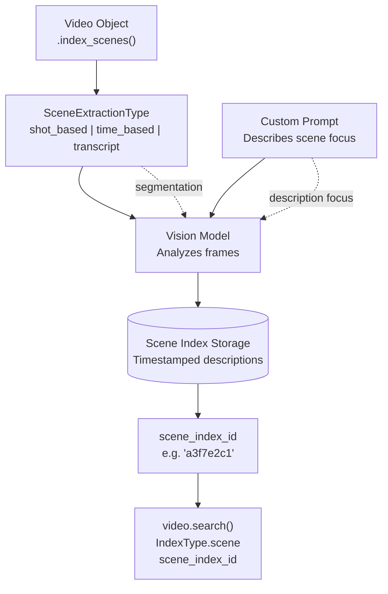
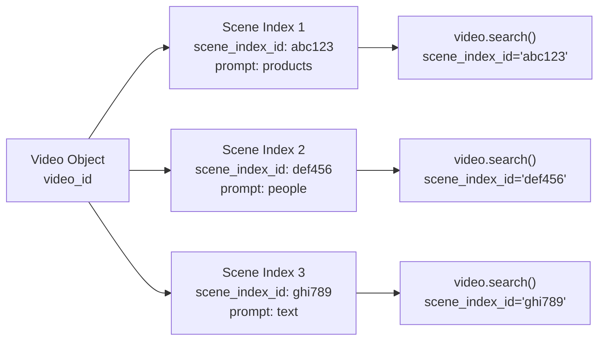
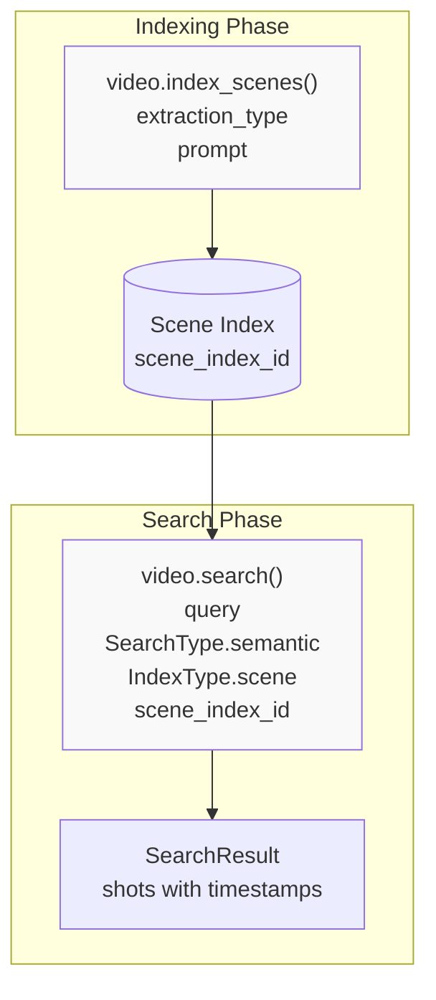

<!-- source: DeepWiki mcp.deepwiki.com · repo video-db/skills · page 5.2 Scene Indexing · fetched 2026-10-26 -->

# Scene Indexing

<details>
<summary>Relevant source files</summary>

The following files were used as context for generating this wiki page:

- [python/SKILL.md](python/SKILL.md)
- [python/reference/search.md](python/reference/search.md)

</details>


This document covers **scene indexing** in VideoDB, which generates AI descriptions of visual content to make videos searchable by what appears on screen. Scene indexing is one of three indexing types available in VideoDB. For speech-to-text indexing, see [Spoken Word Indexing](#5.1). For frame-level visual analysis and audio content detection, see [Visual and Audio Indexing](#5.3). For querying indexed content, see [Searching Videos](#6).

---

## Overview

Scene indexing analyzes video frames and generates natural language descriptions of visual content. Unlike spoken word indexing which transcribes audio, scene indexing describes what is visible: objects, people, actions, settings, and compositions.

Each scene index is identified by a `scene_index_id` that must be passed to search operations targeting that index. A single video can have multiple scene indexes with different prompts or extraction strategies.

**Key characteristics:**
- **AI-generated descriptions**: Each scene receives a text description generated by a vision model
- **Configurable extraction**: Three extraction types control how scenes are segmented
- **Custom prompts**: The prompt parameter controls what information the AI extracts
- **Multiple indexes**: A video can have multiple scene indexes with different configurations
- **Persistent identifiers**: Each index is assigned a `scene_index_id` used for searching

**Sources:** [python/reference/search.md:34-70](), [python/SKILL.md:169-206]()

---

## Scene Indexing Workflow



**Diagram: Scene Indexing Pipeline**

The workflow begins with `video.index_scenes()` which segments the video according to the `SceneExtractionType`. The vision model analyzes frames from each segment using the custom prompt to generate descriptions. These descriptions are stored in a scene index database, and the operation returns a `scene_index_id` that identifies this specific index for future search operations.

**Sources:** [python/reference/search.md:34-70](), [python/SKILL.md:169-189]()

---

## The index_scenes() Method

The `index_scenes()` method is called on a `Video` object and creates a new scene index. Unlike `index_spoken_words()`, it **does not have a `force` parameter** and will raise an error if a scene index already exists for the video.

### Method Signature

```python
scene_index_id = video.index_scenes(
    extraction_type=SceneExtractionType,
    extraction_config=dict,
    prompt="str",
    callback_url="str"
)
```

### Parameters

| Parameter | Type | Required | Description |
|-----------|------|----------|-------------|
| `extraction_type` | `SceneExtractionType` | Yes | How to segment the video into scenes |
| `extraction_config` | `dict` | No | Configuration for time-based extraction |
| `prompt` | `str` | Yes | Instructions for what to describe in each scene |
| `callback_url` | `str` | No | Webhook URL for async completion notification |

### Return Value

Returns a `scene_index_id` (string) that uniquely identifies this scene index. This ID must be passed to `video.search()` when searching against this specific index.

### Error Handling for Existing Indexes

If a scene index already exists, `index_scenes()` raises an exception containing the existing `scene_index_id`. Extract it using regex:

```python
import re
from videodb import SceneExtractionType

try:
    scene_index_id = video.index_scenes(
        extraction_type=SceneExtractionType.shot_based,
        prompt="Describe the visual content in this scene."
    )
except Exception as e:
    match = re.search(r"id\s+([a-f0-9]+)", str(e))
    if match:
        scene_index_id = match.group(1)
    else:
        raise
```

**Sources:** [python/reference/search.md:34-52](), [python/SKILL.md:176-188]()

---

## Scene Extraction Types

The `SceneExtractionType` enum controls how the video is segmented before AI analysis. Three strategies are available, each optimized for different content types.

### SceneExtractionType Enum Values

| Value | Segmentation Strategy | Best For |
|-------|----------------------|----------|
| `SceneExtractionType.shot_based` | Detects visual shot boundaries (cuts, transitions) | Action content, dynamic scenes, general purpose |
| `SceneExtractionType.time_based` | Fixed time intervals | Long static content, uniform sampling |
| `SceneExtractionType.transcript` | Aligns with transcript segments | Speech-driven content, lecture videos |

### shot_based Extraction

Segments the video by detecting shot changes (visual cuts and transitions):

```python
from videodb import SceneExtractionType

scene_index_id = video.index_scenes(
    extraction_type=SceneExtractionType.shot_based,
    prompt="Describe objects, people, and actions in this scene."
)
```

This is the recommended default for most videos as it creates natural scene boundaries aligned with editing.

### time_based Extraction

Segments at fixed time intervals with configurable frame selection:

```python
scene_index_id = video.index_scenes(
    extraction_type=SceneExtractionType.time_based,
    extraction_config={
        "time": 5,  # segment every 5 seconds
        "select_frames": ["first", "last"]  # analyze first and last frames
    },
    prompt="Describe what is happening in this scene."
)
```

The `extraction_config` dictionary accepts:
- `time` (int): Interval in seconds between segments
- `select_frames` (list): Which frames to analyze (e.g., `["first"]`, `["middle"]`, `["first", "last"]`)

### transcript Extraction

Aligns scene boundaries with transcript segments, creating scenes that match spoken phrases or sentences:

```python
scene_index_id = video.index_scenes(
    extraction_type=SceneExtractionType.transcript,
    prompt="Describe the visual content that accompanies the spoken words."
)
```

Requires prior spoken word indexing via `video.index_spoken_words()`.

**Sources:** [python/reference/search.md:54-70]()

---

## Custom Prompts

The `prompt` parameter is the instruction given to the vision model for describing each scene. The quality and focus of scene descriptions depend heavily on prompt engineering.

### Prompt Design Principles

1. **Be specific**: Narrow the focus to relevant attributes
2. **Request structured information**: Ask for specific elements to be identified
3. **Match your search intent**: Prompt for attributes you'll search for

### Example Prompts

| Use Case | Prompt |
|----------|--------|
| General description | `"Describe the visual content, objects, actions, and setting in this scene."` |
| Product detection | `"Identify all products, logos, and brand names visible in this scene."` |
| People and actions | `"Describe the people, their clothing, and what actions they are performing."` |
| Safety monitoring | `"Identify any safety violations, hazardous conditions, or PPE compliance issues."` |
| Content moderation | `"Describe any text, symbols, or imagery that may violate content policies."` |

### Prompt and Search Alignment

The prompt determines what information is indexed. If your prompt asks for "products and logos", searching for "person wearing a hat" may fail because that information wasn't extracted.

**Best practice**: Create separate scene indexes with different prompts for different search use cases.

**Sources:** [python/reference/search.md:42-45]()

---

## Scene Index ID Management

Every scene index is assigned a unique `scene_index_id` which must be provided when searching against that index.



**Diagram: Multiple Scene Indexes per Video**

A single video can have multiple scene indexes, each with a unique `scene_index_id`. When searching, specify which index to query by passing the appropriate `scene_index_id` to `video.search()`.

### Why scene_index_id is Required

Unlike spoken word indexing where a video has at most one transcript index, scene indexing allows multiple indexes per video. The `scene_index_id` disambiguates which index to search:

```python
from videodb import SearchType, IndexType

# Search the product-focused index
results = video.search(
    query="smartphone on desk",
    search_type=SearchType.semantic,
    index_type=IndexType.scene,
    scene_index_id=product_index_id  # target specific index
)
```

### Optional scene_index_id

The `scene_index_id` parameter is optional. If omitted, the search runs against **all scene indexes** on the video:

```python
# Search all scene indexes (may return mixed results)
results = video.search(
    query="laptop computer",
    search_type=SearchType.semantic,
    index_type=IndexType.scene
    # no scene_index_id specified
)
```

**Recommendation**: Always provide `scene_index_id` for predictable results, especially when multiple indexes exist.

**Sources:** [python/reference/search.md:106-136]()

---

## Multiple Indexes per Video

Creating multiple scene indexes with different extraction strategies or prompts enables specialized search capabilities on the same video.

### Use Cases for Multiple Indexes

| Scenario | Index 1 | Index 2 | Benefit |
|----------|---------|---------|---------|
| E-commerce analysis | Products and logos | People and demographics | Separate product vs. audience insights |
| Security monitoring | People and faces | Vehicles and license plates | Different alert triggers |
| Content moderation | Visual content | Text and symbols | Multi-layered policy enforcement |
| Sports analysis | Players and actions | Scoreboard and stats | Game events vs. score tracking |

### Example: Dual Index Strategy

```python
from videodb import SceneExtractionType

# Index 1: Focus on products
product_index_id = video.index_scenes(
    extraction_type=SceneExtractionType.shot_based,
    prompt="Identify all products, brands, and logos visible in this scene."
)

# Index 2: Focus on people
people_index_id = video.index_scenes(
    extraction_type=SceneExtractionType.shot_based,
    prompt="Describe the people, their clothing, and facial expressions."
)

# Search each index independently
product_results = video.search(
    query="iPhone",
    search_type=SearchType.semantic,
    index_type=IndexType.scene,
    scene_index_id=product_index_id
)

people_results = video.search(
    query="person wearing sunglasses",
    search_type=SearchType.semantic,
    index_type=IndexType.scene,
    scene_index_id=people_index_id
)
```

**Note**: Each `index_scenes()` call after the first must succeed—the error handling pattern only applies when trying to create an index that already exists with the same parameters. Different prompts or extraction types create new indexes.

**Sources:** [python/reference/search.md:132-136]()

---

## Integration with Search

Scene indexes are queried using `video.search()` with specific parameters. The relationship between indexing and searching:



**Diagram: Scene Index to Search Flow**

The indexing phase creates the scene index and returns `scene_index_id`. The search phase uses this ID to target the correct index when querying.

### Search Type Compatibility

| Search Type | IndexType | scene_index_id | Availability |
|-------------|-----------|----------------|--------------|
| `SearchType.semantic` | `IndexType.scene` | Required/Recommended | All plans |
| `SearchType.scene` | `IndexType.scene` | Optional | May be plan-restricted |
| `SearchType.keyword` | `IndexType.scene` | N/A | Not supported |

**Recommended**: Use `SearchType.semantic` with `IndexType.scene` for maximum compatibility:

```python
from videodb import SearchType, IndexType
from videodb.exceptions import InvalidRequestError

try:
    results = video.search(
        query="person writing on whiteboard",
        search_type=SearchType.semantic,
        index_type=IndexType.scene,
        scene_index_id=scene_index_id,
        score_threshold=0.3  # filter low-relevance results
    )
    shots = results.get_shots()
except InvalidRequestError as e:
    if "No results found" in str(e):
        shots = []  # treat as empty result set
    else:
        raise
```

### score_threshold Parameter

Scene search can return low-relevance results for vague queries. Use `score_threshold` to filter noise:

```python
results = video.search(
    query="car",
    search_type=SearchType.semantic,
    index_type=IndexType.scene,
    scene_index_id=scene_index_id,
    score_threshold=0.3  # only return matches with score >= 0.3
)
```

Recommended thresholds:
- **0.3**: General filtering, removes obvious noise
- **0.5**: Stricter matching, higher precision
- **0.7**: Very strict, only high-confidence matches

**Sources:** [python/reference/search.md:103-128](), [python/SKILL.md:190-205]()

---

## Metadata Filtering

Scene indexing can extract custom metadata that enables filtered searches combining semantic queries with structured attributes.

### Custom Metadata Example

When indexing with a prompt that requests structured metadata, you can filter search results by those attributes:

```python
from videodb import SearchType, IndexType

# Assume scene index was created with metadata extraction
results = video.search(
    query="skillful chasing scene",
    search_type=SearchType.semantic,
    index_type=IndexType.scene,
    scene_index_id=scene_index_id,
    filter=[
        {"camera_view": "road_ahead"},
        {"action_type": "chasing"}
    ]
)
```

The `filter` parameter accepts a list of dictionaries where each key-value pair must match for the scene to be included.

**Reference**: See the [scene_level_metadata_indexing cookbook](https://github.com/video-db/videodb-cookbook/blob/main/quickstart/scene_level_metadata_indexing.ipynb) for a complete example of custom metadata extraction and filtered search.

**Sources:** [python/reference/search.md:138-154]()

---

## Code Entity Reference

This section maps natural language concepts to concrete code entities in the VideoDB SDK.

### Classes and Enums

| Concept | Code Entity | Location |
|---------|-------------|----------|
| Extraction strategy | `SceneExtractionType` enum | `from videodb import SceneExtractionType` |
| Shot-based segmentation | `SceneExtractionType.shot_based` | Enum value |
| Time-based segmentation | `SceneExtractionType.time_based` | Enum value |
| Transcript-aligned segmentation | `SceneExtractionType.transcript` | Enum value |
| Scene search type | `SearchType.semantic` | `from videodb import SearchType` |
| Scene index type | `IndexType.scene` | `from videodb import IndexType` |

### Methods and Parameters

| Operation | Method | Key Parameters |
|-----------|--------|----------------|
| Create scene index | `video.index_scenes()` | `extraction_type`, `prompt`, `extraction_config` |
| Search scene index | `video.search()` | `query`, `search_type=SearchType.semantic`, `index_type=IndexType.scene`, `scene_index_id` |
| Filter results | `video.search()` | `score_threshold`, `filter` |

### Return Values

| Method | Returns | Type |
|--------|---------|------|
| `video.index_scenes()` | Scene index identifier | `str` (e.g., `"a3f7e2c1"`) |
| `video.search()` | Search results container | `SearchResult` object |
| `results.get_shots()` | List of matching segments | `list[Shot]` |

**Sources:** [python/reference/search.md:34-154](), [python/SKILL.md:169-206]()

---

## Summary

Scene indexing transforms visual content into searchable text descriptions. Key points:

1. **Multiple indexes per video**: Create specialized indexes with different prompts
2. **scene_index_id tracking**: Always extract and store the ID returned by `index_scenes()`
3. **No force parameter**: Handle existing indexes by catching exceptions and extracting the ID
4. **Prompt engineering**: The prompt determines what information is extractable
5. **Search integration**: Use `SearchType.semantic` with `IndexType.scene` for compatibility
6. **Filtering noise**: Apply `score_threshold` to improve result quality

For querying indexed content and working with search results, see [Searching Videos](#6). For frame-level visual analysis and audio content indexing, see [Visual and Audio Indexing](#5.3).

**Sources:** [python/reference/search.md:1-231](), [python/SKILL.md:169-206]()

---

