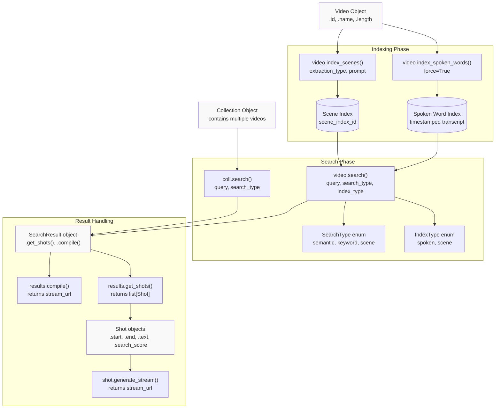
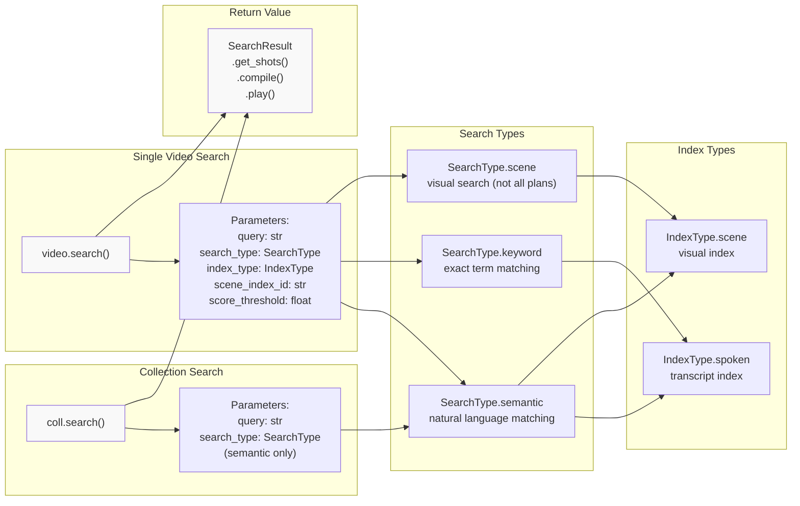
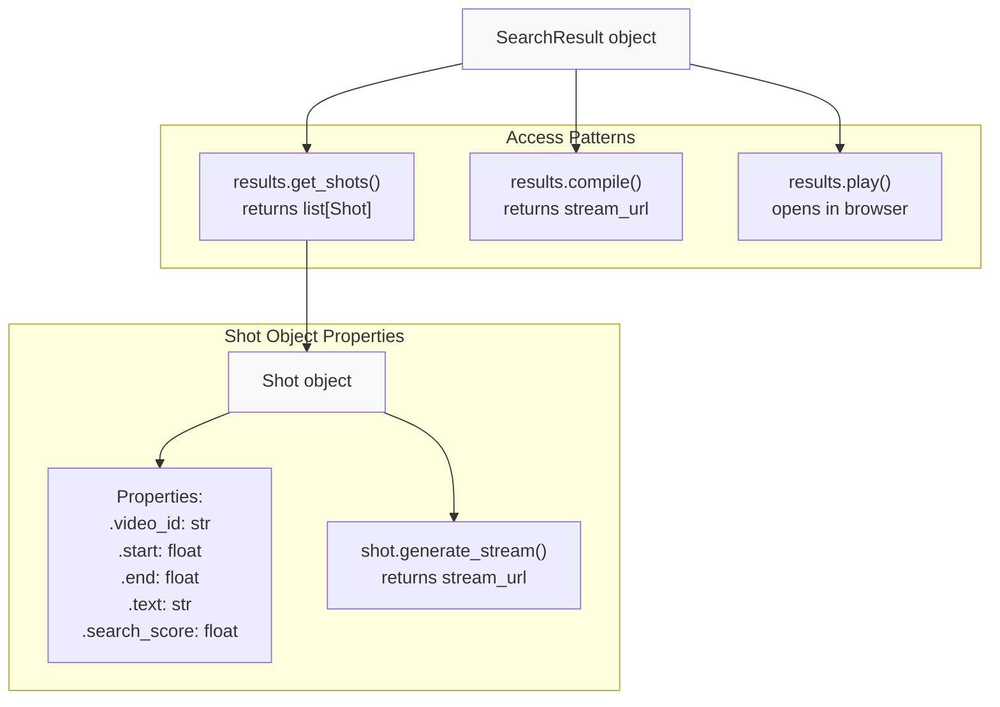
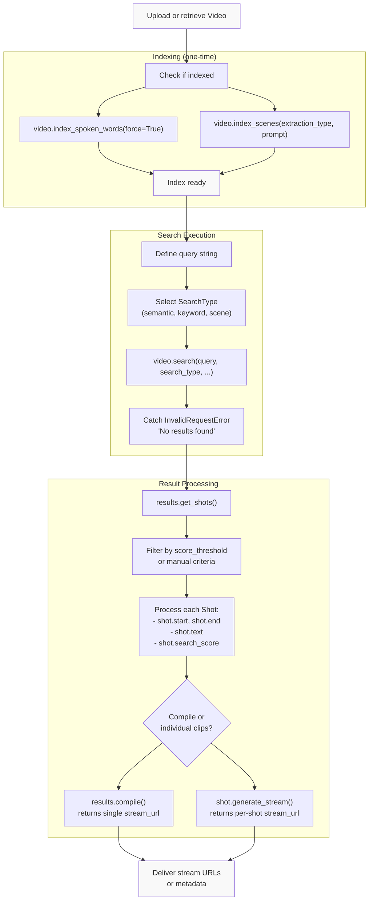

<!-- source: DeepWiki mcp.deepwiki.com · repo video-db/skills · page 6 Searching Videos · fetched 2026-10-26 -->

# Searching Videos

<details>
<summary>Relevant source files</summary>

The following files were used as context for generating this wiki page:

- [python/SKILL.md](python/SKILL.md)
- [python/reference/search.md](python/reference/search.md)

</details>


This page documents the search system for finding specific moments within videos using natural language queries, exact keywords, or visual scene descriptions. Search operations return timestamped segments (`Shot` objects) that can be compiled into playable streams or processed individually.

For information about indexing operations that prepare videos for search, see [Video Understanding and Indexing](#5). For details on the specific search type implementations, see [Search Types](#6.1). For working with search results, see [Working with Search Results](#6.2).

---

## Prerequisites

All search operations require prior indexing. Videos must be indexed before they can be searched. The type of index required depends on the search type:

| Search Type | Required Index | Method |
|------------|----------------|---------|
| Semantic (spoken content) | Spoken word index | `video.index_spoken_words()` |
| Keyword (exact match) | Spoken word index | `video.index_spoken_words()` |
| Scene (visual content) | Scene index | `video.index_scenes()` |

Indexing is a one-time operation per video per index type. Once indexed, the video can be searched repeatedly without re-indexing.

**Sources:** [python/reference/search.md:1-231]()

---

## Search Architecture

The following diagram illustrates the complete search pipeline from raw video to compiled results:

**Figure 1: Search System Architecture**



This architecture separates the one-time indexing phase from the repeatable search phase. The `SearchResult` object provides two primary access patterns: `compile()` for a single merged stream of all results, or `get_shots()` for individual segment access.

**Sources:** [python/reference/search.md:1-231](), [python/SKILL.md:149-206]()

---

## Search Methods

The following diagram maps search methods to their code implementations:

**Figure 2: Search Method Call Patterns**



**Key distinctions:**
- `video.search()` supports all search types and requires prior indexing on that specific video
- `coll.search()` only supports `SearchType.semantic` and searches across all videos in the collection
- Scene search requires both `index_type=IndexType.scene` and a valid `scene_index_id`
- The `score_threshold` parameter filters low-relevance results (recommended: 0.3 or higher)

**Sources:** [python/reference/search.md:72-209](), [python/SKILL.md:149-206]()

---

## Search Types

### Semantic Search

Semantic search uses natural language queries matched against indexed content via AI embeddings. It works on both spoken word indexes (transcript) and scene indexes (visual descriptions).

**Spoken content semantic search:**

```python
from videodb import SearchType

# Index first (one-time operation)
video.index_spoken_words(force=True)

# Search with natural language
results = video.search(
    query="explaining the benefits of machine learning",
    search_type=SearchType.semantic,
)
```

**Visual content semantic search:**

```python
from videodb import SearchType, IndexType
import re

# Create or retrieve scene index
try:
    scene_index_id = video.index_scenes(
        extraction_type=SceneExtractionType.shot_based,
        prompt="Describe the visual content in this scene.",
    )
except Exception as e:
    # Extract existing scene_index_id from error
    match = re.search(r"id\s+([a-f0-9]+)", str(e))
    if match:
        scene_index_id = match.group(1)
    else:
        raise

# Search visual content
results = video.search(
    query="person writing on a whiteboard",
    search_type=SearchType.semantic,
    index_type=IndexType.scene,
    scene_index_id=scene_index_id,
    score_threshold=0.3,  # Filter low-relevance results
)
```

**Sources:** [python/reference/search.md:72-128](), [python/SKILL.md:169-206]()

### Keyword Search

Keyword search performs exact term matching in transcribed speech. It is faster and more precise than semantic search but requires exact phrase matches.

```python
from videodb import SearchType

# Requires spoken word index
video.index_spoken_words(force=True)

results = video.search(
    query="artificial intelligence",
    search_type=SearchType.keyword,
)
```

Keyword search returns segments where the exact keyword or phrase appears in the transcript.

**Sources:** [python/reference/search.md:89-100]()

### Scene Search

Scene search queries visual content using AI-generated scene descriptions. It requires a scene index created via `video.index_scenes()`.

**Important notes:**
- Use `SearchType.semantic` with `index_type=IndexType.scene` — this combination works on all plans
- `SearchType.scene` exists but may not be available on all plans (e.g., Free tier)
- The `scene_index_id` parameter is optional; if omitted, search runs against all scene indexes on the video
- Multiple scene indexes can exist per video (with different prompts or extraction types)

```python
from videodb import SearchType, IndexType, SceneExtractionType

# Create scene index
scene_index_id = video.index_scenes(
    extraction_type=SceneExtractionType.shot_based,
    prompt="Describe objects, actions, and setting in this scene.",
)

# Search with score threshold to filter noise
results = video.search(
    query="person entering a restricted area",
    search_type=SearchType.semantic,
    index_type=IndexType.scene,
    scene_index_id=scene_index_id,
    score_threshold=0.3,
)
```

**Sources:** [python/reference/search.md:102-136](), [python/SKILL.md:169-206]()

---

## Working with Search Results

All search operations return a `SearchResult` object that provides two access patterns:

**Figure 3: SearchResult Access Patterns**



### Accessing Individual Shots

Each `Shot` object represents a timestamped segment with metadata:

```python
results = video.search("product demonstration")

for shot in results.get_shots():
    print(f"Video ID: {shot.video_id}")
    print(f"Timestamp: {shot.start:.2f}s to {shot.end:.2f}s")
    print(f"Transcript: {shot.text}")
    print(f"Relevance: {shot.search_score:.3f}")
    print(f"Stream URL: {shot.generate_stream()}")
    print("---")
```

**Sources:** [python/reference/search.md:156-191]()

### Compiling Results

The `compile()` method merges all matching shots into a single playable stream:

```python
results = video.search("your query")
stream_url = results.compile()

# Open in browser
results.play()
```

The compiled stream concatenates all shots in chronological order, removing gaps between segments.

**Sources:** [python/reference/search.md:172-180]()

### Filtering Results

Use `score_threshold` to filter low-relevance results, especially for scene search:

```python
results = video.search(
    query="person on phone",
    search_type=SearchType.semantic,
    index_type=IndexType.scene,
    scene_index_id=scene_index_id,
    score_threshold=0.3,  # Filter scores below 0.3
)
```

Lower thresholds (0.1-0.2) return more results but include noise. Higher thresholds (0.4-0.5) return fewer, higher-confidence matches.

**Sources:** [python/reference/search.md:113-128](), [python/SKILL.md:169-206]()

---

## Cross-Collection Search

Collections support semantic search across all contained videos:

```python
coll = conn.get_collection()

# Search all videos in collection
results = coll.search(
    query="product demo",
    search_type=SearchType.semantic,
)

# Results contain shots from multiple videos
for shot in results.get_shots():
    print(f"Video: {shot.video_id} [{shot.start:.1f}s - {shot.end:.1f}s]")
```

**Limitations:**
- Collection-level search **only supports** `SearchType.semantic`
- `SearchType.keyword` and `SearchType.scene` raise `NotImplementedError` on collections
- For keyword or scene search, use `video.search()` on individual videos

**Sources:** [python/reference/search.md:192-209]()

---

## Error Handling

Search operations raise `InvalidRequestError` when no results are found. Always wrap search calls in try/except:

```python
from videodb.exceptions import InvalidRequestError

try:
    results = video.search("rare query that may not exist")
    shots = results.get_shots()
except InvalidRequestError as e:
    if "No results found" in str(e):
        shots = []  # Treat as empty result set
        print("No matching segments found")
    else:
        raise  # Re-raise unexpected errors
```

**Common error patterns:**

| Scenario | Error Message | Solution |
|----------|--------------|----------|
| No search results | `No results found` | Catch `InvalidRequestError` and treat as empty list |
| Video not indexed | `Video must be indexed first` | Call `video.index_spoken_words()` or `video.index_scenes()` |
| Invalid scene_index_id | `Scene index not found` | Verify `scene_index_id` exists, or omit to search all indexes |
| Collection keyword search | `NotImplementedError` | Use `SearchType.semantic` or search individual videos |

**Sources:** [python/SKILL.md:152-167](), [python/reference/search.md:228]()

---

## Search Workflow Example

The following diagram illustrates a complete end-to-end search workflow:

**Figure 4: End-to-End Search Workflow**



**Sources:** [python/reference/search.md:211-230](), [python/SKILL.md:149-167]()

---

## Best Practices

**Indexing:**
- Index once, search many times — indexing is the expensive operation
- Use `index_spoken_words(force=True)` for idempotent indexing
- For `index_scenes()`, wrap in try/except and extract existing `scene_index_id` from errors

**Query design:**
- Semantic search works best with descriptive, natural language phrases
- Use keyword search for precision when exact term matches are required
- Scene search queries should describe visual elements, not spoken content

**Result handling:**
- Always wrap `video.search()` in try/except for `InvalidRequestError`
- Use `score_threshold` (0.3+) to filter noise in scene search results
- Check `shot.search_score` to evaluate result relevance

**Performance:**
- Combine index types (spoken + scene) to enable all search types on the same video
- For large result sets, use `compile()` instead of generating individual streams
- Cross-collection search is slower than single-video search but eliminates manual iteration

**Sources:** [python/reference/search.md:222-231](), [python/SKILL.md:289-298]()

---

