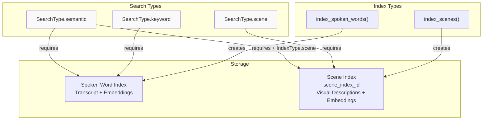
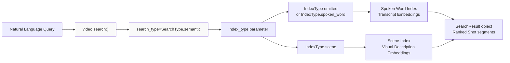
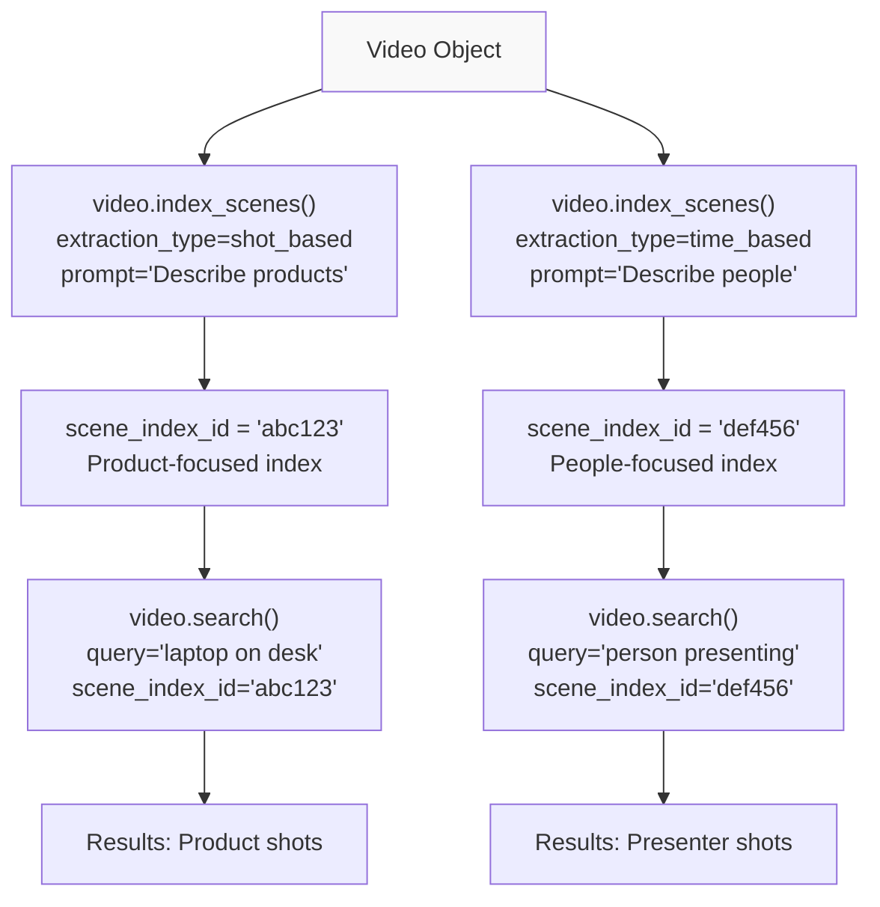

<!-- source: DeepWiki mcp.deepwiki.com · repo video-db/skills · page 6.1 Search Types · fetched 2026-10-26 -->

# Search Types

<details>
<summary>Relevant source files</summary>

The following files were used as context for generating this wiki page:

- [python/reference/search.md](python/reference/search.md)

</details>


## Purpose and Scope

This page documents the three types of search operations available in VideoDB: **semantic search**, **keyword search**, and **scene search**. Each search type queries different aspects of video content and requires specific indexing prerequisites.

For information about handling search results and generating clips, see [Working with Search Results](#6.2). For searching across multiple videos simultaneously, see [Cross-Collection Search](#6.3). For details on the indexing operations that enable search, see [Video Understanding and Indexing](#5).

---

## Search Architecture Overview

**Diagram: Search Type to Index Type Mapping**



**Sources:** [python/reference/search.md:1-231]()

The VideoDB search system separates indexing from querying. Videos must first be indexed using `index_spoken_words()` or `index_scenes()`, which creates searchable representations of the content. Search operations then query these indexes using different matching strategies.

---

## Prerequisites: Indexing

All search operations require prior indexing. Videos must be indexed before they can be searched.

### Spoken Word Index

Required for semantic search and keyword search of audio/speech content:

```python
video = coll.get_video(video_id)
video.index_spoken_words(force=True)
```

The `force=True` parameter makes indexing idempotent—if the video is already indexed, it skips re-indexing instead of raising an error.

**Sources:** [python/reference/search.md:11-31]()

### Scene Index

Required for scene-based visual search:

```python
from videodb import SceneExtractionType

scene_index_id = video.index_scenes(
    extraction_type=SceneExtractionType.shot_based,
    prompt="Describe the visual content, objects, actions, and setting in this scene.",
)
```

Unlike spoken word indexing, `index_scenes()` returns a `scene_index_id` identifier. This is critical because **a single video can have multiple scene indexes** with different extraction types or prompts. You must specify which index to search using the `scene_index_id` parameter.

**Sources:** [python/reference/search.md:33-71]()

---

## Semantic Search

**Diagram: Semantic Search Code Path**



**Sources:** [python/reference/search.md:72-153]()

Semantic search uses natural language queries to find content based on **meaning** rather than exact words. It works by comparing the semantic embedding of your query against embeddings of indexed content.

### Searching Spoken Content

```python
from videodb import SearchType

results = video.search(
    query="explaining the benefits of machine learning",
    search_type=SearchType.semantic,
)
```

This searches the transcript created by `index_spoken_words()`. The query matches against the meaning of what was said, not just exact keywords.

**Sources:** [python/reference/search.md:74-88]()

### Searching Visual Content

```python
from videodb import SearchType, IndexType

results = video.search(
    query="person writing on a whiteboard",
    search_type=SearchType.semantic,
    index_type=IndexType.scene,
    scene_index_id=scene_index_id,
    score_threshold=0.3,
)
```

This searches the visual scene descriptions created by `index_scenes()`. Key parameters:

- `index_type=IndexType.scene` — directs the search to the scene index instead of spoken word index
- `scene_index_id` — specifies which scene index to search (optional if only one exists)
- `score_threshold` — filters low-relevance results (recommended: 0.3 or higher)

**Sources:** [python/reference/search.md:103-136]()

### Metadata Filtering

When scene indexes include custom metadata, you can combine semantic search with filters:

```python
results = video.search(
    query="a skillful chasing scene",
    search_type=SearchType.semantic,
    index_type=IndexType.scene,
    scene_index_id=scene_index_id,
    filter=[{"camera_view": "road_ahead"}, {"action_type": "chasing"}],
)
```

**Sources:** [python/reference/search.md:137-154]()

---

## Keyword Search

Keyword search performs exact term matching in transcribed speech. It returns segments where the **exact keyword or phrase** appears in the transcript.

```python
from videodb import SearchType

results = video.search(
    query="artificial intelligence",
    search_type=SearchType.keyword,
)
```

**Sources:** [python/reference/search.md:89-101]()

### Key Characteristics

| Aspect | Behavior |
|--------|----------|
| **Index Required** | `index_spoken_words()` only |
| **Matching Type** | Exact text match (case-insensitive) |
| **Query Format** | Single word or multi-word phrase |
| **Use Case** | Finding specific terminology, names, or quoted phrases |
| **Advantage** | No semantic drift—finds exactly what you specify |

Keyword search is useful when you need precision and want to avoid the ambiguity of semantic matching. For example, searching for the exact term "neural network" vs. semantically related terms like "deep learning" or "AI model."

---

## Scene Search

Scene search queries visual content using the `SearchType.scene` enum value. However, **this search type is not recommended** and may not be available on all plans (e.g., Free tier).

### Recommended Approach

**Instead of `SearchType.scene`, use `SearchType.semantic` with `index_type=IndexType.scene`:**

```python
# Recommended: Semantic search against scene index
results = video.search(
    query="person entering a building",
    search_type=SearchType.semantic,
    index_type=IndexType.scene,
    scene_index_id=scene_index_id,
    score_threshold=0.3,
)
```

**Sources:** [python/reference/search.md:103-136]()

This approach:
- Works on all plans
- Provides better semantic matching
- Supports `score_threshold` filtering
- Is the officially supported method

---

## Search Type Comparison

**Table: Search Type Feature Matrix**

| Feature | Semantic Search | Keyword Search | Scene Search |
|---------|----------------|----------------|--------------|
| **Index Required** | `index_spoken_words()` or `index_scenes()` | `index_spoken_words()` | `index_scenes()` |
| **Query Type** | Natural language phrase | Exact word/phrase | Natural language phrase |
| **Matching Strategy** | Embedding similarity | Text substring match | Embedding similarity |
| **Works on Transcript** | ✓ (default) | ✓ | ✗ |
| **Works on Visual Content** | ✓ (with `IndexType.scene`) | ✗ | ✓ |
| **Supports `score_threshold`** | ✓ | ✗ | ✗ |
| **Supports Metadata Filtering** | ✓ (scene only) | ✗ | ✗ |
| **Collection-level Search** | ✓ | ✗ | ✗ |
| **Free Tier Support** | ✓ | ✓ | Limited |

**Sources:** [python/reference/search.md:72-210]()

---

## Handling Multiple Scene Indexes

A single video can have multiple scene indexes created with different prompts or extraction types. The `scene_index_id` parameter specifies which index to search.

**Diagram: Multiple Scene Index Workflow**



**Sources:** [python/reference/search.md:33-71](), [python/reference/search.md:103-136]()

If you omit the `scene_index_id` parameter, the search runs against **all scene indexes** on the video, which may return mixed results from different indexing strategies.

---

## Error Handling

Search operations can fail when no results match the query. The `video.search()` method raises `InvalidRequestError` with the message "No results found" in this case.

```python
from videodb import SearchType, IndexType
from videodb.exceptions import InvalidRequestError

try:
    results = video.search(
        query="person writing on a whiteboard",
        search_type=SearchType.semantic,
        index_type=IndexType.scene,
        scene_index_id=scene_index_id,
        score_threshold=0.3,
    )
    shots = results.get_shots()
except InvalidRequestError as e:
    if "No results found" in str(e):
        shots = []
    else:
        raise
```

**Sources:** [python/reference/search.md:113-128]()

This pattern treats empty result sets as an expected condition rather than a fatal error.

---

## Score Thresholding

The `score_threshold` parameter filters low-relevance results from semantic search. Scores range from 0.0 (no relevance) to 1.0 (perfect match).

```python
results = video.search(
    query="vague visual description",
    search_type=SearchType.semantic,
    index_type=IndexType.scene,
    score_threshold=0.3,  # Only return results with score >= 0.3
)
```

**Recommended thresholds:**

| Threshold | Use Case |
|-----------|----------|
| `0.3` | General visual search, filters obvious noise |
| `0.4` | Stricter relevance for focused queries |
| `0.5+` | High-precision searches, may miss relevant results |

Scene search without a threshold can return many low-relevance results for vague queries. Always use `score_threshold` for production scene search.

**Sources:** [python/reference/search.md:113-128](), [python/reference/search.md:229]()

---

## Best Practices

### Index Once, Search Many Times

Indexing is computationally expensive and takes time. Once a video is indexed, you can run unlimited searches against that index instantly:

```python
# Index once (slow, one-time operation)
video.index_spoken_words(force=True)

# Search many times (fast, repeatable)
results1 = video.search("machine learning", SearchType.semantic)
results2 = video.search("neural networks", SearchType.semantic)
results3 = video.search("data science", SearchType.semantic)
```

**Sources:** [python/reference/search.md:224]()

### Choose the Right Search Type

| Scenario | Recommended Search Type |
|----------|------------------------|
| Finding when specific terms are mentioned | Keyword search |
| Finding segments about a topic | Semantic search on spoken words |
| Finding visual content descriptions | Semantic search with `IndexType.scene` |
| Finding exact quotes or names | Keyword search |
| Finding related concepts with flexible phrasing | Semantic search |

### Combine Index Types

For comprehensive searchability, index both spoken words and scenes:

```python
# Enable all search capabilities
video.index_spoken_words(force=True)
scene_index_id = video.index_scenes(
    extraction_type=SceneExtractionType.shot_based,
    prompt="Describe what is visible in this scene.",
)

# Now you can search both audio and visual content
transcript_results = video.search("explains the process", SearchType.semantic)
visual_results = video.search(
    "person pointing at screen",
    SearchType.semantic,
    index_type=IndexType.scene,
    scene_index_id=scene_index_id,
)
```

**Sources:** [python/reference/search.md:225]()

---

## Code Reference Summary

**Key Classes and Enums:**

| Symbol | Location | Purpose |
|--------|----------|---------|
| `SearchType.semantic` | `videodb` module | Natural language query matching |
| `SearchType.keyword` | `videodb` module | Exact text matching |
| `SearchType.scene` | `videodb` module | Visual search (deprecated) |
| `IndexType.scene` | `videodb` module | Directs semantic search to scene index |
| `IndexType.spoken_word` | `videodb` module | Directs semantic search to transcript |
| `video.search()` | Video object | Performs search operation |
| `video.index_spoken_words()` | Video object | Creates spoken word index |
| `video.index_scenes()` | Video object | Creates scene index |
| `SceneExtractionType` | `videodb` module | Defines scene splitting strategy |

**Sources:** [python/reference/search.md:1-231]()

---

