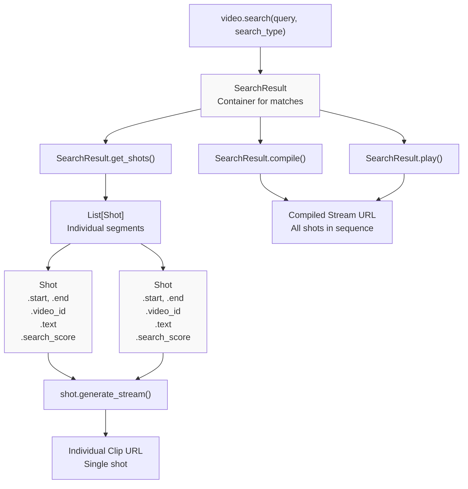
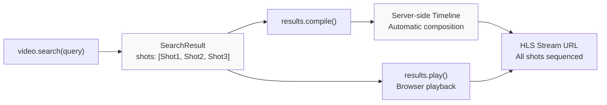
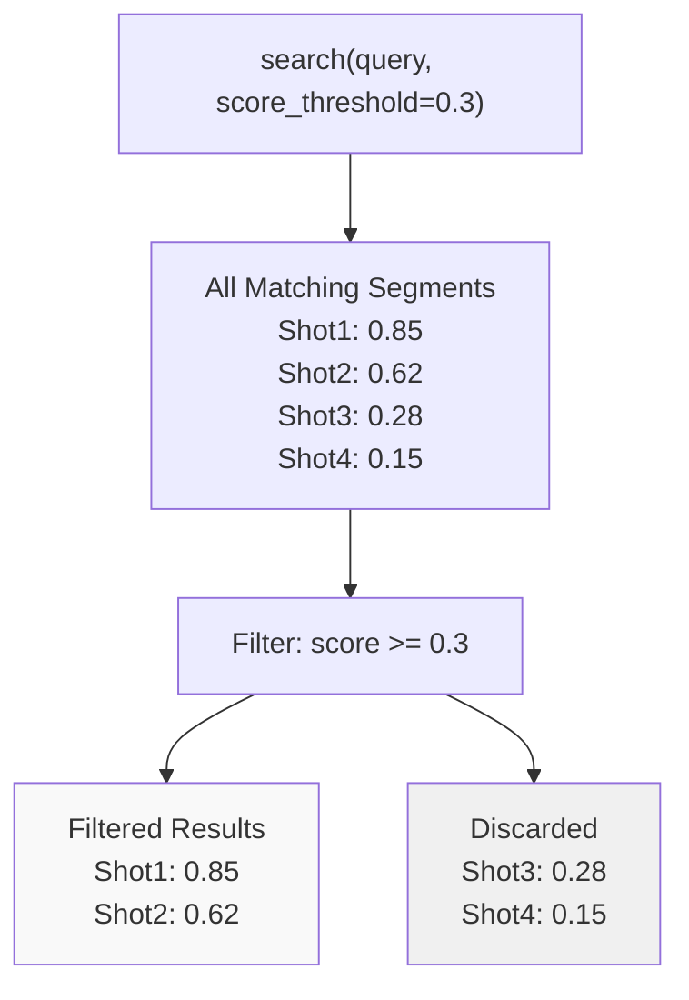
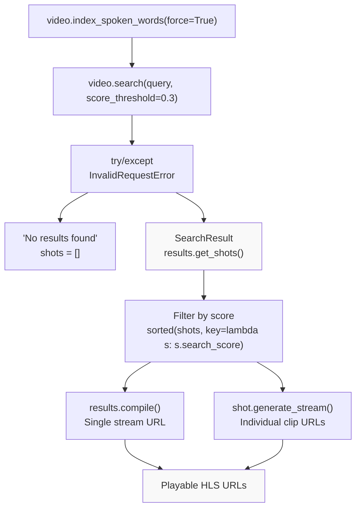

<!-- source: DeepWiki mcp.deepwiki.com · repo video-db/skills · page 6.2 Working with Search Results · fetched 2026-10-26 -->

# Working with Search Results

<details>
<summary>Relevant source files</summary>

The following files were used as context for generating this wiki page:

- [python/SKILL.md](python/SKILL.md)
- [python/reference/search.md](python/reference/search.md)

</details>


This document explains how to process and manipulate search results returned by `video.search()` and `coll.search()`. For information about search types and indexing, see [Search Types](#6.1). For cross-collection search, see [Cross-Collection Search](#6.3).

**Scope**: This page covers the `SearchResult` and `Shot` objects, result compilation, score-based filtering, and clip generation. It assumes you have already performed a search operation as described in [Search Types](#6.1).

---

## SearchResult and Shot Object Model

When you call `video.search()` or `coll.search()`, the SDK returns a `SearchResult` object containing one or more timestamped segments (`Shot` objects) that match your query.

**Object Model: SearchResult and Shot Relationship**



**Sources**: [python/SKILL.md:149-167](), [python/reference/search.md:156-190]()

---

## SearchResult Object

The `SearchResult` object is a container returned by search operations. It provides methods to access individual result segments or compile all results into a single playable stream.

### Key Methods

| Method | Return Type | Description |
|--------|-------------|-------------|
| `get_shots()` | `List[Shot]` | Returns list of individual result segments |
| `compile()` | `str` | Compiles all shots into a single HLS stream URL |
| `play()` | `None` | Opens compiled stream in browser |

**Sources**: [python/reference/search.md:156-180]()

---

## Shot Objects

Each `Shot` represents a single timestamped segment that matched the search query. Shot objects contain the video reference, time boundaries, matched text, and relevance score.

### Shot Properties

| Property | Type | Description |
|----------|------|-------------|
| `video_id` | `str` | ID of the source video containing this segment |
| `start` | `float` | Start timestamp in seconds |
| `end` | `float` | End timestamp in seconds |
| `text` | `str` | Transcript or scene description that matched |
| `search_score` | `float` | Relevance score (0.0 to 1.0, higher is more relevant) |

### Shot Methods

| Method | Return Type | Description |
|--------|-------------|-------------|
| `generate_stream()` | `str` | Generates HLS stream URL for this individual shot |

**Sources**: [python/reference/search.md:156-170](), [python/reference/search.md:182-190]()

---

## Retrieving Individual Shots

Use `get_shots()` to access individual result segments. This returns a list of `Shot` objects that can be iterated, filtered, or processed individually.

**Example: Iterating Through Search Results**

```python
from videodb import SearchType
from videodb.exceptions import InvalidRequestError

try:
    results = video.search("product demo", search_type=SearchType.semantic)
    shots = results.get_shots()
    
    for shot in shots:
        print(f"Video: {shot.video_id}")
        print(f"Time: {shot.start:.2f}s - {shot.end:.2f}s")
        print(f"Score: {shot.search_score:.3f}")
        print(f"Text: {shot.text}")
        print("---")
        
except InvalidRequestError as e:
    if "No results found" in str(e):
        shots = []
        print("No matching segments found")
    else:
        raise
```

**Sources**: [python/reference/search.md:156-170](), [python/SKILL.md:149-167]()

---

## Compiling Results into a Single Stream

The `compile()` method merges all matching shots into a single playable stream in the order they appear in the source video(s). This is useful for creating highlight reels or montages from search results.

**Result Compilation Workflow**



**Example: Compiling Search Results**

```python
from videodb import SearchType

# Search and compile all matches into single stream
results = video.search("machine learning", search_type=SearchType.semantic)
stream_url = results.compile()

print(f"Compiled stream: {stream_url}")

# Or open directly in browser
results.play()
```

The compiled stream:
- Contains all shots in chronological order
- Is ready for immediate playback (no pre-rendering)
- Can be shared as a permanent URL
- Automatically handles transitions between shots

**Sources**: [python/reference/search.md:172-180](), [python/reference/search.md:212-220]()

---

## Filtering with Score Thresholds

Search operations can return low-relevance results, especially for semantic scene search with vague queries. The `score_threshold` parameter filters out matches below a specified relevance score.

**Score Threshold Filtering**



### Recommended Threshold Values

| Search Type | Recommended Threshold | Rationale |
|-------------|----------------------|-----------|
| Semantic (spoken) | `0.2 - 0.3` | Balances recall and precision for transcript search |
| Scene (semantic) | `0.3 - 0.5` | Higher threshold filters visual search noise |
| Keyword | Not applicable | Keyword search is exact match (no scoring) |

**Example: Scene Search with Score Threshold**

```python
from videodb import SearchType, IndexType, SceneExtractionType
from videodb.exceptions import InvalidRequestError
import re

# Create or retrieve scene index
try:
    scene_index_id = video.index_scenes(
        extraction_type=SceneExtractionType.shot_based,
        prompt="Describe the visual content in this scene.",
    )
except Exception as e:
    match = re.search(r"id\s+([a-f0-9]+)", str(e))
    if match:
        scene_index_id = match.group(1)
    else:
        raise

# Search with score threshold to filter noise
try:
    results = video.search(
        query="person writing on a whiteboard",
        search_type=SearchType.semantic,
        index_type=IndexType.scene,
        scene_index_id=scene_index_id,
        score_threshold=0.3,  # Only return matches with score >= 0.3
    )
    shots = results.get_shots()
    
    for shot in shots:
        print(f"Relevance: {shot.search_score:.3f} | {shot.start:.1f}s - {shot.end:.1f}s")
        
except InvalidRequestError as e:
    if "No results found" in str(e):
        shots = []
    else:
        raise
```

**Key Points**:
- Threshold is applied server-side before results are returned
- Lower threshold = more results, possibly less relevant
- Higher threshold = fewer results, higher precision
- If threshold is too high, you may get "No results found" error

**Sources**: [python/reference/search.md:114-128](), [python/reference/search.md:229](), [python/SKILL.md:189-206]()

---

## Generating Individual Clips

While `compile()` creates a single stream from all results, you may want separate clips for each matching segment. Each `Shot` has a `generate_stream()` method that creates an individual HLS stream URL.

**Example: Generating Individual Clips**

```python
results = video.search("product features", search_type=SearchType.semantic)

for i, shot in enumerate(results.get_shots()):
    clip_url = shot.generate_stream()
    print(f"Clip {i+1}: {clip_url}")
    print(f"  Duration: {shot.end - shot.start:.1f}s")
    print(f"  Relevance: {shot.search_score:.3f}")
    print()
```

**Use Cases for Individual Clips**:
- **Social media posts**: Export top-scoring segment for sharing
- **Manual review**: Preview each result separately before compilation
- **Custom ordering**: Reorder clips by score rather than chronological order
- **Selective compilation**: Only include high-scoring segments

**Example: Export Top 3 Results by Score**

```python
results = video.search("key moments", search_type=SearchType.semantic)
shots = results.get_shots()

# Sort by relevance score (descending)
top_shots = sorted(shots, key=lambda s: s.search_score, reverse=True)[:3]

for shot in top_shots:
    stream_url = shot.generate_stream()
    print(f"Score {shot.search_score:.3f}: {stream_url}")
```

**Sources**: [python/reference/search.md:182-190]()

---

## Handling Empty Results

Search operations raise `InvalidRequestError` with message `"No results found"` when no segments match the query. This is not a failure condition—it simply means the query didn't match any content.

**Error Handling Pattern**

```python
from videodb import SearchType
from videodb.exceptions import InvalidRequestError

try:
    results = video.search("nonexistent topic", search_type=SearchType.semantic)
    shots = results.get_shots()
    
    # Process results
    stream_url = results.compile()
    
except InvalidRequestError as e:
    if "No results found" in str(e):
        # Treat as empty result set
        shots = []
        print("No matching segments found for query")
    else:
        # Re-raise unexpected errors
        raise
```

**Best Practices**:
- Always wrap search calls in try/except
- Check for `"No results found"` substring in error message
- Treat as empty list rather than a failure
- Consider lowering `score_threshold` if getting too many empty results
- For scene search, verify the scene index exists and is appropriate for the query

**Sources**: [python/SKILL.md:152-167](), [python/reference/search.md:228]()

---

## Complete Example: Search to Clips Workflow

**Full Workflow: Search, Filter, and Generate Clips**



```python
from videodb import SearchType
from videodb.exceptions import InvalidRequestError

# 1. Index the video
video.index_spoken_words(force=True)

# 2. Search with score threshold
try:
    results = video.search(
        query="tutorial demonstration",
        search_type=SearchType.semantic,
        score_threshold=0.3,
    )
    
    # 3. Get individual shots
    shots = results.get_shots()
    
    # 4. Filter to top 5 by relevance
    top_shots = sorted(shots, key=lambda s: s.search_score, reverse=True)[:5]
    
    # 5. Option A: Compile all results into single stream
    compiled_url = results.compile()
    print(f"Compiled stream: {compiled_url}")
    
    # 6. Option B: Generate individual clips
    print("\nTop 5 clips:")
    for i, shot in enumerate(top_shots, 1):
        clip_url = shot.generate_stream()
        print(f"{i}. [{shot.start:.1f}s-{shot.end:.1f}s] Score: {shot.search_score:.3f}")
        print(f"   {clip_url}")
    
except InvalidRequestError as e:
    if "No results found" in str(e):
        print("No matching segments found")
    else:
        raise
```

**Sources**: [python/reference/search.md:156-190](), [python/reference/search.md:212-220](), [python/SKILL.md:149-167]()

---

## Summary Table: SearchResult and Shot Operations

| Operation | Method | Input | Output | Use Case |
|-----------|--------|-------|--------|----------|
| Get all results | `results.get_shots()` | None | `List[Shot]` | Iterate through individual matches |
| Compile all results | `results.compile()` | None | `str` (HLS URL) | Single stream of all matches |
| Open in browser | `results.play()` | None | Opens browser | Quick preview of compiled results |
| Generate single clip | `shot.generate_stream()` | None | `str` (HLS URL) | Extract individual segment |
| Filter by score | Search parameter | `score_threshold=float` | Filtered `SearchResult` | Remove low-relevance matches |

**Sources**: [python/reference/search.md:156-190]()

---

