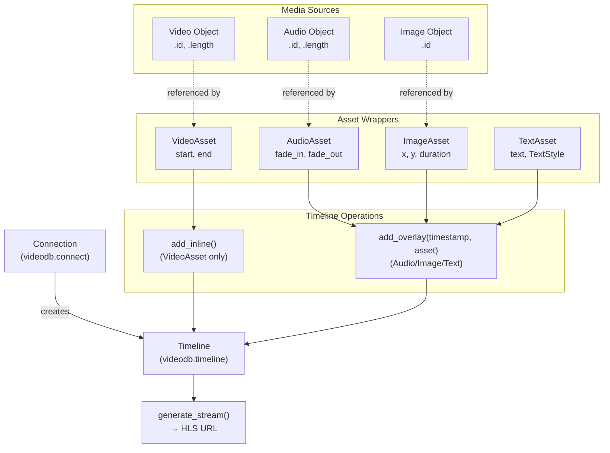
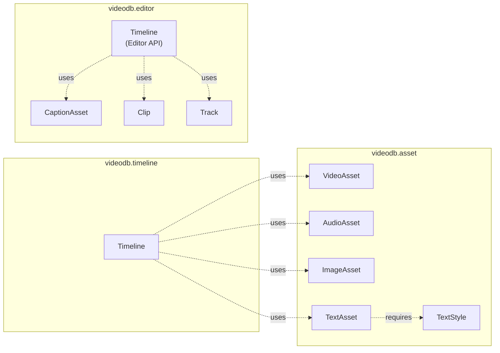
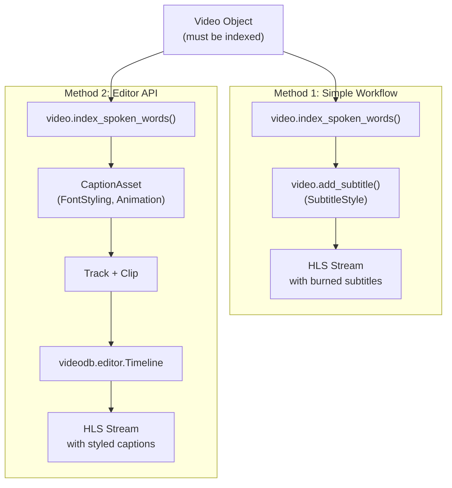

<!-- source: DeepWiki mcp.deepwiki.com · repo video-db/skills · page 7 Timeline Editing · fetched 2026-10-26 -->

# Timeline Editing

<details>
<summary>Relevant source files</summary>

The following files were used as context for generating this wiki page:

- [python/SKILL.md](python/SKILL.md)
- [python/reference/editor.md](python/reference/editor.md)

</details>


This document covers VideoDB's non-destructive timeline editor for composing videos from multiple assets. The timeline system allows server-side video composition, including trimming clips, layering audio, adding text and image overlays, and mixing multiple video segments — all without local encoding or modifying source media.

For video transformation operations like aspect ratio conversion and resolution changes, see [Media Transformation](#10). For AI-powered subtitle generation and styling, see [Subtitles and Captions](#7.3).

## Purpose and Scope

The timeline editor is designed for **linear, non-destructive video composition**. It operates entirely server-side: you assemble a timeline from uploaded media assets, and VideoDB compiles the result into an HLS stream URL on demand. Source media is never modified.

**What the timeline editor does:**
- Combine multiple video clips sequentially
- Trim segments from videos using start/end timestamps
- Layer audio tracks (music, sound effects, narration) over video
- Add text overlays (titles, lower-thirds) with styling
- Add image overlays (logos, watermarks)
- Generate auto-rendered subtitles from transcripts

**What the timeline editor does not do:**
- Video-on-video overlays (picture-in-picture with live video)
- Transitions, crossfades, or effects between clips
- Speed changes, slow motion, or reverse playback
- Crop, zoom, pan, or keyframe animation
- Color grading or video filters
- Per-asset volume control (audio is full volume or muted)

For a complete list of limitations, see [Limitations and Best Practices](#7.4).

**Sources:** [python/reference/editor.md:1-16](), [python/SKILL.md:208-223]()

## Architecture Overview



**Timeline Composition Architecture**

The timeline system uses a factory pattern where `Connection` creates `Timeline` instances. Assets are wrappers that reference uploaded media by ID, allowing multiple timelines to reuse the same source media without duplication.

- **Inline track**: Sequential video clips using `add_inline(VideoAsset)` [python/reference/editor.md:35-50]()
- **Overlay layers**: Time-positioned assets using `add_overlay(timestamp, asset)` [python/reference/editor.md:127-143]()
- **On-demand compilation**: `generate_stream()` produces HLS URLs without pre-rendering [python/reference/editor.md:266-273]()

**Sources:** [python/reference/editor.md:9-31](), [python/reference/editor.md:266-273]()

## Core Classes and Imports



**Timeline API Import Structure**

VideoDB provides two distinct timeline systems that are **not interchangeable**:

| System | Import | Asset Types | Use Case |
|--------|--------|-------------|----------|
| **Main Timeline** | `from videodb.timeline import Timeline` | `VideoAsset`, `AudioAsset`, `ImageAsset`, `TextAsset` | Video composition, overlays, multi-clip editing |
| **Editor API** | `from videodb.editor import Timeline` | `CaptionAsset`, `Clip`, `Track` | Advanced caption/subtitle styling with animations |

Do not mix assets between APIs. `CaptionAsset` only works with `videodb.editor.Timeline`. The other asset types only work with `videodb.timeline.Timeline`.

**Sources:** [python/reference/editor.md:386-396]()

## Basic Timeline Workflow

```python
from videodb.timeline import Timeline
from videodb.asset import VideoAsset

# 1. Initialize timeline from connection
timeline = Timeline(conn)

# 2. Add video clips sequentially
timeline.add_inline(VideoAsset(asset_id=video_a.id))
timeline.add_inline(VideoAsset(asset_id=video_b.id, start=10, end=30))

# 3. Generate stream URL
stream_url = timeline.generate_stream()
```

The timeline is built using two primary methods:

- **`add_inline(VideoAsset)`**: Appends video clips sequentially on the main track. Only accepts `VideoAsset`. [python/reference/editor.md:35-50]()
- **`add_overlay(timestamp, asset)`**: Layers audio, images, or text at a specific timeline position. Accepts `AudioAsset`, `ImageAsset`, or `TextAsset`. [python/reference/editor.md:75-93]()

**Sources:** [python/reference/editor.md:35-60](), [python/SKILL.md:208-223]()

## Asset Types and Parameters

### VideoAsset

Represents a video clip with optional trimming.

| Parameter | Type | Default | Description |
|-----------|------|---------|-------------|
| `asset_id` | `str` | required | Video media ID from `video.id` |
| `start` | `float` | `0` | Trim start position in seconds |
| `end` | `float\|None` | `None` | Trim end position (`None` = full length) |

```python
from videodb.asset import VideoAsset

# Use full video
clip = VideoAsset(asset_id=video.id)

# Trim to seconds 10-30
clip = VideoAsset(asset_id=video.id, start=10, end=30)
```

**Critical validation requirement**: The SDK does not validate timestamp bounds. Negative `start` values or `end > video.length` are silently accepted but produce broken output. Always validate: `start >= 0`, `start < end`, `end <= video.length`. [python/reference/editor.md:63-70]()

**Sources:** [python/reference/editor.md:52-70](), [python/SKILL.md:210-213]()

### AudioAsset

Represents an audio track with fade controls.

| Parameter | Type | Default | Description |
|-----------|------|---------|-------------|
| `asset_id` | `str` | required | Audio media ID from `audio.id` |
| `start` | `float` | `0` | Trim start position in seconds |
| `end` | `float\|None` | `None` | Trim end position |
| `disable_other_tracks` | `bool` | `True` | When `True`, mutes video audio |
| `fade_in_duration` | `float` | `0` | Fade-in duration (max 5 seconds) |
| `fade_out_duration` | `float` | `0` | Fade-out duration (max 5 seconds) |

```python
from videodb.asset import AudioAsset

# Background music with fades, mix with video audio
music = AudioAsset(
    asset_id=music.id,
    disable_other_tracks=False,
    fade_in_duration=2,
    fade_out_duration=2,
)

timeline.add_overlay(0, music)
```

**Sources:** [python/reference/editor.md:127-154]()

### ImageAsset

Represents an image overlay with positioning.

| Parameter | Type | Default | Description |
|-----------|------|---------|-------------|
| `asset_id` | `str` | required | Image media ID from `image.id` |
| `width` | `int\|str` | `100` | Display width in pixels |
| `height` | `int\|str` | `100` | Display height in pixels |
| `x` | `int` | `80` | Horizontal position (pixels from left) |
| `y` | `int` | `20` | Vertical position (pixels from top) |
| `duration` | `float\|None` | `None` | Display duration in seconds |

```python
from videodb.asset import ImageAsset

# Logo in top-right corner for 10 seconds
logo = ImageAsset(
    asset_id=logo.id,
    duration=10,
    width=120,
    height=60,
    x=1140,
    y=20,
)

timeline.add_overlay(0, logo)
```

**Sources:** [python/reference/editor.md:157-186]()

### TextAsset and TextStyle

Represents a text overlay with styling configuration.

```python
from videodb.asset import TextAsset, TextStyle

title = TextAsset(
    text="Welcome to the Demo",
    duration=5,
    style=TextStyle(
        fontsize=36,
        fontcolor="white",
        boxcolor="black",
        alpha=0.8,
        font="Sans",
    ),
)

timeline.add_overlay(0, title)
```

**Key TextStyle Parameters:**

| Parameter | Type | Default | Description |
|-----------|------|---------|-------------|
| `fontsize` | `int` | `24` | Font size in pixels |
| `fontcolor` | `str` | `"black"` | CSS color name or hex code |
| `alpha` | `float` | `1.0` | Text opacity (0.0-1.0) |
| `font` | `str` | `"Sans"` | Font family name |
| `box` | `bool` | `True` | Enable background box |
| `boxcolor` | `str` | `"white"` | Background box color |
| `boxborderw` | `str` | `"10"` | Box border width |
| `x` | `str` | `"(main_w-text_w)/2"` | Horizontal position expression |
| `y` | `str` | `"(main_h-text_h)/2"` | Vertical position expression |

For complete `TextStyle` parameters including shadows, borders, and alignment, see [python/reference/editor.md:96-124]().

**Limitation**: `TextAsset` displays static text for its entire duration. No fade-in/out, movement, or per-word styling is supported. [python/reference/editor.md:411]()

**Sources:** [python/reference/editor.md:73-124]()

## Subtitle Workflows



**Two Subtitle Implementation Paths**

VideoDB provides two approaches for adding subtitles:

### Method 1: Simple Subtitle Workflow

Uses `video.add_subtitle()` which internally creates a `videodb.timeline.Timeline`:

```python
from videodb import SubtitleStyle

# Video must be indexed first
video.index_spoken_words(force=True)

# Default styling
stream_url = video.add_subtitle()

# Custom styling
stream_url = video.add_subtitle(style=SubtitleStyle(
    font_name="Arial",
    font_size=22,
    primary_colour="&H00FFFFFF",
    bold=True,
))
```

**Sources:** [python/reference/editor.md:193-212](), [python/SKILL.md:140-147]()

### Method 2: Editor API (Advanced)

Uses `videodb.editor.CaptionAsset` with animation support:

```python
from videodb.editor import (
    CaptionAsset,
    Clip,
    Track,
    Timeline as EditorTimeline,
    FontStyling,
    BorderAndShadow,
    Positioning,
    CaptionAnimation,
)

video.index_spoken_words(force=True)

caption = CaptionAsset(
    src="auto",
    font=FontStyling(name="Clear Sans", size=30),
    primary_color="&H00FFFFFF",
    back_color="&H00000000",
    border=BorderAndShadow(outline=1),
    position=Positioning(margin_v=30),
    animation=CaptionAnimation.box_highlight,
)

editor_tl = EditorTimeline(conn)
track = Track()
track.add_clip(start=0, clip=Clip(asset=caption, duration=video.length))
editor_tl.add_track(track)
stream_url = editor_tl.generate_stream()
```

**CaptionAsset Parameters:**

| Parameter | Type | Default | Description |
|-----------|------|---------|-------------|
| `src` | `str` | `"auto"` | Caption source (`"auto"` or base64 ASS) |
| `font` | `FontStyling\|None` | `FontStyling()` | Font name, size, bold, italic |
| `primary_color` | `str` | `"&H00FFFFFF"` | Primary text color (ASS format) |
| `back_color` | `str` | `"&H00000000"` | Background color (ASS format) |
| `border` | `BorderAndShadow\|None` | `BorderAndShadow()` | Border and shadow styling |
| `position` | `Positioning\|None` | `Positioning()` | Alignment and margins |
| `animation` | `CaptionAnimation\|None` | `None` | Effect (e.g., `box_highlight`, `reveal`, `karaoke`) |

**Sources:** [python/reference/editor.md:214-263]()

## Complete Composition Example

```python
import videodb
from videodb import SearchType
from videodb.timeline import Timeline
from videodb.asset import VideoAsset, AudioAsset, ImageAsset, TextAsset, TextStyle

conn = videodb.connect()
coll = conn.get_collection()

# Retrieve media assets
main_video = coll.get_video("video_id_1")
music = coll.get_audio("music_id")
logo = coll.get_image("logo_id")

# Search for key moments
main_video.index_spoken_words(force=True)
results = main_video.search("product demo", search_type=SearchType.semantic)
shots = results.get_shots()

# Build timeline
timeline = Timeline(conn)

# Add title card overlay
title = TextAsset(
    text="Product Highlights",
    duration=4,
    style=TextStyle(fontsize=48, fontcolor="white", boxcolor="#1a1a2e", alpha=0.95),
)
timeline.add_overlay(0, title)

# Add search result clips sequentially
for shot in shots:
    clip = VideoAsset(asset_id=shot.video_id, start=shot.start, end=shot.end)
    timeline.add_inline(clip)

# Overlay background music (mix with video audio)
timeline.add_overlay(
    0,
    AudioAsset(
        asset_id=music.id,
        disable_other_tracks=False,
        fade_in_duration=3,
        fade_out_duration=3,
    ),
)

# Add logo watermark
timeline.add_overlay(
    0,
    ImageAsset(asset_id=logo.id, duration=10, x=1140, y=20, width=120, height=60),
)

# Generate final stream
stream_url = timeline.generate_stream()
print(f"Composed video: {stream_url}")
```

**Sources:** [python/reference/editor.md:277-349]()

## Key Limitations

| Limitation | Detail |
|-----------|--------|
| **No video-on-video overlays** | Cannot layer live video on top of another video stream. `add_inline()` only accepts `VideoAsset`. |
| **No transitions** | All cuts between clips are hard cuts. No crossfades, wipes, or dissolves. |
| **No speed control** | Cannot apply slow-motion, fast-forward, or reverse playback. |
| **No crop/zoom/pan** | Cannot extract regions from frames or apply zoom effects. |
| **No color grading** | Cannot adjust brightness, contrast, saturation, or apply filters. |
| **No animated text** | `TextAsset` is static. For animation, use `CaptionAsset` with the Editor API. |
| **No volume control** | Audio is full volume or muted via `disable_other_tracks`. No mixing at reduced levels. |
| **Absolute overlay positioning** | Overlays use fixed timeline timestamps. Rearranging inline clips does not move overlays. |
| **Audio fade max 5 seconds** | `fade_in_duration` and `fade_out_duration` are capped at 5 seconds. |

For the complete constraints list, see [Limitations and Best Practices](#7.4).

**Sources:** [python/reference/editor.md:399-425](), [python/SKILL.md:349]()

## Best Practices

### Timestamp Validation

Always validate `VideoAsset` and `AudioAsset` timestamps before adding to timeline:

```python
# BAD: Negative or out-of-bounds values silently break output
clip = VideoAsset(asset_id=video.id, start=-5, end=100)

# GOOD: Validate bounds
if 0 <= start < end <= video.length:
    clip = VideoAsset(asset_id=video.id, start=start, end=end)
    timeline.add_inline(clip)
else:
    raise ValueError(f"Invalid timestamps: start={start}, end={end}, length={video.length}")
```

**Sources:** [python/reference/editor.md:63-70](), [python/SKILL.md:210-213]()

### Overlay Timestamp Management

Overlays are positioned at absolute timeline timestamps. If you rearrange inline clips, manually adjust overlay timestamps accordingly:

```python
# Timeline structure:
# 0-10s: Video A (10s)
# 10-30s: Video B (20s)

timeline.add_inline(VideoAsset(asset_id=video_a.id))  # 0-10s
timeline.add_inline(VideoAsset(asset_id=video_b.id))  # 10-30s

# Overlay text on Video B (which starts at t=10)
timeline.add_overlay(10, TextAsset(text="Scene 2", duration=3))
```

**Sources:** [python/reference/editor.md:422-424]()

### Audio Mixing Strategy

- Set `disable_other_tracks=False` on `AudioAsset` to mix background music with original video audio
- Set `disable_other_tracks=True` to replace video audio entirely (for narration/dubbing)
- Multiple `AudioAsset` overlays at the same timestamp will mix together

```python
# Mix background music at 50% (NOT SUPPORTED - no volume control)
# Workaround: Pre-process audio to reduce volume before upload

# Mute video audio and replace with narration
narration = AudioAsset(asset_id=narration.id, disable_other_tracks=True)
timeline.add_overlay(0, narration)
```

**Sources:** [python/reference/editor.md:414](), [python/reference/editor.md:428-433]()

### Generated Media Integration

Use collection-level generation methods to create timeline-ready assets:

```python
# Generate assets for immediate timeline use
music = coll.generate_music(prompt="upbeat corporate background", duration=30)
voice = coll.generate_voice(text="Welcome to our product demo", voice="female")
logo = coll.generate_image(prompt="minimalist tech company logo", aspect_ratio="1:1")

# Use in timeline
timeline.add_overlay(0, AudioAsset(asset_id=music.id))
timeline.add_overlay(0, AudioAsset(asset_id=voice.id, disable_other_tracks=False))
timeline.add_overlay(0, ImageAsset(asset_id=logo.id, x=20, y=20, duration=10))
```

**Sources:** [python/reference/editor.md:434-435]()

---

**Page Sources:** [python/reference/editor.md:1-435](), [python/SKILL.md:208-223](), [python/SKILL.md:140-147](), [python/SKILL.md:349]()

---

