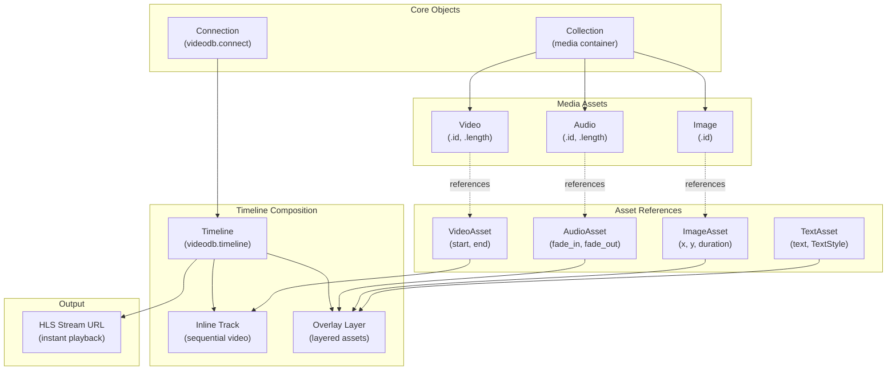
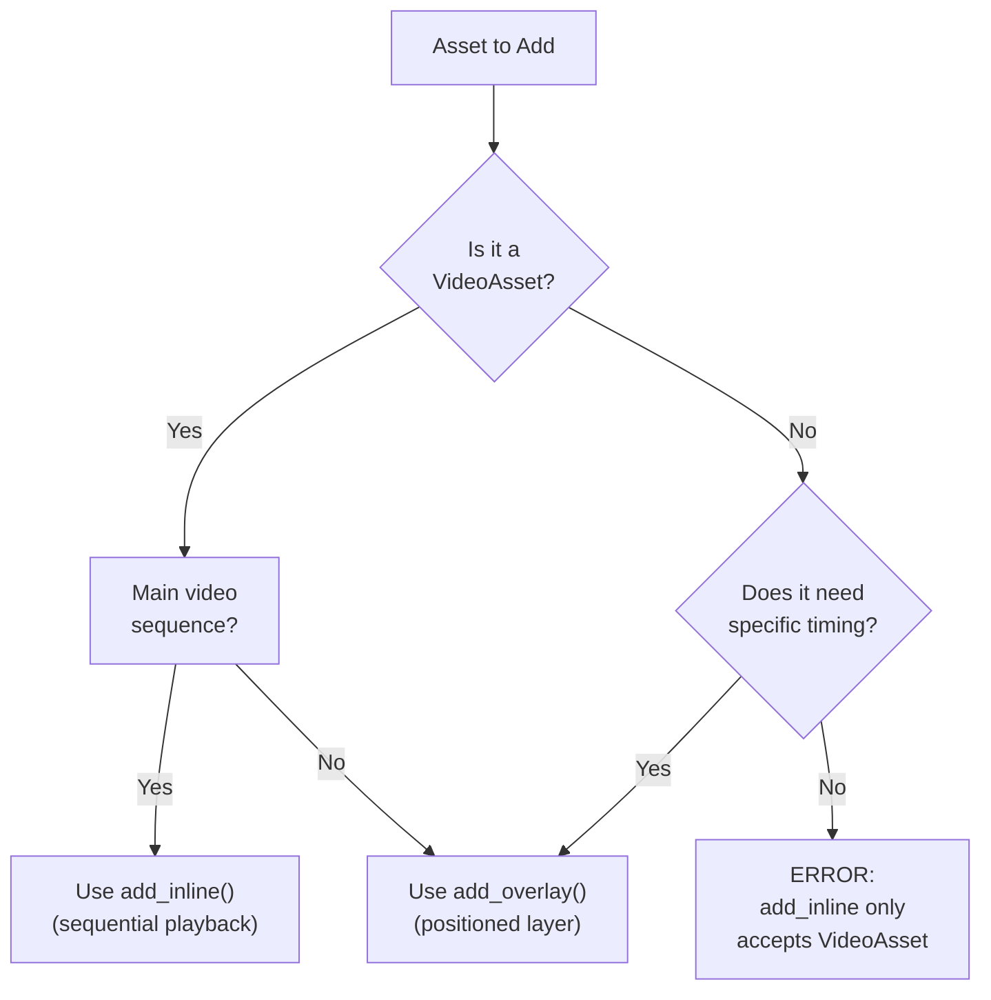
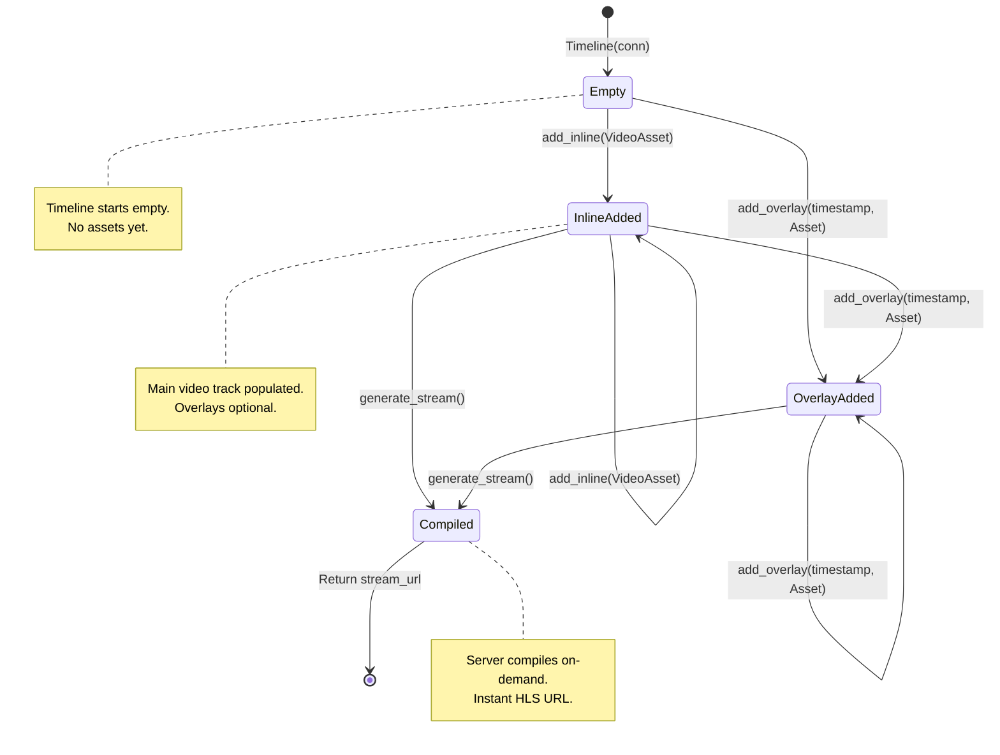

<!-- source: DeepWiki mcp.deepwiki.com · repo video-db/skills · page 7.1 Timeline Basics · fetched 2026-10-26 -->

# Timeline Basics

<details>
<summary>Relevant source files</summary>

The following files were used as context for generating this wiki page:

- [python/SKILL.md](python/SKILL.md)
- [python/reference/editor.md](python/reference/editor.md)

</details>


## Purpose and Scope

This page explains the `Timeline` class from the `videodb.timeline` module, which provides non-destructive video composition. It covers `Timeline` initialization, the distinction between `add_inline()` and `add_overlay()` methods, and stream generation with `generate_stream()`.

For detailed information about individual asset types (`VideoAsset`, `AudioAsset`, `ImageAsset`, `TextAsset`), see [Asset Types](#7.2). For subtitle and caption workflows, see [Subtitles and Captions](#7.3). For system constraints and unsupported operations, see [Limitations and Best Practices](#7.4).

**Note:** VideoDB has two separate Timeline APIs. This page documents `videodb.timeline.Timeline`. For the Editor API (`videodb.editor.Timeline`) used for advanced caption styling, see [Subtitles and Captions](#7.3).

**Sources:** [python/reference/editor.md:1-20](), [python/SKILL.md:208-224]()

---

## What is a Timeline?

A `Timeline` is a virtual composition layer that arranges media assets into a final video stream without modifying source files. All operations are non-destructive: the original `Video`, `Audio`, and `Image` objects remain unchanged. The final output is compiled on-demand when `generate_stream()` is called, producing an HLS stream URL with no pre-rendering wait time.

### Timeline Architecture



**Sources:** [python/reference/editor.md:9-19](), [python/SKILL.md:208-224]()

---

## Timeline Initialization

### Creating a Timeline

A `Timeline` is created from a `Connection` object, not from a `Collection`. This is because timelines can reference assets from multiple collections:

```python
from videodb.timeline import Timeline

conn = videodb.connect()
timeline = Timeline(conn)
```

The `Timeline` constructor requires only the `Connection` object. All authentication and API context is inherited from the connection.

**Sources:** [python/reference/editor.md:15-19](), [python/SKILL.md:218-220]()

---

## Composition Methods: `add_inline()` vs `add_overlay()`

The `Timeline` class provides two distinct methods for adding assets, each serving a different compositional purpose:

### Method Comparison

| Method | Signature | Accepted Assets | Behavior |
|--------|-----------|----------------|----------|
| `add_inline()` | `timeline.add_inline(asset)` | `VideoAsset` only | Adds video to main sequential track |
| `add_overlay()` | `timeline.add_overlay(timestamp, asset)` | `AudioAsset`, `ImageAsset`, `TextAsset` | Layers asset at specific timeline position |

### Inline Track: Sequential Video

The inline track represents the main video timeline. Assets added with `add_inline()` play sequentially, one after another:

```python
from videodb.asset import VideoAsset

video_a = coll.get_video("vid_001")
video_b = coll.get_video("vid_002")

timeline.add_inline(VideoAsset(asset_id=video_a.id))
timeline.add_inline(VideoAsset(asset_id=video_b.id))

# Result: video_a plays first, then video_b immediately follows
```

**Key constraint:** `add_inline()` only accepts `VideoAsset` objects. Attempting to pass `AudioAsset`, `ImageAsset`, or `TextAsset` will fail.

**Sources:** [python/reference/editor.md:35-49](), [python/SKILL.md:220]()

### Overlay Layer: Positioned Assets

Overlays are positioned at absolute timestamps relative to the timeline start. Multiple overlays can exist at the same timestamp and will layer in the order they are added:

```python
from videodb.asset import AudioAsset, TextAsset, TextStyle

music = coll.get_audio("aud_001")
title = TextAsset(
    text="Opening Title",
    duration=5,
    style=TextStyle(fontsize=36, fontcolor="white")
)

# Add background music starting at t=0
timeline.add_overlay(0, AudioAsset(asset_id=music.id))

# Add title text also at t=0 (will appear over the video)
timeline.add_overlay(0, title)
```

**Critical behavior:** Overlay timestamps are **absolute** to the timeline start, not relative to inline video clips. If you rearrange inline clips, overlays remain at their original timestamps and may no longer align with the intended video segment.

**Sources:** [python/reference/editor.md:74-93](), [python/reference/editor.md:126-143](), [python/SKILL.md:221]()

### Inline vs Overlay Decision Tree



**Sources:** [python/reference/editor.md:35-93](), [python/reference/editor.md:422-424]()

---

## Asset References and Trimming

Assets on a `Timeline` are **references** to uploaded media, not copies. The same `Video`, `Audio`, or `Image` can be used in multiple timelines or multiple times within a single timeline:

```python
from videodb.asset import VideoAsset

video = coll.get_video("vid_001")

# Use the same video twice with different trim points
intro = VideoAsset(asset_id=video.id, start=0, end=10)
outro = VideoAsset(asset_id=video.id, start=50, end=60)

timeline.add_inline(intro)
timeline.add_inline(outro)

# Result: plays seconds 0-10, then immediately plays seconds 50-60
```

### Timestamp Validation

**Critical warning:** The SDK does not validate `start` and `end` parameters. Invalid values are silently accepted but produce broken output:

```python
# WRONG: negative start (silently breaks)
bad_asset = VideoAsset(asset_id=video.id, start=-5, end=10)

# WRONG: start >= end (silently breaks)
bad_asset = VideoAsset(asset_id=video.id, start=30, end=20)

# WRONG: end > video.length (silently breaks)
bad_asset = VideoAsset(asset_id=video.id, start=0, end=video.length + 10)
```

**Always validate before creating assets:**

```python
# Correct validation
assert start >= 0, "start must be non-negative"
assert start < end, "start must be less than end"
assert end <= video.length, "end cannot exceed video length"

asset = VideoAsset(asset_id=video.id, start=start, end=end)
```

**Sources:** [python/reference/editor.md:52-70](), [python/SKILL.md:210-213]()

---

## Generating Streams

### `generate_stream()` Method

After assembling a timeline, compile it into a streamable URL with `generate_stream()`:

```python
stream_url = timeline.generate_stream()
print(f"Playable URL: {stream_url}")
```

**Key characteristics:**

- **Instant compilation:** No rendering or transcoding wait time. The stream is available immediately.
- **On-demand processing:** The server compiles the timeline when the stream is requested, not when `generate_stream()` is called.
- **HLS output:** Returns an HLS (HTTP Live Streaming) URL compatible with web players and mobile devices.
- **Non-mutating:** Calling `generate_stream()` multiple times on the same `Timeline` produces different stream URLs, but all reference the same composition.

**Sources:** [python/reference/editor.md:266-273](), [python/SKILL.md:222]()

### Timeline Compilation Workflow

```mermaid
graph LR
    subgraph "Build Phase"
        Upload["Upload Media<br/>(coll.upload)"]
        GetAssets["Get Media Objects<br/>(coll.get_video)"]
        CreateTimeline["Create Timeline<br/>(Timeline(conn))"]
        AddAssets["Add Assets<br/>(add_inline, add_overlay)"]
    end
    
    subgraph "Compilation Phase"
        Generate["Generate Stream<br/>(timeline.generate_stream)"]
        ServerCompile["Server-side Compile<br/>(non-destructive)"]
        HLS["HLS Stream URL"]
    end
    
    subgraph "Delivery Phase"
        Player["Web Player / CDN"]
        OnDemand["On-demand Assembly<br/>(no pre-render)"]
    end
    
    Upload --> GetAssets
    GetAssets --> CreateTimeline
    CreateTimeline --> AddAssets
    AddAssets --> Generate
    Generate --> ServerCompile
    ServerCompile --> HLS
    HLS --> Player
    Player --> OnDemand
```



**Sources:** [python/reference/editor.md:266-273](), [python/SKILL.md:208-224]()

---

## Complete Example Workflow

### Basic Video Composition

```python
import videodb
from videodb.timeline import Timeline
from videodb.asset import VideoAsset, AudioAsset, TextAsset, TextStyle

# 1. Initialize connection and get assets
conn = videodb.connect()
coll = conn.get_collection()

video = coll.get_video("vid_001")
music = coll.get_audio("aud_001")

# 2. Create timeline
timeline = Timeline(conn)

# 3. Add main video clip (trimmed to 30 seconds)
timeline.add_inline(VideoAsset(
    asset_id=video.id,
    start=10,
    end=40
))

# 4. Add background music overlay (starts at timeline t=0)
timeline.add_overlay(0, AudioAsset(
    asset_id=music.id,
    disable_other_tracks=False,  # Mix with video audio
    fade_in_duration=2,
    fade_out_duration=2
))

# 5. Add text overlay (appears 5 seconds into timeline)
timeline.add_overlay(5, TextAsset(
    text="Key Moment",
    duration=3,
    style=TextStyle(
        fontsize=36,
        fontcolor="white",
        boxcolor="black",
        alpha=0.8
    )
))

# 6. Generate stream
stream_url = timeline.generate_stream()
print(f"Timeline compiled: {stream_url}")
```

### Timeline State Diagram



**Sources:** [python/reference/editor.md:277-314](), [python/SKILL.md:208-224]()

---

## Key Concepts Summary

| Concept | Implementation | File Reference |
|---------|---------------|----------------|
| Non-destructive editing | Assets reference original media by ID | [python/reference/editor.md:9-19]() |
| Timeline creation | `Timeline(conn)` from `Connection` | [python/reference/editor.md:15-19]() |
| Sequential video | `add_inline(VideoAsset)` only | [python/reference/editor.md:35-49]() |
| Layered assets | `add_overlay(timestamp, Asset)` | [python/reference/editor.md:74-143]() |
| Asset trimming | `start` and `end` parameters on assets | [python/reference/editor.md:52-70]() |
| Stream generation | `timeline.generate_stream()` returns HLS URL | [python/reference/editor.md:266-273]() |
| Instant compilation | No render wait, on-demand assembly | [python/reference/editor.md:266-273]() |

**Sources:** [python/reference/editor.md:1-273](), [python/SKILL.md:208-224]()

---

## Next Steps

- Learn about specific asset types and their parameters in [Asset Types](#7.2)
- Explore subtitle generation and styling in [Subtitles and Captions](#7.3)
- Review system limitations and unsupported operations in [Limitations and Best Practices](#7.4)
- See complete use case examples in [Highlight Reels and Clips](#12.1) and [Social Media Publishing](#12.5)

---

