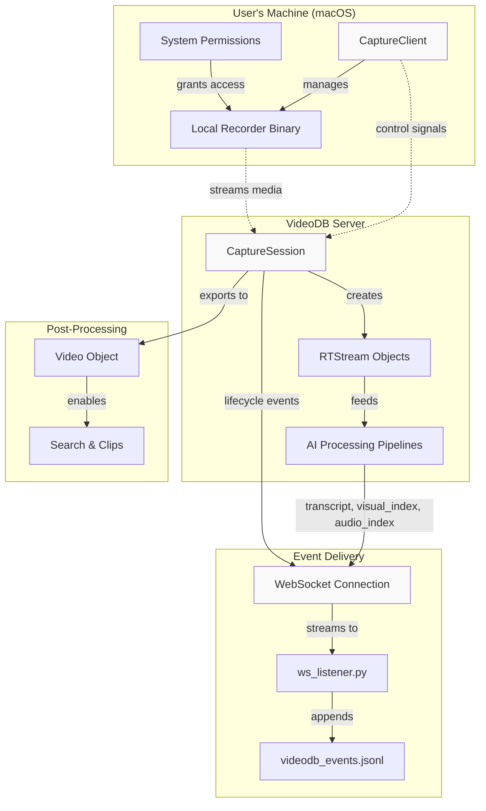
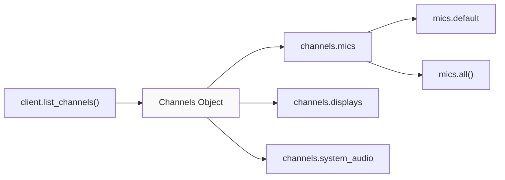
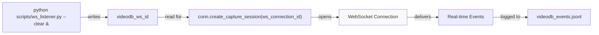
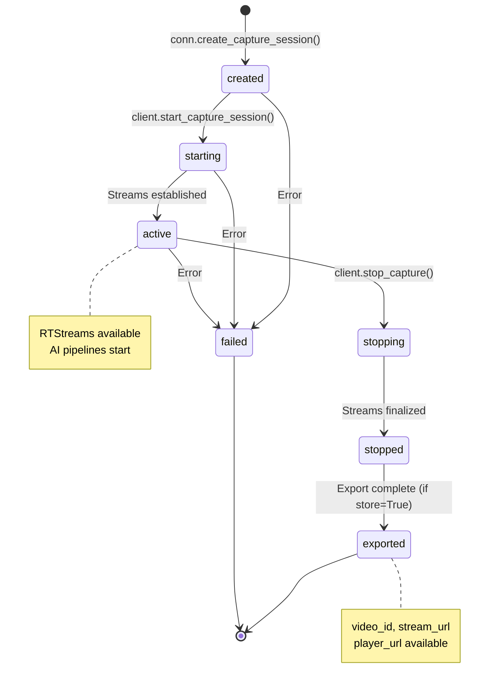
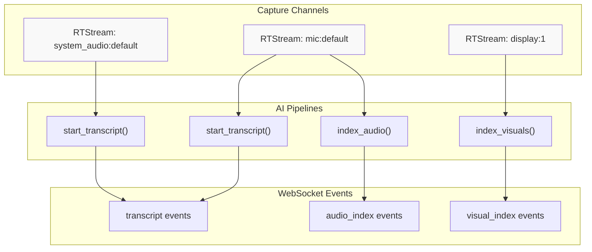
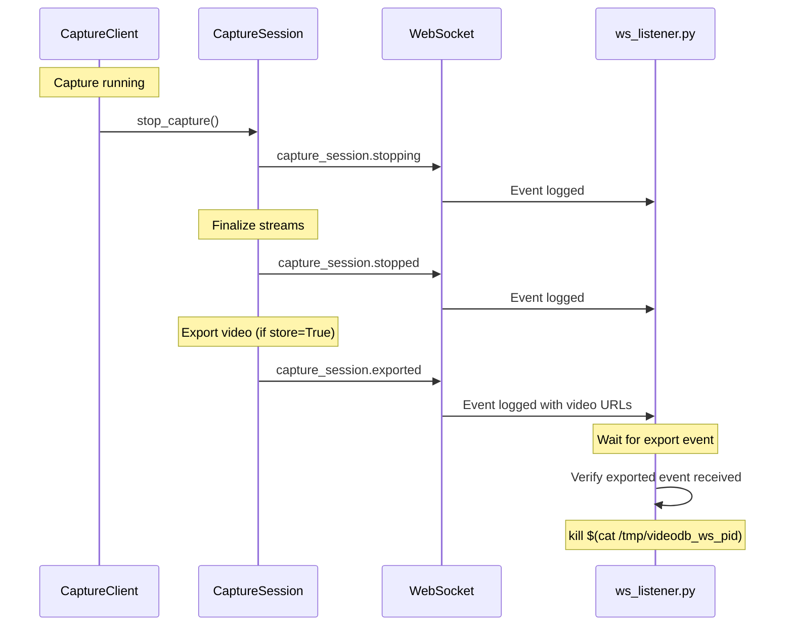

<!-- source: DeepWiki mcp.deepwiki.com · repo video-db/skills · page 8 Desktop Capture · fetched 2026-10-26 -->

# Desktop Capture

<details>
<summary>Relevant source files</summary>

The following files were used as context for generating this wiki page:

- [python/SKILL.md](python/SKILL.md)
- [python/reference/capture-reference.md](python/reference/capture-reference.md)
- [python/reference/capture.md](python/reference/capture.md)

</details>


Desktop Capture enables real-time screen and audio recording with live AI processing. This system streams screen content, microphone input, and system audio to VideoDB's servers while simultaneously running AI pipelines for transcription, visual understanding, and audio analysis. All events are delivered via WebSocket for immediate consumption.

This document provides an architectural overview of the capture system. For detailed information:
- Complete workflow and setup instructions: see [Capture Workflow](#8.1)
- SDK methods and object model: see [CaptureClient API](#8.2)
- WebSocket event types and formats: see [Capture Events](#8.3)
- Querying and analyzing captured content: see [Post-Session Processing](#8.4)

For live stream processing (RTSP/RTMP feeds), see [Live Stream Processing](#9).

**Sources:** [python/reference/capture.md:1-17](), [python/SKILL.md:315-317]()

---

## Platform Support

Desktop Capture currently supports **macOS only**. The system requires:

- Python SDK with capture extras: `pip install "videodb[capture]"`
- Permissions for microphone and screen capture (requested programmatically)
- WebSocket listener process running in background

The capture functionality is not available on Linux or Windows.

**Sources:** [python/SKILL.md:317](), [python/reference/capture.md:5-6]()

---

## Architecture Overview

The Desktop Capture system consists of four layers operating across client and server boundaries:



**Key architectural properties:**

1. **Client-Server Split**: `CaptureClient` runs locally to access system devices; all processing happens server-side
2. **Streaming Architecture**: Media streams continuously from local recorder to server; no local storage
3. **Real-time Events**: WebSocket delivers events as they occur; no polling required
4. **Asynchronous Processing**: AI pipelines run in parallel with capture; results arrive independently
5. **Session Lifecycle**: State machine manages creation, activation, stopping, and export phases

**Sources:** [python/reference/capture.md:1-6](), [python/reference/capture-reference.md:1-8]()

---

## Core Components

### CaptureSession

Server-side object that manages the capture lifecycle and coordinates RTStreams.

| Component | Location | Purpose |
|-----------|----------|---------|
| `CaptureSession` | Server | Session state machine and RTStream factory |
| `session.id` | Server | Unique identifier passed to client |
| `session.get_rtstream(type)` | Server | Retrieve RTStreams by type (`"mic"`, `"screen"`, `"system_audio"`) |

Created via `conn.create_capture_session()` with required `end_user_id`, optional `collection_id`, `ws_connection_id`, and `metadata` parameters.

**Sources:** [python/reference/capture-reference.md:216-252]()

### CaptureClient

Local process that runs on user's machine to stream screen and audio data.

| Component | Location | Purpose |
|-----------|----------|---------|
| `CaptureClient` | Client (macOS) | Manages local recorder binary and permissions |
| `client.request_permission(type)` | Client | Request `"microphone"` or `"screen_capture"` access |
| `client.list_channels()` | Client | Discover available devices |
| `client.start_capture_session()` | Client | Begin streaming selected channels |
| `client.stop_capture()` | Client | Gracefully terminate capture |

Initialized with `client_token` generated from `conn.generate_client_token()`. The client process **must remain running** for the entire capture duration; if the Python process exits, the recorder binary is killed.

**Sources:** [python/reference/capture-reference.md:260-304](), [python/reference/capture.md:21]()

### Channels

Represents discoverable audio and video input devices.



Each `Channel` has:
- `ch.id` - Unique identifier for `start_capture_session()`
- `ch.type` - Device type: `"mic"`, `"display"`, `"system_audio"`
- `ch.name` - Human-readable label
- `ch.store` - Boolean flag; set to `True` to persist recording as video

Without `store=True`, streams are processed in real-time but not saved to permanent storage.

**Sources:** [python/reference/capture-reference.md:307-346]()

### RTStream

Server-side objects created when capture session becomes active. Each channel (mic, display, system_audio) gets its own `RTStream` for independent AI processing.

| Method | Purpose |
|--------|---------|
| `rtstream.start_transcript()` | Begin real-time speech-to-text |
| `rtstream.index_visuals()` | Analyze screen content with AI descriptions |
| `rtstream.index_audio()` | Analyze audio for content/profanity/music |

RTStreams are retrieved via `session.get_rtstream(type)` after the session reaches `"active"` status. For complete RTStream API, see [Live Stream Processing](#9).

**Sources:** [python/reference/capture-reference.md:349-354]()

### WebSocket Event Stream

All capture and AI events are delivered via WebSocket connection to `ws_listener.py`.



The listener must be started before creating the capture session. It writes:
- `videodb_ws_id` - Connection ID to pass to `create_capture_session()`
- `videodb_events.jsonl` - All events in JSONL format
- `videodb_ws_pid` - Process ID for clean shutdown

**Sources:** [python/reference/capture-reference.md:114-165](), [python/scripts/ws_listener.py]()

---

## Capture Lifecycle

The system follows a strict state machine from creation through export:



**Event sequence:**

| State | WebSocket Event | Data Available |
|-------|----------------|----------------|
| `created` | `capture_session.created` | Session ID |
| `starting` | `capture_session.starting` | — |
| `active` | `capture_session.active` | `rtstreams[]` array with IDs |
| `stopping` | `capture_session.stopping` | — |
| `stopped` | `capture_session.stopped` | — |
| `exported` | `capture_session.exported` | `exported_video_id`, `stream_url`, `player_url` |
| `failed` | `capture_session.failed` | `error` message |

The **active** event is critical: it contains the `rtstreams` array with IDs needed to start AI pipelines. The **exported** event provides the permanent video asset for search and clipping.

**Sources:** [python/reference/capture-reference.md:359-387](), [python/reference/capture-reference.md:23-33]()

---

## AI Processing Pipeline

Once the session is active, AI pipelines run in real-time on each RTStream:



**Event channels:**

| Channel | Source Pipeline | Content | Event Structure |
|---------|----------------|---------|-----------------|
| `transcript` | `start_transcript()` | Speech-to-text with timestamps | `{"channel": "transcript", "data": {"text": "...", "start": ..., "end": ...}}` |
| `visual_index` | `index_visuals()` | AI descriptions of screen content | `{"channel": "visual_index", "data": {"text": "User is viewing...", "start": ..., "end": ...}}` |
| `audio_index` | `index_audio()` | Audio content analysis | `{"channel": "audio_index", "data": {"text": "Discussion about...", "start": ..., "end": ...}}` |

All events include `rtstream_id` and `rtstream_name` to identify the source channel. The `ws_listener.py` script adds `ts` (ISO 8601) and `unix_ts` (epoch) timestamps for all events.

**Sources:** [python/reference/capture-reference.md:14-21](), [python/reference/capture-reference.md:36-78]()

---

## Key Capabilities

### Real-time Context Streaming

AI results arrive as events while capture is running, enabling:
- Live transcription of speech
- Screen activity monitoring (e.g., "User opened Slack")
- Audio content detection (music, profanity, discussions)

Events can be consumed immediately from `videodb_events.jsonl` for real-time alerting or logging.

**Sources:** [python/SKILL.md:14-18]()

### Session Memory

All events are persisted to JSONL for retrospective analysis:

```python
import json
events = [json.loads(l) for l in open("/tmp/videodb_events.jsonl")]

# Extract all spoken text
transcripts = [e["data"]["text"] for e in events if e.get("channel") == "transcript"]

# Find visual events from last 5 minutes
import time
cutoff = time.time() - 300
recent_visual = [e for e in events 
                 if e.get("channel") == "visual_index" and e["unix_ts"] > cutoff]
```

**Sources:** [python/reference/capture-reference.md:176-194]()

### Post-Capture Video Export

When channels have `store=True`, the session exports to a permanent `Video` object after stopping:

```python
# Wait for export event
events = [json.loads(l) for l in open("/tmp/videodb_events.jsonl")]
export_event = [e for e in events if e.get("event") == "capture_session.exported"][0]

video_id = export_event["data"]["exported_video_id"]
stream_url = export_event["data"]["stream_url"]
player_url = export_event["data"]["player_url"]
```

The exported video is searchable and can be clipped using standard VideoDB operations. See [Post-Session Processing](#8.4).

**Sources:** [python/reference/capture-reference.md:96-108](), [python/reference/capture.md:49]()

### Multi-Channel Recording

Each input device becomes an independent RTStream with separate AI processing:

| Channel Type | Media | Typical Use |
|--------------|-------|-------------|
| `mic:default` | Audio | User voice, meeting audio |
| `display:1` | Video | Screen content, UI interactions |
| `system_audio:default` | Audio | Application sounds, music, notifications |

Channels can be selected individually; not all must be active. The `primary_video_channel_id` parameter determines which display is used if multiple are available.

**Sources:** [python/reference/capture-reference.md:288-296](), [python/reference/capture-reference.md:307-346]()

---

## Critical Process Requirements

### Long-lived Process

The `CaptureClient` process **must remain running** throughout the capture session:

> If the Python process that created the `CaptureClient` exits, the recorder binary is killed and capture stops silently.

Best practices:
- Run as background process: `nohup python capture_script.py &`
- Write PID file for controlled shutdown
- Use signal handlers (`SIGINT`/`SIGTERM`) with `asyncio.Event` to keep process alive
- Save session info to JSON file for other scripts to read

**Sources:** [python/reference/capture.md:21](), [python/reference/capture.md:36-38]()

### WebSocket Listener Lifecycle

The `ws_listener.py` script must be started **before** creating the session and stopped **after** receiving the export event:

```bash
# 1. Start listener with --clear for new session
python scripts/ws_listener.py --clear &

# 2. Read WebSocket ID
ws_id=$(cat /tmp/videodb_ws_id)

# 3. Run capture (creates session, starts client, waits for completion)
# ... capture code runs ...

# 4. Wait for export event in videodb_events.jsonl

# 5. Stop listener after export received
kill $(cat /tmp/videodb_ws_pid)
```

Stopping the listener before the export event results in missing the final video URLs.

**Sources:** [python/reference/capture.md:56-64](), [python/reference/capture-reference.md:118-146]()

### Proper Shutdown Sequence



**Sources:** [python/reference/capture.md:56-64]()

---

## Integration Points

### With Live Stream Processing

Both Desktop Capture and RTSP/RTMP streams create `RTStream` objects with identical AI pipeline methods:

- `start_transcript(ws_connection_id)` - Real-time speech-to-text
- `index_visuals(ws_connection_id, prompt, batch_duration)` - Visual analysis
- `index_audio(ws_connection_id, prompt, batch_duration)` - Audio analysis
- `create_alert(event, scene_index, ws_connection_id, callback_url)` - Event detection

See [Live Stream Processing](#9) for complete RTStream API documentation.

**Sources:** [python/reference/capture-reference.md:349-354]()

### With Search and Indexing

After export, the resulting `Video` object supports all standard indexing and search operations:

- `video.index_spoken_words()` - Build searchable transcript
- `video.index_scenes()` - Visual scene analysis
- `video.search(query)` - Semantic and keyword search
- `video.generate_stream()` - Generate playback URL

See [Video Understanding and Indexing](#5) and [Searching Videos](#6).

**Sources:** [python/reference/capture.md:48-51]()

---

## Workflow Summary

**Minimal working sequence:**

1. Start `ws_listener.py --clear &`
2. Read `ws_id` from `/tmp/videodb_ws_id`
3. Create `CaptureSession` with `ws_connection_id`
4. Generate `client_token`
5. Initialize `CaptureClient` with token
6. Request permissions for microphone and screen
7. List channels and select devices (set `store=True` on desired channels)
8. Start capture session
9. Wait for `capture_session.active` event
10. Start AI pipelines on RTStreams
11. Keep process alive (signal handlers + asyncio.Event)
12. Stop capture when done
13. Wait for `capture_session.exported` event
14. Stop WebSocket listener

For complete code examples and detailed workflow, see [Capture Workflow](#8.1).

**Sources:** [python/reference/capture.md:17-52]()

---

## Related Documentation

- [Capture Workflow](#8.1) - Step-by-step implementation guide
- [CaptureClient API](#8.2) - Complete SDK reference
- [Capture Events](#8.3) - Event types and JSONL format
- [Post-Session Processing](#8.4) - Querying and analyzing captured content
- [Live Stream Processing](#9) - RTSP/RTMP streams and RTStream API
- [WebSocket Listener](#13) - `ws_listener.py` script documentation

**Sources:** [python/SKILL.md:311-313](), [python/reference/capture.md:1-8]()

---

