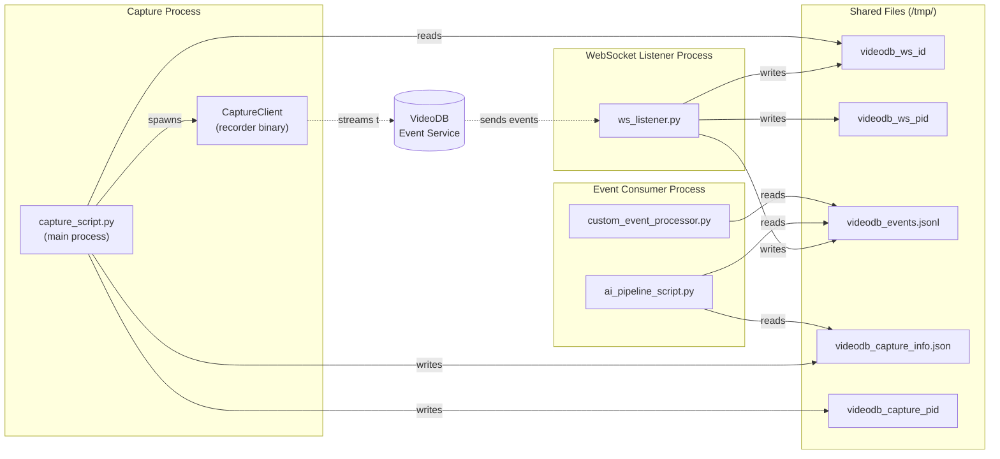
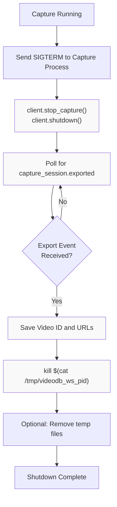

<!-- source: DeepWiki mcp.deepwiki.com · repo video-db/skills · page 8.1 Capture Workflow · fetched 2026-10-26 -->

# Capture Workflow

<details>
<summary>Relevant source files</summary>

The following files were used as context for generating this wiki page:

- [python/reference/capture.md](python/reference/capture.md)

</details>


This page documents the complete lifecycle for desktop screen and audio capture with VideoDB. It covers the multi-process orchestration required for real-time recording: starting the WebSocket listener, creating capture sessions, initializing the client, managing the recording process, and handling shutdown.

For details on `CaptureClient` methods and initialization parameters, see [CaptureClient API](#8.2). For WebSocket event structures and types, see [Capture Events](#8.3). For working with captured content after recording, see [Post-Session Processing](#8.4).

**Platform Support**: Desktop capture is currently **macOS-only**.

---

## Workflow Overview

Desktop capture is a multi-process system requiring coordination between three components:

1. **WebSocket Listener** (`ws_listener.py`) - Background process that receives real-time events
2. **Capture Process** - Long-running Python script that manages `CaptureClient` and `CaptureSession`
3. **Event Consumer** - Separate script(s) that read and process events from the JSONL file

The workflow uses **file-based coordination**: processes communicate through shared files in `/tmp/` for WebSocket IDs, PIDs, session info, and event logs.

```mermaid
graph TB
    Start["Start"] --> WSListener["1. Start ws_listener.py --clear"]
    WSListener --> ReadWSID["2. Read WebSocket ID<br/>/tmp/videodb_ws_id"]
    ReadWSID --> CreateSession["3. Create CaptureSession<br/>conn.create_capture_session(ws_connection_id)"]
    CreateSession --> InitClient["4. Initialize CaptureClient<br/>CaptureClient(client_token)"]
    InitClient --> Permissions["5. Request Permissions<br/>client.request_permissions()"]
    Permissions --> ListChannels["6. List Channels<br/>client.list_channels()"]
    ListChannels --> SelectChannels["7. Select Channels<br/>Set store=True on desired channels"]
    SelectChannels --> StartCapture["8. Start Capture<br/>client.start_capture(channels)"]
    StartCapture --> WaitActive["9. Wait for session.active Event<br/>Read videodb_events.jsonl"]
    WaitActive --> SaveInfo["10. Save Session Info<br/>/tmp/videodb_capture_info.json"]
    SaveInfo --> KeepAlive["11. Keep Process Alive<br/>asyncio.Event + signal handlers"]
    KeepAlive --> StartAI["12. Start AI Pipelines<br/>Separate script reads session info"]
    StartAI --> CustomLogic["13. Custom Event Processing<br/>Read and react to events"]
    CustomLogic --> StopSignal["14. Stop Signal (SIGTERM)"]
    StopSignal --> StopCapture["15. Stop Capture<br/>client.stop_capture() + shutdown()"]
    StopCapture --> WaitExport["16. Wait for session.exported Event"]
    WaitExport --> StopWS["17. Stop WebSocket Listener<br/>kill $(cat /tmp/videodb_ws_pid)"]
    StopWS --> End["End"]

    style WSListener fill:#f9f9f9
    style CreateSession fill:#f9f9f9
    style InitClient fill:#f9f9f9
    style StartCapture fill:#f9f9f9
    style WaitActive fill:#f9f9f9
    style KeepAlive fill:#f9f9f9
    style StopCapture fill:#f9f9f9
    style WaitExport fill:#f9f9f9
```



**Diagram: Complete Capture Workflow Sequence**

Sources: [python/reference/capture.md:17-52]()

---

## Step 1: Start WebSocket Listener

The WebSocket listener must be started **before** creating any capture sessions. It creates a persistent connection to VideoDB's event service and writes all events to a JSONL file.

### Starting the Listener

```bash
# Start in background, clearing old events
python scripts/ws_listener.py --clear &

# Wait for files to be created
sleep 2
```

The `--clear` flag removes old events from previous sessions. Omit it to append to existing event logs.

### Output Files

| File | Purpose | Created By |
|------|---------|------------|
| `/tmp/videodb_events.jsonl` | All WebSocket events (one JSON object per line) | `ws_listener.py` |
| `/tmp/videodb_ws_id` | WebSocket connection ID (UUID string) | `ws_listener.py` |
| `/tmp/videodb_ws_pid` | Process ID for stopping the listener | `ws_listener.py` |

The `videodb_ws_id` file contains the `ws_connection_id` required for creating capture sessions and starting AI pipelines. This ID associates all events with the correct WebSocket connection.

### Custom Output Directory

By default, files are written to `/tmp/`. Specify a custom directory:

```bash
python scripts/ws_listener.py --clear /path/to/events &
```

All three files will be written to the specified directory.

Sources: [python/reference/capture.md:73-101]()

---

## Step 2-3: Create Capture Session

After the WebSocket listener is running, create a server-side `CaptureSession` object.

```python
import videodb

# Read WebSocket ID from file
with open("/tmp/videodb_ws_id", "r") as f:
    ws_connection_id = f.read().strip()

# Connect and create session
conn = videodb.connect()
session = conn.create_capture_session(
    ws_connection_id=ws_connection_id,
    name="Desktop Recording"
)

# Generate client token for desktop client
client_token = session.generate_client_token()
```

The `CaptureSession` object manages the server-side lifecycle. The `client_token` authenticates the desktop client (`CaptureClient`) to stream data to this specific session.

Sources: [python/reference/capture.md:27-29]()

---

## Step 4-7: Initialize and Configure Client

The `CaptureClient` runs a local binary that captures screen and audio, streaming data to the server.

### Initialize Client

```python
from videodb.capture import CaptureClient

client = CaptureClient(client_token=client_token)
```

### Request Permissions

macOS requires explicit permission for screen recording and microphone access:

```python
client.request_permissions()
```

This opens system dialogs. The user must grant permissions before capture can start.

### List Available Channels

```python
channels = client.list_channels()

# channels is a dict with keys: "mic", "display", "system_audio"
# Each key contains a list of available devices
```

### Select and Configure Channels

Set `store=True` on channels you want persisted as permanent video assets:

```python
# Select first microphone and mark for storage
mic_channel = channels["mic"][0]
mic_channel.store = True

# Select primary display and mark for storage
display_channel = channels["display"][0]
display_channel.store = True

# Optionally enable system audio (app sounds, music, etc)
system_audio_channel = channels["system_audio"][0]
system_audio_channel.store = True

selected = [mic_channel, display_channel, system_audio_channel]
```

Channels with `store=False` are still streamed for real-time AI processing but not saved to permanent video.

Sources: [python/reference/capture.md:29-35]()

---

## Step 8-10: Start Capture and Wait for Active

### Start Capture

```python
client.start_capture(channels=selected)
```

This initiates the local recorder binary and begins streaming to VideoDB. The session transitions to "active" state.

### Wait for Session Active Event

Poll the events file until you see the `capture_session.active` event:

```python
import json
import time

def wait_for_session_active(timeout=30):
    """Wait for session to become active and return RTStream IDs."""
    start_time = time.time()
    
    while time.time() - start_time < timeout:
        with open("/tmp/videodb_events.jsonl", "r") as f:
            for line in f:
                event = json.loads(line)
                if event.get("event_type") == "capture_session.active":
                    return event["data"]["rtstreams"]
        time.sleep(1)
    
    raise TimeoutError("Session did not become active")

rtstreams = wait_for_session_active()
```

The `capture_session.active` event contains the `rtstreams` array with one entry per captured channel (each with an `id` and `type`).

### Save Session Information

Save the session details to a file for other scripts to access:

```python
import json

session_info = {
    "session_id": session.id,
    "rtstreams": rtstreams,
    "ws_connection_id": ws_connection_id
}

with open("/tmp/videodb_capture_info.json", "w") as f:
    json.dump(session_info, f)
```

This enables decoupling: AI pipeline scripts and event consumers can read session info independently.

Sources: [python/reference/capture.md:35-38]()

---

## Step 11: Keep Process Alive

**CRITICAL**: The `CaptureClient` must remain running for the entire capture duration. If the Python process exits, the local recorder binary is killed and capture stops silently.

### Process Lifecycle Management

```python
import asyncio
import signal

# Create event for graceful shutdown
shutdown_event = asyncio.Event()

def signal_handler(sig, frame):
    """Handle SIGINT/SIGTERM for graceful shutdown."""
    print(f"Received signal {sig}, stopping capture...")
    shutdown_event.set()

# Register signal handlers
signal.signal(signal.SIGINT, signal_handler)
signal.signal(signal.SIGTERM, signal_handler)

# Write PID file so process can be stopped later
import os
with open("/tmp/videodb_capture_pid", "w") as f:
    f.write(str(os.getpid()))

# Block until signal received
async def keep_alive():
    await shutdown_event.wait()

asyncio.run(keep_alive())
```

### Stopping the Process

From another terminal:

```bash
kill $(cat /tmp/videodb_capture_pid)
```

This sends `SIGTERM`, triggering the signal handler for graceful shutdown.

Sources: [python/reference/capture.md:21-22](), [python/reference/capture.md:37-38]()

---

## Multi-Process Architecture

The capture system uses three independent processes communicating through shared files:



**Diagram: Process Architecture and File-Based Coordination**

This architecture enables:
- **Decoupling**: AI pipelines and event consumers run independently
- **Persistence**: Events are logged to disk, survives process crashes
- **Flexibility**: Multiple consumers can process the same event stream
- **Restartability**: Consumers can be stopped and restarted without affecting capture

Sources: [python/reference/capture.md:17-52]()

---

## Step 12-13: AI Pipelines and Event Processing

While capture is running, start AI pipelines and custom event processing in **separate scripts**.

### Starting AI Pipelines

Read session info and start indexing on each RTStream:

```python
import json
import videodb

# Read session info
with open("/tmp/videodb_capture_info.json", "r") as f:
    session_info = json.load(f)

conn = videodb.connect()
ws_connection_id = session_info["ws_connection_id"]

# Start AI pipelines on each stream
for stream_data in session_info["rtstreams"]:
    rtstream = conn.get_rtstream(stream_data["id"])
    
    # Visual indexing
    rtstream.index_visuals(
        ws_connection_id=ws_connection_id,
        prompt="Describe visible applications and screen activity"
    )
    
    # Audio indexing
    rtstream.index_audio(
        ws_connection_id=ws_connection_id,
        prompt="Detect keywords: 'urgent', 'deadline', 'meeting'"
    )
    
    # Transcription
    rtstream.start_transcript(
        ws_connection_id=ws_connection_id
    )
```

AI results are delivered as events to the WebSocket listener, written to `videodb_events.jsonl`.

### Custom Event Processing

Create a separate script to react to specific events:

```python
import json
import time

def tail_events():
    """Read events in real-time from JSONL file."""
    with open("/tmp/videodb_events.jsonl", "r") as f:
        # Seek to end
        f.seek(0, 2)
        
        while True:
            line = f.readline()
            if line:
                event = json.loads(line)
                handle_event(event)
            else:
                time.sleep(0.1)

def handle_event(event):
    """Process events based on type."""
    event_type = event.get("event_type")
    
    if event_type == "visual_index":
        description = event["data"]["text"]
        if "Slack" in description:
            log_slack_activity(description)
    
    elif event_type == "audio_index":
        text = event["data"]["text"]
        if "urgent" in text.lower():
            send_alert(text)
    
    elif event_type == "transcript":
        transcript = event["data"]["text"]
        save_transcript_segment(transcript)

tail_events()
```

For complete event structure details, see [Capture Events](#8.3).

Sources: [python/reference/capture.md:39-46]()

---

## Step 14-16: Stopping Capture and Export

### Stop Capture

When ready to end recording, signal the capture process:

```bash
kill $(cat /tmp/videodb_capture_pid)
```

The signal handler should call:

```python
# In signal handler
client.stop_capture()
client.shutdown()
```

This stops the local recorder and signals the server to finalize the session.

### Wait for Export Event

The server processes captured streams and exports them to permanent video assets. Poll events for completion:

```python
def wait_for_export(timeout=120):
    """Wait for session to be exported and return video details."""
    start_time = time.time()
    
    while time.time() - start_time < timeout:
        with open("/tmp/videodb_events.jsonl", "r") as f:
            for line in f:
                event = json.loads(line)
                if event.get("event_type") == "capture_session.exported":
                    data = event["data"]
                    return {
                        "video_id": data["exported_video_id"],
                        "stream_url": data["stream_url"],
                        "player_url": data["player_url"]
                    }
        time.sleep(2)
    
    raise TimeoutError("Export did not complete")

export_data = wait_for_export()
print(f"Video ID: {export_data['video_id']}")
print(f"Stream URL: {export_data['stream_url']}")
```

The `capture_session.exported` event contains:
- `exported_video_id`: The permanent `Video` object ID
- `stream_url`: HLS playback URL
- `player_url`: Web player link

Sources: [python/reference/capture.md:47-51]()

---

## Shutdown Sequence

Proper shutdown order ensures all events are captured before terminating processes:



**Diagram: Proper Shutdown Sequence**

### Shutdown Order

1. **Stop Capture Client**: Send `SIGTERM` to capture process
   ```bash
   kill $(cat /tmp/videodb_capture_pid)
   ```

2. **Wait for Export Event**: Continue reading events until `capture_session.exported` appears
   - Export may take 10-60 seconds depending on recording duration
   - Do **NOT** proceed to step 3 until export completes

3. **Stop WebSocket Listener**: Only after receiving export event
   ```bash
   kill $(cat /tmp/videodb_ws_pid)
   ```

4. **Clean Up** (optional): Remove temporary files
   ```bash
   rm /tmp/videodb_capture_pid
   rm /tmp/videodb_capture_info.json
   # Keep events.jsonl for post-processing
   ```

**Why This Order Matters**: If you kill the WebSocket listener before the export event arrives, you'll lose the video URLs and have no way to access the captured content.

Sources: [python/reference/capture.md:55-64]()

---

## Process Failure Recovery

### If Capture Process Crashes

The WebSocket listener continues running and receiving events. However, the local recorder binary terminates, stopping data stream:

**Recovery**: 
- Check `/tmp/videodb_events.jsonl` for error events
- Restart capture process from Step 3 (create new session)
- Previous partial recording may be lost depending on when crash occurred

### If WebSocket Listener Crashes

The listener has auto-reconnect with exponential backoff. It will attempt to reconnect automatically.

**Manual Recovery**:
```bash
# Restart listener (without --clear to preserve existing events)
python scripts/ws_listener.py &
```

The capture process continues streaming; events are buffered server-side during disconnection.

### If Network Connection Lost

Both `CaptureClient` and `ws_listener.py` attempt automatic reconnection:

- **CaptureClient**: Retries streaming with backoff
- **ws_listener**: Reconnects WebSocket with exponential backoff (2s, 4s, 8s, 16s, 32s max)

If reconnection fails for extended period (>5 minutes), stop and restart both processes.

Sources: [python/reference/capture.md:97-101]()

---

## File-Based Coordination Reference

| File | Writer | Readers | Contents | Purpose |
|------|--------|---------|----------|---------|
| `videodb_ws_id` | `ws_listener.py` | Capture script | WebSocket connection UUID | Associates sessions with event stream |
| `videodb_ws_pid` | `ws_listener.py` | Shutdown scripts | Process ID | Enables `kill` for graceful termination |
| `videodb_events.jsonl` | `ws_listener.py` | All consumers | JSONL event log | Persistent event storage |
| `videodb_capture_pid` | Capture script | Stop scripts | Capture process ID | Enables signaling capture process |
| `videodb_capture_info.json` | Capture script | AI pipeline, consumers | Session metadata | Shares RTStream IDs and session details |

All files default to `/tmp/` but can be customized via command-line arguments.

Sources: [python/reference/capture.md:92-95]()

---

## Platform-Specific Considerations

### macOS Requirements

- **System Permissions**: Screen Recording and Microphone access must be granted
- **Terminal App**: If running from Terminal, grant permissions to Terminal.app
- **IDE Permissions**: If running from VS Code or PyCharm, grant permissions to those apps

### Permission Prompts

The first call to `client.request_permissions()` opens system dialogs. The user must:
1. Grant Microphone access
2. Grant Screen Recording access
3. Restart the script after granting permissions (first run will fail)

Subsequent runs use cached permissions.

### Binary Location

`CaptureClient` downloads and manages the recorder binary automatically in:
```
~/.videodb/capture/bin/
```

No manual installation required.

Sources: [python/reference/capture.md:5]()

---

## Next Steps

- **[CaptureClient API](#8.2)** - Detailed method signatures and parameters
- **[Capture Events](#8.3)** - Complete event schema and types  
- **[Post-Session Processing](#8.4)** - Searching and clipping captured content
- **[Live Stream Processing](#9)** - Real-time AI on RTSP/RTMP streams

---

