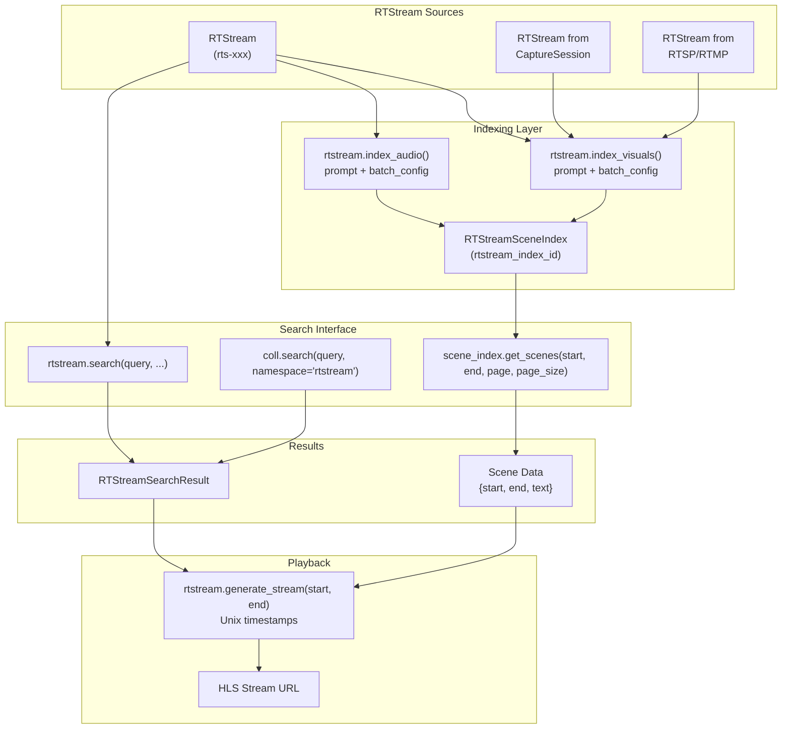
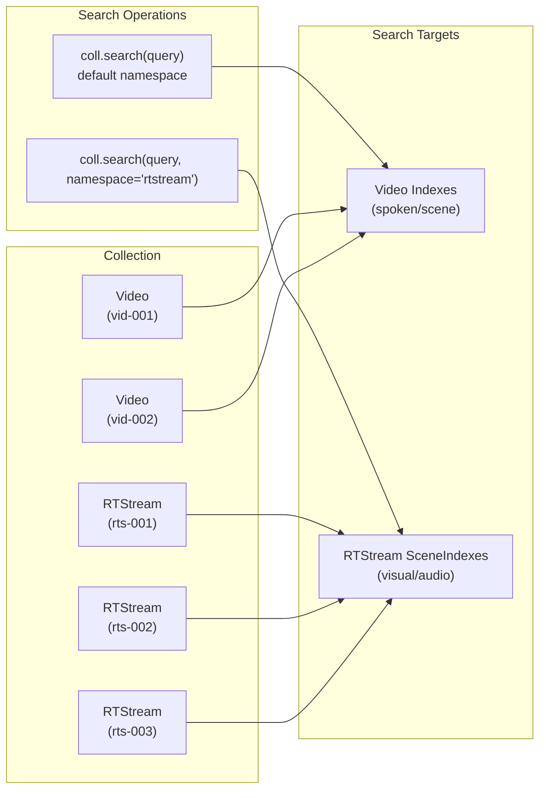
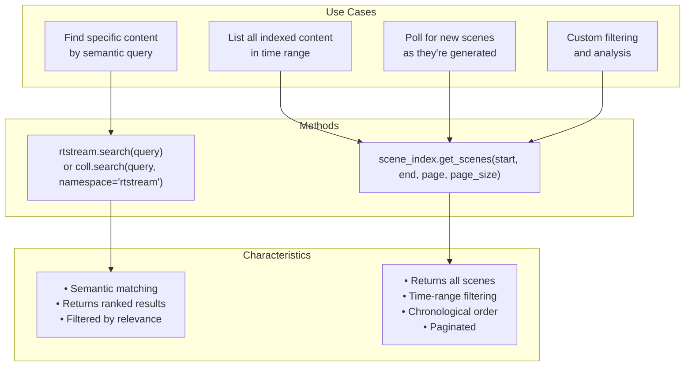

<!-- source: DeepWiki mcp.deepwiki.com · repo video-db/skills · page 9.4 Searching Live Streams · fetched 2026-10-26 -->

# Searching Live Streams

<details>
<summary>Relevant source files</summary>

The following files were used as context for generating this wiki page:

- [python/reference/rtstream-reference.md](python/reference/rtstream-reference.md)
- [python/reference/streaming.md](python/reference/streaming.md)

</details>


This document covers searching indexed content from RTStreams (real-time streams from RTSP/RTMP sources or desktop capture). RTStream search enables querying live stream recordings using semantic or structured queries against AI-indexed visual and audio content.

For basic RTStream ingestion and connection, see [RTStream Basics](#9.1). For indexing configuration and AI pipeline setup, see [Real-time AI Pipelines](#9.2). For regular video search (non-RTStream), see [Searching Videos](#6).

---

## Search Prerequisites

RTStream content must be indexed before it can be searched. Indexing is performed via AI pipelines that analyze the stream in real-time:

**Visual Indexing** via `rtstream.index_visuals()`:
- Returns an `RTStreamSceneIndex` object
- Generates AI descriptions of visual content at configured intervals
- Required for searching visual elements in the stream

**Audio Indexing** via `rtstream.index_audio()`:
- Returns an `RTStreamSceneIndex` object
- Generates LLM summaries of audio content
- Required for searching audio/spoken content

**Transcription** via `rtstream.start_transcript()`:
- Provides real-time speech-to-text
- Does not return a scene index (transcript-only)

Without indexing, search operations will return no results. See [Real-time AI Pipelines](#9.2) for indexing configuration details.

**Sources:** [python/reference/rtstream-reference.md:89-91](), [python/reference/rtstream-reference.md:163-260]()

---

## RTStream Search Architecture



**RTStream Search Flow**

This diagram shows the complete search architecture for RTStreams. Streams from any source (capture sessions, network streams) are indexed via `index_visuals()` or `index_audio()`, creating `RTStreamSceneIndex` objects. These indexes enable three query interfaces: individual stream search via `rtstream.search()`, collection-wide search via `coll.search(namespace="rtstream")`, and direct scene retrieval via `scene_index.get_scenes()`. Results are used to generate playback segments via `rtstream.generate_stream()` using Unix timestamps.

**Sources:** [python/reference/rtstream-reference.md:81-96](), [python/reference/rtstream-reference.md:313-389]()

---

## Individual RTStream Search

The `rtstream.search()` method searches indexed content within a single RTStream.

### Method Signature

| Parameter | Type | Description |
|-----------|------|-------------|
| `query` | `str` | Search query (semantic or keyword) |
| Additional parameters | Various | See reference documentation |

Returns: `RTStreamSearchResult`

### Example Usage

```python
import videodb

conn = videodb.connect()
coll = conn.get_collection()

# Get an RTStream and ensure it's indexed
rtstream = coll.get_rtstream("rts-xxx")

# Index the stream (if not already done)
scene_index = rtstream.index_visuals(
    prompt="Describe what is happening on screen",
    batch_config={"type": "time", "value": 2, "frame_count": 5},
)

# Search the stream
results = rtstream.search("person entering the room")

# Process results (see below for RTStreamSearchResult handling)
```

The search operates against the indexed scenes created by `index_visuals()` or `index_audio()`. The query is matched semantically against the AI-generated scene descriptions.

**Sources:** [python/reference/rtstream-reference.md:93](), [python/reference/rtstream-reference.md:205-260]()

---

## Collection-Level RTStream Search

The `coll.search()` method can search across all RTStreams in a collection by specifying the `namespace` parameter.

### Namespace-Based Search



**Namespace Search Routing**

The `namespace` parameter determines which content types are searched. Default behavior searches Video objects. Specifying `namespace="rtstream"` routes the query to RTStream scene indexes instead. This enables unified search across all live stream recordings in a collection.

### Example Usage

```python
import videodb

conn = videodb.connect()
coll = conn.get_collection()

# Search across all RTStreams in the collection
results = coll.search(
    query="security breach detected",
    namespace="rtstream"
)

# Returns RTStreamSearchResult with matches from all indexed RTStreams
```

This searches all RTStreams that have been indexed via `index_visuals()` or `index_audio()`. Streams without indexes are not included in results.

**Sources:** [python/reference/rtstream-reference.md:18]()

---

## Working with Scene Indexes

Scene indexes provide direct access to indexed content without performing a search. This is useful for:
- Polling for new scenes as they are generated
- Retrieving all indexed data within a time range
- Building custom search or filtering logic

### Direct Scene Retrieval

The `RTStreamSceneIndex` object (returned by `index_visuals()` or `index_audio()`) provides a `get_scenes()` method:

| Parameter | Type | Description |
|-----------|------|-------------|
| `start` | `float` or `None` | Start timestamp (Unix time) |
| `end` | `float` or `None` | End timestamp (Unix time) |
| `page` | `int` | Page number (default: 1) |
| `page_size` | `int` | Results per page (default: 100) |

Returns: `dict` with `scenes` list and pagination metadata

### Example Usage

```python
# Get the scene index from indexing operation
scene_index = rtstream.index_visuals(
    prompt="Describe visible UI elements and user actions",
    batch_config={"type": "time", "value": 2, "frame_count": 5},
)

# Retrieve indexed scenes
result = scene_index.get_scenes(
    start=None,      # optional: filter by start time
    end=None,        # optional: filter by end time
    page=1,
    page_size=100,
)

# Process scenes
for scene in result["scenes"]:
    print(f"[{scene['start']}-{scene['end']}] {scene['text']}")

# Check for more pages
if result["next_page"]:
    next_result = scene_index.get_scenes(page=result["next_page"])
```

### Scene Data Structure

Each scene object contains:

| Field | Type | Description |
|-------|------|-------------|
| `start` | `float` | Scene start time (Unix timestamp) |
| `end` | `float` | Scene end time (Unix timestamp) |
| `text` | `str` | AI-generated description or summary |

**Sources:** [python/reference/rtstream-reference.md:355-373](), [python/reference/rtstream-reference.md:331-342]()

---

## Generating Playback Segments

RTStream search results and scene data can be used to generate playback URLs for specific segments using `rtstream.generate_stream()`.

### Stream Generation with Unix Timestamps

Unlike regular Videos (which use second offsets), RTStreams use **Unix timestamps** for segment generation:

```python
import time

# Start recording
rtstream.start()
start_ts = time.time()

# ... stream runs for some duration ...

end_ts = time.time()
rtstream.stop()

# Generate a playback URL for the recorded segment
stream_url = rtstream.generate_stream(start=start_ts, end=end_ts)
print(f"Playback URL: {stream_url}")
```

### Generating Segments from Search Results

```python
# Perform search
results = rtstream.search("security alert")

# Assuming RTStreamSearchResult has methods to extract timestamps
# (exact API not fully documented in provided references)
# Generate playback for matching segments
```

### Generating Segments from Scene Data

```python
# Get scenes from index
result = scene_index.get_scenes(page=1, page_size=10)

# Generate playback for first scene
if result["scenes"]:
    scene = result["scenes"][0]
    stream_url = rtstream.generate_stream(
        start=scene["start"],
        end=scene["end"]
    )
    print(f"Scene playback: {stream_url}")
```

**Important:** Use Unix timestamps (seconds since epoch) as returned by `time.time()` or scene `start`/`end` fields. Do not use relative offsets.

**Sources:** [python/reference/rtstream-reference.md:115-133](), [python/reference/rtstream-reference.md:87]()

---

## Search vs Direct Scene Access



**Method Selection Guide**

Choose `rtstream.search()` or `coll.search()` when you need to find specific content using natural language queries. Choose `scene_index.get_scenes()` when you need to retrieve all indexed data, poll for updates, or implement custom filtering logic. Search returns relevance-ranked results; `get_scenes()` returns chronological data with time-based filtering.

### When to Use Search

- Finding specific events: "person entering restricted area"
- Semantic queries: "user looking confused"
- Cross-stream queries: searching multiple RTStreams in a collection
- Relevance-ranked results

### When to Use get_scenes()

- Retrieving all indexed content for analysis
- Time-range filtering: "get all scenes between 10am-11am"
- Polling for new scenes as indexing progresses
- Building custom search or filtering on top of raw scene data
- Exporting complete index data

**Sources:** [python/reference/rtstream-reference.md:93](), [python/reference/rtstream-reference.md:355-373]()

---

## Complete Search Workflow

```python
import time
import videodb

conn = videodb.connect()
coll = conn.get_collection()

# 1. Connect to an RTSP stream and start recording
rtstream = coll.connect_rtstream(
    url="rtsp://camera.example.com/stream",
    name="Security Camera - Entrance",
    store=True,  # enable recording for later export
)
rtstream.start()

# 2. Start visual indexing for real-time analysis
scene_index = rtstream.index_visuals(
    prompt="Describe any people, vehicles, or unusual activity visible in the frame",
    batch_config={"type": "time", "value": 3, "frame_count": 3},
    model_name="pro",
)

# 3. Let the stream run and index content
time.sleep(3600)  # 1 hour

# 4. Search for specific events
security_results = rtstream.search("person approaching door")

# 5. Or retrieve all indexed scenes in a time range
start_time = time.time() - 1800  # last 30 minutes
recent_scenes = scene_index.get_scenes(
    start=start_time,
    page=1,
    page_size=50,
)

# 6. Generate playback for interesting segments
for scene in recent_scenes["scenes"][:5]:
    stream_url = rtstream.generate_stream(
        start=scene["start"],
        end=scene["end"]
    )
    print(f"Scene: {scene['text']}")
    print(f"Playback: {stream_url}\n")

# 7. Stop the stream
rtstream.stop()

# 8. Export to permanent video for archival
export_result = rtstream.export(name="Security Recording - 2024-01-15")
print(f"Archived as video: {export_result.video_id}")
```

**Sources:** [python/reference/rtstream-reference.md:517-551](), [python/reference/rtstream-reference.md:205-260]()

---

## Namespace Concept

The `namespace` parameter in `coll.search()` determines which content types are queried. This enables unified search across different media types within a collection.

### Available Namespaces

| Namespace | Searches | Index Types |
|-----------|----------|-------------|
| Default (unspecified) | Video objects | `index_spoken_words()`, `index_scenes()` |
| `"rtstream"` | RTStream objects | `index_visuals()`, `index_audio()` |

### Example: Searching Both Types

```python
# Search uploaded videos
video_results = coll.search("product demonstration")

# Search live stream recordings
stream_results = coll.search(
    "product demonstration",
    namespace="rtstream"
)
```

The namespace system ensures that searches target the appropriate index types. Video searches use Video-specific indexes (spoken words, scene descriptions). RTStream searches use RTStream scene indexes (visual/audio analysis).

**Sources:** [python/reference/rtstream-reference.md:18]()

---

## Tips and Best Practices

- **Index before searching**: Ensure streams are indexed via `index_visuals()` or `index_audio()` before attempting searches
- **Unix timestamps**: Always use Unix timestamps (seconds since epoch) for `generate_stream()`, not relative offsets
- **Pagination**: Use `get_scenes()` with pagination for large result sets
- **Time-range filtering**: Apply `start`/`end` filters in `get_scenes()` to reduce result size
- **Namespace awareness**: Explicitly specify `namespace="rtstream"` for collection searches to avoid searching Videos instead
- **Index management**: List indexes via `rtstream.list_scene_indexes()` and retrieve specific ones via `rtstream.get_scene_index(index_id)`
- **Multiple indexes**: A single RTStream can have multiple scene indexes with different prompts and configurations
- **Export for search**: After stopping an RTStream, export to Video via `rtstream.export()` to enable traditional video search methods

**Sources:** [python/reference/rtstream-reference.md:375-389](), [python/reference/rtstream-reference.md:115-133]()

---

