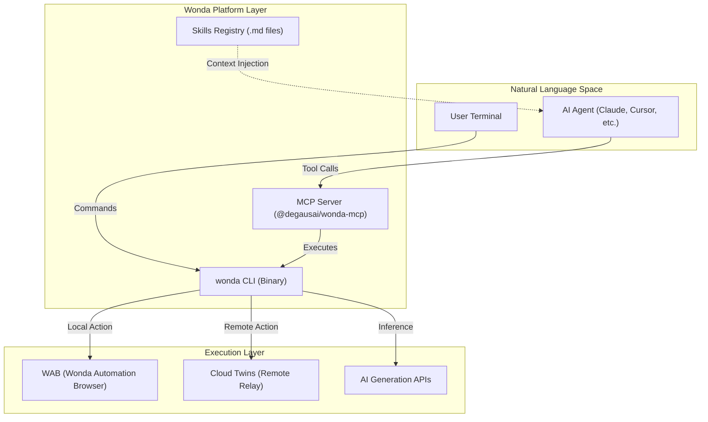
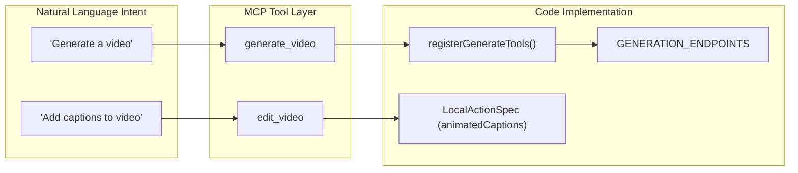
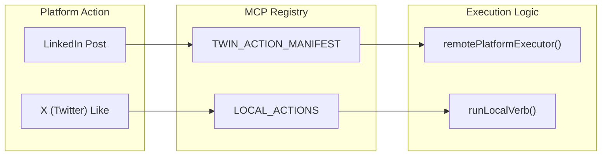

<!-- source: DeepWiki mcp.deepwiki.com · repo degausai/wonda · page 1 Wonda Platform Overview · fetched 2026-10-26 -->

# Wonda Platform Overview

Relevant source files

The following files were used as context for generating this wiki page:

- [.claude-plugin/plugin.json](.claude-plugin/plugin.json)
- [.codex-plugin/plugin.json](.codex-plugin/plugin.json)
- [README.md](README.md)
- [assets/terminal.gif](assets/terminal.gif)
- [assets/terminal.png](assets/terminal.png)
- [gemini-extension.json](gemini-extension.json)
- [mcp/README.md](mcp/README.md)

The Wonda platform is an AI-native content generation and social automation suite designed to be operated by both human users and AI agents (e.g., Claude Code, Cursor, Codex). It bridges high-level natural language intent with low-level execution of media generation, video editing, and social platform interactions.

## Core Value Proposition

Wonda provides a unified interface for the entire content lifecycle:
*   **AI Generation**: Integration with 20+ models for images, video, music, and speech.
*   **Programmatic Editing**: A "local-first" editing engine for automated video manipulation (captions, overlays, merges).
*   **Social Connectivity**: Unified drivers for LinkedIn, X (Twitter), Reddit, and Instagram.
*   **Agent-Native Design**: Built-in "Skills" and Model Context Protocol (MCP) support, allowing AI agents to discover and execute workflows without manual configuration.

## System Architecture

The platform consists of four primary layers that bridge the gap between user intent and platform execution.

### High-Level Component Interaction

**Sources:**
*   `mcp/src/index.ts` (MCP server entry point) [mcp/src/index.ts:1-10]()
*   `README.md` (CLI overview) [README.md:5-12]()
*   `.codex-plugin/plugin.json` (Agent integration) [.codex-plugin/plugin.json:1-32]()

---

## Key Components

### 1. wonda CLI
The core binary providing the command-line interface. It handles credential encryption, rate limiting, and the heavy lifting of media processing via `ffmpeg`.
*   **For details, see [wonda CLI Reference](#2)**.

### 2. MCP Server (`@degausai/wonda-mcp`)
A Model Context Protocol server that exposes Wonda's capabilities as structured tools to AI agents. It supports two modes: `local` (using the local CLI/browser) and `remote` (dispatching to Cloud Twins).
*   **For details, see [MCP Server Architecture](#3)**.

### 3. Wonda Automation Browser (WAB)
A hardened, anti-detect Chromium fork used to bypass bot detection on social platforms. It maintains real browser fingerprints and persistent sessions.
*   **For details, see [Wonda Automation Browser (WAB)](#5)**.

### 4. Cloud Twins
Provisioned remote environments that run WAB sessions 24/7. They allow agents to perform scheduled tasks or high-volume outreach without keeping a local machine active.
*   **For details, see [Cloud Twins & Digital Personas](#6)**.

---

## Bridging Natural Language to Code Entities

The following diagrams illustrate how abstract concepts like "Generation" or "Social Actions" map to specific code implementations within the `wonda-mcp` package.

### Generation & Media Pipeline Mapping

**Sources:**
*   `mcp/src/tools/generate.ts` (Generation tools) [mcp/src/tools/generate.ts:1-20]()
*   `mcp/src/local-action-registry.ts` (Editing actions) [mcp/src/local-action-registry.ts:1-50]()

### Social Action Dispatch Mapping

**Sources:**
*   `mcp/src/tools/twin-action-manifest.ts` [mcp/src/tools/twin-action-manifest.ts:1-10]()
*   `mcp/src/local-action-registry.ts` [mcp/src/local-action-registry.ts:1-10]()
*   `mcp/src/local-exec.ts` [mcp/src/local-exec.ts:1-15]()

---

## Getting Started
To begin using the platform, users typically install the CLI and authenticate their accounts. AI agents are then granted access via the MCP server or by installing "Skill" files into the project directory.

*   **Installation**: `curl -fsSL https://wonda.sh/install.sh | bash`
*   **Authentication**: `wonda auth login`
*   **Agent Setup**: `wonda skill install -o .`

For a complete walkthrough, see **[Getting Started & Installation](#1.1)** and **[AI Agent Integration (Skills & Plugins)](#1.2)**.

---

