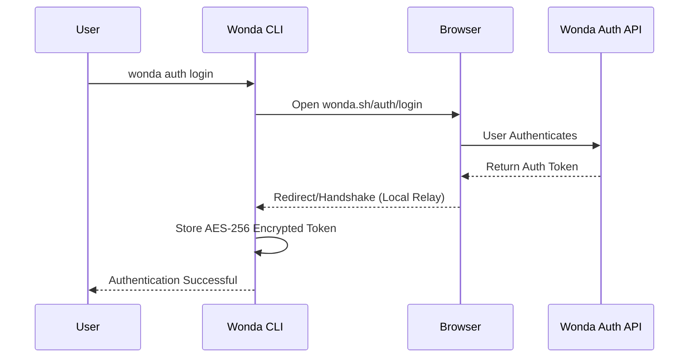
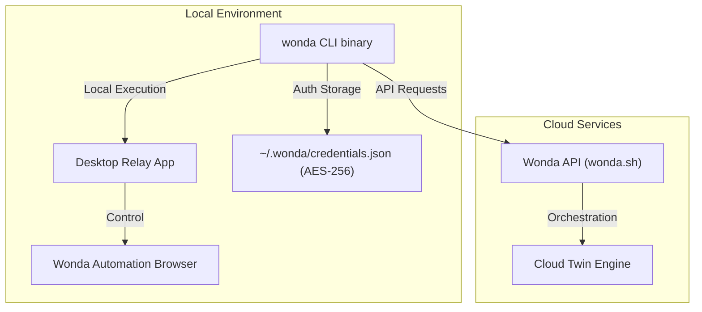

<!-- source: DeepWiki mcp.deepwiki.com · repo degausai/wonda · page 1.1 Getting Started & Installation · fetched 2026-10-26 -->

# Getting Started & Installation

<details>
<summary>Relevant source files</summary>

The following files were used as context for generating this wiki page:

- [README.md](README.md)
- [assets/terminal.gif](assets/terminal.gif)
- [assets/terminal.png](assets/terminal.png)
- [install.sh](install.sh)

</details>


This page provides a technical guide for the initial setup, authentication, and environment configuration of the Wonda CLI and its associated services. It covers the local installation lifecycle, shell integration, and agent-native skill deployment.

## Installation Overview

The Wonda CLI is distributed as a pre-compiled binary for macOS, Linux, and Windows. The primary installation method is via a shell script that handles architecture detection, binary retrieval, and PATH configuration [install.sh:1-12]() [README.md:35-48]().

### 1. Automated Installation (Recommended)

The `install.sh` script automates the setup process by detecting the host operating system and CPU architecture [install.sh:55-80]().

```bash
curl -fsSL https://wonda.sh/install.sh | bash
```

**Implementation Details:**
- **Binary Source:** Fetches the latest release from the GitHub repository `degausai/wonda` [install.sh:7-8]().
- **Architecture Mapping:** Maps `x86_64` to `amd64` and `aarch64`/`arm64` to `arm64` [install.sh:65-71](). On macOS, it includes logic to detect Rosetta translation and prefer the native `arm64` slice [install.sh:74-79]().
- **Verification:** Downloads the `checksums.txt` from the release assets and performs a SHA-256 verification of the archive before extraction [install.sh:124-147]().
- **Location:** Installs the binary to `$HOME/.wonda/bin/wonda` [install.sh:102-158]().

### 2. Manual Installation via Package Managers

Wonda is also available via platform-specific package managers for users who prefer managed updates [README.md:37-47]().

| Platform | Command |
| :--- | :--- |
| **macOS (Homebrew)** | `brew tap degausai/tap && brew install wonda` |
| **Node.js (NPM)** | `npm i -g @degausai/wonda` |

*Note: If multiple installation methods are used, the `install.sh` version placed in `~/.wonda/bin` typically takes precedence in the PATH [install.sh:201-221]().*

---

## Environment Configuration

### Shell PATH Setup
The installer attempts to modify shell configuration files (`.zshrc`, `.bashrc`, or `config.fish`) to include the Wonda binary directory [install.sh:161-188]().

| Shell | Configuration File | Entry Added |
| :--- | :--- | :--- |
| **Zsh** | `~/.zshrc` | `export PATH=$HOME/.wonda/bin:$PATH` |
| **Bash** | `~/.bashrc` | `export PATH=$HOME/.wonda/bin:$PATH` |
| **Fish** | `~/.config/fish/config.fish` | `fish_add_path $HOME/.wonda/bin` |

### Environment Variables
Wonda behavior can be tuned using the following environment variables:

| Variable | Purpose |
| :--- | :--- |
| `WONDA_NO_AUTO_SETUP` | If set to `1`, skips the prompt to install the desktop relay app during installation [install.sh:25](). |
| `GITHUB_ACTIONS` | When detected as `true`, the installer automatically exports the install path to `$GITHUB_PATH` [install.sh:191-193](). |

---

## Authentication & Initialization

Once installed, the CLI must be authenticated with a Wonda account to access media generation and social automation features [README.md:49-54]().

### Authentication Flow
The command `wonda auth login` initiates an OAuth2-style flow that opens the system browser for credential entry [README.md:52]().

**Data Flow: CLI Authentication**

*Sources: [README.md:52-54](), [install.sh:224-226]()*

---

## Agent-Native Setup (Skills)

Wonda is designed to be "agent-native," meaning AI assistants (like Claude, Cursor, or Gemini) can use it without manual training. This is achieved through **Skill Files** [README.md:16-27]().

### Installing Skills
To allow a project-local agent to use Wonda, run:
```bash
wonda skill install -o .
```
This generates a `.wondaskill` (Markdown) file in the current directory containing the tool definitions and workflow instructions the agent needs to interpret [README.md:53-67]().

### Integration Options

| Agent Environment | Installation Command |
| :--- | :--- |
| **General Agents** | `npx skills add degausai/wonda` |
| **Claude Code** | `/plugin marketplace add degausai/wonda` |
| **Gemini CLI** | `gemini extensions install https://github.com/degausai/wonda` |

---

## Desktop Relay App (Optional)

For advanced social automation (LinkedIn, X, etc.) that requires local browser context or "Human-in-the-loop" (HITL) interactions, Wonda offers a desktop relay app [install.sh:24-25]().

**System Component Interaction**

*Sources: [README.md:7-12](), [install.sh:102-110]()*

---

## Summary of Initial Commands

After installation, the following sequence is recommended for a fresh setup:

1.  **Verify Install:** `wonda --version`
2.  **Login:** `wonda auth login` [README.md:52]()
3.  **Check Balance:** `wonda balance` [README.md:88]()
4.  **Install Agent Skill:** `wonda skill install -o .` [README.md:53]()

**Sources:**
- [README.md:1-106]()
- [install.sh:1-226]()

---

