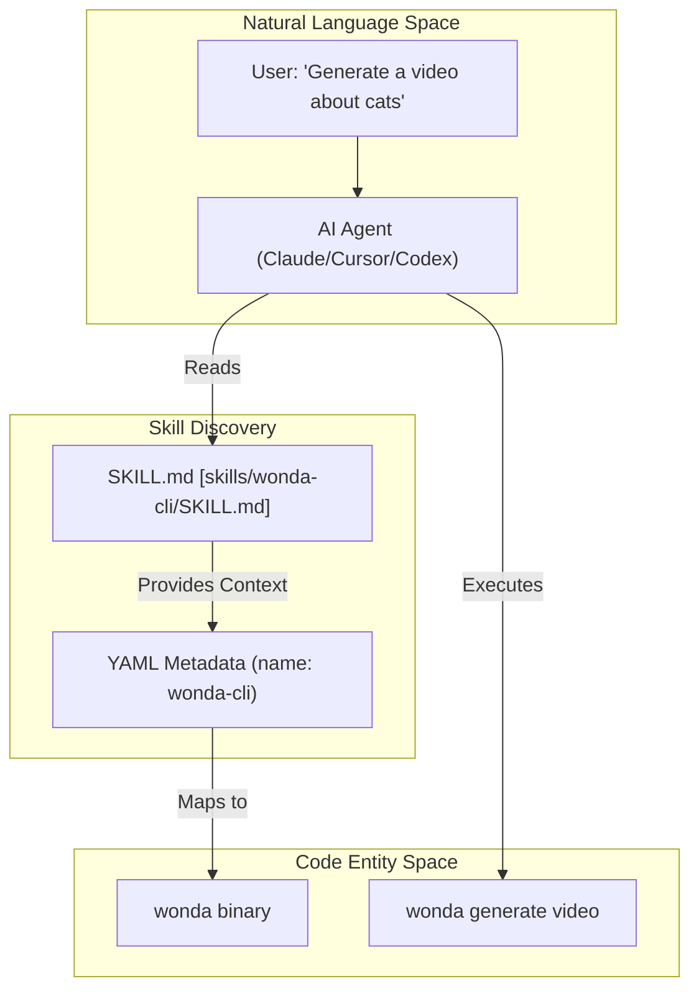
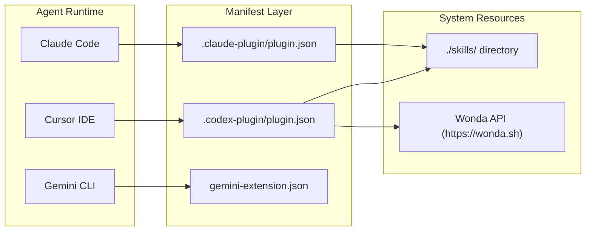

<!-- source: DeepWiki mcp.deepwiki.com · repo degausai/wonda · page 1.2 AI Agent Integration (Skills & Plugins) · fetched 2026-10-26 -->

# AI Agent Integration (Skills & Plugins)

Relevant source files

The following files were used as context for generating this wiki page:

- [.claude-plugin/marketplace.json](.claude-plugin/marketplace.json)
- [.claude-plugin/plugin.json](.claude-plugin/plugin.json)
- [.codex-plugin/plugin.json](.codex-plugin/plugin.json)
- [gemini-extension.json](gemini-extension.json)
- [skills/README.md](skills/README.md)
- [skills/wonda-cli/SKILL.md](skills/wonda-cli/SKILL.md)

Wonda is architected as an "agent-native" platform. Unlike traditional tools designed primarily for human GUI interaction, Wonda prioritizes discoverability and operability by Large Language Models (LLMs) and autonomous agents. This is achieved through a structured **Skills System** and native **Plugin Manifests** that allow agents to understand the CLI's capabilities without manual training.

## The Skills System

The core of Wonda's agent integration is the **Skill**—a Markdown-based workflow definition that bridges the gap between natural language intent and CLI execution. These files provide agents with high-level context, installation instructions, and common patterns for using the `wonda` binary.

### Skill Structure and Discovery
Skills are defined as Markdown files with YAML frontmatter. The primary entry point for agents is `skills/wonda-cli/SKILL.md` [[skills/wonda-cli/SKILL.md:1-4]]().

*   **Name & Description**: Used by agents to identify the tool's purpose (e.g., content generation, social research) [[skills/wonda-cli/SKILL.md:2-3]]().
*   **Workflow Documentation**: Detailed guides on authentication, organization context (`wonda use --org`), and project tagging [[skills/wonda-cli/SKILL.md:24-82]]().
*   **Agent Instructions**: Specific guidance for agents on how to handle spend context and project management [[skills/wonda-cli/SKILL.md:79-82]]().

### Natural Language to CLI Mapping
The following diagram illustrates how an agent moves from a natural language request to executing a Wonda command using the Skills system.

**Agent Command Discovery Flow**

**Sources:** [[skills/wonda-cli/SKILL.md:1-20]](), [[skills/README.md:1-17]]()

## Plugin Manifests

Wonda provides native integration manifests for major AI development environments. These manifests allow agents like Claude Code, Cursor, and Gemini to treat Wonda as a first-class extension.

### Manifest Types
Wonda maintains several platform-specific manifests to ensure compatibility across the agent ecosystem:

| Platform | Manifest File | Purpose |
| :--- | :--- | :--- |
| **Claude Code** | `.claude-plugin/plugin.json` | Defines version, author, and repository for Claude's internal toolbelt [[.claude-plugin/plugin.json:1-21]](). |
| **Codex** | `.codex-plugin/plugin.json` | Maps the `./skills/` directory for OpenAI Codex-based agents [[.codex-plugin/plugin.json:1-32]](). |
| **Gemini** | `gemini-extension.json` | Basic extension metadata for Google Gemini CLI/extensions [[gemini-extension.json:1-6]](). |
| **Marketplace** | `.claude-plugin/marketplace.json` | Registry information for official Wonda plugins [[.claude-plugin/marketplace.json:1-29]](). |

### Capabilities and Interfaces
The `.codex-plugin/plugin.json` defines the `interface` which specifies that Wonda has both `Read` and `Write` capabilities [[.codex-plugin/plugin.json:22-31]](). This tells the agent it can both fetch data (e.g., `wonda usage`) and perform destructive or creative actions (e.g., `wonda publish`).

**Plugin Architecture Association**

**Sources:** [[.codex-plugin/plugin.json:21-31]](), [[.claude-plugin/plugin.json:1-10]](), [[gemini-extension.json:1-5]]()

## Agent-Native Authentication

Wonda facilitates two primary auth paths for agents to ensure security while maintaining autonomy:

1.  **CLI Auth**: Agents use `wonda auth login` which opens a browser for the human operator, or they consume the `WONDA_API_KEY` environment variable [[skills/wonda-cli/SKILL.md:24-25]]().
2.  **OAuth Connector**: For web-based agents (like Claude web), Wonda uses an OAuth 2.1 flow. The server swaps OAuth tokens for internal API keys so the agent host never sees the raw secret `sk_...` key [[skills/wonda-cli/SKILL.md:27-35]]().
3.  **Local Relay**: The `wonda relay pair` command allows remote connectors to run actions on the user's local machine and residential IP, bridging cloud-based agents to local execution environments [[skills/wonda-cli/SKILL.md:37-52]]().

## Spend and Context Management

Agents are instructed via the Skills system to manage "Spend Context" to ensure costs are attributed correctly within organizations.

*   **Organization Context**: Agents use `wonda use --org <slug>` to switch from personal wallets to shared org wallets [[skills/wonda-cli/SKILL.md:65-68]]().
*   **Project Tagging**: Agents are encouraged to use `wonda use --project <name>` at the start of a task to tag all subsequent generation and social actions for monitoring [[skills/wonda-cli/SKILL.md:79-84]]().
*   **Safety Checks**: Agents check the `active project` and `active org` using `wonda use` to prevent unauthorized spend [[skills/wonda-cli/SKILL.md:79-82]]().

**Sources:** [[skills/wonda-cli/SKILL.md:59-93]]()

---

