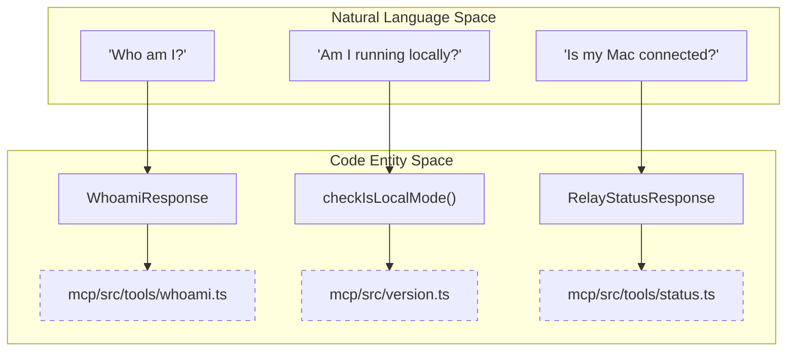
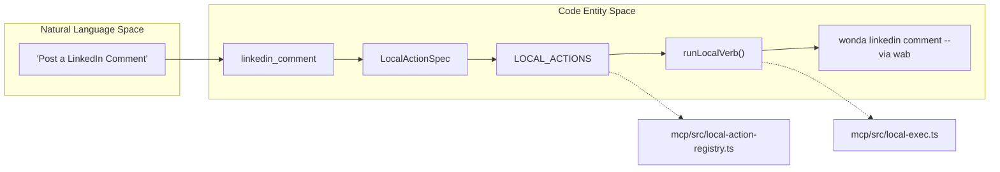

<!-- source: DeepWiki mcp.deepwiki.com · repo degausai/wonda · page 10 Glossary · fetched 2026-10-26 -->

# Glossary

Relevant source files

The following files were used as context for generating this wiki page:

- [mcp/README.md](mcp/README.md)
- [mcp/src/api.ts](mcp/src/api.ts)
- [mcp/src/local-action-registry.ts](mcp/src/local-action-registry.ts)
- [mcp/src/local-exec.ts](mcp/src/local-exec.ts)
- [mcp/src/notices.ts](mcp/src/notices.ts)
- [mcp/src/tools/campaign.ts](mcp/src/tools/campaign.ts)
- [mcp/src/tools/status.ts](mcp/src/tools/status.ts)
- [mcp/src/tools/twin-action-manifest.ts](mcp/src/tools/twin-action-manifest.ts)
- [mcp/src/tools/twin.ts](mcp/src/tools/twin.ts)
- [mcp/src/tools/wab.ts](mcp/src/tools/wab.ts)
- [mcp/src/tools/whoami.ts](mcp/src/tools/whoami.ts)
- [mcp/src/version.ts](mcp/src/version.ts)
- [skills/wonda-cli/SKILL.md](skills/wonda-cli/SKILL.md)

This page provides technical definitions and implementation details for core Wonda concepts, mapping natural language terms to their respective code entities and files.

## Core System Concepts

### Wonda Automation Browser (WAB)
The WAB is a hardened, antidetect Chromium instance used to bypass bot detection on social platforms. It implements real-browser TLS fingerprints, canvas/WebGL noise, and trusted input events [mcp/README.md:81-84](). Unlike standard headless Chrome, it maintains a coherent identity per persona, including profile data and cookies stored in `~/.wonda/wab/personas/<name>/` [mcp/README.md:87-88]().

*   **Implementation**: Controlled via the `wonda wab` CLI command group. The MCP server bridges these commands using `registerWabTools` [mcp/src/tools/wab.ts:33-35]().
*   **Visibility**: Runs offscreen by default but can be surfaced using `wab_show` [mcp/src/tools/wab.ts:50-57]().

### Local Relay
 A background process (typically the Wonda Desktop App) that allows the Wonda Cloud to execute actions on a user's local machine using their residential IP and local WAB sessions [skills/wonda-cli/SKILL.md:37-44](). It bridges the gap between the "Remote Mode" (Cloud) and "Local Mode" (On-device).

*   **Detection**: The MCP server checks for live relays via `fetchLiveRelays` which queries the `/relay/status` endpoint [mcp/src/tools/status.ts:34-40]().

### Cloud Twin
A hosted digital persona that executes 24/7 automated workflows. Twins can be "born in the cloud" or "synced" from a local session [mcp/src/tools/twin.ts:12-22](). They follow a `twinEnginePolicy` which determines if actions run in the cloud or via the local relay [mcp/src/tools/whoami.ts:16-16]().

### Persona
A distinct identity within Wonda, mapping to a specific browser profile and set of social media credentials. One persona typically manages one account per platform (e.g., "Marketing-John" might have one LinkedIn and one X account) [mcp/README.md:87-88]().

---

## Technical Mapping: Natural Language to Code

The following diagrams bridge domain concepts to specific code entities and data structures.

### Identity and Execution Context
This diagram shows how user identity (`whoami`) and execution environment (`mode`) are represented in the MCP server.

**Sources:** [mcp/src/tools/whoami.ts:12-37](), [mcp/src/version.ts:39-41](), [mcp/src/tools/status.ts:16-26]()

### Action Dispatch and Transport
This diagram illustrates how a "Write" action (like a LinkedIn comment) flows from a tool call to the local binary.

**Sources:** [mcp/src/local-action-registry.ts:5-57](), [mcp/src/local-exec.ts:71-169](), [mcp/src/tools/twin-action-manifest.ts:73-82]()

---

## Key Data Structures & Terms

| Term | Code Reference | Description |
| :--- | :--- | :--- |
| **`ApiResult`** | [mcp/src/api.ts:51-75]() | A discriminated union representing successful (`ok: true`) or failed (`ok: false`) API calls, including support for `partialResult` in batch failures. |
| **`LocalActionVia`** | [mcp/src/local-action-registry.ts:3-3]() | The transport mechanism: `cookies` (fast, HTTP-based) or `wab` (stealth browser-based). |
| **`UpdatePolicy`** | [mcp/src/version.ts:21-26]() | Metadata returned from the server to guide CLI updates, including `latest` version and `updateCommands` per platform. |
| **`Twin Notice`** | [mcp/src/api.ts:57-57]() | Informational text appended to tool outputs by the backend, often used for rate limit warnings or credits balance. |
| **`requestedSlots`** | [mcp/src/local-action-registry.ts:9-9]() | A map defining the cost/weight of an action (e.g., `comment: 1`) used for rate limiting and spend tracking. |

### Execution Modes
The system operates in two primary modes defined by the `WONDA_MCP_MODE` environment variable [mcp/src/version.ts:39-41]():

1.  **Local Mode**: The MCP server spawns the `wonda` binary directly on the host machine using `execFile` [mcp/src/local-exec.ts:1-24]().
2.  **Remote Mode**: The MCP server acts as a thin client, forwarding requests to the Wonda API [mcp/src/api.ts:133-146](), which then routes them to a Cloud Twin or a Local Relay.

### Transport Heuristics
*   **`cookies`**: Used primarily for **Read** operations. It uses a Chrome-fingerprinted HTTP client for speed [mcp/README.md:95-98]().
*   **`wab`**: Used for **Write** operations and sensitive reads (e.g., `linkedin_search_posts`). This ensures the action occurs within a real browser session to minimize anti-abuse triggers [mcp/README.md:96-98]().

**Sources:**
- [mcp/src/local-action-registry.ts:1-57]()
- [mcp/src/local-exec.ts:71-169]()
- [mcp/src/api.ts:51-75]()
- [mcp/src/version.ts:39-49]()
- [mcp/README.md:81-108]()