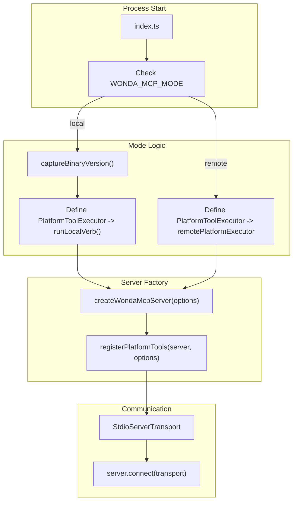
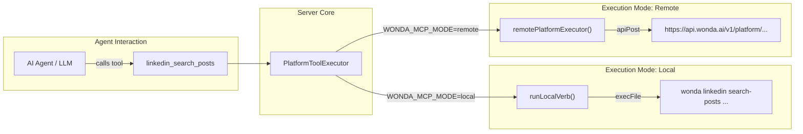

<!-- source: DeepWiki mcp.deepwiki.com · repo degausai/wonda · page 3.1 Server Initialization & Execution Modes · fetched 2026-10-26 -->

# Server Initialization & Execution Modes

Relevant source files

The following files were used as context for generating this wiki page:

- [mcp/src/index.ts](mcp/src/index.ts)
- [mcp/src/server.ts](mcp/src/server.ts)

This page details the initialization sequence and dual-mode execution architecture of the `@degausai/wonda-mcp` server. The server acts as a bridge between Model Context Protocol (MCP) clients (like Claude Desktop or Cursor) and the Wonda platform, operating in either a direct local execution mode or a remote cloud-proxy mode.

## Entry Point & Mode Selection

The server entry point is `mcp/src/index.ts`. It determines the operational mode via the `WONDA_MCP_MODE` environment variable. If set to `"local"`, the server is configured to execute social platform actions by directly spawning the local `wonda` CLI binary. Otherwise, it defaults to `"remote"` mode, where actions are dispatched to the Wonda API for routing to Cloud Twins or the Wonda Desktop Relay [mcp/src/index.ts:8-12]().

### Initialization Sequence

1.  **Environment Check**: Reads `process.env.WONDA_MCP_MODE` [mcp/src/index.ts:8]().
2.  **Version Capture**: In local mode, `captureBinaryVersion()` is called to cache the `wonda --version` output for use in the User-Agent header [mcp/src/index.ts:12]().
3.  **Server Factory**: Calls `createWondaMcpServer` with a mode-specific `PlatformToolExecutor` [mcp/src/index.ts:14-29]().
4.  **Transport Binding**: Instantiates `StdioServerTransport` and connects the server to `stdin`/`stdout` [mcp/src/index.ts:31-32]().

### Data Flow: Initialization to Execution

The following diagram illustrates how the `WONDA_MCP_MODE` environment variable influences the internal `PlatformToolExecutor` configuration.

**Wonda MCP Initialization Flow**

Sources: [mcp/src/index.ts:8-32](), [mcp/src/server.ts:52-70]()

---

## The `createWondaMcpServer` Factory

The `createWondaMcpServer` function in `mcp/src/server.ts` is responsible for instantiating the `McpServer` class from the SDK and attaching all resources and tools.

### Server Instructions
The server dynamically sets its `instructions` property based on the execution mode. This informs the LLM about the capabilities and limitations of the current environment:
*   **LOCAL_INSTRUCTIONS**: Emphasizes that tools (like `linkedin_*`) execute on the host machine via the CLI and Wonda Automation Browser (WAB) [mcp/src/server.ts:23-33]().
*   **REMOTE_INSTRUCTIONS**: Explains that actions are routed through the Wonda backend to either a Cloud Twin or a local relay [mcp/src/server.ts:35-46]().

### Tool Registration Registry
The factory centralizes the registration of various tool groups:

| Registry Function | Responsibility |
| :--- | :--- |
| `registerResources` | Exposes `wonda://` URIs for skills and balance [mcp/src/server.ts:68](). |
| `registerPlatformTools` | Core social actions (LinkedIn, X, Reddit, Instagram) [mcp/src/server.ts:65](). |
| `registerGenerateTools` | AI media generation (Image, Video, Music) [mcp/src/server.ts:59](). |
| `registerWabTools` | Browser control (show, hide, screenshot, login) [mcp/src/server.ts:70](). |
| `registerTwinTools` | Cloud Twin provisioning and lifecycle [mcp/src/server.ts:69](). |
| `registerStatusTools` | System health and versioning information [mcp/src/server.ts:67](). |

Sources: [mcp/src/server.ts:18-72](), [mcp/src/index.ts:14-29]()

---

## Platform Tool Execution Interface

The `PlatformToolExecutor` is a critical interface that abstracts the execution logic for social platform actions. This allows the tool definitions (schemas and metadata) to remain identical regardless of whether the execution happens locally or via the API.

### Local vs. Remote Dispatch

When a platform tool (e.g., `linkedin_post`) is invoked, the `PlatformToolExecutor` provided during server creation is called:

1.  **Local Mode**: The executor calls `runLocalVerb` from `mcp/src/local-exec.ts`. This function builds a command-line string and spawns the `wonda` process [mcp/src/index.ts:17-27]().
2.  **Remote Mode**: The executor defaults to `remotePlatformExecutor` (defined in `mcp/src/tools/platform.ts`), which performs an `apiPost` to the Wonda backend [mcp/src/tools/platform.ts:120-125]().

**Tool Execution Mapping**

Sources: [mcp/src/index.ts:8-29](), [mcp/src/server.ts:3-15](), [mcp/src/tools/platform.ts:1-20]()

---

## Environment & Configuration

The server relies on several environment variables and global states to function correctly:

*   **`WONDA_MCP_MODE`**: Switches between local CLI execution and remote API routing [mcp/src/index.ts:8]().
*   **`WONDA_API_KEY`**: Required for all modes to authenticate with the Wonda API for generation, media, and remote platform tools [mcp/src/server.ts:33,46]().
*   **`captureBinaryVersion`**: A utility in `mcp/src/version.ts` that runs `wonda --version` once and caches the result. This ensures the server can report the CLI version to the API even if the binary is updated during the process lifetime [mcp/src/index.ts:10-12]().

### Stdio Binding
The server uses `StdioServerTransport` [mcp/src/index.ts:31](). This is the standard for MCP, allowing the server to be managed as a child process by host applications. The host sends JSON-RPC requests via `stdin` and receives responses via `stdout`.

Sources: [mcp/src/index.ts:1-33](), [mcp/src/version.ts:6-10]()

---

