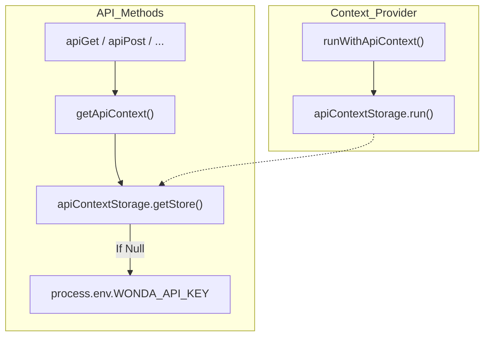

<!-- source: DeepWiki mcp.deepwiki.com · repo degausai/wonda · page 3.2 API Client & Context Management · fetched 2026-10-26 -->

# API Client & Context Management

<details>
<summary>Relevant source files</summary>

The following files were used as context for generating this wiki page:

- [mcp/src/api.ts](mcp/src/api.ts)

</details>


The Wonda MCP server communicates with the Wonda Cloud backend via a specialized API client designed for reliability, contextual awareness, and detailed error reporting. This system leverages Node.js `AsyncLocalStorage` to manage credentials across asynchronous execution flows and provides a unified interface for all HTTP operations.

### ApiContext & Context Management

The API client uses an `ApiContext` to manage the `apiKey` and `baseUrl` for requests. To ensure these credentials remain consistent throughout a specific execution chain (e.g., during a single MCP tool call), the system utilizes `AsyncLocalStorage` [mcp/src/api.ts:17-17]().

#### Key Components
*   **`ApiContext`**: A type defining the required `apiKey` and optional `baseUrl` [mcp/src/api.ts:7-10]().
*   **`runWithApiContext`**: A wrapper function that executes a callback within a specific context, ensuring all downstream API calls use the provided credentials [mcp/src/api.ts:19-24]().
*   **`getApiContext`**: Retrieves the current context from storage. If no context is active, it falls back to environment variables `WONDA_API_KEY` or `WONDERCAT_API_KEY`, and `WONDA_BASE_URL` [mcp/src/api.ts:26-34]().
*   **`normalizeApiContext`**: Ensures the `baseUrl` is correctly formatted (stripping trailing slashes) and defaults to `https://api.wondercat.ai/api/v1` [mcp/src/api.ts:36-44]().

**API Context Flow**
"The following diagram illustrates how the `AsyncLocalStorage` provides context to the API methods."


Sources: [mcp/src/api.ts:1-44]()

### HTTP Methods & Result Handling

The client provides a set of typed wrappers for standard HTTP verbs. Every method returns an `ApiResult`, which is a discriminated union used to handle success and failure states without throwing exceptions.

#### Supported Methods
| Method | Function | Description |
| :--- | :--- | :--- |
| `GET` | `apiGet` | Standard JSON GET request [mcp/src/api.ts:77-93](). |
| `GET (Text)` | `apiGetText` | Fetches plain text (e.g., Markdown Skills) without JSON parsing [mcp/src/api.ts:100-131](). |
| `POST` | `apiPost` | Sends JSON payload [mcp/src/api.ts:133-146](). |
| `PUT` | `apiPut` | Updates resources [mcp/src/api.ts:148-161](). |
| `PATCH` | `apiPatch` | Partial updates [mcp/src/api.ts:163-176](). |
| `DELETE` | `apiDelete` | Removes resources [mcp/src/api.ts:178-189](). |
| `UPLOAD` | `apiUpload` | Handles `FormData` for media uploads [mcp/src/api.ts:191-204](). |

#### The ApiResult Union
The `ApiResult<T>` type ensures that callers handle errors and metadata like `notice` or `warning` fields returned by the backend [mcp/src/api.ts:51-75]().

*   **Success**: Contains `ok: true`, `data: T`, and optional `notice` (informational text) or `warning` (staleness indicators) [mcp/src/api.ts:52-61]().
*   **Failure**: Contains `ok: false`, `error: string`, and an optional `partialResult`. The `partialResult` is critical for batch operations (like LinkedIn enrichment) that might fail halfway through; it allows the agent to see what was completed before the error occurred [mcp/src/api.ts:62-75]().

Sources: [mcp/src/api.ts:51-204]()

### User-Agent & Headers

Every request automatically includes authentication and identification headers via `getAuthHeaders` [mcp/src/api.ts:206-226]().

1.  **Authorization**: Uses the `Bearer` token scheme with the `apiKey` [mcp/src/api.ts:221-221]().
2.  **User-Agent**: Constructed via `buildUserAgent()` (defined in `version.ts`), which includes the MCP server version and the environment/platform information to assist in backend debugging and telemetry [mcp/src/api.ts:222-222](), [mcp/src/version.ts:78-83]().

**Request Preparation Flow**
"Association of code entities involved in generating a valid HTTP request."

```mermaid
sequenceDiagram
    participant C as "Caller (e.g. registerPlatformTools)"
    participant A as "api.ts (apiPost)"
    participant H as "getAuthHeaders()"
    participant V as "version.ts (buildUserAgent)"

    C->>A: apiPost("/path", body)
    A->>H: getAuthHeaders()
    H->>V: buildUserAgent()
    V-->>H: "wonda-mcp/1.2.3 (darwin; arm64) ..."
    H-->>A: { Authorization, User-Agent }
    A->>A: fetch(url, { headers, body })
```
Sources: [mcp/src/api.ts:206-226](), [mcp/src/version.ts:78-83]()

### Error Extraction Logic

The API client implements robust error extraction in `extractError` to handle various backend response formats [mcp/src/api.ts:232-258](). It attempts to find a human-readable message in the following order:
1.  Direct string response.
2.  The `error` field if it is a string.
3.  The `message` field nested inside an `error` object.
4.  The `message` field at the top level.
5.  A fallback string `HTTP {status}` if no message is found.

If a response includes a `partialResult` within the error body, it is extracted and attached to the `ApiResult` so that MCP tools can return partial data to the AI agent [mcp/src/api.ts:74-74]().

Sources: [mcp/src/api.ts:232-258]()

---

