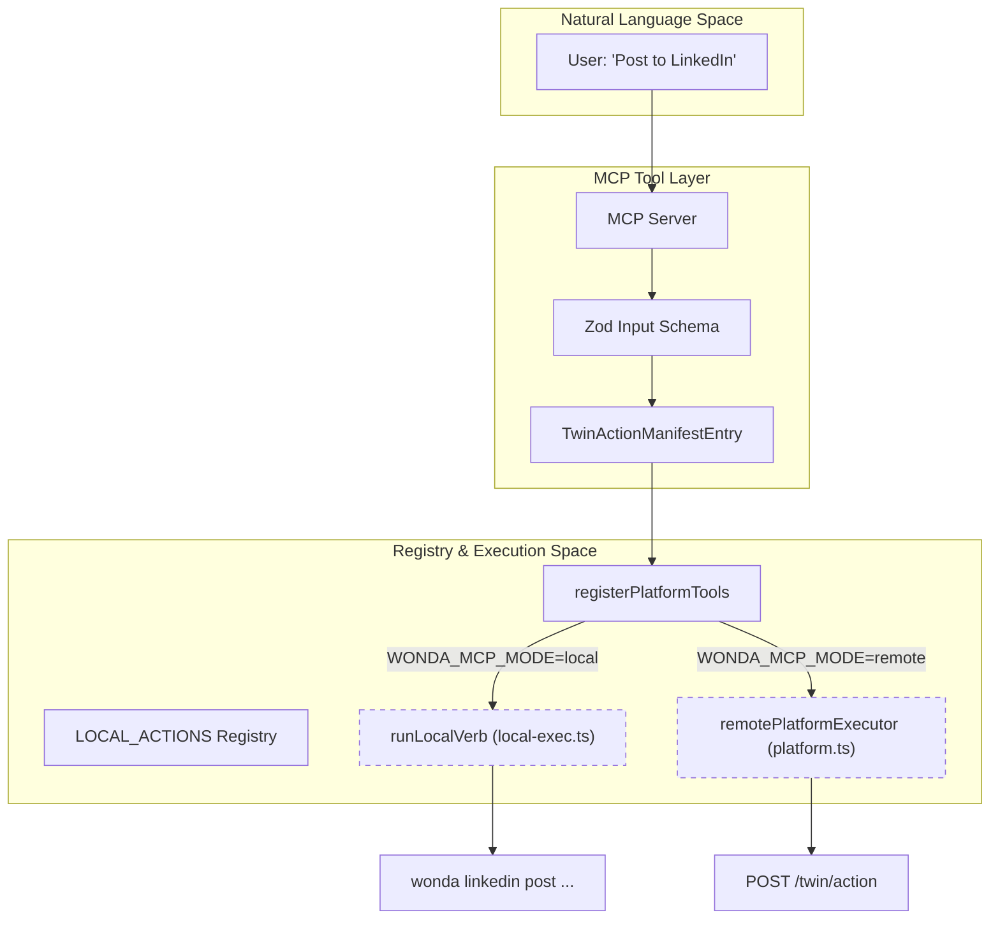
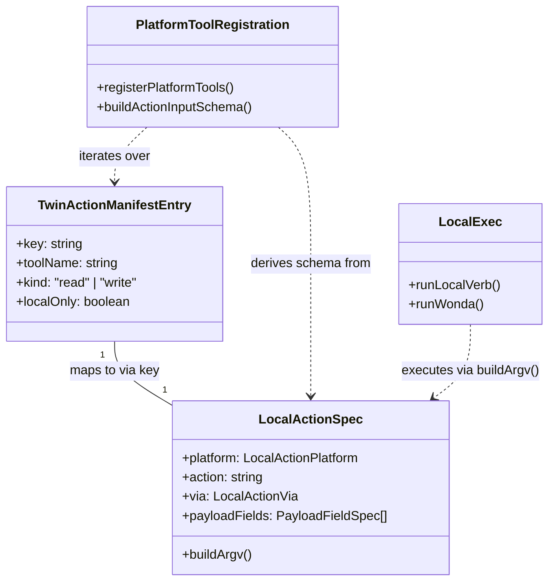

<!-- source: DeepWiki mcp.deepwiki.com · repo degausai/wonda · page 4 Platform Tools & Action Registry · fetched 2026-10-26 -->

# Platform Tools & Action Registry

Relevant source files

The following files were used as context for generating this wiki page:

- [mcp/src/local-action-registry.ts](mcp/src/local-action-registry.ts)
- [mcp/src/tools/platform.ts](mcp/src/tools/platform.ts)
- [mcp/src/tools/twin-action-manifest.ts](mcp/src/tools/twin-action-manifest.ts)
- [mcp/src/version.ts](mcp/src/version.ts)

The **Platform Tools & Action Registry** system defines how social platform actions (LinkedIn, X, Reddit, Instagram) are structured, validated, and executed. It serves as the bridge between high-level agent requests and the low-level execution engines, whether running locally via the Wonda CLI or remotely on a Cloud Twin.

The system uses a declarative approach to tool registration, ensuring that AI agents receive rich, schema-validated interfaces while the underlying execution logic remains decoupled from the MCP server transport.

### System Overview

The registry architecture is divided into three primary layers:
1.  **Action Definition**: The `LOCAL_ACTIONS` registry defines the technical capabilities, transport requirements, and CLI argument mapping for every verb.
2.  **Tool Registration**: The `TWIN_ACTION_MANIFEST` and `registerPlatformTools` pipeline converts these definitions into MCP-compliant tools with Zod-validated input schemas.
3.  **Execution Dispatch**: The system determines whether to route the action to `runLocalVerb` (local CLI execution) or `remotePlatformExecutor` (Cloud Twin API call).

### Action Execution Flow: Natural Language to Code

This diagram illustrates how a natural language request from an AI agent traverses the registry to reach the correct execution entity.

**Registry Dispatch Logic**

**Sources:** [mcp/src/tools/platform.ts:63-97](), [mcp/src/local-action-registry.ts:5-57](), [mcp/src/tools/twin-action-manifest.ts:13-150]()

---

### Key Components

#### 1. LOCAL_ACTIONS Registry
The `LOCAL_ACTIONS` object is the source of truth for action metadata. It defines the `LocalActionSpec` for each command, including supported transports (`cookies` vs `wab`), required payload fields, and version gating requirements.
*   **Transports**: Controlled via `LocalActionVia` [mcp/src/local-action-registry.ts:3]().
*   **Field Overrides**: Custom schemas for complex actions like `linkedin/enrich` or `linkedin/activity` are defined in `FIELD_OVERRIDES` [mcp/src/local-action-registry.ts:111-183]().
*   **Version Gating**: Uses `minCliVersion` to prevent execution on outdated binaries [mcp/src/local-action-registry.ts:41]().

For details, see [LOCAL_ACTIONS Registry (#4.1)](#).

#### 2. Twin Action Manifest & Platform Registration
The `TWIN_ACTION_MANIFEST` lists all actions available to the MCP server. The `registerPlatformTools` function iterates through this manifest to create tools. It dynamically builds Zod schemas using `buildActionInputSchema`, ensuring that the AI agent knows exactly which fields (like `target` or `count`) are required for a specific tool.
*   **Remote Execution**: Dispatched via `remotePlatformExecutor` which calls `apiPost` [mcp/src/tools/platform.ts:65-94]().
*   **Tool Annotations**: Automatically adds safety and category metadata via `annotationsForTwinActionKind` [mcp/src/tools/platform.ts:19]().

For details, see [Twin Action Manifest & Platform Tool Registration (#4.2)](#).

#### 3. Local Execution Engine
When the server is in `local` mode, it uses `runLocalVerb` to spawn the Wonda CLI binary. This component handles the translation of the JSON payload into a command-line argument vector (`buildLocalActionArgv`) and manages process timeouts and concurrency.
*   **Binary Interaction**: Uses `execFile` to run the binary identified by `WONDA_BIN` [mcp/src/version.ts:76]().
*   **Update Notices**: Extracts version warnings and update instructions from `stderr` to return as `Twin Notices` [mcp/src/local-exec.ts:255-275]().

For details, see [Local Execution Engine (#4.3)](#).

---

### Entity Relationship Diagram

This diagram maps the relationships between the configuration objects and the code entities that process them.

**Registry Entity Mapping**

**Sources:** [mcp/src/local-action-registry.ts:5-57](), [mcp/src/tools/twin-action-manifest.ts:1-11](), [mcp/src/tools/platform.ts:107-114]()

### Transport Comparison
The registry supports two primary transports for platform actions, defined in the `LocalActionVia` type [mcp/src/local-action-registry.ts:3]():

| Transport | Code Identifier | Description | Use Case |
| :--- | :--- | :--- | :--- |
| **Cookies** | `cookies` | Uses stored AES-256-GCM encrypted session headers. | High-speed read operations, simple likes/follows. |
| **WAB** | `wab` | Launches the Wonda Automation Browser (hardened Chromium). | Complex writes, anti-bot bypass, and human-in-the-loop auth. |

**Sources:** [mcp/src/local-action-registry.ts:3-21](), [mcp/src/tools/platform.ts:116-126]()

---

