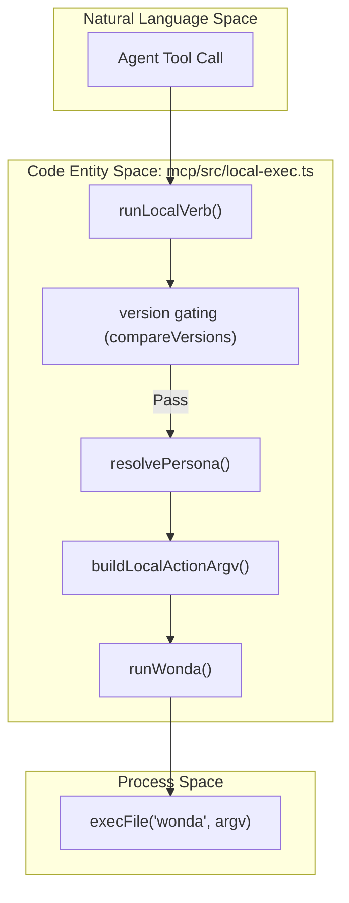
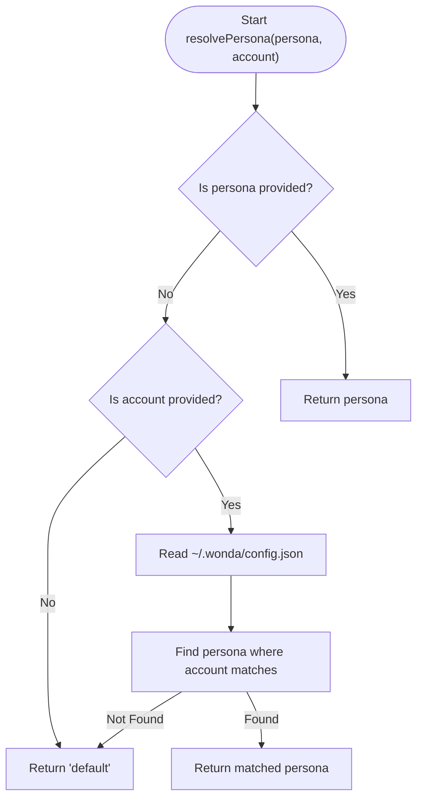

<!-- source: DeepWiki mcp.deepwiki.com · repo degausai/wonda · page 4.3 Local Execution Engine · fetched 2026-10-26 -->

# Local Execution Engine

Relevant source files

The following files were used as context for generating this wiki page:

- [mcp/src/local-exec.ts](mcp/src/local-exec.ts)

The **Local Execution Engine** is the core subsystem within the Wonda MCP server responsible for bridging high-level agent requests to the local `wonda` CLI binary. It handles command construction, version gating, persona resolution, and process execution management.

## Architecture & Data Flow

The engine acts as a translation layer that converts structured tool calls into shell commands. It ensures that the local environment (CLI version, persona configurations, and account sessions) meets the requirements of the requested action before execution.

### Execution Lifecycle Diagram
This diagram illustrates the flow from an MCP tool call to the final execution of the `wonda` binary.

**Sources:** `[mcp/src/local-exec.ts:71-169]()`, `[mcp/src/local-exec.ts:245-285]()`

## Key Functions

### `runLocalVerb`
The entry point for executing any local action. It performs three critical checks before invoking the binary:
1.  **Registry Validation**: Ensures the requested platform/action pair exists in `LOCAL_ACTIONS` `[mcp/src/local-exec.ts:75-89]()`.
2.  **Version Gating**: Checks the installed `wonda` binary version against `minCliVersion` defined in the action spec `[mcp/src/local-exec.ts:99-147]()`.
3.  **Argument Building**: Transforms the JSON payload into a CLI-compatible `argv` array using the spec's `buildArgv` function `[mcp/src/local-exec.ts:149-162]()`.

### `runWonda`
A wrapper around Node.js `execFile` that manages the lifecycle of the `wonda` process.
*   **Timeout Calculation**: It uses the `timeoutMs` provided by the action spec or a default. If a process exceeds this limit, it is killed `[mcp/src/local-exec.ts:317-331]()`.
*   **Concurrency**: The engine allows multiple concurrent executions but serializes version checks via `captureBinaryVersion` to avoid redundant process spawns `[mcp/src/local-exec.ts:109-121]()`.
*   **Error Handling**: It distinguishes between fatal process errors and application-level errors (e.g., rate limits). If `preservePartialStdout` is true, it returns partial results even on non-zero exit codes `[mcp/src/local-exec.ts:348-356]()`.

**Sources:** `[mcp/src/local-exec.ts:71-169]()`, `[mcp/src/local-exec.ts:287-375]()`

## Version Gating & Update Policy

To prevent agents from attempting to use features not yet supported by the user's local CLI, the engine implements strict version gating.

| Component | Responsibility |
| :--- | :--- |
| `minCliVersion` | The minimum semantic version required for the action `[mcp/src/local-action-registry.ts:23-23]()`. |
| `minCliVersionWhen` | A predicate that triggers version gating only if specific payload fields are present `[mcp/src/local-action-registry.ts:28-28]()`. |
| `captureBinaryVersion` | Probes `wonda --version` and caches the result for the process lifetime `[mcp/src/version.ts:40-58]()`. |
| `UpdatePolicy` | Metadata fetched from the Wonda API indicating the latest available version and urgent update notices `[mcp/src/version-policy.ts:7-14]()`. |

### Update Notice Extraction
The engine monitors the `stderr` of every command. If the CLI binary detects it is out of date, it prints a notice which `extractUpdateNotices` parses and bubbles up to the MCP response `[mcp/src/local-exec.ts:389-407]()`.

**Sources:** `[mcp/src/local-exec.ts:99-147]()`, `[mcp/src/version.ts:40-58]()`, `[mcp/src/version-policy.ts:7-14]()`

## Persona & Config Resolution

Local actions often require a specific identity context (e.g., which LinkedIn account to use). The engine resolves these via `resolvePersona`.

1.  **Explicit Persona**: If a `persona` name is provided in the tool call, it is used directly.
2.  **Account Mapping**: If an `account` (email/username) is provided, the engine searches `~/.wonda/config.json` to find the persona mapped to that account `[mcp/src/local-exec.ts:208-228]()`.
3.  **Default Logic**: If neither is provided, the engine defaults to the `default` persona.

**Sources:** `[mcp/src/local-exec.ts:199-234]()`

## Implementation Details

### CLI Argument Construction
The `buildLocalActionArgv` logic (referenced via `spec.buildArgv`) follows a strict sequence to ensure the CLI receives flags in the correct order:
1.  **Verb**: The primary command (e.g., `linkedin/post`).
2.  **Payload**: Fields from the MCP tool call mapped to CLI flags (e.g., `--text "hello"`).
3.  **Context**: The `--persona` flag derived from resolution.
4.  **Transport**: The `--via` flag (either `cookies` or `wab`) `[mcp/src/local-exec.ts:152-154]()`.

### Error & Notice Extraction
The engine parses `stderr` for specific patterns using `extractUpdateNotices`. This allows the CLI to pass non-functional metadata (like "A new version is available") back to the user without polluting the primary tool output `[mcp/src/local-exec.ts:389-407]()`.

**Sources:** `[mcp/src/local-exec.ts:149-162]()`, `[mcp/src/local-exec.ts:389-407]()`, `[mcp/src/local-action-registry.ts:114-135]()`

---

