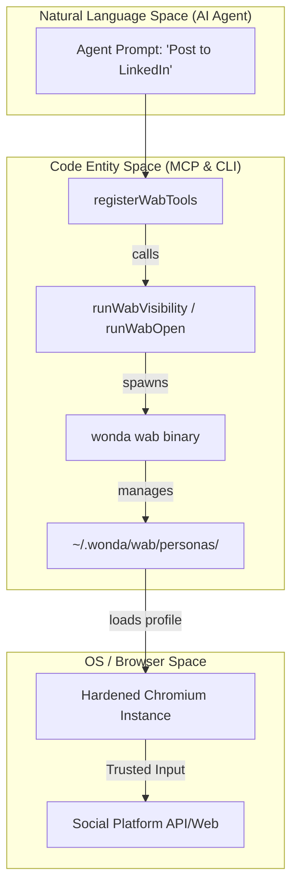
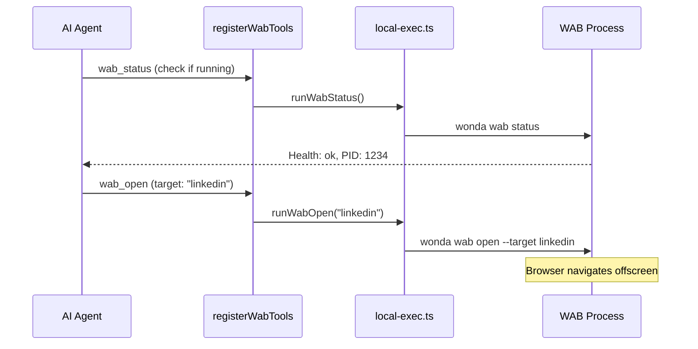

<!-- source: DeepWiki mcp.deepwiki.com · repo degausai/wonda · page 5 Wonda Automation Browser (WAB) · fetched 2026-10-26 -->

# Wonda Automation Browser (WAB)

Relevant source files

The following files were used as context for generating this wiki page:

- [mcp/README.md](mcp/README.md)
- [mcp/src/tools/wab.ts](mcp/src/tools/wab.ts)
- [skills/wonda-cli/SKILL.md](skills/wonda-cli/SKILL.md)

The **Wonda Automation Browser (WAB)** is a hardened, anti-detect fork of Chromium designed specifically for social platform automation. Unlike standard headless browsers, WAB is engineered to bypass anti-bot heuristics by providing real-browser TLS fingerprints, canvas/WebGL rendering, authentic fonts, and trusted input events [mcp/README.md:81-84]().

WAB serves as the primary transport for "write" operations (e.g., posting, commenting, liking) across LinkedIn, X (Twitter), Reddit, and Instagram, where raw HTTP cookie-based requests are frequently flagged as suspicious [mcp/README.md:91-98]().

### Core Architecture

The WAB operates as a background daemon on the user's local machine or within a Cloud Twin environment. It manages isolated browser profiles called **Personas**, each containing its own cookies, localStorage, and browser fingerprint [mcp/README.md:87-87]().

#### System Integration Diagram
This diagram illustrates how the WAB subsystem bridges the gap between high-level AI Agent requests and the underlying OS-level browser processes.

**Sources:** [mcp/src/tools/wab.ts:33-36](), [mcp/src/tools/wab.ts:58-64](), [mcp/README.md:87-87]()

### Key Features

| Feature | Description | Code Reference |
| :--- | :--- | :--- |
| **Stealth Hardening** | Real-browser TLS and WebGL to prevent fingerprinting as automation. | [mcp/README.md:81-84]() |
| **Persona Isolation** | Each persona maps to a unique directory in `~/.wonda/wab/personas/`. | [mcp/README.md:87-87]() |
| **Offscreen Rendering** | Runs in a real window but off-viewport to avoid interrupting the user. | [mcp/README.md:88-88]() |
| **Hybrid Execution** | Works locally via CLI/MCP or remotely via the Local Relay. | [mcp/src/tools/wab.ts:28-32]() |

### WAB Management Lifecycle

The WAB is typically managed through a set of specialized MCP tools that handle everything from browser health checks to manual login flows.

#### Browser Control Flow
The following diagram shows the `registerWabTools` orchestration for a typical automation task.

**Sources:** [mcp/src/tools/wab.ts:36-47](), [mcp/src/tools/wab.ts:84-106](), [mcp/src/local-exec.ts:6-14]()

### Detailed Subsystems

#### [WAB MCP Tools & Browser Control](#5.1)
Details the specific tools used by agents to manipulate the browser. This includes `wab_status` for health monitoring (ok, browser-dead, unresponsive), `wab_show`/`wab_hide` for window visibility, and the `wab_login_open` flow for human-in-the-loop authentication.
For details, see [WAB MCP Tools & Browser Control](#5.1).

#### [WAB CLI Commands & Session Management](#5.2)
Covers the underlying CLI commands such as `wonda wab install` and `wonda wab record`. It also documents how sessions are persisted in the local cookie jar and how these sessions are synced to the cloud for use with Cloud Twins.
For details, see [WAB CLI Commands & Session Management](#5.2).

### Technical Constraints
*   **Platform Transport**: While "reads" can often use the faster `cookies` transport, "writes" are strictly routed via `wab` to maintain account safety [mcp/README.md:91-98]().
*   **Installation**: WAB requires a one-time download of approximately 300MB via `wonda wab install` [mcp/README.md:89-89]().
*   **OS Support**: The signed `.mcpb` bundle and local WAB features are primarily optimized for macOS [mcp/README.md:13-13]().

**Sources:**
- [mcp/README.md:81-107]()
- [mcp/src/tools/wab.ts:1-183]()
- [skills/wonda-cli/SKILL.md:37-58]()

---

