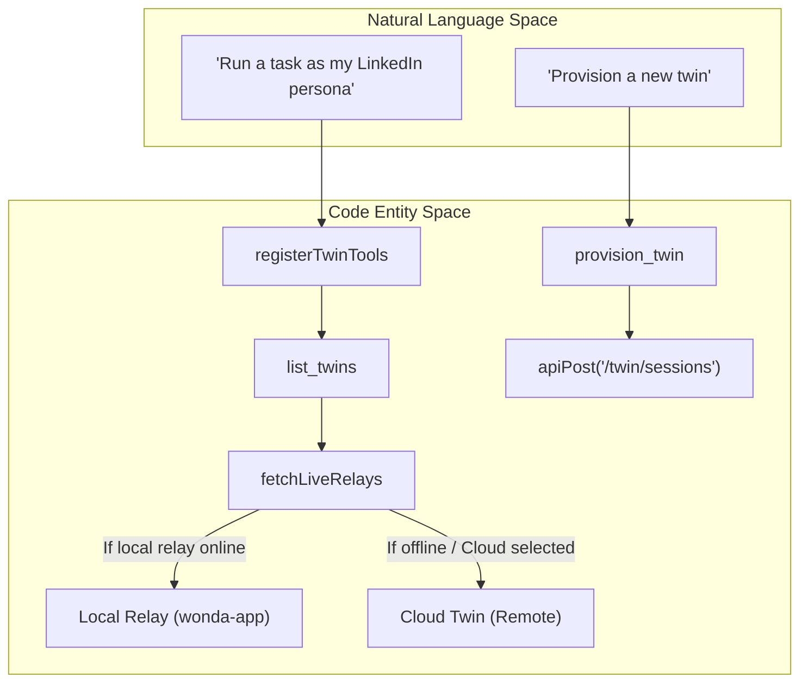
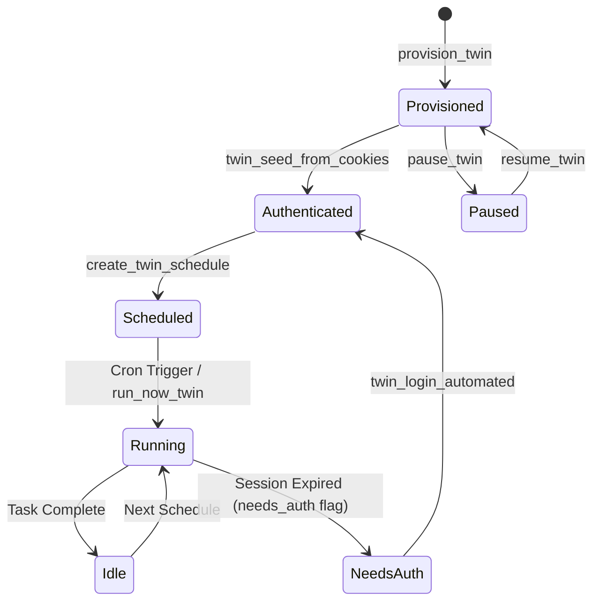

<!-- source: DeepWiki mcp.deepwiki.com · repo degausai/wonda · page 6 Cloud Twins & Digital Personas · fetched 2026-10-26 -->

# Cloud Twins & Digital Personas

Relevant source files

The following files were used as context for generating this wiki page:

- [mcp/README.md](mcp/README.md)
- [mcp/src/tools/twin.ts](mcp/src/tools/twin.ts)
- [skills/wonda-cli/SKILL.md](skills/wonda-cli/SKILL.md)

Cloud Twins are hosted, 24/7 autonomous instances of the Wonda ecosystem. While the local Wonda Automation Browser (WAB) runs on a user's machine, a Cloud Twin acts as a persistent digital persona in the cloud, capable of executing scheduled tasks, maintaining social platform sessions, and responding to agent commands without requiring the user's computer to be online.

### Overview of the Twin System

A Cloud Twin is a provisioned environment that encapsulates a specific **Persona**. It differs from a local WAB instance primarily in its execution environment and lifecycle. While local execution uses the user's residential IP and local hardware, Cloud Twins run on Wonda's hosted infrastructure, managed via the `provision_twin` and `update_twin` tools [mcp/src/tools/twin.ts:84-93]().

The system employs a **Relay Architecture**. If a user has the Wonda Desktop App running locally, the system can route tasks to the "Local Relay" instead of the cloud, allowing for a hybrid model where the agent drives the user's actual machine when available [mcp/src/tools/twin.ts:109-124]().

### Twin vs. Local WAB

| Feature | Local WAB | Cloud Twin |
| :--- | :--- | :--- |
| **Execution** | Manual / Agent-triggered | Scheduled / Persistent |
| **Infrastructure** | User's Machine | Wonda Cloud |
| **IP Address** | Residential (User) | Datacenter / Proxy |
| **Availability** | Only when machine is on | 24/7 |
| **Persistence** | Session-based | Always-on / Periodic |

### Architecture & Entity Mapping

The following diagram illustrates how Natural Language concepts map to specific code entities and how the Relay decides between local and cloud execution.

**Twin Execution & Relay Dispatch**

Sources: [mcp/src/tools/twin.ts:83-131](), [mcp/src/tools/status.ts:9-9]()

### The Twin Lifecycle

The lifecycle of a Cloud Twin spans from initial provisioning to autonomous scheduled execution.

1.  **Provisioning**: A twin is created with a specific `persona`, `region`, and `spendCapMicrodollars` [mcp/src/tools/twin.ts:24-33]().
2.  **Authentication**: The twin must be seeded with credentials. This can be done via `twin_seed_from_cookies` (migrating a local session) or `twin_login_automated` [mcp/README.md:108-108]().
3.  **Scheduling**: Tasks are assigned via `create_twin_schedule`, defining `cron` patterns and `taskKind` (e.g., `engage`, `agent`) [mcp/src/tools/twin.ts:44-60]().
4.  **Execution**: The twin executes commands based on the schedule or on-demand via `run_now_twin` [mcp/src/tools/twin.ts:201-217]().
5.  **Monitoring**: Health and logs are tracked through `twin_health` and `list_twin_runs` [mcp/src/tools/twin.ts:39-42]().

**Twin Lifecycle State Machine**

Sources: [mcp/src/tools/twin.ts:146-175](), [mcp/src/tools/twin.ts:201-217](), [mcp/README.md:100-108]()

### Management & Limits

Cloud Twins operate under strict safety and spend controls. Administrators can set `maxWritesPerHour` and `spendCapMicrodollars` to prevent runaway autonomous behavior [mcp/src/tools/twin.ts:28-29](). The system also supports different `limitsMode` settings, such as `warmup` (for new accounts) or `unlimited` (for established personas) [mcp/src/tools/twin.ts:17-22]().

### Child Pages

For detailed technical implementation of these subsystems, refer to the following:

*   **[Twin Provisioning, Scheduling & Monitoring](#6.1)**: Details on the `provision_twin` tool, cron management, spend caps, and the `twin_health` monitoring system.
*   **[Twin Authentication & Human-in-the-Loop Flows](#6.2)**: Details on the `twin_needs_auth_view` mechanism, session streaming via `viewerUrl`, and migrating local cookies to the cloud.

Sources: [mcp/src/tools/twin.ts:1-220](), [mcp/README.md:81-108](), [skills/wonda-cli/SKILL.md:1-116]()

---

