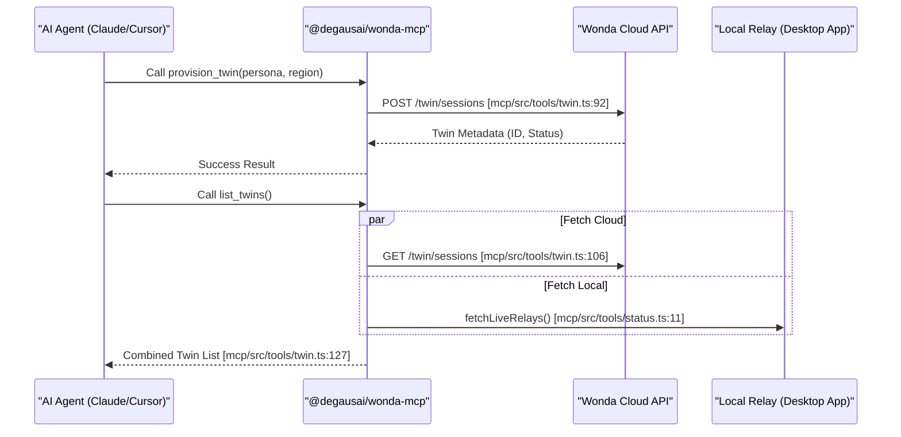
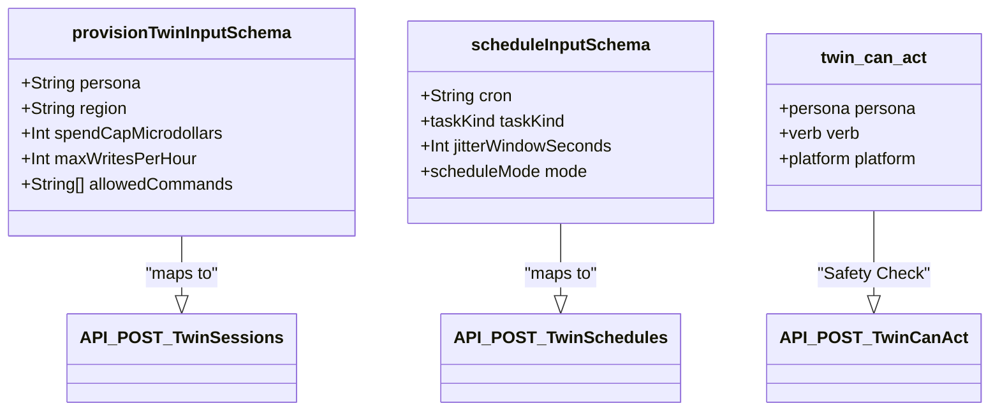

<!-- source: DeepWiki mcp.deepwiki.com · repo degausai/wonda · page 6.1 Twin Provisioning, Scheduling & Monitoring · fetched 2026-10-26 -->

# Twin Provisioning, Scheduling & Monitoring

Relevant source files

The following files were used as context for generating this wiki page:

- [mcp/src/tools/twin.ts](mcp/src/tools/twin.ts)

This page documents the lifecycle management of Cloud Twins within the Wonda platform. It covers the MCP tools used for provisioning, updating, and scheduling automated tasks, as well as the hybrid "Local Relay" model that bridges local Wonda Automation Browser (WAB) personas with cloud infrastructure.

## Twin Lifecycle Overview

A "Twin" is a persistent digital persona managed by Wonda. While local personas run via the WAB on a user's machine, Cloud Twins are provisioned in remote environments to perform automated tasks without local hardware dependencies.

### Provisioning and Management
The `provision_twin` tool initializes a new cloud session for a specific persona and region [mcp/src/tools/twin.ts:84-93](). Once provisioned, twins can be managed through a suite of state-control tools:

*   **`list_twins`**: Returns all cloud twins associated with the account, while also fetching active local personas from the user's Wonda Mac app via `fetchLiveRelays` [mcp/src/tools/twin.ts:95-131]().
*   **`show_twin`**: Retrieves detailed metadata for a specific persona [mcp/src/tools/twin.ts:133-143]().
*   **`pause_twin` / `resume_twin`**: Toggles the operational status of the twin between `active` and `paused` [mcp/src/tools/twin.ts:145-175]().
*   **`update_twin`**: Modifies permissions, spend caps, and safety limits [mcp/src/tools/twin.ts:177-198]().

### The Local Relay Hybrid Model
Wonda implements a hybrid architecture where the MCP server can interact with both cloud-hosted twins and local WAB instances. The `list_twins` tool explicitly merges these two data sources [mcp/src/tools/twin.ts:105-128](). Local personas are identified as being served by the "local relay" (typically the Wonda Desktop app) and do not require a premium cloud plan [mcp/src/tools/twin.ts:99-100]().

### Twin Provisioning Data Flow
The following diagram illustrates the flow from an AI Agent request to the creation of a Cloud Twin.

**Diagram: Twin Provisioning Sequence**

**Sources:** [mcp/src/tools/twin.ts:84-131](), [mcp/src/tools/status.ts:11-15]()

---

## Scheduling and Automation

Wonda allows for both deterministic and agentic scheduling of twin activities. Schedules are defined using standard CRON syntax and support advanced features like jitter to avoid bot-detection patterns.

### Schedule Configuration
The `create_twin_schedule` tool [mcp/src/tools/twin.ts:241-250]() accepts a `scheduleInputSchema` [mcp/src/tools/twin.ts:44-60]() which includes:
*   **`taskKind`**: One of `saved_sync`, `engage`, or `agent` [mcp/src/tools/twin.ts:14]().
*   **`jitterWindowSeconds`**: A window (up to 86,400 seconds) to randomize the start time [mcp/src/tools/twin.ts:57]().
*   **`mode`**: Either `deterministic` (fixed commands) or `agent` (dynamic reasoning) [mcp/src/tools/twin.ts:15]().

### Execution Control
*   **`run_now_twin`**: Immediately triggers a run for a specific persona, bypassing the schedule [mcp/src/tools/twin.ts:200-217]().
*   **`cancel_twin_run`**: Aborts an active or queued run [mcp/src/tools/twin.ts:265-274]().
*   **`list_twin_runs`**: Provides history and status of previous executions [mcp/src/tools/twin.ts:276-285]().

---

## Safety, Limits & Monitoring

Wonda enforces strict safety boundaries to protect social accounts and manage costs.

### Spend Caps and Limits
During provisioning or via `update_twin`, users can configure:
*   **`spendCapMicrodollars`**: Hard financial limit for cloud compute and API usage [mcp/src/tools/twin.ts:28]().
*   **`maxWritesPerHour`**: Throttling mechanism for social actions [mcp/src/tools/twin.ts:29]().
*   **`limitsMode`**: Presets for account activity levels, ranging from `warmup` to `unlimited` [mcp/src/tools/twin.ts:17-22]().

### Health and Observability
The platform provides real-time monitoring tools to ensure twins are functioning correctly:
*   **`twin_health`**: Returns the current operational health of a twin [mcp/src/tools/twin.ts:303-312]().
*   **`twin_liveness`**: A heartbeat check to verify the twin's execution environment is responsive [mcp/src/tools/twin.ts:314-323]().
*   **`twin_artifact`**: Retrieves logs or files generated during a twin's run [mcp/src/tools/twin.ts:325-337]().

### The SENSE Layer (`twin_can_act`)
Before performing an action, the system checks the `twin_can_act` tool [mcp/src/tools/twin.ts:220-239](). This queries the backend "SENSE" layer to determine if an action is permitted based on current rate limits, account standing, and safety policies.

**Diagram: Scheduling and Safety Entity Mapping**

**Sources:** [mcp/src/tools/twin.ts:24-33](), [mcp/src/tools/twin.ts:44-60](), [mcp/src/tools/twin.ts:220-239]()

---

## Tool Reference Table

| MCP Tool | HTTP Endpoint | Method | Description |
| :--- | :--- | :--- | :--- |
| `provision_twin` | `/twin/sessions` | POST | Creates a new cloud twin. |
| `list_twins` | `/twin/sessions` | GET | Lists cloud and local personas. |
| `update_twin` | `/twin/sessions/{persona}` | PATCH | Updates limits and permissions. |
| `create_twin_schedule`| `/twin/schedules` | POST | Sets up recurring tasks. |
| `run_now_twin` | `/twin/sessions/{persona}/run-now` | POST | Manual execution trigger. |
| `twin_health` | `/twin/sessions/{persona}/health` | GET | Checks twin status. |
| `twin_can_act` | `/twin/can-act` | POST | Validates safety/rate limits. |

**Sources:** [mcp/src/tools/twin.ts:84-337]()

---

