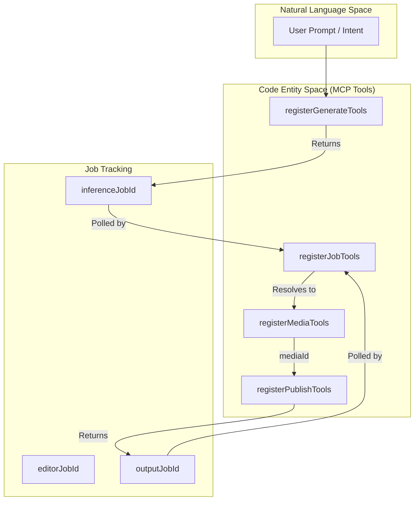
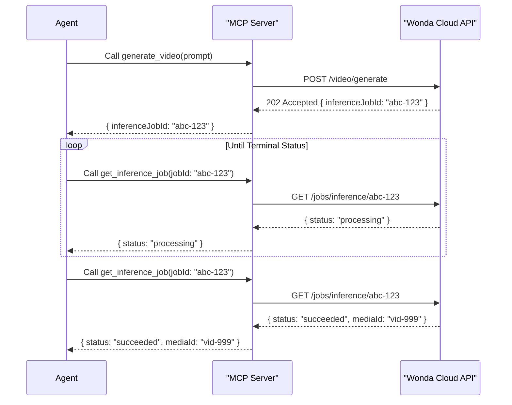

<!-- source: DeepWiki mcp.deepwiki.com · repo degausai/wonda · page 7 Media Pipeline & Publishing · fetched 2026-10-26 -->

# Media Pipeline & Publishing

Relevant source files

The following files were used as context for generating this wiki page:

- [mcp/src/tools/generate.ts](mcp/src/tools/generate.ts)
- [mcp/src/tools/jobs.ts](mcp/src/tools/jobs.ts)
- [mcp/src/tools/media.ts](mcp/src/tools/media.ts)
- [mcp/src/tools/publish.ts](mcp/src/tools/publish.ts)

The Wonda media pipeline provides an end-to-end asynchronous workflow for generating, managing, and publishing AI-driven content. The system bridges high-level AI generation models with social platform APIs through a centralized media library and a robust job polling architecture.

## Pipeline Overview

The content lifecycle in Wonda follows a three-stage progression:
1.  **Generation**: Invoking AI models for text, image, video, or audio creation.
2.  **Management**: Storing and retrieving assets via the Media Library using unique `mediaId` identifiers.
3.  **Publishing**: Dispatching assets to social platforms like Instagram and TikTok.

All long-running operations (generation, editing, and publishing) follow an asynchronous pattern where the initial request returns a Job ID, which must be polled until completion.

### Content Flow Architecture

This diagram maps the transition from natural language prompts to specific code entities and job tracking.

**System Content Flow**

Sources: [mcp/src/tools/generate.ts:82-138](), [mcp/src/tools/media.ts:10-149](), [mcp/src/tools/publish.ts:7-73](), [mcp/src/tools/jobs.ts:42-67]()

---

## AI Generation & Analysis

Wonda integrates multiple AI modalities through a unified interface. Generation tools are registered via `registerGenerateTools` and interact with specialized backend endpoints.

*   **Multimodal Generation**: Supports `generate_image`, `generate_video`, `generate_music`, and `speech` (TTS) [mcp/src/tools/generate.ts:14-64]().
*   **Analysis & Transcription**: Tools like `analyze_video` extract frame grids and transcripts, while `transcribe` converts audio to text [mcp/src/tools/generate.ts:51-56, 107-123]().
*   **Input Schema**: Most generation tools utilize a common `generationInputSchema` accepting a `model`, `prompt`, and optional `attachmentMediaIds` for reference-based generation [mcp/src/tools/generate.ts:66-80]().

For detailed implementation of model parameters and frame grid extraction, see **[Generation Tools & Job Polling (#7.1)]**.

---

## Media Library & Storage

The Media Library acts as the central repository for all assets. Every asset is tracked by a `mediaId`, which serves as the primary reference for editing and publishing tools.

*   **Ingestion**: Assets enter the library via `upload_media` (URL-based upload) or as outputs from generation/editor jobs [mcp/src/tools/media.ts:12-80]().
*   **Retrieval**: The `list_media` tool allows filtering by `kind` (image, video, audio) and `source` (user_upload, model_generated, etc.) [mcp/src/tools/media.ts:104-148]().
*   **Metadata**: `get_media` provides technical details for a specific asset [mcp/src/tools/media.ts:82-101]().

Sources: [mcp/src/tools/media.ts:1-150]()

---

## Asynchronous Job Model

Because media processing is computationally intensive, Wonda uses a polling pattern. Each stage of the pipeline produces a specific type of Job ID.

| Job Type | ID Key | Polling Tool | Terminal Statuses |
| :--- | :--- | :--- | :--- |
| **Inference** | `inferenceJobId` | `get_inference_job` | succeeded, failed, canceled |
| **Editing** | `editorJobId` | `get_editor_job` | succeeded, failed |
| **Publishing** | `outputJobId` | `get_publish_job` | succeeded, failed |

**Job Polling Logic**

Sources: [mcp/src/tools/jobs.ts:15-40](), [mcp/src/tools/generate.ts:19-21]()

---

## Platform Publishing

Publishing tools bridge the Media Library to external social networks. These tools require pre-connected accounts and support platform-specific metadata.

*   **Instagram**: `publish_instagram` supports different `product` types such as `IMAGE`, `REELS`, and `STORIES` [mcp/src/tools/publish.ts:9-39]().
*   **TikTok**: `publish_tiktok` includes safety features like `isAigc` (AI-Generated Content) flags and `privacyLevel` settings [mcp/src/tools/publish.ts:42-72]().

For details on account IDs, privacy levels, and publishing job monitoring, see **[Media Library & Publishing Tools (#7.2)]**.

---

