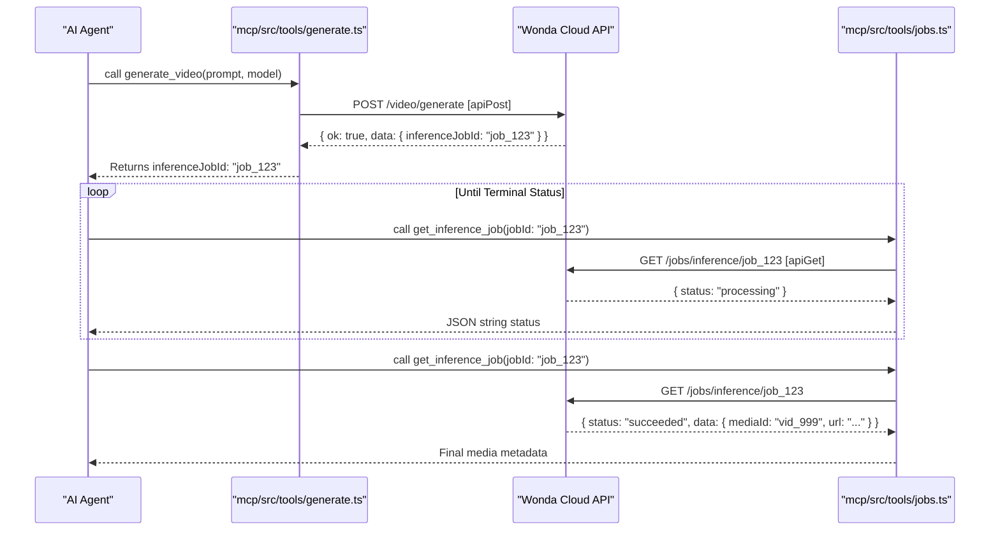
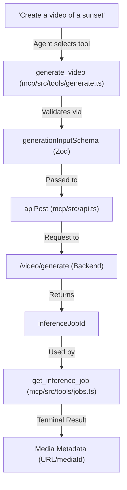

<!-- source: DeepWiki mcp.deepwiki.com · repo degausai/wonda · page 7.1 Generation Tools & Job Polling · fetched 2026-10-26 -->

# Generation Tools & Job Polling

Relevant source files

The following files were used as context for generating this wiki page:

- [mcp/src/tools/generate.ts](mcp/src/tools/generate.ts)
- [mcp/src/tools/jobs.ts](mcp/src/tools/jobs.ts)

The Wonda platform provides a comprehensive suite of AI generation tools through its MCP server, allowing agents to create and analyze multi-modal content. Because high-fidelity media generation (video, audio, high-res images) is computationally intensive and time-consuming, the system utilizes an **asynchronous job polling pattern**.

## Generation Tools Overview

The `registerGenerateTools` function in `mcp/src/tools/generate.ts` exposes several tools to the AI agent. These tools are mapped to specific backend endpoints defined in the `GENERATION_ENDPOINTS` array [mcp/src/tools/generate.ts:14-64]().

### Standard Generation Tools
All standard generation tools share a common `generationInputSchema` [mcp/src/tools/generate.ts:66-80]().

| Tool Name | Purpose | Endpoint Path |
| :--- | :--- | :--- |
| `generate_image` | Create images from text prompts | `/image/generate` |
| `generate_video` | Create video from text or reference images | `/video/generate` |
| `generate_text` | Large language model text generation | `/text/generate` |
| `generate_music` | Generate music tracks from prompts | `/music/generate` |
| `speech` | Text-to-speech (TTS) audio generation | `/audio/speech` |
| `transcribe` | Convert audio to text (requires `attachmentMediaIds`) | `/audio/transcribe` |
| `dialogue` | Generate multi-speaker audio tracks | `/audio/dialogue` |

### Input Schema Details
The `generationInputSchema` [mcp/src/tools/generate.ts:66-80]() includes:
*   `model`: String identifier for the specific AI model (e.g., `nano-banana-2`, `suno-music`).
*   `prompt`: Optional text description.
*   `params`: A record of model-specific parameters (e.g., `duration`, `voiceId`).
*   `attachmentMediaIds`: An array of existing `mediaId` strings to be used as references (essential for `transcribe` or image-to-video).

### Specialized Analysis: `analyze_video`
The `analyze_video` tool [mcp/src/tools/generate.ts:106-137]() differs from standard generation. It is used to extract structured data from existing video assets:
*   **Composite Frame Grids**: Generates a grid of frames for visual context.
*   **Audio Transcript**: Extracts spoken text from the video.
*   **Input**: Takes a `mediaId` and an optional `targetFrameCount` (1-100) [mcp/src/tools/generate.ts:113-122]().

**Sources:**
* [mcp/src/tools/generate.ts:14-64]()
* [mcp/src/tools/generate.ts:66-80]()
* [mcp/src/tools/generate.ts:106-137]()

## The Inference Job Polling Pattern

Generation tools do not return the final media asset immediately. Instead, they return an `inferenceJobId` [mcp/src/tools/generate.ts:19-20](). The agent must then poll for the result using the status tools defined in `mcp/src/tools/jobs.ts`.

### Job Polling Logic Flow

**Generation Tool Execution to Job Completion**

**Sources:**
* [mcp/src/tools/generate.ts:92-102]()
* [mcp/src/tools/jobs.ts:15-40]()
* [mcp/src/tools/jobs.ts:54-65]()

## Job Status Tools

The `registerJobTools` function [mcp/src/tools/jobs.ts:42-67]() registers tools to check the status of different asynchronous processes. All these tools are marked with `READ_TOOL_ANNOTATIONS` [mcp/src/tools/jobs.ts:49]().

| Tool Name | Job ID Parameter | Terminal Statuses | Endpoint |
| :--- | :--- | :--- | :--- |
| `get_inference_job` | `inferenceJobId` | `succeeded`, `failed`, `canceled` | `/jobs/inference` |
| `get_editor_job` | `editorJobId` | `succeeded`, `failed` | `/jobs/editor` |
| `get_publish_job` | `outputJobId` | `succeeded`, `failed` | `/jobs/publish` |

### Implementation Detail
The job tools are generated dynamically from the `JOB_ENDPOINTS` array [mcp/src/tools/jobs.ts:15-40](). Each tool performs an `apiGet` request to the specific job path appended with the `jobId` provided by the agent [mcp/src/tools/jobs.ts:55]().

**Sources:**
* [mcp/src/tools/jobs.ts:15-40]()
* [mcp/src/tools/jobs.ts:42-67]()
* [mcp/src/tools/annotations.ts:5-5]()

## Tool Annotations & Permissions

Wonda uses specialized annotations to signal the nature of a tool to the MCP host and the agent.

*   **`WRITE_TOOL_ANNOTATIONS`**: Applied to all generation tools [mcp/src/tools/generate.ts:89](). This indicates that the tool performs a "write" or "create" action, which may consume credits or modify the state of the media library.
*   **`READ_TOOL_ANNOTATIONS`**: Applied to job polling tools [mcp/src/tools/jobs.ts:49](). This indicates a safe "read-only" check on the status of a previously initiated process.

**Sources:**
* [mcp/src/tools/generate.ts:89-89]()
* [mcp/src/tools/jobs.ts:49-49]()
* [mcp/src/tools/annotations.ts:1-10]()

## Data Flow: Natural Language to API

The following diagram maps how natural language requests from an agent are transformed into code entities and eventually API calls.

**Media Generation Data Mapping**

**Sources:**
* [mcp/src/tools/generate.ts:23-28]()
* [mcp/src/tools/generate.ts:66-80]()
* [mcp/src/tools/jobs.ts:17-23]()
* [mcp/src/api.ts:4-4]()

---

