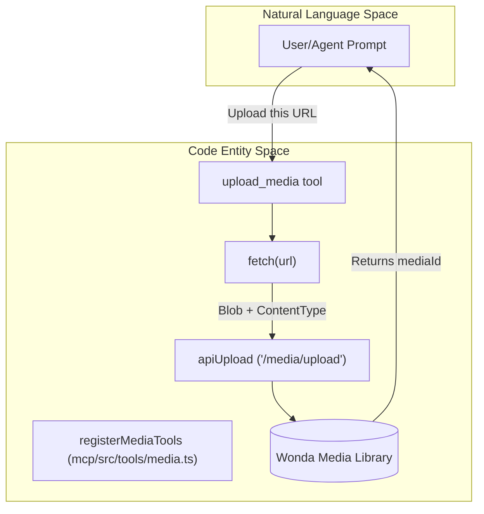
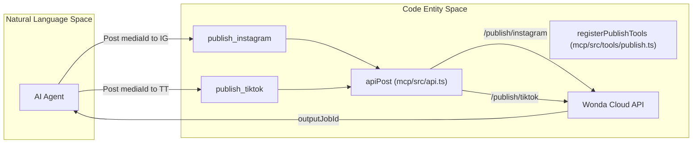

<!-- source: DeepWiki mcp.deepwiki.com · repo degausai/wonda · page 7.2 Media Library & Publishing Tools · fetched 2026-10-26 -->

# Media Library & Publishing Tools

Relevant source files

The following files were used as context for generating this wiki page:

- [mcp/src/tools/media.ts](mcp/src/tools/media.ts)
- [mcp/src/tools/publish.ts](mcp/src/tools/publish.ts)

This page documents the MCP tools responsible for managing the media lifecycle and executing publishing operations to social platforms. The system centers around a centralized media library and an asynchronous job pattern for publishing.

## Media Library Tools

The `registerMediaTools` function in `mcp/src/tools/media.ts` exposes tools for interacting with the Wonda media library. This library acts as the central repository for assets generated by models, uploaded by users, or produced by the video editor.

### Media Lifecycle and Upload Flow
Media is identified by a unique `mediaId` which is required by downstream tools like `publish_instagram` or `publish_tiktok`. The `upload_media` tool implements a URL-based upload flow where the MCP server acts as a proxy:
1.  **Download**: The server fetches the file from the provided HTTP/HTTPS URL [mcp/src/tools/media.ts:24-47]().
2.  **Form Construction**: The binary data is wrapped in a `FormData` object as a `File` [mcp/src/tools/media.ts:53-57]().
3.  **API Upload**: The data is sent to the `/media/upload` endpoint via `apiUpload` [mcp/src/tools/media.ts:59-59]().

### Media Tool Definitions

| Tool Name | Purpose | Key Inputs |
| :--- | :--- | :--- |
| `upload_media` | Imports media from a URL into the Wonda library. | `url` |
| `get_media` | Retrieves metadata for a specific asset. | `mediaId` |
| `list_media` | Queries the library with filters for `kind` and `source`. | `kind`, `source`, `limit` |

**Sources:** [mcp/src/tools/media.ts:10-149]()

### Media Data Flow Diagram

The following diagram illustrates how external URLs are ingested into the system and associated with a `mediaId`.

"Media Ingestion Pipeline"

**Sources:** [mcp/src/tools/media.ts:11-80](), [mcp/src/api.ts:59-64]()

---

## Publishing Tools

The `registerPublishTools` function in `mcp/src/tools/publish.ts` provides the interface for pushing media to social platforms. Unlike simple API calls, publishing is treated as an asynchronous task due to platform processing times.

### Asynchronous Job Pattern
Both `publish_instagram` and `publish_tiktok` follow the **Output Job Pattern**:
1.  The tool initiates the request via `apiPost` [mcp/src/tools/publish.ts:31-31]().
2.  The backend returns an `outputJobId` immediately.
3.  The caller must poll the status (typically via a `get_publish_job` tool, though not defined in this specific registry file) until the state reaches success or failure [mcp/src/tools/publish.ts:13-13]().

### Platform Specifics

#### Instagram (`publish_instagram`)
*   **Product Types**: Supports `IMAGE`, `REELS`, and `STORIES` via the `product` enum [mcp/src/tools/publish.ts:23-26]().
*   **Feed Integration**: Reels can optionally be shared to the main feed using `shareToFeed` [mcp/src/tools/publish.ts:27-27]().

#### TikTok (`publish_tiktok`)
*   **Privacy**: Allows setting `privacyLevel` (e.g., `PUBLIC_TO_EVERYONE`) [mcp/src/tools/publish.ts:55-58]().
*   **AI Disclosure**: Includes an `isAigc` flag to mark content as AI-generated, complying with platform safety guidelines [mcp/src/tools/publish.ts:59-59]().
*   **Post Mode**: Supports `direct` (immediate post) or `inbox` (send to app for manual finalization) [mcp/src/tools/publish.ts:60-60]().

**Sources:** [mcp/src/tools/publish.ts:7-73]()

### Publishing Dispatch Diagram

This diagram bridges the agent's intent to the underlying API execution.

"Publishing Tool Dispatch"

**Sources:** [mcp/src/tools/publish.ts:9-72](), [mcp/src/api.ts:38-43]()

---

## Metadata & Filtering
The `list_media` tool allows agents to browse the library using specific filters, which is critical for agents that need to select the "latest video" or "most recent user upload."

| Filter | Values | Description |
| :--- | :--- | :--- |
| `kind` | `image`, `video`, `audio` | The physical format of the file. |
| `source` | `user_upload`, `model_generated`, `editor_output`, `scrape`, `import` | How the file entered the library. |

**Sources:** [mcp/src/tools/media.ts:111-124]()

---

