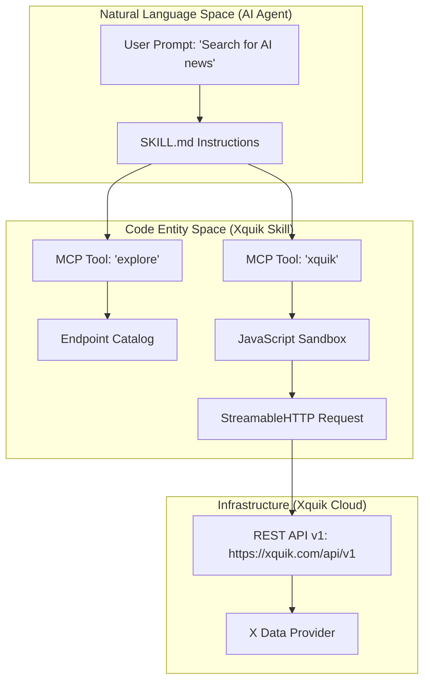
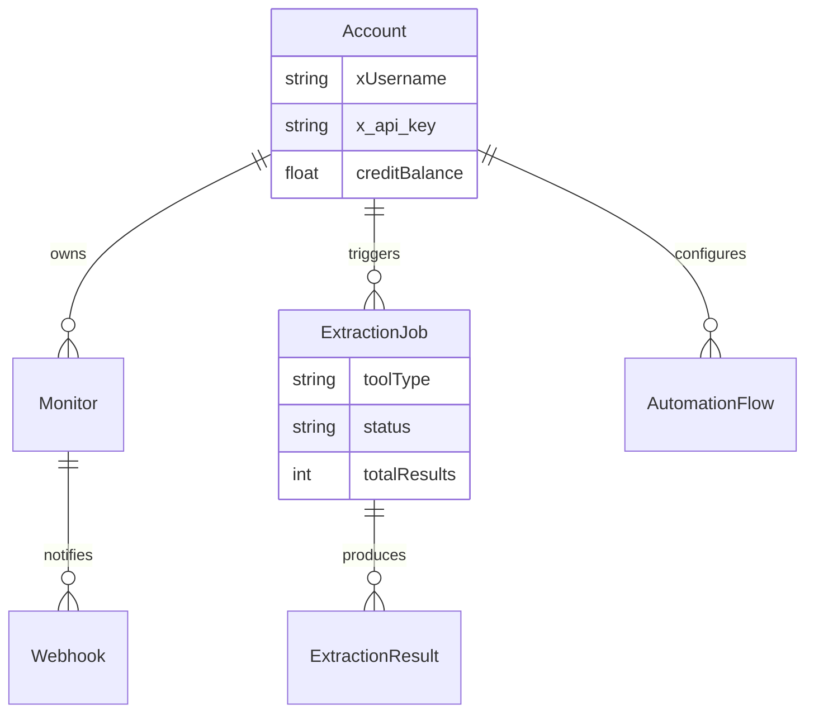

<!-- source: DeepWiki mcp.deepwiki.com · repo Xquik-dev/x-twitter-scraper · page 1 Overview · fetched 2026-10-26 -->

# Overview

Relevant source files

The following files were used as context for generating this wiki page:

- [README.md](README.md)
- [mcpize/SUBMISSION-STEPS.md](mcpize/SUBMISSION-STEPS.md)
- [openclaw.plugin.json](openclaw.plugin.json)
- [package.json](package.json)
- [skills/x-twitter-scraper/metadata.json](skills/x-twitter-scraper/metadata.json)

The **x-twitter-scraper** (Xquik) platform is a high-performance, cost-effective alternative to the official X (Twitter) API, designed specifically for AI coding agents and developers. It provides a comprehensive suite of tools for real-time data retrieval, bulk extraction, account management, and automation workflows.

The platform is structured as a "Skill" for AI agents, exposing 100+ REST API endpoints through a Model Context Protocol (MCP) server [README.md:1-12](). It supports over 40 AI coding environments, including Claude Code, Cursor, and Windsurf [README.md:16-17]().

### Core Value Proposition

Xquik offers a significant price advantage over the official X API, with read operations starting at **$0.00015 per call** (approximately 33x cheaper than X's Basic tier) [README.md:14-27]().

| Feature | Xquik | Official X API (Pay-per-usage) |
| :--- | :--- | :--- |
| **Tweet Read** | $0.00015 | $0.005 |
| **User Lookup** | $0.00015 | $0.010 |
| **Write Actions** | $0.0015 | $0.015 - $0.20 |
| **Bulk Extraction** | $0.00015/result | Charged per resource |

Sources: [README.md:18-54]()

### System Architecture

The Xquik ecosystem bridges high-level AI agent requests to low-level X data operations through three primary layers: the **Skill Interface**, the **MCP Server**, and the **REST API**.

#### Conceptual Bridge: Agent to API
This diagram illustrates how natural language instructions from an AI agent are translated into code entities and executed against the Xquik infrastructure.

Sources: [README.md:12](), [skills/x-twitter-scraper/metadata.json:5-5](), [mcpize/SUBMISSION-STEPS.md:9-10]()

### Key Functional Areas

1.  **X Lookups & Writes**: Synchronous access to tweets, user profiles, engagement metrics, and the ability to post, like, or DM [README.md:140-143, 150-154]().
2.  **Bulk Extractions**: Asynchronous processing for high-volume data (e.g., extracting followers) using 23 specialized tool types [README.md:144-148, 48-50]().
3.  **Monitors & Webhooks**: Real-time event tracking (new tweets, follower changes) delivered via HMAC-signed webhooks [README.md:152-153, 32-32]().
4.  **Flow Automations**: A trigger-action workflow system for building automated pipelines [skills/x-twitter-scraper/metadata.json:5-5]().
5.  **Giveaway Draws**: Auditable contest management with complex filtering (e.g., `mustRetweet`, `minFollowers`) [README.md:51-51, 33-33]().

#### Entity Relationship Diagram
This diagram maps the core data entities mentioned in the metadata and README to their functional roles.

Sources: [README.md:48-53](), [skills/x-twitter-scraper/metadata.json:5-5](), [openclaw.plugin.json:8-16]()

### Getting Started

To integrate Xquik into your development environment, you must first install the skill and configure authentication.

*   **Installation**: The skill can be installed via the `skills` CLI or by cloning the repository into specific agent directories (e.g., `.claude/skills/` or `.agents/skills/`) [README.md:62-135]().
*   **Authentication**: Most operations require an `x-api-key` header [mcpize/SUBMISSION-STEPS.md:16-17](). Xquik also supports the **Machine Payments Protocol (MPP)** for anonymous, per-request payments on select endpoints [README.md:60-60]().

For detailed setup instructions, see **[Getting Started & Installation](#1.1)**.
For information on billing and the credit system, see **[Authentication & Credits](#1.2)**.

Sources: [README.md:55-135](), [openclaw.plugin.json:7-17](), [mcpize/SUBMISSION-STEPS.md:1-18]()

---

