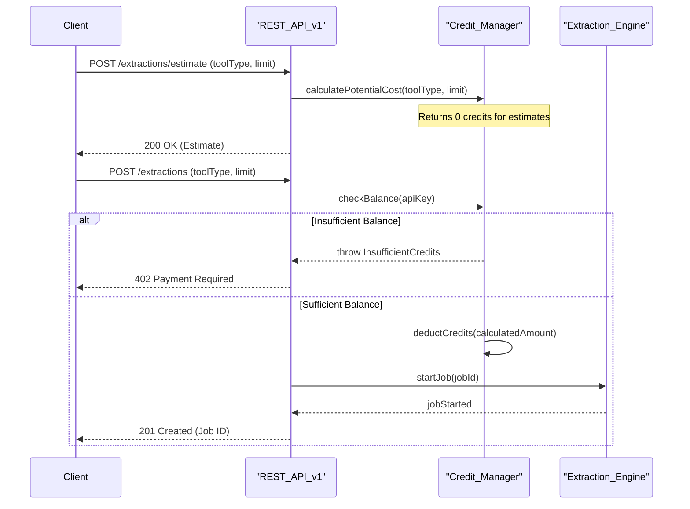
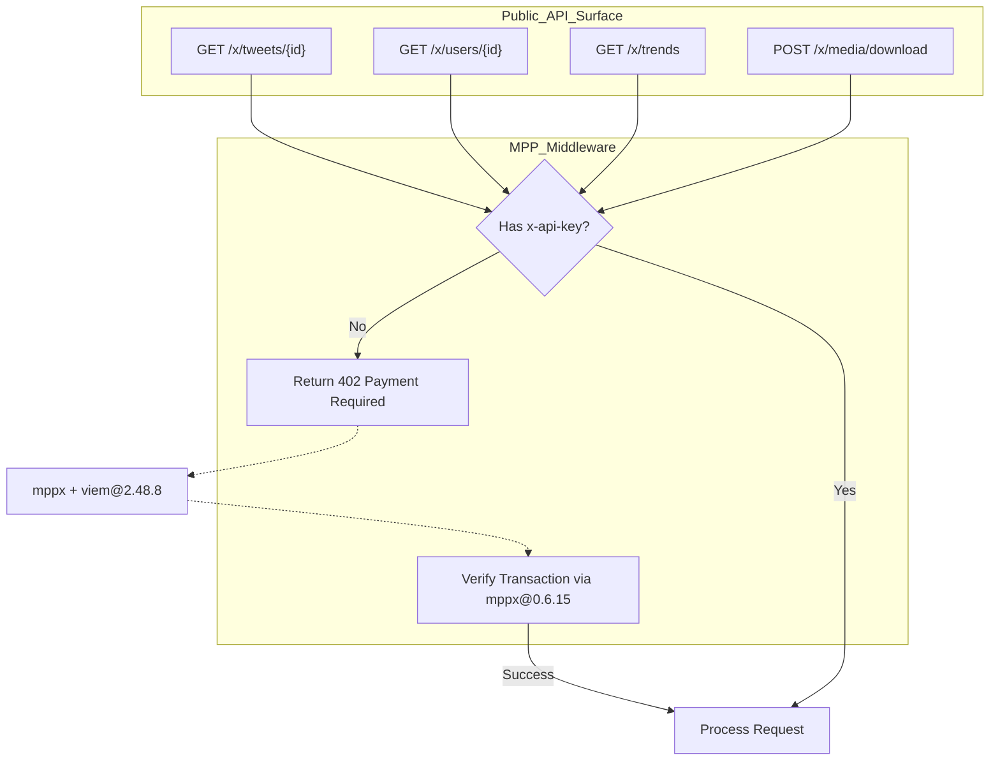

<!-- source: DeepWiki mcp.deepwiki.com · repo Xquik-dev/x-twitter-scraper · page 1.2 Authentication & Credits · fetched 2026-10-26 -->

# Authentication & Credits

<details>
<summary>Relevant source files</summary>

The following files were used as context for generating this wiki page:

- [scripts/check-versions.mjs](scripts/check-versions.mjs)
- [skills/x-twitter-scraper/SKILL.md](skills/x-twitter-scraper/SKILL.md)
- [skills/x-twitter-scraper/references/pricing.md](skills/x-twitter-scraper/references/pricing.md)

</details>


This page details the security and economic model of the Xquik platform. It covers the header-based authentication scheme, the granular credit system, rate-limiting tiers, and the decentralized MPP payment protocol.

## Authentication Scheme

Xquik uses a symmetric key authentication model. Every request to the REST API or the MCP server must include an `x-api-key` header [skills/x-twitter-scraper/SKILL.md:12-16]().

### API Key Lifecycle
1.  **Generation**: Keys are generated via the Xquik dashboard. The skill never handles X login material directly [skills/x-twitter-scraper/SKILL.md:101-101]().
2.  **Format**: Keys follow the pattern `xq_` followed by 64 hexadecimal characters [skills/x-twitter-scraper/SKILL.md:3-3]().
3.  **Security**: The skill authenticates only with this Xquik API key and does not ask for, transmit, store, or log any X account login material (passwords, cookies, or TOTP) [skills/x-twitter-scraper/SKILL.md:20-25]().
4.  **Dashboard Integration**: Connecting or re-authenticating an X account is performed entirely by the user in the Xquik dashboard via a browser-based flow [skills/x-twitter-scraper/SKILL.md:75-75]().

### Implementation Example
```javascript
const headers = { 
  "x-api-key": "xq_your_64_char_hex_key", 
  "Content-Type": "application/json" 
};
```
[server.json:176-176]()

**Sources:** [skills/x-twitter-scraper/SKILL.md:3-101](), [server.json:176-183]()

---

## Credit-Based Billing Model

Xquik operates on a "unit-of-work" credit system where 1 credit is valued at **$0.00015** [skills/x-twitter-scraper/references/pricing.md:14-14](). Credits are consumed from a shared pool for metered operations.

### Operation Cost Tiers

| Tier | Cost | Example Operations |
| :--- | :--- | :--- |
| **Free** | 0 Credits | Webhooks, AI Compose, Radar, Style Cache, Estimates [skills/x-twitter-scraper/references/pricing.md:71-73]() |
| **Read (Standard)** | 1 Credit | Get Tweet, Search (per tweet), Timeline, DM History [skills/x-twitter-scraper/references/pricing.md:20-38]() |
| **Read (Trends)** | 3 Credits | Trends (per call) [skills/x-twitter-scraper/references/pricing.md:40-44]() |
| **Read (Deep)** | 5 Credits | Follow Check, Get X Article [skills/x-twitter-scraper/references/pricing.md:46-52]() |
| **Write** | 10 Credits | Post Tweet, Like, Retweet, Follow, Update Profile [skills/x-twitter-scraper/references/pricing.md:53-56]() |
| **Bulk/Draws** | Variable | Extractions (1-5/res), Giveaway Draws (1/entry) [skills/x-twitter-scraper/references/pricing.md:57-66]() |

### Data Flow: Credit Validation & Consumption
The following diagram illustrates how the system validates credits before executing a metered tool like a bulk extraction.

**System Logic: Credit Check Flow**

**Sources:** [skills/x-twitter-scraper/references/pricing.md:57-73](), [skills/x-twitter-scraper/SKILL.md:42-59]()

---

## Rate Limit Tiers

Rate limits are enforced per-method-tier using a fixed-window counter [skills/x-twitter-scraper/SKILL.md:73-73]().

| Tier | Limit | Scope |
| :--- | :--- | :--- |
| **Read** | 10 requests / 1s | GET requests (Lookups, Search) |
| **Write** | 30 requests / 60s | POST/PATCH requests (Posting, Liking, Billing) |
| **Delete** | 15 requests / 60s | DELETE requests (Unfollowing, Unliking) |

**Sources:** [skills/x-twitter-scraper/SKILL.md:59-87]()

---

## MPP: Anonymous Payment Protocol

The **Multi-Party Payment (MPP)** protocol allows for pay-per-use access to 32 specific X-API endpoints without requiring a monthly subscription [skills/x-twitter-scraper/references/pricing.md:90-96]().

### Protocol Mechanism
1.  **402 Challenge**: When a client calls an MPP-supported endpoint without sufficient credits or a key, the server returns an HTTP 402 status.
2.  **USDC Settlement**: The client uses the `mppx` SDK and `viem` to settle the micro-payment via blockchain [skills/x-twitter-scraper/references/pricing.md:133-133]().
3.  **Fulfillment**: The agent must display the exact amount and get explicit user confirmation before every transaction [skills/x-twitter-scraper/SKILL.md:47-52]().

**Code Entity Association: MPP Support**

**Sources:** [skills/x-twitter-scraper/references/pricing.md:90-133](), [skills/x-twitter-scraper/SKILL.md:47-52]()

---

## Topping Up & Subscriptions

Users can manage their credit balance through several mechanisms:

1.  **Monthly Subscriptions**: Starter ($20), Pro ($99), and Business ($199) plans include pre-allocated credits [skills/x-twitter-scraper/references/pricing.md:9-11]().
2.  **Manual Top-ups**: `POST /credits/topup` creates a hosted checkout session ($10 minimum) [skills/x-twitter-scraper/references/pricing.md:137-143]().
3.  **Quick Top-up**: `POST /credits/quick-topup` can charge a saved payment method after explicit user confirmation of the exact amount [skills/x-twitter-scraper/SKILL.md:47-51]().
4.  **Auto Top-up**: Can be configured via the dashboard to trigger at a specific threshold [skills/x-twitter-scraper/references/pricing.md:145-146]().

### Balance Monitoring
The `GET /credits` endpoint returns the current `balance`, `lifetimePurchased`, and `lifetimeUsed` [skills/x-twitter-scraper/references/pricing.md:139-139]().

**Sources:** [skills/x-twitter-scraper/references/pricing.md:1-146](), [skills/x-twitter-scraper/SKILL.md:47-58]()

---

