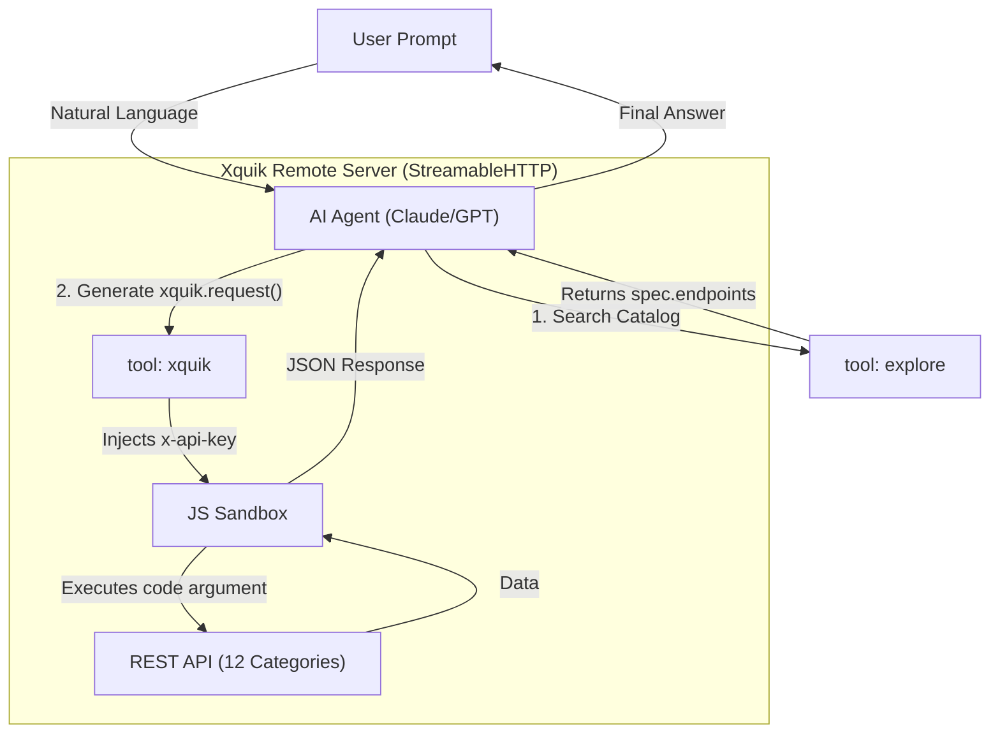
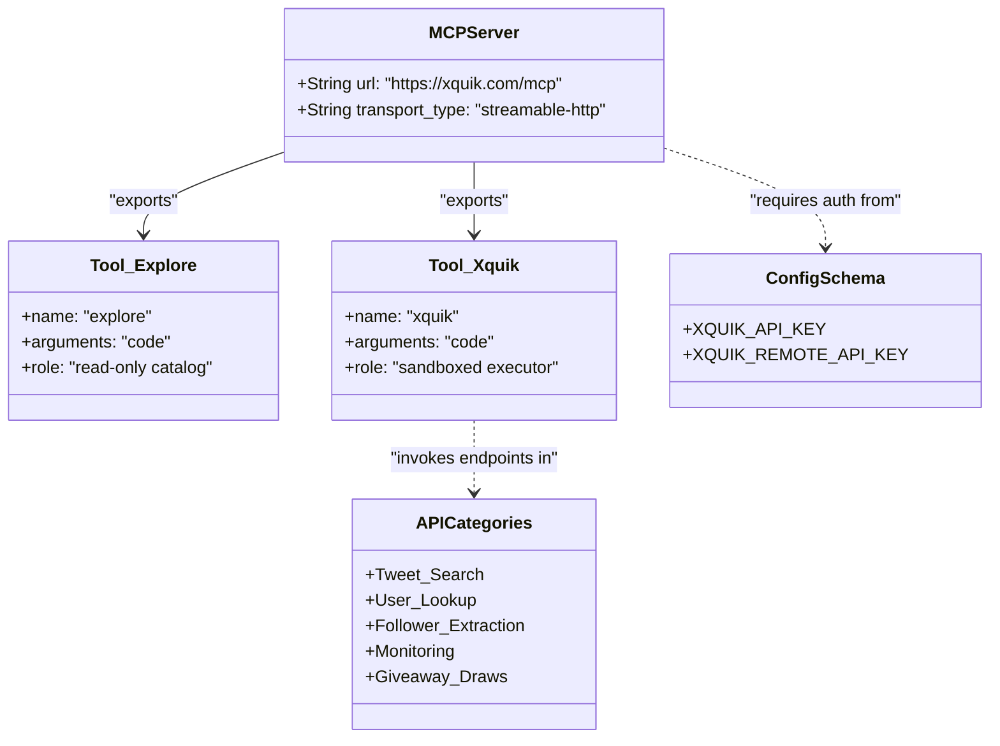

<!-- source: DeepWiki mcp.deepwiki.com · repo Xquik-dev/x-twitter-scraper · page 2.1 MCP Setup & Client Configuration · fetched 2026-10-26 -->

# MCP Setup & Client Configuration

<details>
<summary>Relevant source files</summary>

The following files were used as context for generating this wiki page:

- [docker-mcp-registry/SUBMISSION-STEPS.md](docker-mcp-registry/SUBMISSION-STEPS.md)
- [docker-mcp-registry/cyrus-submission-steps.md](docker-mcp-registry/cyrus-submission-steps.md)
- [docker-mcp-registry/xquik-remote/readme.md](docker-mcp-registry/xquik-remote/readme.md)
- [docker-mcp-registry/xquik-remote/server.yaml](docker-mcp-registry/xquik-remote/server.yaml)
- [docker-mcp-registry/xquik-remote/tools.json](docker-mcp-registry/xquik-remote/tools.json)
- [mcpize/SUBMISSION-STEPS.md](mcpize/SUBMISSION-STEPS.md)
- [openclaw.plugin.json](openclaw.plugin.json)
- [package.json](package.json)
- [skills/x-twitter-scraper/references/mcp-setup.md](skills/x-twitter-scraper/references/mcp-setup.md)

</details>


This page provides detailed technical instructions for connecting various AI agents, IDEs, and programmatic environments to the Xquik platform using the Model Context Protocol (MCP). The Xquik MCP server acts as a bridge to the REST API, allowing models to execute complex X (Twitter) operations through a sandboxed execution environment.

## Protocol Specification

The Xquik MCP implementation utilizes the **StreamableHTTP** transport layer rather than the standard `stdio` transport used by local binary servers. This allows for a remote, stateless connection over HTTPS.

| Setting | Value |
|---------|-------|
| Protocol | HTTP (StreamableHTTP) |
| Endpoint | `https://xquik.com/mcp` |
| Auth Header | `x-api-key` |

**Sources:** [skills/x-twitter-scraper/references/mcp-setup.md:5-10]()

## Client Configuration Reference

### Claude Desktop (via mcp-remote bridge)
Because Claude Desktop natively expects `stdio` transport, a bridge utility is required to translate `stdio` messages to the Xquik `StreamableHTTP` endpoint. The `mcp-remote` package (v0.1.38) is the recommended open-source proxy for this translation.

**Configuration (`claude_desktop_config.json`):**
```json
{
  "mcpServers": {
    "xquik": {
      "command": "mcp-remote",
      "args": [
        "https://xquik.com/mcp",
        "--header",
        "x-api-key:${XQUIK_API_KEY}"
      ]
    }
  }
}
```
**Sources:** [skills/x-twitter-scraper/references/mcp-setup.md:17-46]()

### Cursor, VS Code, & Windsurf
These IDEs support direct HTTP MCP connections. Configuration is handled by specifying the remote URL and the required authentication header.

| Client | Configuration File | Key Field |
|--------|-------------------|-----------|
| **Cursor** | `~/.cursor/mcp.json` | `url` |
| **VS Code** | `.vscode/mcp.json` | `url` |
| **Windsurf**| `~/.codeium/windsurf/mcp_config.json` | `serverUrl` |

**Example Header Injection:**
```json
"headers": {
  "x-api-key": "xq_YOUR_KEY_HERE"
}
```
**Sources:** [skills/x-twitter-scraper/references/mcp-setup.md:106-156]()

### ChatGPT Custom GPTs & Developer Mode
There are three primary ways to connect ChatGPT to Xquik:

1.  **Custom GPT (Action):** Add Xquik as an Action using the OpenAPI schema at `https://xquik.com/openapi.json`. Set the API key under **Authentication > API Key > Header `x-api-key`**.
2.  **Developer Mode:** Supports MCP connectors via OAuth. Add `https://xquik.com/mcp` as the endpoint in **Settings > Developer Mode > MCP Tools**.
3.  **Agents SDK:** Use the `MCPServerStreamableHttp` class for programmatic access.

**Sources:** [skills/x-twitter-scraper/references/mcp-setup.md:68-95]()

### Python SDK (OpenAI Agents)
For programmatic integration, the `MCPServerStreamableHttp` class from the OpenAI Agents SDK can be used to wrap the Xquik endpoint.

```python
from agents.mcp import MCPServerStreamableHttp

async with MCPServerStreamableHttp(
    url="https://xquik.com/mcp",
    headers={"x-api-key": "xq_YOUR_KEY_HERE"},
    params={},
) as xquik:
    # Use xquik as a tool provider
    pass
```
**Sources:** [skills/x-twitter-scraper/references/mcp-setup.md:76-90]()

## MCP Server Architecture

The Xquik MCP server (v2) operates on a **code-execution sandbox model**. Unlike traditional MCP servers that map one tool to one API endpoint, Xquik provides two high-level tools that allow the agent to navigate and execute logic against the entire 120-endpoint REST API.

### Tool Definitions

| Tool Name | Implementation Role | Cost |
|-----------|---------------------|------|
| `explore` | Catalog Discovery: Search the in-memory endpoint definitions. | Free |
| `xquik`   | Sandbox Execution: Execute async JavaScript arrow functions. | Varies |

**Sources:** [skills/x-twitter-scraper/references/mcp-setup.md:176-186](), [docker-mcp-registry/xquik-remote/tools.json:1-24]()

### System Data Flow

The following diagram illustrates how a natural language prompt is translated into code execution within the Xquik sandbox using the tools defined in `tools.json`.

**Prompt to Sandbox Execution Flow**

**Sources:** [skills/x-twitter-scraper/references/mcp-setup.md:176-186](), [docker-mcp-registry/xquik-remote/tools.json:1-24]()

### Code Entity Mapping

This diagram bridges the conceptual tools to the underlying API structure and configuration entities defined in the `server.yaml` and `openclaw.plugin.json` files.

**Entity Mapping Diagram**

**Sources:** [docker-mcp-registry/xquik-remote/server.yaml:1-31](), [docker-mcp-registry/xquik-remote/tools.json:1-24](), [openclaw.plugin.json:7-25]()

## Docker MCP Registry Submission

Xquik is submitted to the Docker MCP Catalog as a `remote` server type. Because it is a hosted service, no Dockerfile is required for the registry entry; instead, metadata files define the connection.

### Registry Metadata Structure
The submission in `servers/xquik-remote` consists of three primary files:
1. `server.yaml`: Defines the `transport_type: streamable-http` and the environment variable mapping for the API key (`XQUIK_REMOTE_API_KEY`).
2. `tools.json`: Contains the JSON-schema definitions for the `explore` and `xquik` tools.
3. `readme.md`: Documentation pointers.

**Validation Command:**
```bash
task validate --name xquik-remote
```
**Sources:** [docker-mcp-registry/SUBMISSION-STEPS.md:1-40](), [docker-mcp-registry/xquik-remote/server.yaml:1-31]()

## Summary of Integration Files
The following files define the configuration and discovery mechanisms for the MCP server:

- **`skills/x-twitter-scraper/references/mcp-setup.md`**: Primary documentation for client-side configuration.
- **`docker-mcp-registry/xquik-remote/server.yaml`**: Server metadata for the Docker MCP catalog.
- **`openclaw.plugin.json`**: Provider authentication and configuration schema for the OpenClaw plugin ecosystem.
- **`mcpize/SUBMISSION-STEPS.md`**: Metadata for the MCPize marketplace submission.

**Sources:** [skills/x-twitter-scraper/references/mcp-setup.md:1-215](), [docker-mcp-registry/xquik-remote/server.yaml:1-31](), [openclaw.plugin.json:1-25](), [mcpize/SUBMISSION-STEPS.md:1-42]()

---

