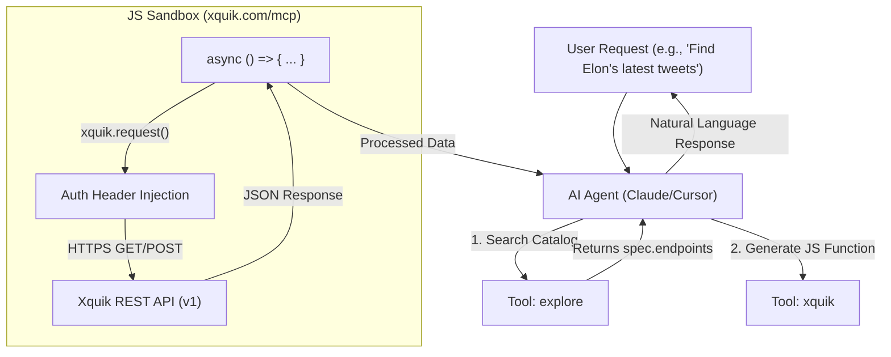
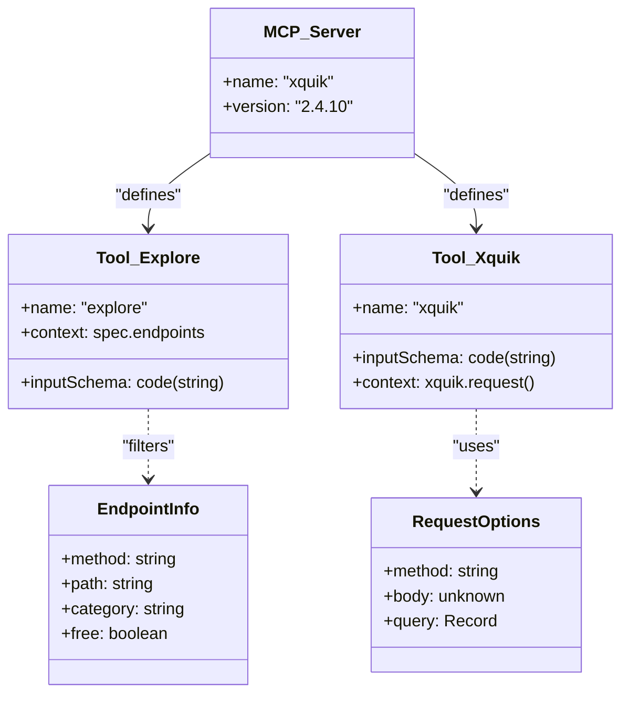

<!-- source: DeepWiki mcp.deepwiki.com · repo Xquik-dev/x-twitter-scraper · page 2.2 MCP Tools: `explore` and `xquik` · fetched 2026-10-26 -->

# MCP Tools: `explore` and `xquik`

<details>
<summary>Relevant source files</summary>

The following files were used as context for generating this wiki page:

- [skills/x-twitter-scraper/references/api-endpoints.md](skills/x-twitter-scraper/references/api-endpoints.md)
- [skills/x-twitter-scraper/references/extractions.md](skills/x-twitter-scraper/references/extractions.md)
- [skills/x-twitter-scraper/references/mcp-tools.md](skills/x-twitter-scraper/references/mcp-tools.md)
- [skills/x-twitter-scraper/references/types.md](skills/x-twitter-scraper/references/types.md)
- [stub-server.mjs](stub-server.mjs)

</details>


This page provides a technical deep dive into the two primary Model Context Protocol (MCP) tools provided by the Xquik platform. Unlike traditional MCP tools that map 1:1 to specific API endpoints, Xquik utilizes a **sandboxed code-execution model**. This allows AI agents to perform complex logic, filtering, and multi-step API orchestrations within a single tool call while maintaining secure, authenticated access to the Xquik REST API.

## Architecture Overview

The MCP server acts as a bridge between the AI agent and the internal REST API. It exposes two tools that accept asynchronous JavaScript arrow functions. These functions are executed in a secure sandbox where authentication headers (API keys) are injected automatically by the server-side runtime [skills/x-twitter-scraper/references/mcp-tools.md:3-4]().

### Data Flow: Natural Language to Code Execution

The following diagram illustrates how a user's natural language request is transformed into a sandboxed execution within the MCP environment.

**Diagram: Request Resolution Pipeline**

Sources: [skills/x-twitter-scraper/references/mcp-tools.md:3-10](), [stub-server.mjs:20-116]()

---

## Tool 1: `explore` (Endpoint Discovery)

The `explore` tool is a read-only utility designed for "Self-Discovery." It does not make network calls; instead, it queries an in-memory catalog of the 120+ available API endpoints [stub-server.mjs:33-34]().

### Implementation Details
The sandbox provides a global `spec` object containing an `endpoints` array. Each object in this array follows the `EndpointInfo` interface [skills/x-twitter-scraper/references/mcp-tools.md:17-25]():

| Field | Type | Description |
| :--- | :--- | :--- |
| `method` | `string` | HTTP verb (GET, POST, PUT, DELETE, PATCH) |
| `path` | `string` | The REST API path (e.g., `/api/v1/x/tweets/{id}`) |
| `summary` | `string` | Human-readable description of the endpoint |
| `category` | `string` | One of the 12 functional categories |
| `free` | `boolean` | Indicates if the call consumes credits |
| `parameters` | `Array` | List of query, path, or body parameters |
| `responseShape`| `string` | Stringified representation of the expected JSON response |

Sources: [skills/x-twitter-scraper/references/mcp-tools.md:17-25](), [stub-server.mjs:38-45]()

### Usage Pattern
Agents use `explore` to locate the correct path and required parameters before attempting an execution. Common patterns include filtering by category or searching for keywords like "tweet" or "follower" [stub-server.mjs:41-45]().

---

## Tool 2: `xquik` (API Execution)

The `xquik` tool is the primary execution engine. It provides a global `xquik.request()` helper that handles the underlying fetch logic and security [skills/x-twitter-scraper/references/mcp-tools.md:43-45]().

### The `xquik.request` Interface
```typescript
declare const xquik: {
  request(path: string, options?: {
    method?: string;  // default: 'GET'
    body?: unknown;
    query?: Record<string, string>;
  }): Promise<unknown>;
};
```
Sources: [skills/x-twitter-scraper/references/mcp-tools.md:61-67](), [stub-server.mjs:93-97]()

### API Categories
The platform organizes its endpoints into 12 distinct categories. When using `explore` or `xquik`, agents interact with these functional domains [skills/x-twitter-scraper/references/mcp-tools.md:21]():

| Category | Purpose |
| :--- | :--- |
| `twitter` | Read-only X lookups (tweets, users, search) |
| `x-write` | Write actions (post tweet, like, follow, DM) |
| `extraction` | Bulk data jobs (replies, followers, community members) |
| `monitoring` | Real-time account tracking and event logs |
| `composition` | AI-assisted tweet drafting and scoring |
| `media` | Media downloads and uploads |
| `account` | Identity linking and profile management |
| `credits` | Balance checks and top-ups |
| `support` | Ticket creation and tracking |
| `x-accounts` | Managing connected X accounts |
| `media` | X Media download and upload operations |

Sources: [skills/x-twitter-scraper/references/api-endpoints.md:9-28](), [skills/x-twitter-scraper/references/mcp-tools.md:21]()

---

## Technical Mapping: MCP to Code Entities

The following diagram maps the high-level MCP tool concepts to the specific code entities and data structures defined in the system.

**Diagram: MCP Tool Entity Mapping**

Sources: [stub-server.mjs:9-12](), [stub-server.mjs:20-116](), [skills/x-twitter-scraper/references/mcp-tools.md:17-25]()

---

## Best Practices & Safety

### 1. Avoiding `Promise.all` for Mixed-Cost Calls
A critical constraint of the credit-based system is how errors are handled. If an agent groups a free call and a paid call in a `Promise.all` block, and the paid call fails (e.g., due to a `402 Payment Required` error), the entire execution context may fail, losing the results of the free call [skills/x-twitter-scraper/references/mcp-tools.md:134]().
*   **Recommendation:** Execute free calls (like `radar` or `styles`) first, then proceed to paid calls sequentially.

### 2. Authentication Injection
The sandbox environment strictly forbids passing API keys in the `code` argument. The MCP bridge automatically injects authentication [stub-server.mjs:75](), [skills/x-twitter-scraper/references/mcp-tools.md:45]().

### 3. Safety Gates and Confirmations
Certain operations require explicit user approval before execution via `xquik` [skills/x-twitter-scraper/references/mcp-tools.md:47-59]():
*   **Public Writes:** Show the exact tweet text or action before calling `POST /api/v1/x/tweets` [skills/x-twitter-scraper/references/mcp-tools.md:53]().
*   **Private Reads:** Confirm before fetching bookmarks or home timelines [skills/x-twitter-scraper/references/mcp-tools.md:56]().
*   **Billing:** Do not trigger top-ups or payments without explicit amount confirmation [skills/x-twitter-scraper/references/mcp-tools.md:57]().

### 4. Bulk Extraction Lifecycle
For bulk data (e.g., all followers of an account), the `xquik` tool should follow the asynchronous lifecycle [skills/x-twitter-scraper/references/mcp-tools.md:115]():
1.  `POST /api/v1/extractions/estimate`: Preview `creditsRequired` [skills/x-twitter-scraper/references/extractions.md:7]().
2.  `POST /api/v1/extractions`: Create the job and receive an `id` [skills/x-twitter-scraper/references/extractions.md:178]().
3.  `GET /api/v1/extractions/{id}`: Poll for status until `completed` [skills/x-twitter-scraper/references/extractions.md:190]().

Sources: [skills/x-twitter-scraper/references/mcp-tools.md:47-59](), [skills/x-twitter-scraper/references/extractions.md:7-216](), [stub-server.mjs:80-87]()

---

