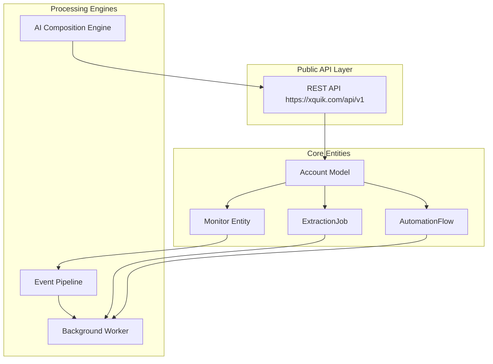
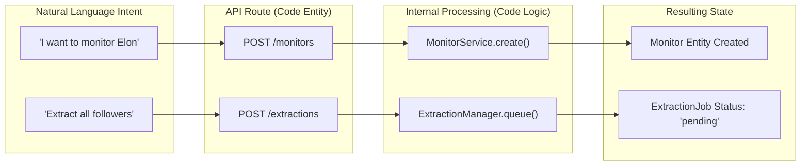

<!-- source: DeepWiki mcp.deepwiki.com · repo Xquik-dev/x-twitter-scraper · page 3 REST API Reference · fetched 2026-10-26 -->

# REST API Reference

Relevant source files

The following files were used as context for generating this wiki page:

- [skills/x-twitter-scraper/SKILL.md](skills/x-twitter-scraper/SKILL.md)
- [skills/x-twitter-scraper/references/api-endpoints.md](skills/x-twitter-scraper/references/api-endpoints.md)

The Xquik REST API provides a comprehensive suite of over 120 endpoints for interacting with X (Twitter). Operating at `https://xquik.com/api/v1`, the API enables developers to perform synchronous lookups, execute bulk data extractions, monitor accounts in real-time, and automate complex social media workflows [skills/x-twitter-scraper/SKILL.md:4-4]().

All requests require an `x-api-key` header for authentication [skills/x-twitter-scraper/references/api-endpoints.md:5-5](). The API follows a credit-based billing model where different operations (Read, Write, Extraction) consume varying amounts of credits [skills/x-twitter-scraper/SKILL.md:48-52]().

### API Functional Domains

The API is organized into several functional domains, each serving a specific part of the X ecosystem.

| Domain | Primary Responsibility | Key Endpoints |
|:---|:---|:---|
| **X Lookups** | Synchronous data retrieval | `GET /x/tweets/{id}`, `GET /x/users/{username}` |
| **X Write** | Account actions & posting | `POST /x/tweets`, `POST /x/users/{id}/follow` |
| **Extractions** | Asynchronous bulk data | `POST /extractions`, `GET /extractions/{id}/results` |
| **Monitors** | Real-time event tracking | `POST /monitors`, `GET /events` |
| **Automations** | Workflow engine | `POST /automations`, `GET /automations/{id}/runs` |
| **Composition** | AI-assisted content | `POST /compose`, `POST /styles` |

**Sources:** [skills/x-twitter-scraper/references/api-endpoints.md:7-28]()

---

### System Architecture Overview

The following diagram illustrates how the REST API entities interact with the underlying X platform and the internal processing engines.

**API Entity Relationship Diagram**

**Sources:** [skills/x-twitter-scraper/references/api-endpoints.md:1-30](), [skills/x-twitter-scraper/SKILL.md:58-153]()

---

### 3.1 X Lookups & Write Actions
These endpoints provide direct, synchronous access to X. They are used for fetching specific tweets, user profiles, or performing account actions like liking, retweeting, and following. This domain also includes media management, Note Tweets, and private data retrieval such as DMs and timelines [skills/x-twitter-scraper/references/api-endpoints.md:421-483]().

For details, see [X Lookups & Write Actions](#3.1).

**Sources:** [skills/x-twitter-scraper/SKILL.md:76-81](), [skills/x-twitter-scraper/references/api-endpoints.md:421-483](), [skills/x-twitter-scraper/references/api-endpoints.md:628-680]()

### 3.2 Bulk Extractions
The extraction system is designed for high-volume data retrieval that exceeds standard API limits. It supports 23 specialized tool types (e.g., `follower_explorer`, `reply_extractor`) and follows an asynchronous lifecycle: estimate cost, create job, poll for completion, and export up to 50,000 rows [skills/x-twitter-scraper/references/api-endpoints.md:374-410]().

For details, see [Bulk Extractions](#3.2).

**Sources:** [skills/x-twitter-scraper/SKILL.md:42-42](), [skills/x-twitter-scraper/references/api-endpoints.md:374-410]()

### 3.3 Monitors, Webhooks & Events
This sub-system enables real-time tracking of X accounts. Users can create `Monitors` for specific usernames to capture events like `tweet.new`, `tweet.reply`, or `follower.gained` [skills/x-twitter-scraper/references/api-endpoints.md:113-140](). These events can be polled via the `/events` endpoint or delivered instantly via HMAC-signed `Webhooks` [skills/x-twitter-scraper/references/api-endpoints.md:225-286]().

For details, see [Monitors, Webhooks & Events](#3.3).

**Sources:** [skills/x-twitter-scraper/references/api-endpoints.md:113-140](), [skills/x-twitter-scraper/references/api-endpoints.md:176-213](), [skills/x-twitter-scraper/references/api-endpoints.md:225-286]()

### 3.4 Automations & Flow Engine
The Automation engine allows for the creation of `AutomationFlow` objects—directed graphs of `AutomationStep` entities [skills/x-twitter-scraper/references/api-endpoints.md:682-720](). These flows can be triggered by monitor events, schedules, or inbound webhooks to perform multi-stage actions using an optimistic-concurrency update pattern.

For details, see [Automations & Flow Engine](#3.4).

**Sources:** [skills/x-twitter-scraper/references/api-endpoints.md:682-720]()

### 3.5 Content Composition & Style Analysis
Leveraging AI, these endpoints assist in creating algorithmically optimized content. The `POST /compose` endpoint handles the `compose` -> `refine` -> `score` pipeline [skills/x-twitter-scraper/references/api-endpoints.md:506-520](), while the `Style Cache` system analyzes account voices to generate "PhoenixScores" and engagement multipliers [skills/x-twitter-scraper/references/api-endpoints.md:562-580]().

For details, see [Content Composition & Style Analysis](#3.5).

**Sources:** [skills/x-twitter-scraper/references/api-endpoints.md:506-520](), [skills/x-twitter-scraper/references/api-endpoints.md:562-580](), [skills/x-twitter-scraper/references/api-endpoints.md:493-504]()

### 3.6 Giveaway Draws
The Draws system provides an auditable way to run contests on X. It supports 11 configurable filters, such as `mustRetweet`, `filterMinFollowers`, and `requiredKeywords`, to automatically select winners and backups from tweet interactions [skills/x-twitter-scraper/references/api-endpoints.md:300-337]().

For details, see [Giveaway Draws](#3.6).

**Sources:** [skills/x-twitter-scraper/references/api-endpoints.md:300-337]()

---

### Request Lifecycle & Code Mapping

This diagram maps the natural language intent of a developer to the specific code entities and API routes involved in a standard request lifecycle.

**Natural Language to Code Entity Mapping**

**Sources:** [skills/x-twitter-scraper/SKILL.md:131-140](), [skills/x-twitter-scraper/references/api-endpoints.md:113-132](), [skills/x-twitter-scraper/references/api-endpoints.md:374-400]()

---

