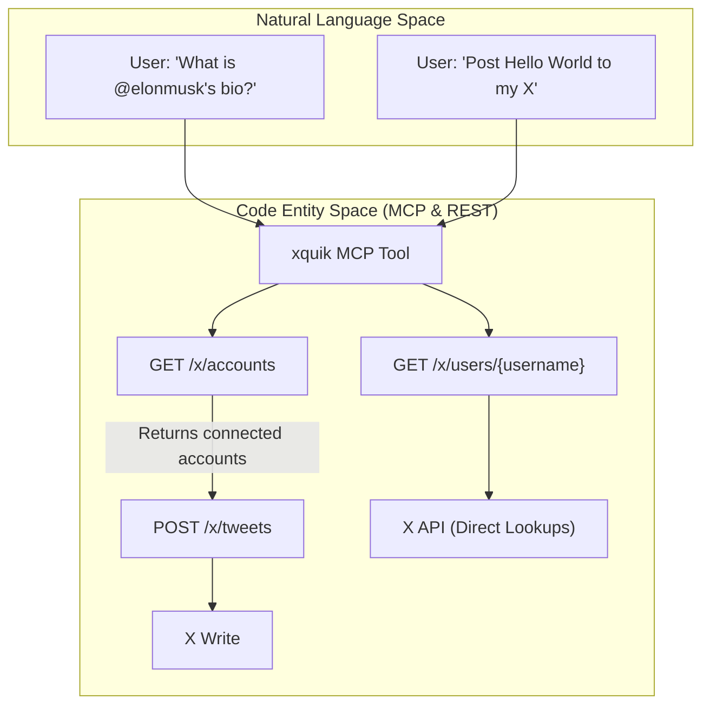
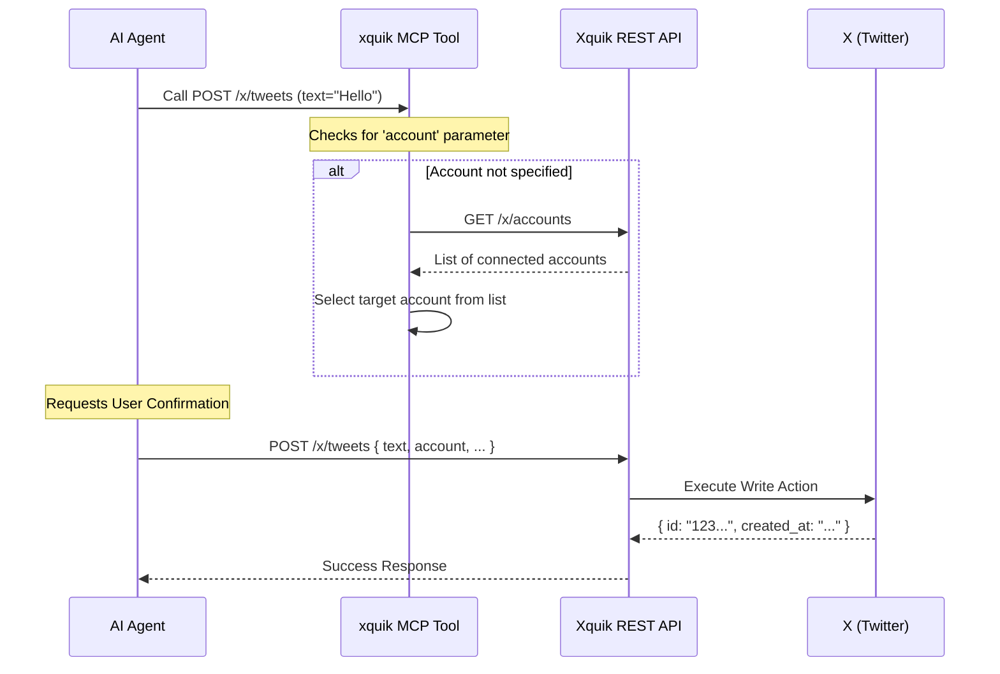

<!-- source: DeepWiki mcp.deepwiki.com · repo Xquik-dev/x-twitter-scraper · page 3.1 X Lookups & Write Actions · fetched 2026-10-26 -->

# X Lookups & Write Actions

Relevant source files

The following files were used as context for generating this wiki page:

- [skills/post-tweets/SKILL.md](skills/post-tweets/SKILL.md)
- [skills/search-tweets/SKILL.md](skills/search-tweets/SKILL.md)
- [skills/tweet-analytics/SKILL.md](skills/tweet-analytics/SKILL.md)
- [skills/user-tweets/SKILL.md](skills/user-tweets/SKILL.md)
- [skills/x-twitter-scraper/SKILL.md](skills/x-twitter-scraper/SKILL.md)
- [skills/x-twitter-scraper/references/api-endpoints.md](skills/x-twitter-scraper/references/api-endpoints.md)

This page covers the synchronous read and write operations within the Xquik REST API. These endpoints facilitate real-time interaction with X (formerly Twitter), allowing for immediate data retrieval and account actions without the overhead of the asynchronous extraction pipeline.

## Overview

The X Lookup and Write system is designed for low-latency operations where the agent or user requires an immediate response. These operations are categorized into **Direct Lookups** (reading public data) and **Write Actions** (performing account-level operations like posting or liking).

### Key Characteristics
*   **Synchronous Execution:** Unlike Extractions, these endpoints return the final data or success confirmation in a single HTTP request-response cycle [skills/x-twitter-scraper/references/api-endpoints.md:3-5]().
*   **Authentication:** Requires the `x-api-key` header for all requests [skills/x-twitter-scraper/references/api-endpoints.md:5]().
*   **Account Context:** Write actions require a connected X account, typically identified via the `account` field in the request body [skills/post-tweets/SKILL.md:45-58]().
*   **Confirmation Gating:** All write actions (posting, liking, following) require explicit user confirmation before execution [skills/x-twitter-scraper/SKILL.md:43-45]().

---

## Data Flow: Read vs. Write

The following diagram illustrates how the system handles a simple lookup (User Profile) versus a write action (Posting a Tweet).

### Lookup and Write Logic Flow

**Sources:** [skills/x-twitter-scraper/references/api-endpoints.md:395-400](), [skills/post-tweets/SKILL.md:63-69](), [skills/user-tweets/SKILL.md:49-50]()

---

## Synchronous Read Operations (Lookups)

Lookups provide immediate access to X entities. These are categorized as "Read tier" operations for rate-limiting purposes.

### User & Tweet Lookups
| Endpoint | Description | Implementation Detail |
| :--- | :--- | :--- |
| `GET /x/users/{username}` | Retrieves profile details for a specific handle. | Resolves handle to numeric `id`. Returns bio, counts, and verified status [skills/user-tweets/SKILL.md:49-70](). |
| `GET /x/tweets/{id}` | Fetches a single tweet by its unique ID. | Includes text, author, and full engagement metrics [skills/tweet-analytics/SKILL.md:46-71](). |
| `GET /x/tweets/search` | Performs a real-time search for tweets. | Supports `q` and `queryType` (Latest/Top) [skills/search-tweets/SKILL.md:66-69](). |

### Timelines, Likes & Media
*   **User Tweets:** `GET /x/users/{id}/tweets` retrieves recent posts, with optional reply inclusion [skills/user-tweets/SKILL.md:75-80]().
*   **User Likes:** `GET /x/users/{id}/likes` retrieves tweets liked by the target user [skills/user-tweets/SKILL.md:76]().
*   **User Media:** `GET /x/users/{id}/media` retrieves tweets containing photos or videos [skills/user-tweets/SKILL.md:77]().
*   **Private Data:** Endpoints like `GET /x/bookmarks`, `GET /x/notifications`, and `GET /x/timeline` return private user data and require explicit user confirmation before the agent fetches them [skills/x-twitter-scraper/SKILL.md:76-81]().

**Sources:** [skills/user-tweets/SKILL.md:31-41](), [skills/tweet-analytics/SKILL.md:34-35](), [skills/search-tweets/SKILL.md:34](), [skills/x-twitter-scraper/SKILL.md:76-81]()

---

## Write Operations (Account Actions)

Write actions modify the state of an X account. These require a connected account authorized via the Xquik dashboard.

### Posting & Content Creation
The primary endpoint for creating content is `POST /x/tweets`.

*   **Standard Tweets:** Default 280-character limit [skills/post-tweets/SKILL.md:56]().
*   **Note Tweets:** Long-form content up to 25,000 characters, enabled via `is_note_tweet: true` [skills/post-tweets/SKILL.md:50-56]().
*   **Replies & Quotes:** Handled via `reply_to_tweet_id` or by including the target URL in the text [skills/post-tweets/SKILL.md:47-61]().
*   **Media Upload:** Performed via `POST /x/media`. Returns `id`s to be included in the `media_ids` array of a tweet [skills/post-tweets/SKILL.md:36-51]().

### Engagement & Social Actions
*   **Like:** `POST /x/tweets/{id}/like` [skills/x-twitter-scraper/references/api-endpoints.md:520]().
*   **Retweet:** `POST /x/tweets/{id}/retweet` [skills/x-twitter-scraper/references/api-endpoints.md:525]().
*   **Follow:** `POST /x/users/{username}/follow` [skills/x-twitter-scraper/references/api-endpoints.md:530]().
*   **Direct Messages:** `POST /x/dm` sends messages to a specific `userId` [skills/x-twitter-scraper/references/api-endpoints.md:535]().

**Sources:** [skills/post-tweets/SKILL.md:32-36](), [skills/x-twitter-scraper/references/api-endpoints.md:515-540]()

---

## Implementation Details: Account Selection

When performing a write action, the system must know which connected X account to use.

### Account Resolution Pattern

**Sources:** [skills/post-tweets/SKILL.md:58-68](), [skills/x-twitter-scraper/SKILL.md:43-45]()

### Media Upload Workflow
1.  **Upload:** Call `POST /x/media` with image/video data. Capture the returned `id` [skills/post-tweets/SKILL.md:66]().
2.  **Attach:** Pass the `id` in the `media_ids` array (max 4 images or 1 video) to `POST /x/tweets` [skills/post-tweets/SKILL.md:51-57]().

**Sources:** [skills/post-tweets/SKILL.md:51-68]()

---

