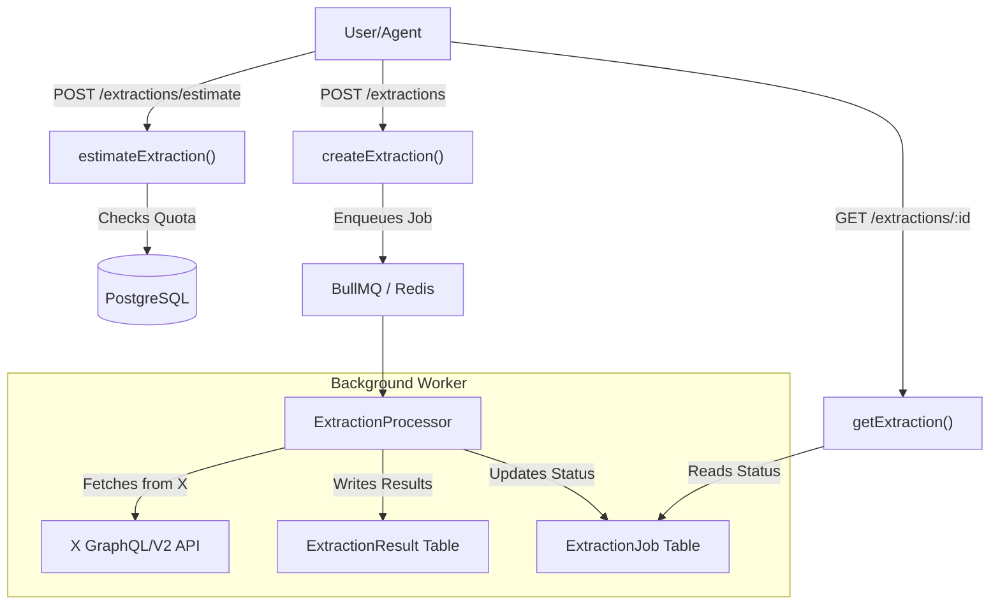
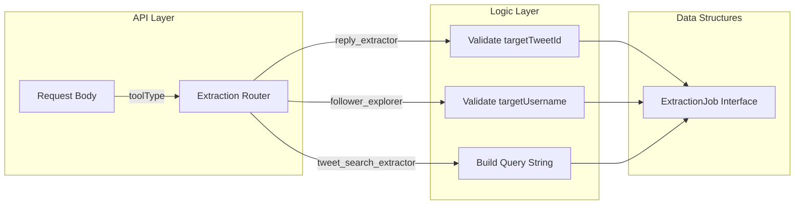

<!-- source: DeepWiki mcp.deepwiki.com · repo Xquik-dev/x-twitter-scraper · page 3.2 Bulk Extractions · fetched 2026-10-26 -->

# Bulk Extractions

Relevant source files

The following files were used as context for generating this wiki page:

- [.github/workflows/publish-mcp-registry.yml](.github/workflows/publish-mcp-registry.yml)
- [skills/extract-followers/SKILL.md](skills/extract-followers/SKILL.md)
- [skills/follow-unfollow/SKILL.md](skills/follow-unfollow/SKILL.md)
- [skills/send-dms/SKILL.md](skills/send-dms/SKILL.md)
- [skills/track-hashtags/SKILL.md](skills/track-hashtags/SKILL.md)
- [skills/x-twitter-scraper/references/api-endpoints.md](skills/x-twitter-scraper/references/api-endpoints.md)
- [skills/x-twitter-scraper/references/extractions.md](skills/x-twitter-scraper/references/extractions.md)
- [skills/x-twitter-scraper/references/mcp-tools.md](skills/x-twitter-scraper/references/mcp-tools.md)
- [skills/x-twitter-scraper/references/types.md](skills/x-twitter-scraper/references/types.md)

The Bulk Extractions system is an asynchronous engine designed to handle large-scale data retrieval from X (Twitter). Unlike synchronous lookups, extractions are job-based: they are created, queued, processed in the background, and then accessed via pagination or exported as files. This system supports 23 specialized tool types covering users, tweets, communities, lists, and spaces.

## Lifecycle of an Extraction

The extraction process follows a strict state machine to ensure credit safety and resource management.

1.  **Estimate**: `POST /extractions/estimate` [skills/x-twitter-scraper/references/extractions.md:7-7](). This validates the request, checks the user's monthly quota, and returns the `estimatedResults` and `creditsRequired` [skills/x-twitter-scraper/references/extractions.md:221-222]().
2.  **Create**: `POST /extractions` [skills/x-twitter-scraper/references/extractions.md:5-5](). Submits the job to the queue. Returns an `id` and initial `status` [skills/x-twitter-scraper/references/extractions.md:177-183]().
3.  **Poll**: `GET /extractions/{id}` [skills/x-twitter-scraper/references/extractions.md:190-190](). The client polls this endpoint until the `status` transitions to `completed` or `failed` [skills/x-twitter-scraper/references/extractions.md:185-185]().
4.  **Retrieve/Export**: Once completed, data can be fetched via paginated JSON (1,000 results/page) [skills/x-twitter-scraper/references/extractions.md:193-193]() or downloaded as a bulk file [skills/x-twitter-scraper/references/extractions.md:202-202]().

### Extraction Data Flow

The following diagram illustrates the transition from a natural language request to the execution of a background job.

"Extraction Execution Flow"

**Sources:** [skills/x-twitter-scraper/references/extractions.md:5-185](), [skills/x-twitter-scraper/references/api-endpoints.md:15-15]()

## Extraction Tool Types

There are 23 distinct extraction tools categorized by their target identifier [skills/x-twitter-scraper/references/extractions.md:3-3]().

### 1. Tweet-Based Tools
Require `targetTweetId` [skills/x-twitter-scraper/references/extractions.md:11-11]().

| Tool Type | Description |
| :--- | :--- |
| `reply_extractor` | Extract users who replied to a specific tweet |
| `repost_extractor` | Extract users who retweeted a tweet |
| `quote_extractor` | Extract users who quote-tweeted a tweet |
| `thread_extractor` | Extract all tweets in a conversation thread |
| `article_extractor` | Extract content from articles linked in a tweet |
| `favoriters` | Extract users who liked/favorited a tweet |

**Sources:** [skills/x-twitter-scraper/references/extractions.md:11-20]()

### 2. User-Based Tools
Require `targetUsername` (the `@` is automatically stripped [skills/x-twitter-scraper/references/extractions.md:48-48]()) or `targetUserId`.

| Tool Type | Identifier | Description |
| :--- | :--- | :--- |
| `follower_explorer` | `targetUsername` | Extract followers of an account |
| `following_explorer` | `targetUsername` | Extract accounts followed by a user |
| `verified_follower_explorer` | `targetUsername` | Extract only verified followers |
| `mention_extractor` | `targetUsername` | Extract tweets mentioning an account |
| `post_extractor` | `targetUsername` | Extract all posts from an account |
| `user_likes` | `targetUserId` | Extract tweets liked by a user |
| `user_media` | `targetUserId` | Extract media tweets from a user |

**Sources:** [skills/x-twitter-scraper/references/extractions.md:30-63]()

### 3. Entity-Based Tools (Communities, Lists, Spaces)
Require `targetCommunityId`, `targetListId`, or `targetSpaceId`.

| Tool Type | Target ID | Description |
| :--- | :--- | :--- |
| `community_extractor` | Community | Extract members of a community |
| `community_moderator_explorer` | Community | Extract moderators of a community |
| `community_post_extractor` | Community | Extract posts within a community |
| `community_search` | Community | Search posts within a community (requires `searchQuery`) |
| `list_member_extractor` | List | Extract members of a list |
| `list_post_extractor` | List | Extract posts from a list |
| `list_follower_explorer` | List | Extract followers of a list |
| `space_explorer` | Space | Extract participants of an X Space |

**Sources:** [skills/x-twitter-scraper/references/extractions.md:65-110]()

### 4. Search-Based Tools
Require `searchQuery` [skills/x-twitter-scraper/references/extractions.md:112-112]().

*   **`people_search`**: Finds users by keyword [skills/x-twitter-scraper/references/extractions.md:116-116]().
*   **`tweet_search_extractor`**: A bulk search tool supporting up to 1,000 results and 16 advanced filters [skills/x-twitter-scraper/references/extractions.md:117-138]().

#### Advanced Search Filters
The `tweet_search_extractor` maps the following fields to X search operators:
*   `fromUser`, `toUser`, `mentioning`
*   `minFaves`, `minRetweets`, `minReplies`
*   `sinceDate`, `untilDate` (YYYY-MM-DD)
*   `mediaType` (`images`, `videos`, `gifs`, `media`)
*   `verifiedOnly` (boolean)
*   `replies`, `retweets` (`include`, `exclude`, `only`)

**Sources:** [skills/x-twitter-scraper/references/extractions.md:140-158]()

## System Limits & Exporting

### Pagination and Results
JSON results via `GET /extractions/{id}` are paginated with a limit of 1,000 records per page [skills/x-twitter-scraper/references/extractions.md:193-193](). Each record follows the `ExtractionResult` interface, including core user metadata (`xUserId`, `xUsername`, `xVerified`) and, if applicable, tweet metadata (`tweetId`, `tweetText`) [skills/x-twitter-scraper/references/types.md:286-305]().

### Bulk Export
For datasets exceeding JSON response limits, the export endpoint should be used:
`GET /extractions/{id}/export?format={csv|xlsx|md|pdf|json|txt}` [skills/x-twitter-scraper/references/extractions.md:202-202]().

*   **Row Limit**: 50,000 rows per export [skills/x-twitter-scraper/references/extractions.md:205-205]().
*   **Enrichment**: Exports contain additional enrichment columns not available in the standard API response [skills/x-twitter-scraper/references/extractions.md:207-207]().

### Tool Mapping and Request Handling

"Tool Dispatcher Logic"

**Sources:** [skills/x-twitter-scraper/references/extractions.md:11-138](), [skills/x-twitter-scraper/references/types.md:268-284]()

## Implementation Notes

*   **Error Handling**: If an extraction fails, the `status` is set to `failed` and an `errorMessage` may be populated in the `ExtractionJob` object [skills/x-twitter-scraper/references/types.md:271-281]().
*   **Results Limit**: The `resultsLimit` parameter can be passed to `estimate` and `create` to cap the extraction size and save credits [skills/x-twitter-scraper/references/extractions.md:172-172]().
*   **Safety Rule**: AI agents must call `POST /extractions/estimate` and receive explicit user approval before calling `POST /extractions` due to the credit cost [skills/x-twitter-scraper/references/mcp-tools.md:115-115](), [skills/extract-followers/SKILL.md:65-65]().

**Sources:**
- [skills/x-twitter-scraper/references/extractions.md:1-230]()
- [skills/x-twitter-scraper/references/types.md:244-305]()
- [skills/x-twitter-scraper/references/mcp-tools.md:115-123]()
- [skills/extract-followers/SKILL.md:26-72]()

---

