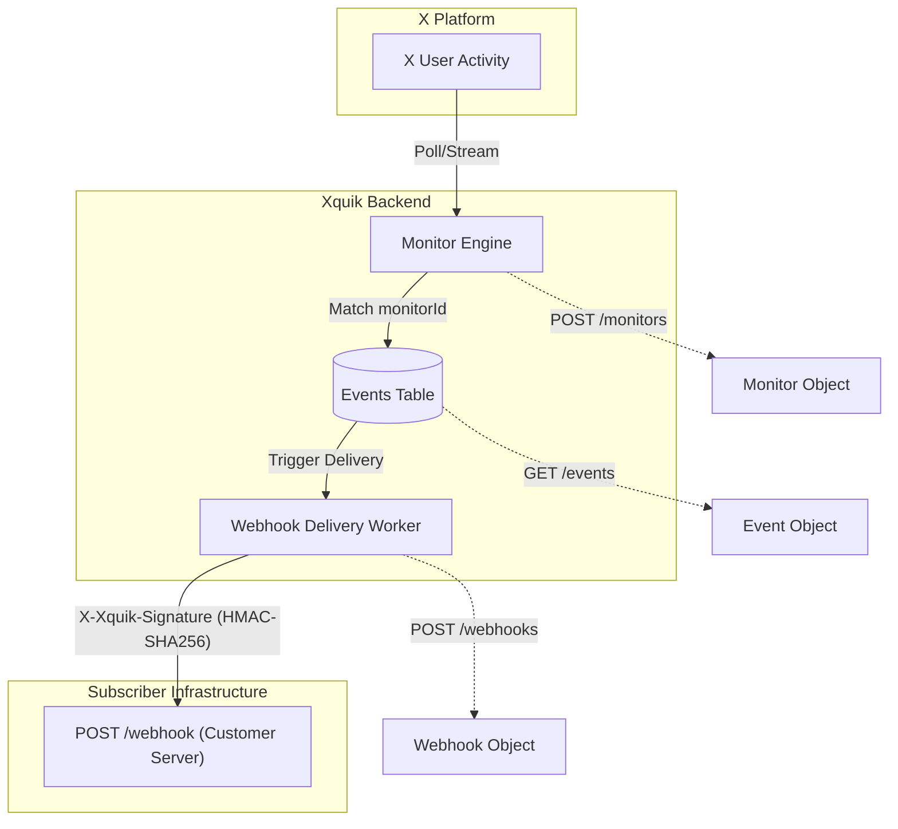
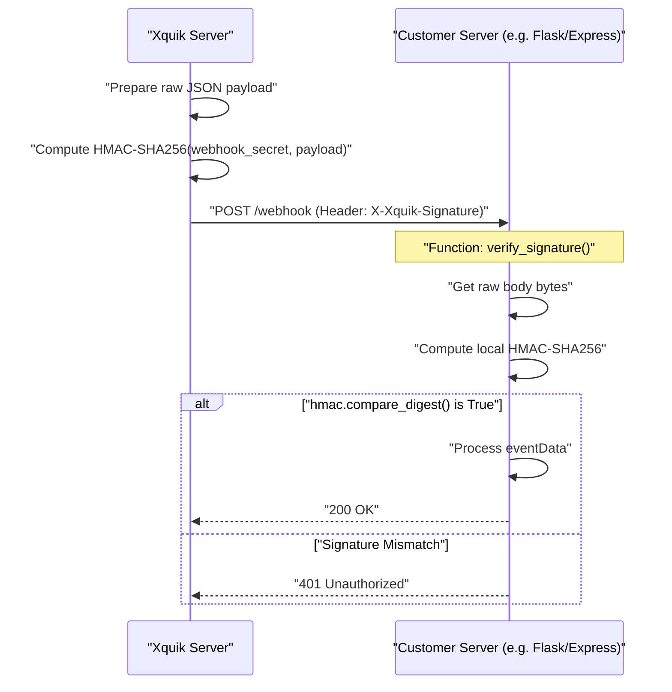

<!-- source: DeepWiki mcp.deepwiki.com · repo Xquik-dev/x-twitter-scraper · page 3.3 Monitors, Webhooks & Events · fetched 2026-10-26 -->

# Monitors, Webhooks & Events

<details>
<summary>Relevant source files</summary>

The following files were used as context for generating this wiki page:

- [skills/x-twitter-scraper/references/api-endpoints.md](skills/x-twitter-scraper/references/api-endpoints.md)
- [skills/x-twitter-scraper/references/python-examples.md](skills/x-twitter-scraper/references/python-examples.md)
- [skills/x-twitter-scraper/references/webhooks.md](skills/x-twitter-scraper/references/webhooks.md)
- [skills/x-twitter-scraper/references/workflows.md](skills/x-twitter-scraper/references/workflows.md)

</details>


This page documents the real-time monitoring infrastructure of Xquik. The system allows developers to track X accounts for specific activities and receive push notifications via webhooks or Telegram integrations. Active monitors are metered hourly based on the account's monitor billing configuration [skills/x-twitter-scraper/references/api-endpoints.md:48-56]().

## Monitoring Pipeline Overview

The monitoring pipeline consists of three stages: defining a target via a **Monitor**, the generation of an **Event** when activity is detected, and the delivery of that event via a **Webhook** or polling mechanism.

### Real-Time Monitoring Flow
The following diagram illustrates the lifecycle of a real-time event from detection to delivery, mapping system components to code-level entities.

Title: Monitoring Data Flow & Entity Mapping

Sources: [skills/x-twitter-scraper/references/api-endpoints.md:113-212](), [skills/x-twitter-scraper/references/webhooks.md:1-26]()

---

## Monitors

A `Monitor` is a configuration object that defines which X account to watch and which actions to record as events [skills/x-twitter-scraper/references/api-endpoints.md:113-126]().

### Supported Event Types
Monitors can be configured to listen for the following `eventTypes` [skills/x-twitter-scraper/references/api-endpoints.md:140-140]():
*   `tweet.new`: A new original tweet is posted.
*   `tweet.reply`: The user replies to another tweet.
*   `tweet.quote`: The user quotes another tweet.
*   `tweet.retweet`: The user retweets content.
*   `webhook.test`: A manual test event triggered via the API [skills/x-twitter-scraper/references/api-endpoints.md:278-284]().

### Monitor Management
| Action | Endpoint | Description |
| :--- | :--- | :--- |
| **Create** | `POST /monitors` | Starts tracking a username. Returns `409 monitor_already_exists` if already monitored [skills/x-twitter-scraper/references/api-endpoints.md:115-142](). |
| **List** | `GET /monitors` | Returns all monitors (up to 200) [skills/x-twitter-scraper/references/api-endpoints.md:144-150](). |
| **Update** | `PATCH /monitors/{id}` | Modify `eventTypes` or toggle `isActive` [skills/x-twitter-scraper/references/api-endpoints.md:158-164](). |
| **Delete** | `DELETE /monitors/{id}` | Stops tracking and deletes associated data [skills/x-twitter-scraper/references/api-endpoints.md:166-172](). |

Sources: [skills/x-twitter-scraper/references/api-endpoints.md:113-172]()

---

## Events

Events are the individual records of activity generated by Monitors. They can be retrieved via polling or pushed via webhooks [skills/x-twitter-scraper/references/api-endpoints.md:176-182]().

### Event Schema
When an event occurs, it is stored with the following structure [skills/x-twitter-scraper/references/api-endpoints.md:194-212]():
*   `id`: Unique event identifier.
*   `type`: The event type (e.g., `tweet.new`).
*   `monitorId`: The ID of the monitor that triggered it.
*   `username`: The X username being monitored.
*   `occurredAt`: ISO8601 timestamp.
*   `data`: Context-specific payload containing `tweetId`, `text`, and `metrics` [skills/x-twitter-scraper/references/api-endpoints.md:203-207]().

### Polling Events
The `GET /events` endpoint supports cursor-based pagination for historical retrieval or polling [skills/x-twitter-scraper/references/api-endpoints.md:178-191]().
*   **Filters**: `monitorId`, `eventType`.
*   **Pagination**: Use the `after` query parameter with the `nextCursor` provided in the response [skills/x-twitter-scraper/references/workflows.md:45-48]().

Sources: [skills/x-twitter-scraper/references/api-endpoints.md:176-212](), [skills/x-twitter-scraper/references/workflows.md:45-69]()

---

## Webhooks

Webhooks provide a push-based mechanism for receiving events. Xquik delivers events as `POST` requests with JSON payloads [skills/x-twitter-scraper/references/webhooks.md:1-14]().

### Implementation & Security
Xquik signs every webhook delivery using **HMAC-SHA256** to ensure data integrity and authenticity.

1.  **Secret Retrieval**: When creating a webhook (`POST /webhooks`), the response includes a `secret`. This is shown **only once** [skills/x-twitter-scraper/references/api-endpoints.md:241-241]().
2.  **Signature Header**: Every delivery includes the `X-Xquik-Signature` header.
3.  **Verification Logic**: The signature is generated by hashing the raw request body with the secret: `sha256=` + `HMAC-SHA256(secret, raw_body)` [skills/x-twitter-scraper/references/webhooks.md:30-30]().

Title: Webhook Signature Verification Logic

Sources: [skills/x-twitter-scraper/references/webhooks.md:32-113](), [skills/x-twitter-scraper/references/python-examples.md:120-149]()

### Delivery Retries & Idempotency
*   **Retries**: Failed deliveries are retried up to 5 times with exponential backoff [skills/x-twitter-scraper/references/webhooks.md:189-191]().
*   **Idempotency**: Consumers should deduplicate by hashing the raw payload or tracking event IDs, as retries may result in duplicate deliveries [skills/x-twitter-scraper/references/webhooks.md:173-187]().
*   **Timeouts**: Your endpoint must respond within 10 seconds [skills/x-twitter-scraper/references/webhooks.md:169-169]().

### Webhook Testing
Use the `POST /webhooks/{id}/test` endpoint to trigger a `webhook.test` event [skills/x-twitter-scraper/references/api-endpoints.md:267-273](). This delivery includes the `X-Xquik-Signature` header, allowing for verification of the signature logic without waiting for real X activity [skills/x-twitter-scraper/references/api-endpoints.md:286-286]().

Sources: [skills/x-twitter-scraper/references/webhooks.md:154-194](), [skills/x-twitter-scraper/references/api-endpoints.md:225-296]()

---

## Integration Examples

### Node.js (Express) Webhook Handler
A robust handler must use the raw request body to compute the HMAC [skills/x-twitter-scraper/references/webhooks.md:34-79]().

```javascript
app.post("/webhook", express.raw({ type: "application/json" }), (req, res) => {
  const signature = req.headers["x-xquik-signature"];
  const payload = req.body.toString();

  if (!verifySignature(payload, signature, WEBHOOK_SECRET)) {
    return res.status(401).send("Invalid signature");
  }

  const event = JSON.parse(payload);
  // Process event.eventType...
  res.status(200).send("OK");
});
```

### Python (Flask) Webhook Handler
Python implementations should use `hmac.compare_digest` for timing-safe comparison [skills/x-twitter-scraper/references/python-examples.md:111-149]().

```python
@app.route("/webhook", methods=["POST"])
def webhook():
    signature = request.headers.get("X-Xquik-Signature", "")
    payload = request.get_data()

    if not verify_signature(payload, signature, WEBHOOK_SECRET):
        return "Invalid signature", 401

    event = json.loads(payload)
    # Handle event...
    return "OK", 200
```

Sources: [skills/x-twitter-scraper/references/webhooks.md:32-113](), [skills/x-twitter-scraper/references/python-examples.md:109-151]()

---

