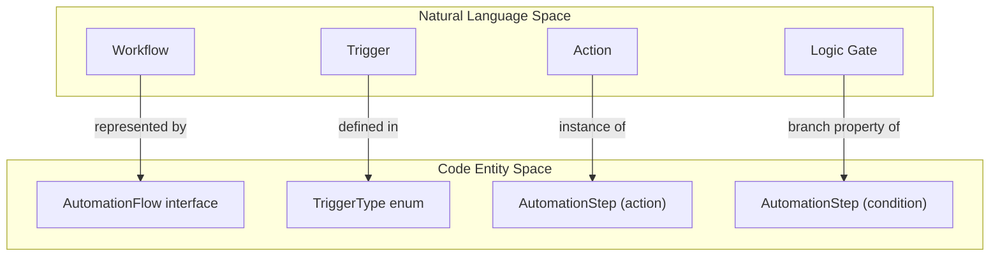
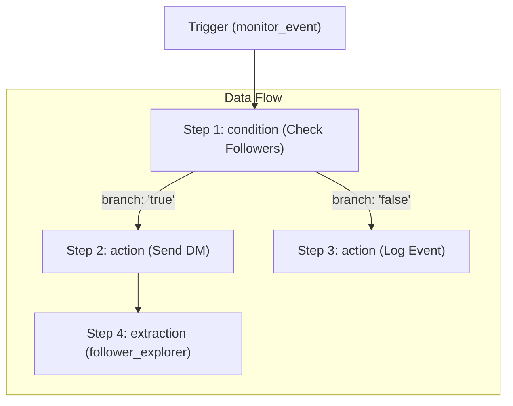

<!-- source: DeepWiki mcp.deepwiki.com · repo Xquik-dev/x-twitter-scraper · page 3.4 Automations & Flow Engine · fetched 2026-10-26 -->

# Automations & Flow Engine

<details>
<summary>Relevant source files</summary>

The following files were used as context for generating this wiki page:

- [skills/x-twitter-scraper/references/extractions.md](skills/x-twitter-scraper/references/extractions.md)
- [skills/x-twitter-scraper/references/mcp-tools.md](skills/x-twitter-scraper/references/mcp-tools.md)
- [skills/x-twitter-scraper/references/python-examples.md](skills/x-twitter-scraper/references/python-examples.md)
- [skills/x-twitter-scraper/references/types.md](skills/x-twitter-scraper/references/types.md)
- [skills/x-twitter-scraper/references/webhooks.md](skills/x-twitter-scraper/references/webhooks.md)
- [skills/x-twitter-scraper/references/workflows.md](skills/x-twitter-scraper/references/workflows.md)

</details>


The Automations & Flow Engine is a trigger-action workflow system designed to orchestrate complex operations across the Xquik platform. It allows users to define "Flows" consisting of a sequence of steps—including conditional logic, data extractions, and write actions—triggered by real-time events, schedules, or inbound webhooks.

### System Overview

The engine operates as a directed graph where each `AutomationStep` points to a subsequent step via `parentStepId`. This structure supports branching logic (e.g., "True" vs "False" paths) and sequential execution.

#### Core Entity Space Mapping
The following diagram maps high-level automation concepts to their corresponding TypeScript interfaces and API structures.

**Diagram: Automation Entity Mapping**

Sources: [skills/x-twitter-scraper/references/types.md:268-284](), [skills/x-twitter-scraper/references/types.md:97-110]()

---

### Flow Structure & Step Logic

An `AutomationFlow` is the top-level container. It defines the entry point of the automation via a `trigger`.

#### 1. Trigger Types
Triggers define when a flow starts. The system supports three primary types:
*   **`monitor_event`**: Fires when a monitored X account triggers an event (e.g., `tweet.new`, `tweet.reply`). [skills/x-twitter-scraper/references/types.md:106-110]()
*   **`schedule`**: Fires at specific intervals (CRON-like behavior).
*   **`webhook_inbound`**: Fires when an external system sends a POST request to the flow's unique endpoint.

#### 2. Automation Steps
Steps are the building blocks of a flow. Each step is defined by an internal `AutomationStep` structure.

| Field | Type | Description |
| :--- | :--- | :--- |
| `type` | `action` \| `condition` \| `extraction` | The functional category of the step. |
| `actionType` | `string` | The specific operation (e.g., `post_tweet`, `like_tweet`, `send_dm`). |
| `parentStepId` | `string` (optional) | The ID of the step that must complete before this one. |
| `branch` | `"true"` \| `"false"` (optional) | For conditional steps, determines which path this step belongs to. |
| `config` | `Record<string, any>` | Parameters for the action (e.g., tweet text, search queries). |

#### 3. Execution Graph
The flow engine processes steps by following the `parentStepId` links. If a step is of type `condition`, the engine evaluates the logic and proceeds only to child steps where the `branch` value matches the result.

**Diagram: Step Execution Logic**

Sources: [skills/x-twitter-scraper/references/types.md:246-266](), [skills/x-twitter-scraper/references/workflows.md:128-150]()

---

### API Implementation

Automations are managed via the REST API, utilizing standard patterns for resource creation and state management.

#### Creating and Updating Flows
Flows are created via `POST` requests. To prevent race conditions during multi-step updates, the system utilizes an **optimistic-concurrency update pattern**. When updating a flow, the client should provide the expected state to ensure the graph remains consistent.

#### Key Patterns
*   **Creation**: Initialize a flow with a specific `TriggerType`.
*   **Step Management**: Steps are added by specifying a `parentStepId`, effectively building the directed graph.
*   **Validation**: The system validates that `extraction` steps use valid `ExtractionToolType` values such as `reply_extractor` or `follower_explorer`. [skills/x-twitter-scraper/references/types.md:246-266]()

#### Step Configuration Examples
When adding a step, the `config` object varies by the tool or action being performed:

```json
{
  "type": "extraction",
  "actionType": "follower_explorer",
  "config": {
    "targetUsername": "elonmusk",
    "resultsLimit": 100
  }
}
```
Sources: [skills/x-twitter-scraper/references/extractions.md:40-46](), [skills/x-twitter-scraper/references/types.md:268-284]()

---

### Execution and Monitoring

Once a flow is active, the engine listens for the defined trigger (e.g., a `tweet.new` event from a `Monitor`). [skills/x-twitter-scraper/references/types.md:97-110]()

#### Execution Logs
Every time a flow is triggered, an execution record is created. These records track the status of each step (e.g., `pending`, `running`, `completed`, `failed`). [skills/x-twitter-scraper/references/types.md:271-271]()

#### Pricing and Credits
Flow execution consumes credits based on the actions performed within the steps. For example, a `post_extractor` step will consume credits per result extracted, while a `post_tweet` action (via `x-write` category) has a higher fixed cost. [skills/x-twitter-scraper/references/mcp-tools.md:95-100](), [skills/x-twitter-scraper/references/workflows.md:180-190]()

| Component | Cost |
| :--- | :--- |
| Triggers / Webhooks | Free |
| Write Actions (Post/Like) | 10 credits |
| Extractions | 1-5 credits per result |
| Read Actions (Lookup) | 1-5 credits |

Sources: [skills/x-twitter-scraper/references/workflows.md:156-192](), [skills/x-twitter-scraper/references/mcp-tools.md:74-114]()

---

