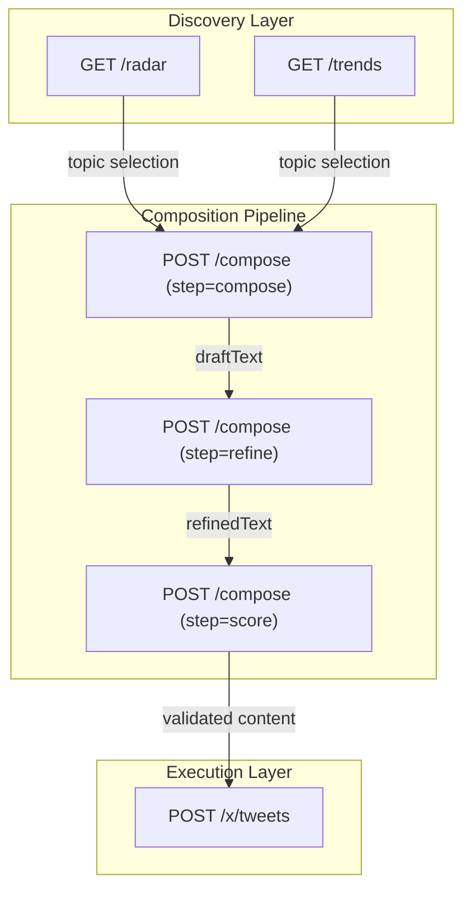
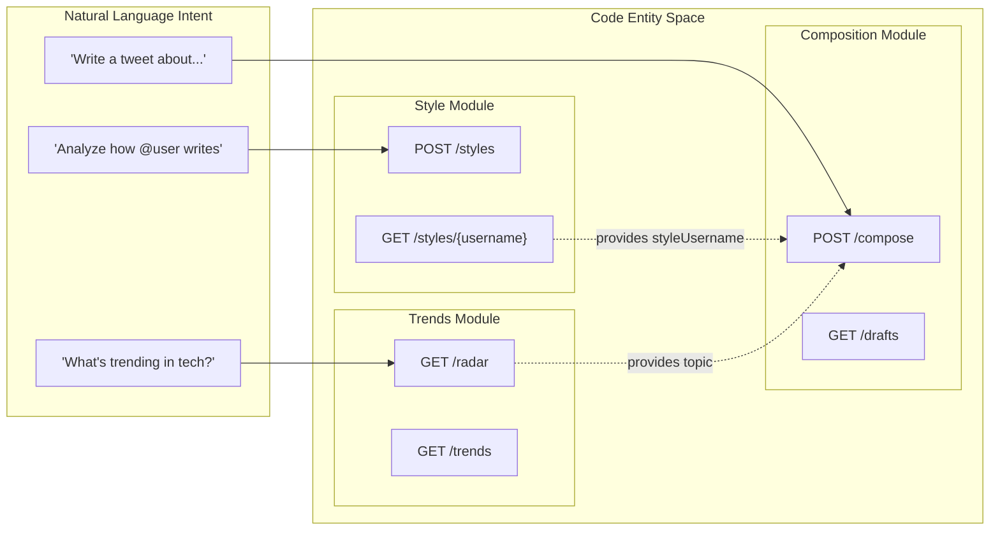

<!-- source: DeepWiki mcp.deepwiki.com · repo Xquik-dev/x-twitter-scraper · page 3.5 Content Composition & Style Analysis · fetched 2026-10-26 -->

# Content Composition & Style Analysis

Relevant source files

The following files were used as context for generating this wiki page:

- [skills/monitor-accounts/SKILL.md](skills/monitor-accounts/SKILL.md)
- [skills/optimize-tweets/SKILL.md](skills/optimize-tweets/SKILL.md)
- [skills/trending-news/SKILL.md](skills/trending-news/SKILL.md)
- [skills/tweet-style/SKILL.md](skills/tweet-style/SKILL.md)
- [skills/update-x-profile/SKILL.md](skills/update-x-profile/SKILL.md)
- [skills/write-threads/SKILL.md](skills/write-threads/SKILL.md)
- [skills/x-twitter-scraper/references/api-endpoints.md](skills/x-twitter-scraper/references/api-endpoints.md)

The Content Composition & Style Analysis system provides a sophisticated AI-assisted pipeline for generating, refining, and scoring X (Twitter) content. It leverages historical data to clone specific account voices through a Style Cache sub-system and integrates real-time global trends via Radar and Trends endpoints to ensure content relevance and high engagement potential.

## Composition Pipeline

The composition process is structured as a 3-step stateful workflow designed to move from a raw idea to a production-ready tweet with predicted performance metrics.

### Pipeline Flow: Compose → Refine → Score

The pipeline is primarily accessed via the `POST /compose` endpoint [skills/x-twitter-scraper/references/api-endpoints.md:575-575](). The `step` parameter determines the current stage of the pipeline.

| Step | Function | Input Requirements | Output |
| :--- | :--- | :--- | :--- |
| `compose` | Generates initial drafts | `topic`, `styleUsername` (optional), `mode` ("tweet" or "thread") | Array of draft objects with `text` [skills/x-twitter-scraper/references/api-endpoints.md:575-583]() |
| `refine` | Polishes a selected draft | `draftText`, `instructions` | Refined version of the text |
| `score` | Analyzes engagement potential | `text` | `phoenixScore`, `signals`, `suggestions` [skills/optimize-tweets/SKILL.md:41-51]() |

### Implementation Details
The `POST /compose` endpoint [skills/x-twitter-scraper/references/api-endpoints.md:575-575]() accepts a JSON body containing the `step` and associated data. While `compose` is used for drafting, the final output should be sent to `POST /x/tweets` [skills/x-twitter-scraper/references/api-endpoints.md:683-683]() for publishing. For multi-tweet threads, the `mode: "thread"` parameter in `POST /compose` generates a sequence of tweets, each within the 280-character limit [skills/write-threads/SKILL.md:41-52]().

**Sources:** [skills/x-twitter-scraper/references/api-endpoints.md:575-590](), [skills/optimize-tweets/SKILL.md:30-58](), [skills/write-threads/SKILL.md:26-52]()

## PhoenixScores & Engagement Multipliers

The `score` step of the composition pipeline returns a `PhoenixScore`, a proprietary metric representing the predicted virality and quality of a tweet.

### Scoring Metrics
When calling `POST /compose` with `step="score"` [skills/optimize-tweets/SKILL.md:34-34](), the engine returns:
*   **PhoenixScore**: A numerical value (0-100) indicating overall quality [skills/optimize-tweets/SKILL.md:48-48]().
*   **Signals**: Specific coefficients for `hook_quality`, `length_fit`, `format`, `media_bonus`, `reply_bait_risk`, and `link_penalty` [skills/optimize-tweets/SKILL.md:49-49]().
*   **Suggestions**: Actionable feedback to improve the score (e.g., "Add a hook", "Use fewer hashtags") [skills/optimize-tweets/SKILL.md:50-50]().

The `link_penalty` signal specifically warns users that tweets containing external URLs typically underperform in the X algorithm [skills/optimize-tweets/SKILL.md:70-70]().

**Sources:** [skills/optimize-tweets/SKILL.md:26-58](), [skills/x-twitter-scraper/references/api-endpoints.md:575-590]()

## Style Cache Sub-system

The Style Cache allows the system to analyze the "voice" of any X account and apply that style to new compositions. This is managed through the `/styles` endpoint category [skills/x-twitter-scraper/references/api-endpoints.md:612-612]().

### Key Components
1.  **Style Analysis**: Triggered via `POST /styles` [skills/x-twitter-scraper/references/api-endpoints.md:614-614](), which crawls a user's recent history to generate a style profile.
2.  **Style Retrieval**: Cached styles are fetched via `GET /styles/{username}` [skills/x-twitter-scraper/references/api-endpoints.md:623-623](). This returns `tone`, `avg_length`, `top_topics`, `format_breakdown`, and `signature_phrases` [skills/tweet-style/SKILL.md:41-48]().
3.  **Style Comparison**: `POST /styles/compare` [skills/tweet-style/SKILL.md:59-62]() allows identifying linguistic overlaps between two accounts.
4.  **Performance Analysis**: `GET /styles/{username}/performance` identifies which formats (threads, lists, etc.) earn the most engagement for a specific user [skills/tweet-style/SKILL.md:36-36]().

### Style-to-Composition Mapping
| System Concept | Code Entity / Endpoint | File Reference |
| :--- | :--- | :--- |
| Style Analyzer | `POST /styles` | [api-endpoints.md:614]() |
| Style Repository | `GET /styles/{username}` | [api-endpoints.md:623]() |
| Composition Engine | `POST /compose` | [api-endpoints.md:575]() |
| Style Comparison | `POST /styles/compare` | [tweet-style/SKILL.md:60]() |

**Sources:** [skills/tweet-style/SKILL.md:26-62](), [skills/x-twitter-scraper/references/api-endpoints.md:612-635]()

## Trends & Radar Endpoints

To facilitate contextually aware content, the system provides two primary discovery endpoints.

### Radar (Global Trends)
The `GET /radar` endpoint [skills/x-twitter-scraper/references/api-endpoints.md:562-562]() aggregates trending news stories from curated sources. This endpoint is often used to surface "breaking news" with social context.

**Functionality:**
*   **Category Filter**: Supports filtering by `tech`, `business`, `politics`, `sports`, or `entertainment` [skills/trending-news/SKILL.md:35-35]().
*   **Social Context**: `GET /radar/{id}/tweets` retrieves X reactions related to a specific news story [skills/trending-news/SKILL.md:36-36]().

### X Trends (Platform Specific)
The `GET /trends` endpoint [skills/x-twitter-scraper/references/api-endpoints.md:553-553]() retrieves X-specific trending topics (hashtags and keywords). It requires a `woeid` (Where On Earth ID) parameter, where `1` represents Global trends [skills/x-twitter-scraper/references/api-endpoints.md:553-553]().

### Integration Diagram: Trends to Composition
This diagram illustrates how data from the Radar/Trends endpoints flows into the Composition pipeline.

**Sources:** [skills/trending-news/SKILL.md:26-58](), [skills/x-twitter-scraper/references/api-endpoints.md:553-570]()

## Technical Architecture

The following diagram bridges the Natural Language concepts of "Writing and Style" to the specific Code Entities used in the system.

**Sources:** [skills/x-twitter-scraper/references/api-endpoints.md:553-635](), [skills/optimize-tweets/SKILL.md:30-40](), [skills/tweet-style/SKILL.md:30-40]()

---

